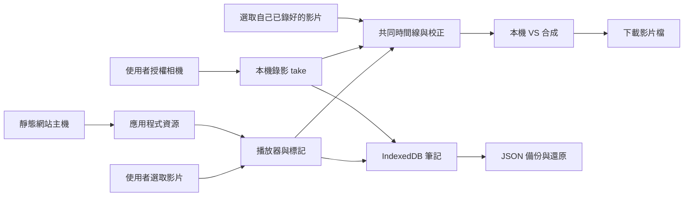

<!-- 檔案用途：產品與開發工具的技術決策索引。所在層：根文件。主要關聯：AGENTS.md、docs/PRODUCT_PLAN.md、docs/ai/HARNESS.md。 -->
# 技術設計與決策

最新可及性決策見第 20 節，下載包與發布準備見第 21 節；前面標記原型階段的限制保留歷史版本歸屬。
分類、動作庫、練習歷史與 v1→v2 相容決策見第 26 節。

Safari 有界本機音訊候選的格式與資源取捨見第 33 節；這不是整體 Safari／P0 通過聲明。

選定筆記分享的原始設計見第 27 節；整合格式取捨另記。

狀態：2026-10-28；已加入桌面 Web 預覽版、既有影片比較與 AI harness；未完成整體 P0／手機驗收。工具測試與產品／真機驗收分開記錄。需求以 [PRODUCT_PLAN.md](docs/PRODUCT_PLAN.md) 為準。

#3 的早期 macOS Safari 同步／私人副本失敗見[歷史證據](docs/evidence/issue-3-safari-feasibility.md)，各原生結果保持來源歸屬。一般新視窗不需改 Profiles，保存／關窗取回對照見第31節；有界音訊候選見第33節，與資料保護整合見第34節。Safari 完整品質及私人儲存仍未過，目前原生續測等待 Mac 解鎖，無須另選設定。

## 1. 架構結論

第一候選：**TypeScript + Vite + Svelte，靜態 Web／PWA，原生媒體 API，IndexedDB（透過 Dexie）保存筆記。** 不需要 SSR、登入、SQL 雲端、付費影片平台或訂閱表。

這是可驗證的選擇，並非因為「換框架就能解決錄影」。最先做的工作是用最小 Web 頁面驗證手機同時播放與錄影，以及 VS 影片匯出。若 iPhone Web 過不了門檻，保留 Web 筆記，先以 SwiftUI + AVFoundation 做 iOS 媒體功能，再考慮 Android。

沒有由 App 發出的「媒體 → 雲端」箭頭。首次網站載入／更新仍會連線到靜態主機；不是完全沒有網路活動。相機與影片資料不跟隨程式更新上傳。P1 分享由使用者匯出檔案後，自行透過個人雲端或 AirDrop 傳送；這不新增 App 的影片儲存後端。

## 2. 框架選擇：依維護成本，不依偏好綁定 Vue

以下為本專案工程判斷，不是框架跑分。

| 候選 | 優點 | 本專案代價 | 決策 |
| --- | --- | --- | --- |
| Svelte + Vite + TypeScript | 適合小型互動介面；編譯式元件；易分離媒體核心 | 維護者需熟悉 Svelte 反應式生命週期 | 預設候選；可行性確認後鎖版本 |
| Vue + Vite + TypeScript | 單檔元件、成熟工具；若維護者更熟悉可降低時間成本 | 不因既有偏好自動採用；仍需相同媒體驗證 | 合理替代；不必用 Nuxt |
| React + Vite + TypeScript | 元件與工具選擇廣 | 需避免 effect 重複掛相機／音訊事件；不是不可用 | 有熟悉貢獻者時可選 |
| 原生 TypeScript | 驗證媒體路徑最快、依賴少 | 大量表單、時間軸、狀態整合後維護成本增加 | 用於第一個可行性原型 |
| Nuxt／Next／SvelteKit 全端 | 路由與伺服器能力完整 | 本期沒有 SSR、API 或帳號需求 | 不引入伺服器運行需求 |
| Flutter／React Native／Capacitor | 可包裝行動應用 | 仍需原生媒體實作；包 WebView 不會自動修復瀏覽器限制 | 不作第一步；iOS gate 失敗才比較 |
| SwiftUI + AVFoundation | 直接控制 iOS 相機、音訊、時間線與合成 | 第二套 UI／資料儲存、簽章及發佈成本 | iOS 備援首選，必須先有失敗證據 |

參考官方文件：[Svelte](https://svelte.dev/docs/svelte/overview)、[Vue](https://vuejs.org/guide/introduction.html)、[React](https://react.dev/learn)、[Vite](https://vite.dev/guide/)、[AVFoundation](https://developer.apple.com/av-foundation/)。版本、授權與依賴樹在建骨架時重新確認並鎖定，本文不指定未驗證的最新版本。

## 3. 模組邊界

不先建立 monorepo、通用外掛市場或抽象同步引擎。以下是未來檔案分工建議，現在不存在：

| 模組 | 責任 | 邊界 |
| --- | --- | --- |
| domain | 時間區間、標記、take 與比較配方驗證 | 不依賴 UI、DOM 或雲端 |
| media | 載入／seek、鏡像、速度、A–B、相機錄影與匯出 | 一個媒體資源由一個 owner 清理 |
| storage | IndexedDB 交易、migration、媒體副本與分段寫入 | UI 不能自行繞過儲存流程 |
| transfer | JSON 匯入／匯出、媒體重新連結、衝突副本 | 外部資料視為不可信，不執行 HTML |
| ui | 影片庫、練習、錄影、比較、資料管理 | 不把播放時間每一影格寫進全域 store |
| capability | 能力偵測與實測支援表 | API 存在不等於整條流程成功 |

只在實際出現第二個平台實作時抽 adapter。跨平台共同契約是資料交換格式與驗收範例，第一版不強求 Swift 與 TypeScript 共用執行碼。

## 4. 本機儲存與恢復

筆記與索引進 IndexedDB，Dexie 減少交易及 migration 樣板；不啟用 Dexie Cloud。示範原片預設是當次選取的 File，object URL 只在當次生命週期存在，不能當永久路徑存起來。重開後透過重新選檔連回筆記。

「保存離線影片副本」採明確選擇；初期試驗 200 MiB 以下單檔，這是待實測的產品護欄，不是瀏覽器保證容量。較大原片可繼續用重新選檔模式。錄影的 chunks 需逐步落盤並保留順序／MIME；最終完成前不宣稱可播放，殘留 chunks 不一定能單獨解碼。

先比較 IndexedDB Blob 與 OPFS 的真機可靠性，再固定媒體後端；筆記永遠不與大型媒體寫入綁在同一個長交易。寫入 staging → 成功關閉／檢查 → 更新 metadata 為 ready；中斷留下 failed／recoverable 狀態，下次提供重試或清理選項，不自動刪原片。

`navigator.storage.estimate()` 只供估計，`persist()` 可能未獲准。即使獲准，使用者清除網站資料仍會刪資料；備份是必需功能。多分頁以 revision 檢查防止覆寫，migration 遇到舊分頁時提示關閉；不做 last-write-wins 靜默覆蓋。來源：[Storage API](https://developer.mozilla.org/en-US/docs/Web/API/Storage_API/Storage_quotas_and_eviction_criteria)、[persist](https://developer.mozilla.org/en-US/docs/Web/API/StorageManager/persist)、[Dexie](https://dexie.org/docs)。

### P1 分享：檔案交換，不新增服務

2026-10-27 決策：[#18](https://github.com/sunpochin/dance-stamp/issues/18) 第一版只在 `transfer` 邊界做選定筆記檔匯出／匯入與媒體重新連結。沿用 [DATA_FORMAT.md](docs/DATA_FORMAT.md#6-分享格式p1) 的 `kind=share`、欄位篩選、ID 關聯與影片分離規則，不新增雲端網址欄位或憑證儲存。

使用者在 App 外自行使用 Google Drive、Dropbox、iCloud Drive 或 AirDrop 傳檔。下載／選檔匯入為基線；系統分享僅作能力偵測後的選用入口，取消或失敗保留原資料。App 無法確認外部傳送結果，不把匯出或系統分享回傳當成「已送達」。接收者先取得檔案，再人工確認影片配對；不把雲端分享頁當可直接播放的媒體來源。

選擇此方案是為了讓核心功能不依賴供應商帳號、免費配額或後端維運。排除自建影片儲存／上傳中繼、供應商 API／OAuth 直連、自動同步及大型 ZIP 打包；前者增加憑證、權限與服務維護，後者增加手機記憶體壓力。若日後需要直連，另提規劃與授權；本次只更新設計，未宣稱已通過裝置驗收。

## 5. 播放與相機

### 既有影片入口（2026-10-28 桌面實作，#10／#11）

「比較已有影片」接受老師課後原片與自己的練習原片，無須呼叫相機／麥克風。復用既有選片驗證、take／recipe、共同時間線及 VS 合成；不建立第二個剪輯器。首頁與老師片頁提供明確入口，取代只靠「載入自拍測片」發現功能的用法。外部原片預設 session-only，保存副本須明確操作，不能沿用相機錄影流程而暗中複製檔案。

老師 A–B、自己的起點 C 及固定 r 使用 [RECORD_COMPARE.md](docs/RECORD_COMPARE.md) 的同一映射，C 初始化 offset，不另增第二份起點欄位。新配對預設原速；使用者確認慢速跟跳才選既有固定比例，不把兩段片長比當成速度。資料關聯、舊 v1 相容與更換配方規則見 [DATA_FORMAT.md](docs/DATA_FORMAT.md)。桌面 runtime 已接入，交換格式維持 v1；實測範圍見[既有影片證據](docs/evidence/existing-comparison.md)。

排除強迫重新錄影、要求外部裁片／拼片、雲端上傳轉碼與自動 AI 對拍：使用者已有兩片，應可本機選取和手動對齊；原片保持不變，也不引入額外服務。#10 的外部影片入口依賴 #5／#6，可先於相機流程驗收；#9 僅是工具內錄影接入的依賴，整體 P0 仍保留兩條路徑的驗收。

2026-10-28 桌面實作：正式入口及兩側起點按鈕共用既有原生播放器。外部 File 只存本次頁面的 asset→File 對照，metadata 直接建立 ready take；只有明確按保存才使用既有原子 metadata／Blob 交易。候選影片實播及 metadata 寫入成功後才釋放舊 URL，quota、revision 衝突、取消與壞檔均回復舊片。

改動 A／B 或固定比例時另建 take／recipe，共用同一原片 asset；offset／鏡像只提高 recipe revision，舊輸出仍可下載並標明設定差異。輸出辨識包含兩側媒體身分，避免同時長的新片被誤認為上一組輸出。重新連結先載入保存的配方，再讓使用者預覽原片、明確確認；既有 v1 JSON 不加欄位、不改版本。

比較設定保存採同一佇列，避免失焦保存吞掉按鈕點擊或 revision 互撞；佇列等待只保證前件結束，單次 quota／revision／seek 失敗由該件獨立回報。拒絕讓 rejected Promise 永久阻擋整個操作入口，因為使用者必須能在不重載、不丟失 session File 的情況下備份與下載原片。預覽／匯出仍各自重新保存目前配方，實際失敗照常顯示，不繞過原子交易或 revision 保護。

共同預覽可一起暫停，再拖動時間線與繼續；合成固定從交集起點開始。自己片強制靜音，老師無音軌時輸出無聲；音軌資訊無法偵測的瀏覽器顯示條件式說明，不用尚未解碼的 0 bytes 冒充「沒有音軌」。沒有新增框架、雲端服務或 runtime 依賴。驗收工具使用二進位影格碼與不同頻率合成聲源，從下載檔獨立解碼，而非把 JS drift 當作成檔同步證據。

兩側使用 `requestVideoFrameCallback` 持續消費真正的影格更新；rAF 保持共同時鐘及 30fps 繪製節奏，缺少影格 callback 時保留 rAF 路徑。Chrome 的合成採 `captureStream(0)`，繪製後呼叫 `requestFrame()`；缺少該能力時先停止初始串流，再退回自動 30fps。停止、取消及失敗都清掉兩側 callback 與輸出 tracks。依據 [影片影格通知](https://developer.mozilla.org/en-US/docs/Web/API/HTMLVideoElement/requestVideoFrameCallback)與[手動擷取](https://developer.mozilla.org/en-US/docs/Web/API/CanvasCaptureMediaStreamTrack/requestFrame)的原生能力，偵測不能代替成檔驗證。

測試曾在慢速素材留下約 267ms 舊畫面，但 JS 繪製間隔仍約 20ms；僅改手動擷取或 CPU 畫布都未消除。讓比較持續接收兩側真正影格更新後，針對性實測才通過。故不把播放時間、編碼 fps 或 JS drift 當作 G2／G3；驗收仍獨立讀回下載檔的影格碼及音軌，門檻沒有放寬。

#11 補充驗證沿用同一匯出流程，直接注入格式啟動／編碼／新檔讀回失敗及取消，核對上一支成功 VS、兩側原片與配方仍可用，再同頁重試原生 WebM。以短橫／直式邊界素材逐格獨立解碼檢查 contain、鏡像與單一老師聲源，不另建編碼器、雲端轉碼或產品內自動故障測試。這份靜態色條證據只補失敗與成檔內容，不替代 G2／G3 長片矩陣；版本與結果見 [#11 匯出證據](docs/evidence/issue-11-export-failure.md)。

### 共用播放與相機規則

- `input type=file` 為跨瀏覽器基線；`showOpenFilePicker` 是能力偵測後的選用增強，不能成為 iPhone 的必要入口。[File API](https://developer.mozilla.org/en-US/docs/Web/API/File_API)、[picker 支援限制](https://developer.mozilla.org/en-US/docs/Web/API/Window/showOpenFilePicker)。
- 以 `loadedmetadata`／`seeked`／播放結果決定狀態；副檔名、MIME 和 `canPlayType()` 只能提示，不保證實際解碼。HEVC、旋轉、HDR、可變影格率均要真片驗證。
- A–B 優先使用 `requestVideoFrameCallback` 觀察顯示時間，fallback 用前景動畫迴圈及媒體事件；seek 有 in-flight 鎖，離開頁面清除 callback。背景暫停，恢復前重新定位。它不是逐格精準／無縫音訊循環保證。[rVFC](https://developer.mozilla.org/en-US/docs/Web/API/HTMLVideoElement/requestVideoFrameCallback)。
- 只鏡像影片／輸出圖層，不翻轉控制文字；預設 `preservesPitch`，不支援則顯示限制。[音高](https://developer.mozilla.org/en-US/docs/Web/API/HTMLMediaElement/preservesPitch)。
- 相機只在使用者進入錄影流程後請求；預設不開麥克風。停止、取消、離頁都釋放 track；中斷停止錄影並嘗試保存已完成部分。
- 同時播放／相機／音訊與匯出細節以 [RECORD_COMPARE.md](docs/RECORD_COMPARE.md) 為準。

## 6. 離線、發佈與安全

靜態檔可由免費主機或使用者自己的本機 HTTP server 提供，沒有必需後端。PWA 只 precache 應用資源，不把私人影片放公開 cache URL；未載入過的網站不能第一次離線啟動。使用 HTTPS 或受信任 localhost，不能只叫使用者雙擊 HTML 就保證相機／離線能力。

更新採「有新版 → 保存工作 → 使用者重新載入」。禁止錄影／匯出中強制切換 service worker；破壞性 migration 需先備份，不把 app 檔回滾當成資料可自動回滾。[Service Worker](https://developer.mozilla.org/en-US/docs/Web/API/Service_Worker_API/Using_Service_Workers)。

GitHub Pages 可當免費靜態候選，但有容量／流量／使用政策限制，不能用來放私人練舞影片。`sunpochin.github.io/dance-stamp/` 與同網域其他 repo 頁面共用 origin；不同路徑與 DB 名稱不是安全隔離。發佈前須盤點同 origin 信任邊界；有不受信任內容時改用可免費取得的獨立站點 origin，或保留專用 localhost 入口，不直接宣稱安全上線。[Pages 限制](https://docs.github.com/en/pages/getting-started-with-github-pages/github-pages-limits)。

使用純文字筆記、匯入大小／數量限制、CSP 與依賴鎖檔；不自動讀取筆記中的遠端 URL。禁止第三方追蹤、遠端字型與媒體分析 SDK。診斷匯出必須預覽並移除檔名／影片／筆記正文。

## 7. 排除的替代方案

| 方案 | 本期不採用原因 | 何時重評 |
| --- | --- | --- |
| Supabase Auth／雲端 DB／RLS | 本機單人資料不需帳號與服務維運 | 使用者另行要求自架協作 |
| Cloudflare Stream 等託管轉碼 | 無法承諾影片用量成長仍零費用 | 不在本路線圖 |
| 免費雲端配額拼湊／自建影片儲存 | 免費方案會變，不能當免費永續的核心；#18 改由使用者自行傳檔 | 不作核心依賴 |
| Google Drive／Dropbox／iCloud 的 API、OAuth 直連及同步 | 檔案匯出／匯入已滿足第一版分享，不增加憑證與權限維護 | 使用者另行要求並核准規劃；不阻擋 #18 |
| FFmpeg.wasm 全量轉碼所有影片 | 手機 CPU／記憶體／耗電與等待時間大 | 只有明確短片格式缺口、授權相容且實測通過 |
| 即時直接把 VS 烘焙進唯一錄影 | 錄完無法校正兩側偏移，失敗即失去素材 | 可作選用快速路徑，不能取代原始 take 保存 |
| WebCodecs 自寫完整剪輯器 | 解碼、編碼、封裝、背壓與跨裝置支援成本高 | 即時匯出已證明不足且本機替代可行 |
| 自動姿態評分／AI 對拍 | 不解決第一版找片、錄影、比較問題 | 核心驗收後獨立研究 |

FFmpeg.wasm 官方也指出與原生效能差距、多執行緒資源需求及組件授權差異；不能因「不收 API 費」就當成沒有成本。[官方 FAQ](https://ffmpegwasm.netlify.app/docs/faq/)。

## 8. 品質門檻與文件維護

建立程式時補型別檢查、lint、domain／migration／匯入測試與瀏覽器整合測試；相機與編碼必須另做真機。改架構須同步此文件並寫被排除方案；容易踩坑的時間映射、資源釋放、儲存順序在程式中用繁體中文說明原因。所有變更經新分支、檢查差異、單一任務提交並推送，不直接推 main。實際測試結果另記錄，不能靠文件存在宣告完成。

## 9. AI harness 與開發流程

- [AI 協作憲法](AGENTS.md)：唯一規則來源；工具入口保持薄轉接。
- [開發工作流程](docs/agents/workflow.md)：issue → 獨立分支 → 本機檢查／真機證據 → PR；AI 開票的標題標示實際開票廠商與模型 → 明確核准後發布。
- [Harness 說明](docs/ai/HARNESS.md)：來源版本、本機完整參考副本、公開啟用及未啟用範圍。
- [匯入清單](docs/ai/harness-import.json)：逐檔 Git blob、處理方式與 SHA-256。
- [證據範本](docs/agents/acceptance-template.md)：產品驗收依 commit／裝置留記錄。

決策：完整上游參考只留本機且不進 Git；公開可追溯的清單、適配規則、skills、破壞性命令防護、Git hooks 與公開內容掃描。CI 位於 `.github/workflows/harness-ci.yml`，PR 與 main 更新時使用 Bun 1.4.4 執行相同的 `bun run check`。只有 `contents: read`，不使用 secrets 或部署；目前沒有第三方套件依賴，產品框架版本留給 #3/#4 的證據決定。

排除直接套整個家健錄：會把照護授權、三語要求、資料庫、staging／production、付費審查與自動部署假設混進本機免費工具。也不重寫複雜 shell parser；沿用來源 destructive guard 及其必要依賴、負向回歸。來源 parser 的限制與工具端 hook 是否自動載入必須明說，Git native hooks 是另一層獨立防線。

`bun run check` 現在驗證指紋、入口、文件、工具／產品邏輯測試及原生 Web 語法建置，已接入 TypeScript checkJs 與 Biome；它們不代替 G1–G7。來源副本不在測試掃描入口內，不會啟動來源 CI、任務控制或 secrets。

使用者確認公開原始碼並保留非商用授權。為避免把歷史照護文件的真人／營運脈絡帶入公開 repo，拒絕整包上游原文公開；保留本機完整副本、公開必要通用工具與 MIT notices。使用者補上 workflow 權限後，將原範本移到正式位置，避免維護兩份會漂移的設定；不另建遠端專用檢查或加入自動部署。PR 的 CI 執行成功與合併後 main 的執行結果分開記錄。

## 10. 桌面 Web 預覽決策（#1）

2026-10-27 使用者明確要求先做 Web、暫不處理 iPhone。本次因此先交付桌面 Web 預覽，不以缺少 iPhone 阻擋可操作版本，也不宣告 #3 全平台 gate 或 #1 完成。

採原生 JavaScript ES modules 與 IndexedDB，無 runtime／npm 套件依賴；Bun 僅供本機建置與提供靜態資源。`web/` 分出時間邏輯、備份驗證、儲存、錄影工具與 UI，`bun run build` 驗證語法並產生 `dist/web/`。此次保留原生路徑以重用已走通的媒體程式；暫不導入 Svelte／Vite／Dexie，避免在尚未確認桌面流程前同時改動框架。原先框架比較仍作後續維護決策參考，後續 #4 接入 checkJs／lint，而不重寫已驗證的媒體層。

IndexedDB v1 分開 metadata、media、chunks。metadata 是有全庫 revision 的短交易快照；媒體 finalize 與對應索引同一交易，衝突或 quota 全部回滾。自拍錄影每次 dataavailable 依序落盤，未完成記錄保留工作狀態，恢復時先取得跨分頁鎖、組檔並讀回，成功才 ready；不因另一分頁開啟而自動判中斷。示範需明確點按才保存副本，object URL 永不寫入 DB。筆記輸出依 v1 白名單，不含媒體 bytes。衝突匯入目前拒絕整份且保留資料，另存衝突副本尚未實作，不能關閉 #12。

前景 canvas 即時合成保留來源音訊，重用單一 Web Audio source，閒置 suspend、離頁 close。一般示範播放與 A–B 循環會恢復既有 AudioContext，避免合成後練習無聲；暫停仍 suspend。換片前保護未保存的標記草稿，結束編輯時清除狀態，寫入另查影片歸屬；自拍替換只有新檔讀回成功才解除舊 take，讓失敗／取消後配方及輸出仍可保存。播放／取消／背景釋放相機與各次合成 tracks；新檔先用獨立 video 驗證，失敗不破壞先前成功輸出。完成的自拍與 VS 另存 IndexedDB；VS 中斷可從原片及配方重試，不以半成品冒充完成。

Service Worker 只快取已知靜態資源，cache 版本來自建置內容 SHA-256；不 skipWaiting、不強制重載、不快取使用者媒體。靜態入口限制固定資源及讀取方法，CSP 不允許外部資源，無部署、追蹤或外部服務。版本及限制見 [Web 說明](docs/WEB_PREVIEW.md)，驗收見 [Web 證據](docs/evidence/web-preview.md)。

## 11. #4 可重現靜態品質入口

固定 TypeScript 7.0.2（Apache-2.0）與 Biome 2.6.3（MIT OR Apache-2.0）為開發依賴，`bun.lock` 固定來源與完整性；產品仍沒有 runtime 套件。保留原生 ES modules，因既有媒體路徑可工作，為引入 Svelte／Vite 而重寫 UI 不能改善編碼能力。

`bun run typecheck` 檢查所有 Web JavaScript 的資料契約、DOM 對照與媒體型別，Service Worker 用獨立 WebWorker lib。啟用 strict 的空值及型別檢查；動態 callback 參數仍容許漸進式 JSDoc（noImplicitAny=false），沒有略過整份檔案。`bun run lint` 使用 Biome recommended、warning 也失敗；唯一局部說明是本機影片無自動字幕，以及 hidden 必須蓋過 display。

CI 已由主分支啟用，本次加 frozen lockfile／ignore-scripts 安裝，再執行同一 `bun run check`。建置產物帶根授權與第三方 notices，伺服器只提供白名單資源，不需金鑰、登入或伺服器 API。這是工程骨架驗收，不表示 #3 的實體媒體 gates 已通過；使用者先做桌面 Web 的決定保留。

## 12. #5 短交易、缺片與安全恢復

IndexedDB 明確實作 0→1 migration；未知路徑拒絕、交易回滾並保留舊版本，錯誤後可重試，不自動 reset。開啟後驗證三個 store、metadata 格式與 revision。讀 metadata 與媒體 key 清單在同一 readonly transaction，依實際 Blob 推導 ready／missing／interrupted；不把失效 object URL 存入 DB，也不以 state 字串取代實際讀回。

採原生 Web Locks 對同一 take 的錄製／恢復互斥，分頁或程序結束會釋放；不另寫容易過期的時間戳 lease。新分頁不自動改寫 recording 狀態。沒有 Web Locks 時錄製／恢復明確拒絕，筆記和播放器仍可用；不假裝多分頁安全。全庫 revision 檢查仍保護 metadata／Blob 原子 finalize；空間或版本衝突不留下半份資料，UI 草稿保留。

示範 session-only 與明確選擇保存副本分開；同名檔必須預覽確認，重連短片保留原 canonical 時間，超界 marker 顯示待修復且不能跳轉。測試使用 native IndexedDB 的初始化中途失敗、未知升級回滾、重試、兩個真實分頁互斥及同名不同長度的合成檔。這些是桌面 Chrome 證據，不延伸宣稱其他裝置。

## 13. #6 可恢復的本機播放器

選檔不以副檔名、MIME 或 canPlayType 宣告成功；先實際 loadeddata、讀尺寸與長度。換片採兩階段：新 URL 解碼成功且未取消才取代舊 URL；失敗只釋放候選，恢復原片時間與速度。空檔及取消也在 finally 清掉 file input，讓同檔可再選。自拍綁定只在新片成功後變更，避免錯誤檔讓既有比較配方失聯。

媒體啟動與事件等待由 mediaAction 共用 AbortController／finally；setter 同步拋錯、play Promise 拒絕、取消與逾時都撤銷 listener。先等到畫面事件也不表示 play Promise 已成功，兩者都完成才返回。沒有新增播放器套件或遠端解碼服務。

桌面 Chrome 156 已用合成 H.264 靜音片、180×320 直向、90° display matrix、VFR、H.264 MOV 與改名有效 MP4 實播。相同副檔名的壞檔即使 canPlayType 回 probably 仍拒絕，十次換片只保留一個現用 URL；候選解碼時最多兩個。HEVC／HDR 顏色、Safari 與手機仍未驗證，不能從 metadata 或第一幀推論全部支援。

## 14. #7 時間標記與草稿保護

點擊事件同步擷取毫秒，表單持有當時影片 ID；保存時驗證歸屬與全庫 revision。新增／編輯／刪除後立即重畫索引，依數字時間排序並顯示到毫秒。時間邊界由 `timeline.js` 的 `validateMarkerRange` 同時供表單與備份驗證，不另建第二套規則；點標記可在片頭／片尾，區間必須正長、非負整數毫秒且在原筆記及已連結媒體範圍內，不自動交換 A/B。

未保存的編輯阻擋換示範、切筆記、另一個編輯及刪除入口，明確保存或取消後才繼續；離頁由瀏覽器原生警示提醒。保存中停用操作並顯示狀態，失敗與多分頁衝突保留草稿。這比換片後靜默清空更能保留輸入，也不需要建立額外草稿資料表或自動存入正式筆記。瀏覽器強制結束仍可能失去未存草稿，不宣稱永久保存。

跳轉以既有 seek 路徑執行，無自拍時區間一併設 A/B；已有自拍則保留錄製來源範圍並明確提示。驗收使用 requestVideoFrameCallback 的 mediaTime 量實際顯示影格，沒有拿 currentTime setter 當證據。受測 H.264 檔與限制見 [#7 證據](docs/evidence/issue-7-time-markers.md)；這不是錄影成檔 G2 同步驗收。

## 15. #8 練習循環生命週期

循環啟動在等待 seek 之前就建立可取消的 session；開始按鈕立即成為停止入口。停止／切片／離頁會終止該 session，晚到的 seek／play 不得重新啟動。回捲以單一 in-flight Promise 互斥，影格 callback 與 ended 共用；callback 以版本及 session 歸屬拒絕過期結果，依原 API 取消，原生暫停也清理。前景優先用 requestVideoFrameCallback，缺少時用 requestAnimationFrame，不新增固定間隔計時器或播放器依賴。

停止會解除舊回捲 Promise 的歸屬，但取消等待不會取消原生 seek；重啟先等該跳轉完成，防止新 owner 誤接舊拒絕或重疊 seek。循環中修改 A/B 時仍檢查上下界；若目前位置落在新 A 之前，透過同一個可取消的回捲路徑校正，不另開一份循環。逆序區間則停止並提示。手動跳轉會停止循環，再按開始從 A 重新校正。原生 ended 走同一可取消啟動路徑；空白或逆序 A/B 拒絕，不自動交換。暫停、seek 完成與選片後都能更新鏡像 canvas，原生 video 控制與文字不翻轉。

練習速度獨立於錄影配方，使用六個既有選項；一般 play、load 的預設速度及媒體操作結束後恢復練習選項。錄製仍使用既有 0.5／0.75／1 配方及停用控制，不能在 take 中改寫來源時間。依 [preservesPitch](https://developer.mozilla.org/en-US/docs/Web/API/HTMLMediaElement/preservesPitch) 能力啟用音高保持並顯示限制，未提供時明確提示可能變調；能力存在不是音質驗收。

實測數據與各版本原生背景 gate 見 [#8 證據](docs/evidence/issue-8-practice-loop.md)。合成 visibility 事件只驗證 handler，不能代替真正切背景；保留獨立嚴格測試，不降低 ACCEPTANCE.md 門檻。受測桌面結果不擴大為整體 P0 或其他裝置通過。

原生背景補查須排除測試工具的 focus emulation：以全新專用 Chrome 的現有 default context，連線時設定 [noDefaults](https://playwright.dev/docs/api/class-browsertype#browser-type-connect-over-cdp)，不另建 context 或覆寫可見性。桌面必須解鎖且能觀察實際視窗；Mac 鎖定時的載入逾時不能冒充格式失敗。解鎖後 main 靜態 `2f1ec6b3335cd790` 已通過；提供只管理自己程序的 `launch-native-browser.ts`，runner 沿用同一份嚴格測試並記版本。測試另檢查 trusted 事件、回前景 500ms 內無 playing、callback 清空及原生 playing 從 A 啟動。排除事後從另一 CDP session 停用焦點、合成事件、改產品停止邏輯或搬用另一版本結果。鎖定期間與 PR #40 的歷史資料分別保留，未擴大為裝置／音訊驗收。

2026-10-28：PR #31 同步已合併既有雙片入口的 main `cbc5dee`。保留比較設定保存佇列、重連確認與標記草稿保護；媒體操作結束同時收起比較暫停按鈕並恢復練習速度。片尾只保留可取消 session 的單一 handler，排除直接保留兩份事件監聽的解法，避免重疊回捲與停止後重新播放。既有真機／背景與成檔證據仍綁原受測版本，本次同步不擴大驗收結論。

## 16. #9 錄影工作狀態與原片保護

新增錄影沿用 RECORD_COMPARE.md 的 0.5／0.75／1 固定速度、實際規劃 15–60 秒及 3／5／10 秒倒數；短片仍可練習、匯入或保留中斷原片，不把下限施加到既有檔案。前鏡頭採 ideal 以容納桌面 webcam，後鏡頭明確要求 environment；缺少後鏡頭不靜默換成前鏡頭。選項變更先釋放原串流，須再次按開啟才存取相機。權限、占用及缺少鏡頭有中文重試提示；全身框只在預覽，不混入原片與輸出。

建立 take 工作記錄不會立即變更目前自拍關聯；倒數取消標為 failed，舊自拍與配方維持原關聯。新原片解碼成功後才啟用新 take；新錄影永遠配置新 ID。「準備下一段」只清當次視圖、解鎖設定，已保存的舊 take 保留。選片、原片讀回及 chunks 恢復共用候選載入／失敗恢復路徑，避免另一套壞檔處理。

編碼 error 先拒絕 done 通知 owner 停止，但 stop 仍等原生最後 dataavailable／stop 或明確逾時，之後才移除監聽；落盤 queue 收齊後離開操作。遲到錯誤以 signal 歸屬限制，不能中止下一個操作。暫存使用 add 拒絕覆寫同一 index，恢復在同一 readonly transaction 讀 keys／Blob，僅組合從零連續、非空且容器一致的片段。解碼與原子 finalize 成功後才清 chunks；缺號／壞檔、quota 或寫入衝突保留原件。

中斷原片即使解碼成功、重新開啟或由 chunks 恢復，仍標示 interrupted，不能冒充完整 take。相機 ended／mute／尺寸改變、旋轉、freeze／hidden 與離頁停止並釋放 tracks；中斷監聽隨相機 owner 撤銷。BFCache 的 pagehide 保留同一 video／AudioContext 並 suspend，避免返回後為同一 video 建第二個來源節點；相機不自動重開。非 BFCache 離頁才 close 與撤銷 URLs。

可選 captureTiming 記錄呼叫錄影、原生 start 事件、play Promise 完成與示範位置，依 DATA_FORMAT.md 白名單往返。它們是單頁單調時間觀測，不以其差值自動校正，也不當 G2 影格同步證據。測試與未完成真機 gates 見 [#9 證據](docs/evidence/issue-9-capture-recovery.md)，不因合成資料通過而關閉 #9。

離頁驗收拆成 prepare／verify，中間由 CLI 真的導覽並接受瀏覽器原生警示；排除直接注入 pagehide 或停用 beforeunload，因為那些方式無法證明 document 被卸載後的片段保留。prepare 逐次 await IndexedDB 的 count 結果，至少兩塊確實保存才離開；本 CLI 的 async predicate 實測可能在查詢結果為 false 時仍先返回，不能把 Promise 當成功。依 [Playwright 的 truthy 等待契約](https://playwright.dev/docs/api/class-page#page-wait-for-function)，既有自拍回歸也改為操作結束後明確讀資料並 assert。匯出回歸等整個操作完成才讀診斷，避免下載連結先出現而讀到舊報告。這些只加強驗收，沒有新增 runtime 依賴或降低媒體 gate。

分頁背景另由 `capture-background.js` 使用 #8 的專用原生 Chrome 入口；`--capture` 僅追加合成相機來源與隔離頁標記，缺素材先拒絕，預設 #8 模式不啟用相機。測試在產品 listener 之後觀察 trusted visibility／同步 track 釋放，收尾解碼可等回前景，但未經操作不得重新錄製。保留明確的預覽、倒數與錄影案例，不拿 pagehide 或合成 visibility 結果冒充。下載透過原生 Browser domain 的 GUID 檔及完成事件，再核對實際磁碟檔／雜湊；不用 Playwright 私有下載欄位或只憑 Blob URL 判定成檔。舊片、可播放中斷片與新錄影片的 metadata／配方／完整 Blob SHA256 在重開後比較，避免同大小內容被覆寫仍通過。這是 QA 設計，實際已通過的範圍以 #9 證據為準，未修改產品停止或保存邏輯。

2026-10-28：PR #33 同步已合併既有雙片入口的 main `cbc5dee`，沿用 PR #36 已有的共同播放器解法，保留候選載入／metadata 同成敗、錄影尾塊排空、單一循環 owner 與 BFCache 資源歸屬。測試先明確保存用來驗證保留的舊片，並等待比較設定佇列完成；排除恢復外部影片自動保存或刪掉資料保護斷言的解法。新增同頁相機→VS→既有雙片→VS→重開錄影回歸；歷史長片、真機與背景證據不自動移作本次提交通過。

2026-10-28 審查修正：開啟另一個 take 時，候選原片、比較模式、A/B、速度、偏移、鏡像與下載連結要在解碼成功後一起切換。排除先換表單再嘗試讀片，因為取消或壞檔雖恢復舊播放器，卻會把另一段校正存進舊 take。缺片仍進人工重連；成功開啟其他已存 take 會清除先前的待重連狀態。`take-open-failure.js` 先重現舊版失敗，再核對修復後仍能以原配方匯出。

2026-10-28 保存選擇修正：只有直接錄下或從 chunks 恢復的資料自動 finalize。人工選回的原片即使屬於中斷 take，仍遵守 session-only；已存中斷原片重開也不重寫整份 Blob。副本只由明確保存入口建立，錄影中斷標籤保持不變。

2026-10-28 尾塊互斥修正：原生編碼 error 或候選原片讀回失敗，仍須在 take 鎖內等待已排入的 chunks 交易結束；相機先釋放，工作狀態持續忙碌。只在外層 finally 等待雖能保住本頁資料，卻已交出跨分頁鎖，會讓另一頁用未收齊的片段開始恢復。沿用既有 queue／Web Locks，不另建計時 lease 或固定延遲；成功路徑仍先落盤再原子 finalize，失敗保留 interrupted 與原 chunks。`capture-drain.js` 用真正 IndexedDB 未提交交易及另一分頁取得鎖的結果驗證，沒有用等待秒數猜測寫入完成。

2026-10-29：在已合併 #54 的 main `918d8d7` 有界稽核 #9，未重現需修改 runtime 的資料保留缺陷；補編碼器先自行停止、owner 後續重複 stop 的純事件回歸，涵蓋前塊／尾塊保留、error 不冒充成功、空片拒絕及完成後不再落盤。既有 queue／鎖／交易與恢復入口不變，不另建恢復狀態機。覆蓋、版本歸屬與未驗證條件見 [#9 證據](docs/evidence/issue-9-capture-recovery.md#2026-10-29整合-main-的有界覆蓋稽核)；mock 不代替原生 IndexedDB、瀏覽器或硬體驗收。

## 17. #9 錄影與 #35 既有雙片整合

兩個功能分支都從 main `1d8ed7f` 延伸：#33 `f77a8bf` 包含標記、循環及錄影恢復，#35 `9935b06` 包含正式雙片入口與實際影格通知／手動擷取。整合保留雙方提交及單一入口，不把未審查的功能直接推到 main；另外實驗的雙片 dialog 原型只保存在獨立分支，不引入第二套 UI 或 schema。

選片、相機原片讀回及 chunks 恢復共用 `loadCandidate`。選片可在新 URL 提升前執行 metadata 交易，失敗還原舊播放器；錄影讀回仍能不帶使用者取消 signal 完成尾塊保護。保留 #9 的原生 stop／尾塊 queue、跨分頁鎖、interrupted 狀態及可選 captureTiming；外部 ready take 不製造相機觀測、不自動複製原片。從 chunks 實際恢復的片段才完成保存；人工重連原片與已存中斷片段只開啟，不因 interrupted 狀態自動複製或重寫。

保留 #8 的單一循環 owner／seek 與 #35 的比較影格 callback 排程，各操作都由同一 operation 清理。未沿用舊版重複的 ended listener，避免同一尾端觸發兩次回捲。BFCache 只 suspend 同一 AudioContext 並保留 session File；真正離頁才 close、撤銷 URLs 並清除 Map，避免回來無聲或失去未複製原片。

測試舊片保護時必須先明確保存合成基準副本，不恢復已排除的「選外部影片便自動保存」。設定保存回歸等候 aria-busy 清除再核對 revision；新增同頁相機 → 既有雙片 → 重開原錄影的整合測試，檢查一個 AudioContext、相機只依明確操作、原筆記／原片／VS 不變。成檔分析另檢查嚴格前進的影格時間與真正首末影格，不讓附近中位數掩蓋邊界偏移。結果依靜態內容版本另記於 [整合證據](docs/evidence/issue-9-comparison-integration.md)，不移用兩個原分支的歷史數據。

## 18. #12 預覽、衝突副本與媒體保存清單

備份仍為 v1 白名單 JSON，沿用 10 MiB／各表 10,000 筆與單筆 note 20,000 字的界線。`planBackupImport` 先驗證兩邊資料，再計算新增、重複與衝突；原生 dialog 顯示數量、來源影片及缺片提醒，預設焦點在取消。只有使用者明確確認才以原 revision 寫入單一 metadata transaction；quota／另一分頁衝突保留原配對及候選，取消以可選 AbortSignal 中止同一交易。錄影 finalize 不帶此 signal，保留 #9 尾塊排空政策。

本機新增實體仍用隨機 UUIDv4。不同來源以 sourceLibraryId／table／原 ID 建立穩定的 SHA-256 UUIDv8；同來源衝突只分開受影響的依賴閉包。配方衝突也分開 owning take，因為開啟入口按 take 取配方；take 副本身分包含校正內容，既有副本校正被編輯時另配置 take，不覆寫也不綁成不可選的第二配方。reference 變更須分開 Video；fork 配方／輸出也分開 VS asset，避免拿本機舊成檔充當備份的另一個輸出。副本 ID 包含 canonical 欄位、重寫後的關聯與來源版本；已存在的相同副本跳過，副本再被編輯時找下一個穩定候選，不覆寫。來源描述 hash 以 Map 共用，避免大量輸出重複序列化整份來源。這些 ID 不作授權、影片身分或內容去重證明；不讀媒體 bytes。

ID 位元依 [RFC 9562 的 UUIDv8](https://www.rfc-editor.org/rfc/rfc9562.html#section-5.8)，摘要使用瀏覽器內建 [Web Crypto digest](https://www.w3.org/TR/2017/REC-WebCryptoAPI-20170126/#subtlecrypto-method-digest)。沒有新套件或雲端呼叫。政策版本字串在 library.js，canonical 欄位順序以同檔白名單重建結果為準；不同平台若要相同 ID 必須實作相同政策，不依賴任意 dictionary 順序。空環境還原保留來源 library ID／原 ID，因此完整備份再還原後仍能重匯。交換 schema 不加本機 alias 表或裝置狀態；只用隨機新 ID 會讓重匯持續重複，本機私有 alias 表則會在換環境時遺失，兩者都未採用。現有 v1 接受 UUID 字串，舊資料 ID 不改動。

保存清單以實際 IndexedDB media keys 與已確認的 session File 判斷可用性，並涵蓋 reference／take／VS。JSON 的 ready 或相同檔名不能冒充影片存在。同名筆記只在畫面加第幾份標示，不修改原文。缺片才提供獨立預覽／確認 dialog；候選不碰主播放器，預設 session-only，保存副本須明確勾選且沿用 200 MiB 初期限制。已存比較所需 B 超過候選老師片長時拒絕連結，不能以同名裁切片取代原片；只有標記的短片修復仍沿用既有入口。VS 可另外重連與下載，不能當成比較原片。

相同容器保留既有 codec 描述，不因 File.type 沒提供 codec 就抹掉備份資訊。外部 File 最多讀 4 KiB 檔頭補正 MP4／MOV／WebM／Matroska 的容器型別，仍須真正解碼與播放；這不是轉碼或 codec 驗證。另存未知舊媒體時保留原始 bytes 的 bin 救援下載，不偽造 MP4。候選 URL 於取消／完成／離頁清理，已確認 File 仍依 session-only 政策保留。測試、實際還原演練與未驗證項目見 [#12 證據](docs/evidence/issue-12-backup-recovery.md)。

## 19. #13 桌面離線、容量、更新及個別刪除

沿用已驗證的原生 IndexedDB Blob／分段後端，不因新增離線資訊而搬移既有媒體或新增 OPFS／套件。metadata、media、chunks 仍為 schema 1；沒有破壞性 migration。既有初始化失敗、未知升級與多分頁保護仍拒絕並保留舊資料，未宣稱已有其他 schema 的升級／降級路徑。

容量邊界另以 20／100／200 MiB 及 200 MiB＋1 byte 合成 MP4 驗證：保留同一份已解碼的媒體 sample，在尾端加入 [free atom](https://developer.apple.com/documentation/quicktime-file-format/skip_atom) 精確控制總 bytes，不用壞檔或虛報 File.size。這只測保存大小、資料完整性與上限，不能代表高碼率、長片、HDR 或空間回收能力。各保存雙片均在瀏覽器完全關閉、原始測片暫時移開後，以同一專用 profile 重啟並斷網重開；全 Blob／實際下載 SHA256 比對，避免僅憑同頁 preview 或存在 metadata 判定保存。兩階段腳本不清庫、不請求相機；證據見 [#13 大檔矩陣](docs/evidence/issue-13-media-size.md)。

離線狀態向當前 worker 查詢實際公開資源，逐一核對 SHA256，不以 SW 註冊或 online 狀態代替完整性。建置版本涵蓋所有 Web 來源、SW 來源及兩份 notices；只改授權說明也建立新 cache，避免改寫舊分頁使用的內容。manifest 包含應用及 notices，不包含媒體、筆記、其他 origin 或非 GET。安裝逐份無 HTTP cache 取回、驗證後存入；任一不符使安裝失敗，只清理該新版的未完成 cache。舊版缺檔也只補回符合自己 manifest 的 bytes；新版不同內容回 503，避免新舊 JS 混搭。這是本專案的建置一致性設計，不能當作來源主機或同 origin 已受信任。

更新保留原生等待生命週期，不呼叫 skipWaiting、clients.claim，也不因 controllerchange 重載。顯示新版待用，要求先另存工作及原片、關閉所有本站舊分頁後再開啟。只有 activate 清理本產品舊的公開 cache，不碰 IndexedDB 或其他 cache 名稱。首次在線備妥並重開受控制頁面後才可離線重開；影片需已有副本，或重新選取本機原檔。瀏覽器清除／回收仍可能使應用與媒體分別缺少，重新檢查會報不完整，不承諾永久離線或首次離線開站。生命週期依 [W3C Service Workers](https://www.w3.org/TR/service-workers/)；本節不宣告所有瀏覽器已支援或實測。

快取讀取／開啟失敗或補存遭 quota 拒絕時，仍可提供通過當前 manifest 雜湊的在線回應；實際未補存便維持離線不完整。排除把 Cache API 異常直接變成網路失敗，因為低空間時仍需在線開啟工作台及取出資料；也排除未驗證的 network-first fallback，避免混入新版模組。安裝候選仍要求整批保存成功，任何錯誤都拒絕該候選；此降級只用於既有 worker 的讀取，不放寬更新門檻。針對性重現與限制見 [#13 快取故障證據](docs/evidence/issue-13-cache-failure.md)。

2026-10-29 [有界更新稽核](docs/evidence/issue-13-update-audit.md)補上「第一份已存，第二份才遇網路／HTTP／雜湊／quota 失敗」的候選回滾，以及 install 與 activate 的清理邊界純邏輯回歸；未重現需改 runtime 的 P0 缺陷。既有真正 SW 更新函式只開一個受控制產品頁，handler 單元測試不代替生命週期驗收。後續 `offline-multi-tab.js` 用兩個真正舊控制頁補缺：第一頁關閉後，第二頁可保存同一筆記，第三個新導航也仍用舊 active；剩餘舊頁關閉後才換版，完整資料／revision 與無關 cache 保留。測試沿用原 worker／主機及產品表單，實際版本回覆與 waiting 文字共同作屏障，不以固定等待、直接觸發 activate 或結果欄位名稱當證據；媒體 API 明確禁用，精確提交／結果見交付 PR。

容量只顯示 navigator.storage.estimate 的估計 usage／quota／差額，不冒充裝置剩餘空間或寫入保證；缺值與例外顯示未知。持久保存僅點按才請求，分別回報允許、拒絕與失敗；手動清除不受保護。拒絕仍能使用，媒體副本與 JSON 仍應另存。估計可能變動，不以估計值繞過實際交易結果；quota、取消與中斷依同一原子寫入回滾。原片兩個保存入口也傳遞取消訊號。介面語義依 [WHATWG Storage](https://storage.spec.whatwg.org/)，不是本機容量保證。

2026-10-29 #13 補正交易收尾契約：只有真正 complete 確認成功、真正 abort 確認中止。Safari 私人模式原生 Blob UnknownError 後可能沒有任一結束事件，連 abort 返回也不能證明中止；此時原本的 completed Promise 會永久忙碌。共用收尾器現在只在觀察到 error、要求取消或同步失敗後開始 1 秒結束通知寬限；正常大檔保存沒有新增總時限。期限到了只回報 `StorageUnconfirmedError`／「保存狀態未確認」，不回報成功、已回滾或已取消。正常 complete、quota／其他原生 abort 仍採原結果，清除通知監聽及寬限計時。

未確認旗標在本頁維持到真正重新導航：拒絕重用 DB 的讀／寫、釋放本頁既有儲存等待，盡力 abort 並 close 自有連線。依 [IndexedDB 關閉規則](https://www.w3.org/TR/IndexedDB/#closing-connection)，close 只阻止新交易，仍需等既有交易完成，不能作回滾證明；不清庫、不自動重連／重試覆寫，也不因遲到 complete 或 BFCache 返回而解封。其他分頁／程序並無全域隔離保證。

UI 退出忙碌後暫停可能換掉影片或寫入的操作，保留當次原片、已成檔 VS 的 Blob／下載 URL、最後確認的筆記與表單輸入；獨立救援入口從記憶體匯出最後確認的 JSON（不含未保存草稿及影片），待使用者確認另存後才重開同一頁讀回。私人分頁不能假定共用同一 storage partition。排除只 reject 後照常重試、把固定延遲當回滾證據、換空分頁當恢復、清庫與新增儲存後端。原生缺陷來源、單元／控制器覆蓋與驗收界線見 [未確認保存證據](docs/evidence/issue-13-unconfirmed-storage.md)。

操作在等待初始化與比較保存結束後、執行任何動作前再次檢查未確認旗標；只在入口檢查仍會讓已排隊的「準備下一段」越過等待期間才發生的封鎖，清掉當次自拍。拒絕走既有 catch／finally，確保忙碌狀態收尾與救援提示照常執行；不依賴按鈕 disabled 或個別動作自行補判斷。

受測 `99e862d`／靜態 `ba8397999a6d08f4` 已由主聊天補 Safari 27.0.1 真正產品儲存對照：私人模式原生 Blob UnknownError、缺 abort／complete，1006ms 轉未確認並退出忙碌，原片可下載、救援筆記可另存；原分頁確認重開後兩次原生 metadata 與原 revision 2／keys 完全相同。一般模式同片真正 complete 到 revision 3，1,789,027 bytes 的原生 Blob 與重載後兩次完整狀態／SHA 均一致。觀測器只旁聽原方法，QA 頁額外載入觀測程式，產品模組 bytes 保持受測版；後續文件提交不改 runtime。這只涵蓋該版／原分頁與合成原片，未產生 VS，亦未驗原生在途取消／abort、其他程序或私人 partition 關窗後保留；不以舊 `782790a` 或歷史 quota 輪承接。完整方法與限制見同份證據，#13／主 P0 仍未完成。

個別刪除先由純資料 planDeletion 計算關聯及計數，原生 modal 預設取消焦點；確認前不寫入。副本只移除該 media Blob，保留描述、筆記及配方，本次已載入 File 可繼續使用，重開則缺片。單一 VS 只移除該輸出與無人引用的 asset；刪 take 包含其 recipes／exports；整份影片筆記包含所屬標記、take 及下游。原相簿／原始檔從不刪除。仍被其他 take 或輸出共用的媒體保留。

刪除先按固定 ID 順序取得所有受影響 take 的原生鎖，再以全庫 revision 核對；另一頁錄製／恢復或預覽後更新會拒絕。metadata、無關聯的 media 及 chunks 在同一原生交易提交，取消或 abort 全數回滾；chunks 按 cameraAssetId 清理，不是 take.id，共用原片未失去所有引用時不清分段。UI 及下載 URL 僅在成功後清理；等待缺片重連的 take 被刪除時也釋放 pending 狀態，下一次選片可新建配對。

排除自動啟用新版、強制 reload、清庫修復及只刪 metadata 後另清媒體：都可能中斷工作或留下半份關聯。也不新增另一份媒體後端、永久儲存宣稱、雲端備份或服務依賴。桌面真實 SW／IndexedDB 與瀏覽器斷網證據見 [#13 驗證](docs/evidence/issue-13-offline-storage.md)；瀏覽器斷網不等同手機飛航模式，iPhone、Safari、真實相機與全 P0 仍分開驗收。

## 20. #14 Web 可及性與觀察測試準備

先修正桌面可重現問題，不用版面漂亮替代 P0 驗收：鍵盤按保存後，fieldset 暫停用會把焦點丟到 BODY；編輯既有標記時在停用中 focus 也不生效。操作結束後才恢復原控制或明確下一步；列表以本機 record／action key 尋回重繪後的控制，媒體清單的非同步重繪同樣保留焦點。若使用者已移到停止鍵等處，不搶回；原生 modal 開啟／關閉分別前往適當控制與返回開啟處，不新增自製 focus trap。key 僅在 DOM，不進 JSON 或網路。

長狀態原先可佔去橫向小畫面大半高度，遮住已取得的鍵盤焦點。現在保留完整文字與原生捲動、限制可見高度，預留 scroll padding；停止／暫停分列，停止至少 56px，重連 checkbox 以整列 label 提供 44px 可點範圍。欄位按 rem 自動換欄，原生檔案選取的 flex 項可縮小，長 token 可換行，不用橫向裁切掩蓋內容。維持 contain 與獨立鏡像，不更動時間映射、繪製或編碼。已補跳到主要控制的原生連結、播放器可讀名稱、共同時間線單位／描述、禮貌且完整的狀態訊息；busy 只在工作控制區，狀態不包在 busy 內，不逐影格宣告進度。

依 [W3C 焦點不可被遮蔽](https://www.w3.org/WAI/WCAG22/Understanding/focus-not-obscured-minimum.html)、[狀態訊息](https://www.w3.org/WAI/WCAG22/Understanding/status-messages.html)及[44px 目標](https://www.w3.org/WAI/WCAG22/Understanding/target-size-enhanced.html)選擇上述修正；44px 是本專案原要求，不宣稱已通過全部 WCAG。可捲動狀態在受測 Chrome 使用原生鍵盤行為，不為靜態段落新增多餘 Tab stop，也不關閉 lint 規則；[Chrome 原生可捲動焦點](https://developer.chrome.com/blog/keyboard-focusable-scrollers)仍須按實際瀏覽器驗證，未測 Safari 不算通過。

原生錯誤可能含檔名／裝置資訊，diagnostics.lastError 只記 cancelled／storage-full／operation-failed 分類；詳細錯誤留在本機狀態，不自動送出。相機設定仍只保留必要尺寸、frameRate、facingMode，不帶 label／deviceId／groupId。沒有新增追蹤、外部服務或依賴。

[五人 Web 觀察操作單](docs/WEB_USABILITY_CHECK.md)依 #1 現行三項任務，預留匿名空表並明示尚未執行，不造人數或結果。人工提示、實體觸控、讀屏實聽、相機／音訊及裝置保存與自動化各自記錄；iPhone 暫緩，#14 不因工具檢查關閉。

## 21. #15 獨立下載包與來源邊界

沿用未編譯改寫的靜態 Web bytes，以 Bun 原生 Archive 打包，既有本機主機隨包提供，不新增壓縮、HTTP 框架或 runtime 依賴。白名單與回應標頭抽到同一個 web-assets.ts，建置、主機及打包共用；靜態 `_headers` 由同一來源產出。政策也參與建置版本，避免離線頁繼續使用舊標頭的 cache。沒有改動媒體演算法、資料格式或時序門檻。

先拒絕未知檔／目錄、符號及硬連結才讀檔，再做公開內容掃描；建置寫入前也共用這個檢查，避免先沿輸出連結覆寫其他檔案。每檔雜湊、來源 commit／dirty 與整包雜湊分開記錄，壓縮後讀回核對。排除遞迴壓縮 checkout、只掃副檔名、先刪可疑檔再打包及自動 CI 發布，避免把私人資料帶走或繞過發布決策。雜湊不作簽章或來源可信證明；下載包不附使用者資料。

包內操作單及支援表明示需 Bun、尚無公開發行與真人／裝置缺口。公開 GitHub Pages 盤點無法排除同 origin 其他來源，因此本輪使用專用 localhost；專用 pages.dev 只作待核准的託管候選，不先建立資源。比較與回復取捨見 [發布準備](docs/RELEASE.md)，實際包與本機流程證據另記，不把 CI 或來源中繼資料寫成發布、隔離或真人驗收完成。

2026-10-28 補查發現 Bun.write 也會沿最外層 archive／checksum 的符號或硬連結覆寫另一端，因此在任何打包寫入前先逐一 lstat 兩個輸出；既有路徑只能是單一連結的一般檔案，懸空連結、目錄及其他類型一律拒絕。不能只查壓縮檔，否則 checksum 到最後才拒絕時，舊 archive 已被改寫；也不自動移除異常路徑。完整 CLI 回歸覆蓋兩個輸出各四種異常與正常重建，確認合成 sentinel 與另一份舊產物不變。這是本機既存路徑的預檢，不宣稱抵禦其他本機程式同時競態改寫輸出；應使用本聊天專用目錄。

2026-10-29 補查 #15：打包時拒絕連結仍不足以保護啟動後的 HTTP 讀檔。以獨立合成包重現，把合法 `main.js` 換成指向包外 sentinel 的符號連結，舊主機回 200 並傳回 sentinel 原文。主機現在每次 GET／HEAD 都用 lstat 核對包根目錄到白名單檔案：中間層須為真正目錄，末端須為單一連結的一般檔案，異常及缺檔統一 404。這也涵蓋明確啟用的既有測片路徑，不新增路由。排除只在啟動時查一次、只查末端及 realpath 後直接服務包外 bytes；前者漏掉後續誤換連結，後兩者漏掉父目錄邊界。保留 Bun.file 的傳輸方式與原標頭，不改媒體／SW bytes；此預檢仍不是對同時惡意改檔的本機程式之隔離保證。實際 HTTP 回歸見 `tests/unit/serveWeb.test.ts`，版本證據見 [#15 紀錄](docs/evidence/issue-15-web-package.md)。

## 22. #3 首輪成檔量測與手機測試入口

沿用 main 已有的原生媒體流程，不為可行性驗證重寫框架或帶入未合併的 #9。合成測片加入逐幀二進位時間碼，下載每段原 take 與 VS 後，使用本機 FFmpeg 與 Python 標準函式庫獨立解碼，核對配方起／中／末、漂移、編碼 fps、重複畫面與提示音。已知 200ms 偏移的負向自查必須拒絕；JS 時鐘僅作診斷，不當成成檔同步。選擇可機器讀取的色塊，避免新增 OCR／影像辨識依賴。

這是合成檔對配方的量測，實體相機、光學時鐘、聲音聽感及裝置保存仍須真機證據。長錄影測試沿用同一隔離資料庫，逐次核對媒體存在，不以清庫重開掩蓋遺失；原片及量測產物留 ignored output，公開只記匿名化數據。

本機伺服器以明確命令列連接埠優先、其次 DANCE_STAMP_PORT、最後 4173 的順序保留下載包與媒體工具兩種入口，避免佔用別的工作；預設仍是 loopback HTTP。共用產品白名單先複製，僅在明確測片模式加入固定合成路由，不污染一般主機與打包清單。手機區網入口必須明確設定 HTTPS 憑證；用七天測試 CA 並由使用者安裝信任，避免為取得相機能力直接對外部署或引入隧道服務。仍不提供任意檔案、目錄或上傳，拒絕憑證覆寫與不完整設定，私鑰不進 Git。

重現與限制見 [媒體驗證](docs/MEDIA_PROBE.md)、[本輪證據](docs/evidence/issue-3-media-feasibility.md)、[手機操作](docs/PHONE_MEDIA_CHECK.md)。無設備或 Safari 自動化未啟用均標記未驗證，不能觸發 iOS fallback；#3 在真機 gates 補齊前保持開啟。

首輪 24 組全部成檔並保存；20 組在右側呈現出 264–268ms 停格，G3 未過。原片對應區間約 46ms，合成後才停住。降低微小播放速率更新的有界實驗未穩定消除問題，已撤回，拒絕提高門檻或略過輸出前一秒來過關。後續整合與最新手機安排見第 21 節。

## 23. G3 解碼呈現與同版驗證

第 20 節為修正前基線。合成按鈕會讓來源播放器離開 viewport，本機 Chrome 的靜音來源雖然 currentTime 前進，drawImage 仍可能取得重複畫面。控制條件實驗中，持續訂閱實際呈現的影格就解除停格，無需移動播放器或改播放速率。

本輪測試期間 main 合併 PR #35，已在共用 timeline 為兩側各維持一個 requestVideoFrameCallback，並在畫好 canvas 後明確 requestFrame；不支援手動擷取時保留 30fps 自動擷取。正常、取消及錯誤會清理訂閱，rAF 仍保留共同時鐘與停滯檢查。此次直接整合該修正，不再疊加另一套訂閱或修改時間映射；沒有影格 API 的裝置仍須另做 G3。

驗收工具只觀察產品自己的影格回呼，不另掛訂閱而意外修掉問題。每段立即全片解碼、失敗即停；同版重跑三速度／三長度、十次 60 秒 capture→export、WebM、校正及取消／失敗恢復，核對回呼釋放及資料庫 Blob 與下載指紋。

拒絕提高 250ms 門檻、忽略前一秒、裁片或降低品質目標；也不引入轉碼套件、WebCodecs 或新框架。精確版本及結果見 [G3 證據](docs/evidence/issue-3-g3-composition.md)。手機依最新使用者安排，等桌面完整重跑通過後才安排。

交付前 main 合併錄影恢復、比較整合、備份與離線功能，本輪最終以 `e9e154a`／靜態內容 `2f1ec6b3335cd790` 重跑，不用中途 `cbc5dee` 的數據代替。分析器另將聲音事件限制於合法交集、末格呈現時間納入凍結，正負向自查仍須拒絕原停格／缺音／錯位；公開證據保留舊誤報與校正原因。

PR #34 的保存／音訊 PTS／完整匯出三項審查意見已納入：依預期媒體關聯找遺失檔，以共同 PTS 建立量測 PCM，90 秒用完整 ready 上界判定。用實際移除還原 Blob、僅平移音軌 PTS 與 100 秒收尾作反例，最終以分析器 v4 統一覆核，不能用弱化的檢查聲稱通過。

此固定版本的九組／十輪、WebM、正負校正及恢復共 24 組已通過，48 份持久化媒體與下載指紋一致；最長重複畫面 134.333ms、完整匯出上界 62.383 秒。這是桌面合成相機證據，手機及實體相機光學同步仍未驗證。

PR #41 審查再補 v5 完整性與本輪保存門檻：解碼長度和來源時間碼必須覆蓋合法交集，拒絕截短及重播補長；保存前後 ID 差集要有本輪 take／export，關聯及 Blob 內容均一致。全片來源時間碼亦依輸出時鐘核對，沿用 250ms 品質容差。24 組重新覆核、24 對關聯核對，另以真實 quota 證明成檔可下載仍不等於已保存。產品 runtime 與靜態版本未改。

## 24. #1 P0 Web 整合候選

從 main `0a8bbd6` 以獨立候選分支整合 #39／#40／#41／#45／#46／#48／#49，保留來源提交與舊證據歸屬，完成後以同一份 runtime 驗證並重建包，不自動合併 main 或發布。下載包與量測工具的主機入口統一為命令列 port 優先、環境參數次之，產品路由與標頭共用，測片路由只加入獨立 Map。排除以覆蓋分支或任選一側的方式解衝突，以免遺失錄影保護、可及性、快取版本驗證或包的來源校驗。

入口與隨包支援表明示桌面 Chrome 候選；Safari 的已知匯出／保存阻礙與 iPhone 暫緩分開記錄。這是使用者選環境所需資訊，不能把「桌面」字樣當成全部瀏覽器皆可用。最終整合證據須另綁候選提交與靜態版本，來源 PR 的通過數不直接相加為本版通過。

## 25. #11 慢速比較的音高與成檔同步

P0 整合靜態 `59fa4aa5134d6cbe` 的 0.5×／15 秒在 headless 與有視窗 Chrome 重現聲音早於畫面 104.6–124.6ms，成檔約 15.101–15.110 秒；既定工具拒絕，後續矩陣停止。去除靜音啟動旗標仍失敗，觀察音訊處理／輸出延遲只有約 5.3／16ms；把換速提前到定位前也未修好。僅關閉 `preservesPitch` 的有界對照降到 60ms、長度 15.034 秒並通過相同門檻；這支持音高處理是本環境的影響因素，不代表已定位瀏覽器內部缺陷。

最小修正於共用 `align` 設定比較音訊自然變調，故比較預覽、scrub 後續播放與 VS 使用同一行為；`operation` 原有 finally 恢復一般練習的音高保持。缺 API 時不建立假屬性。介面及開始指南明示聲音會隨比較速度變調；仍只輸出老師聲源，不改配方、音訊路徑、schema 或既有同步門檻。[preservesPitch 語義](https://developer.mozilla.org/en-US/docs/Web/API/HTMLMediaElement/preservesPitch)。

排除硬填 100ms 音訊延遲（不同裝置及路徑不固定）、縮短合法交集／略過首尾、放寬分析器、引入轉碼套件，以及保留無效的提前換速實驗。新回歸真正下載三速度輸出，另解碼驗自然頻率、老師聲源與失敗／取消後的原播放設定；完整候選媒體與裝置 gates 仍須分別驗證。

### WebM 啟播就緒與完整起點

`be00fdd`／`2cda4630fadf2da4` 的九組與同 session 十輪 MP4 通過後，WebM 以原 v5 測得首個聲畫差 110ms；獨立有視窗 Chrome 也重現，後段約 32–34ms。影音開始錄製前尚未真正呈現的等待被寫進初始時間軸，不能從已成檔或格式支援判定通過。

有界對照先等兩側原生影格才建立輸出，WebM 降到 45ms，卻讓慢速自拍起點缺 140.133ms，被完整性門檻拒絕；該作法不保留。改為先喚醒兩側解碼／音訊，再暫停並依同一配方重新 seek 到合法起點，才建立輸出與正式播放。`presentedFrame` 有取消及逾時清理，仍各側最多一個訂閱；缺 API 時退回原生 playing，該平台 G3 仍需實測。原時間映射、音高取捨、來源音軌、片長及品質門檻不改，不硬填補償或裁片。

未提交對照 `22c187ea10e457c2` 的 WebM／0.5× MP4 都通過原 v5，聲畫最大差 31／51.8ms，兩側起點誤差均 0；這是實驗 bytes，非 `be00fdd` 的新通過。新增準備取消、兩次播放拒絕、舊片保留及重試下載回歸；完整候選矩陣須從提交後同版重跑。量測 runner 預設拒絕未提交來源；實驗須明確指定 `--allow-dirty` 並在每筆記錄保留 sourceDirty，避免 Git head 被誤綁。

`efd0910`／`22c187ea10e457c2` 已完成提交後正式 24 組、同 session 十輪、18 組瀏覽器、獨立包與真正離頁／更新及三份 file:// 重播；完整數據與證據歸屬見 [媒體驗證的正式同版節](docs/MEDIA_PROBE.md#p0-整合候選的正式同版桌面證據2026-10-28)。本次僅補證據與 Safari 版本界線，runtime 未再改動；不重算舊實驗或降低原門檻。

## 26. #17 分類、動作庫與練習歷史（桌面候選）

以下保留原 #51 獨立候選設計；跨功能整合以第 29 節補充為準。

依 2026-10-28 當次授權在獨立分支實作 P1；不改動 #15、P0、人工／真機與發布門檻。沿用原生 Web、同一 metadata revision／IndexedDB 交易、既有重連及比較入口。Video 增加選填 teacher／danceStyle／recordedDate；Move 以 id、name、danceStyle、status、revision 保存，Marker 選填 moveId，一個動作可連多支影片的標記。狀態只有 wanted／practicing／learned，由人明確保存；take 次數與播放器事件不更改狀態。

搜尋直接掃描有筆數上限的本機白名單資料，NFKC 正規化、不分大小寫；關鍵字空白分詞採 AND，與舞風、老師、日期起迄及手動狀態共同篩選。老師與日期限定課程，舞風可匹配課程或所連動作；未填日期的課程不符合日期篩選。沒有另建全文索引、遠端搜尋或分類服務，避免第二份資料同步／migration；大量資料互動效能尚未量測。

歷史從所列 Marker 與既有 PracticeTake 老師區間相交計算：區間採半開邊界，點標記在 take 起點內、結尾外，同 take 去重並依 createdAt 新到舊。createdAt 只是練習紀錄建立時間，不宣稱相機拍攝日期。編輯／解除 marker 關聯會改變歷史視圖，原 take／recipe 不改；此語義在 UI 明示。排除額外 take→marker 外鍵及另一套播放器；從動作開片段、比較配方都重用既有載入、seek、take lock 與原片缺檔重連，缺片仍可讀標記和配方摘要。

交換與本機 metadata schema 提升為 v2，避免舊版 v1 白名單靜默丟掉新增資料。v2 能讀 v1，舊 ID、revision、筆記、take、配方及媒體不搬動；讀取只在記憶體升版，第一次成功編輯才在原子交易寫 v2。IndexedDB 結構仍為 version 1 的 metadata／media／chunks，沒有新增 store 或大檔 migration。交易取消、quota、多分頁衝突或未知格式必須保留舊資料；舊程式會拒絕 v2，不能宣稱支援降版。回復舊程式前需保留升版前用舊版匯出的 v1 備份及分開另存的影片，在另一個資料環境還原；不能覆蓋現有 v2 庫或清庫修復。新版本匯出的備份為 v2，不提供會丟資料的 v1 另存。

衝突副本沿用既有穩定 ID 政策，加入 marker.moveId 依賴閉包／重寫，先配置 Move 副本 ID 再配置 Marker。不同來源、同動作 ID 的狀態衝突及再匯入皆保留本機，動作副本只帶入對應 marker，不覆寫既有配方。移除動作由既有刪除預覽／取消焦點處理，只刪 Move 並解除 marker.moveId、增加 marker revision；不刪標記、take、配方、原片、VS 或 chunks。單純解除關聯同樣不碰媒體。

本候選驗證與限制見 [#17 證據](docs/evidence/issue-17-moves.md)。不擴成 #18 分享輸出、#19 拍點、AI 學會判斷、帳號或雲端，也不將尚未合併的其他 P1 schema 當前置。

## 27. #18 選定筆記檔分享（桌面 Web）

以下保留原 #50 獨立候選設計；跨功能整合以第 29 節補充為準。

2026-10-28：依使用者當次授權先做獨立 P1 工程；不把 P0、#15 發布或真實跨裝置前置判為完成。基線 main `0a8bbd62035cc90f4498cb82bde1f58de83c447b` 已含 #12／PR #37 的原子匯入與重連；#48 是未合併的補充測試，沒有工程依賴，也未引入本分支。第 4 節的檔案交換方案現在接入桌面介面；其他平台與外部傳送仍依實測記錄。

`createShare` 從各表逐欄建立新物件，不展開資料庫列後刪欄。使用者逐一勾 Video 標題／描述、Marker、take 或 VS；選 Marker 補其 Video／reference 描述，選 VS 只補 owning recipe／take／兩側原片描述，不拉入其他練習、其他標記或其他 VS。標題與時間必含，正文、老師、舞風、原檔名、拍攝日期預設不含；額外欄位另勾。move、節拍、任意未來 metadata、captureTiming、裝置狀態及位置都不自動輸出。允許的文字仍可能被使用者寫入私人內容，所以明示核對標題並提供實際文字與完整 JSON 預覽。

預覽的 File 是下載／系統分享的同一份 bytes；任一選項改動會清掉舊預覽並停用傳送。每次開啟都重設選取，避免上次允許正文變成下次預設。沿用 v1 的 10 MiB／各表 10,000 筆／正文 20,000 字元界線，另檢查縮排後實際 UTF-8 File 大小。take／export 必填 createdAt 使用固定 `1970-01-01T00:00:00.000Z` 佔位，不輸出原練習日期，也不讓重複匯出因時間變動產生假衝突；exportedAt 只表示匯出時間。原資料與舊備份不改寫。

驗證器接受 v1 backup／share，保留明確允許的三個 Video 欄位及 originalName，使接收後完整備份不遺失它們。分享永遠以 `dance-stamp-share-v1`／sourceLibraryId／table／原 ID 建立穩定 UUIDv8，即使空庫或同來源也重建；沿用第 18 節的完整衝突閉包、重匯冪等與單一 revision 交易。只在 ID 規劃完成後轉為本機 backup 資料；低階 merge 拒絕未規劃的 share。完整備份保留接收者 library 身分，恢復後仍可重匯相同分享。沒有 schema migration、alias 表或媒體複製。

接收端共用既有選檔、格式／大小／關聯驗證、完整內容預覽與取消優先的 modal。缺片仍留筆記，reference／take／VS 逐側實播及人工確認；選檔不自動信任同名或相同長度，短於 B 的示範拒絕，其他裁切／轉碼顯示差異，原時間不截斷。內容是否為正確原片仍靠人核對，未聲稱能自動辨識任意 VS；VS 重連不替換比較原片。確認後可從筆記開啟並跳標記，take 保持既有時間映射。

系統分享依 [Web Share API](https://www.w3.org/TR/web-share/) 檢查實際 File 的 canShare，只在使用者明確點按時呼叫 share，呼叫前不 await；取消／拒絕／失敗保留下載途徑。不包含 URL、帳號或連結，不顯示送達。排除完整備份直接分享、隨機 ID 導致重匯重複、全物件匯出、雲端 API／OAuth／上傳中繼、大 ZIP 及自動媒體辨識。影片另傳時的畫面／聲音／內嵌資訊與已下載副本不能撤回，分享前明示。

版本與測試限制見 [#18 證據](docs/evidence/issue-18-sharing.md)。同機隔離 context／系統 API stub 不代替真實跨裝置、OS 寄件或 Google Drive／Dropbox／iCloud Drive／AirDrop；未操作真人資料、相機、麥克風或雲端帳號，待 Claude Code 或使用者最終審查。

## 28. #19 手動拍點與拍數倒數

以下保留原 #52 獨立候選設計；本整合候選的 v2 與分享規則見第 29 節。

2026-10-28：依當次授權先實作獨立桌面工程候選，未宣告 #15、P0 或發布完成。沿用原生 UI、metadata transaction 與 v1 格式；新增 `beats.js`，由建置、伺服器白名單與 SW 指紋一起提供，不新增套件。

BPM 以來源音樂原速為準；第一拍為來源整數毫秒。Video 的可選 `beatGrid` 跟筆記保存，標記仍保存原秒數，八拍標籤由來源位置即時計算。新相機 take 留一份拍點快照；修改老師拍點不回寫舊 take、不改錄影時間映射、配方或影片 bytes。詳細公式及護欄以 [錄影比較](docs/RECORD_COMPARE.md#7-19-手動拍點與倒數桌面工程候選) 與 [資料格式](docs/DATA_FORMAT.md#12-19-可選手動拍點metadata) 為準。

表單明確保存、取消與移除；輸入尚未保存時阻止換片及新錄影，其他保存不清掉草稿。只有短交易成功才換設定，quota、取消及 revision 衝突保留舊資料與目前輸入。秒數／秒倒數不需要 BPM。沒有資料庫升版或搬移；舊 v1 缺欄直接讀取，拒絕壞拍點的整份輸入而非部分匯入。

拍數倒數先完成既有音訊啟動與 A 定位，提示音由同一 AudioContext 排程，文字讀同一音訊時鐘，完成才啟動既有錄影。取消會停止並斷開所有音節點；提示音只接監聽端，不接 VS 音軌。原有 #9 chunks、鎖、失敗保護及停止流程不重寫。倒數不能證明原生錄影／播放的取樣級同步，真人及路由驗收仍另計。

排除自動 BPM／曲目辨識、逐幀烘焙八拍字樣、第二套音訊 context、把慢速 BPM 寫回來源、依牆鐘累加拍號及自動 snap A：它們增加誤判或改寫時間語意，手動能力已足以校正。自動辨識留獨立後續。合成證據見 [#19 驗證](docs/evidence/issue-19-manual-beats.md)。

## 29. #1 Web 功能候選的格式與隱私整合

整合既有 #17／#18 工程候選時，沿用動作庫 v2；完整備份及新分享都輸出 v2，可讀 v1 backup／share。v1 合法的老師／舞風／日期及原檔名白名單也保留，分類依 v2 的字數與日曆日期契約驗證，不猜測或靜默省略無效值；格式不合就拒絕且保留輸入與本機原件。分享的穩定 ID 命名空間仍保留 `dance-stamp-share-v1`，讓同一分享內容從 v1 正規化至 v2 後不重複匯入。新分享仍不帶 Move、marker.moveId、節拍或未選欄位；接收者已有動作與私人資料保留。

分享關閉沿用 P0 的延後焦點流程，控制尚停用時也能在操作 finally 返回分享入口；沒開分享時不搶其他操作焦點。保留原始 v1／v2 範例及各來源證據的版本歸屬，不把單獨候選的測試合計為整合驗收。原儲存結構、媒體演算法及發布核准邊界沿用既有規則。

拍點整合保留 Video 與 take 的獨立 `beatGrid` 快照，完整 v2 備份往返保留，分享白名單仍預設排除。拍點標籤與動作名稱同時顯示，不犧牲既有片段關聯；離頁保護合併 beat 草稿、標記及分享確認框。新增 beats.js 只接共用 web-assets 白名單，建置／主機／SW／下載包同步取得，不維護另一份模組表。更新測試主機也共用此表與回應政策，使用專用 loopback 測試埠；測試控制路由不進產品。下載包另帶三份匿名功能證據，支援限制可離線查閱。

PR #54 審查實際重現：編輯動作甲或填新增動作時，點乙的編輯會直接覆蓋未保存輸入。現在追蹤本頁動作表單的 input；有草稿時保留名稱／舞風／狀態，切換提示先保存或明確取消，並回到原表單。只有交易成功或使用者取消才清旗標，quota／revision 失敗繼續保護；離頁保護亦納入草稿。排除每次切換直接覆寫、只靠按鈕 disabled、以及自動保存未確認內容；不新增持久化草稿或改 schema。

P1 整合沿用 P0 `efd0910` 的啟播準備／回到起點及準備失敗清理，不另建合成排程。分類、分享與拍點的資料／私密欄位規則保持；來源候選的量測仍只屬該 runtime，整合後另驗瀏覽器與媒體。

## 30. #1 Web 整合的正式驗證與資料規模

P1 受測 `587689d143bb1417ef48f083e5fe983a81af2c02`／靜態 `db129e273cf0039b` 另跑自己的完整 24 組與十輪，不能承接 P0 的數據。14 組整合流程、額外動作草稿原生離頁、裸包雙入口、同頁三功能、真正錄影離頁恢復／SW 更新及產品外重播均通過；完整證據見 [媒體驗證](docs/MEDIA_PROBE.md#p1-整合候選的正式同版桌面證據2026-10-28)。仍保留人工、實體媒體、Safari／跨裝置及發布 gates。

新增 `integrated-workflow.js` 真正由介面保存拍點／動作關聯、成檔與歷史、分享預設排除和完整備份還原。分享要裁去私人關聯，完整備份要保留，故不能只用同一份過濾後 JSON 自我比較；接收端另開空環境核對完整 v2 關聯且無影片。原片與輸出仍留 ignored output，不新增帳號、服務或依賴。

`notes-scale.js` 在獨立效能鎖與無媒體 API 的環境量測原生 IndexedDB 及真正 DOM 搜尋；每種資料 100／1000／5000 筆，最大 JSON 5,200,234 bytes，空白重建最多約 664ms、唯一命中約 30ms。搜尋前後 revision／內容指紋不變。這是本機一次量測，非低階手機、全部格式上限或持續負載承諾；沒有憑空建立新的速度門檻。暫不引入持久化索引、分頁架構或搜尋服務，保留單份原資料與目前掃描方式。

本次合入 P0 的後續文件並新增可重現驗證，不再改產品 runtime；最終乾淨包應與受測 587689d 的 15 份執行資源逐檔相同，來源 head 與 archive 校驗在 PR／release.json 另記，避免文件自我引用形成無窮重建。

## 31. 原 #58 Safari 環境對照（歷史版本界線）

普通新視窗與獨立 loopback origin 已能完成一般模式對照，不需要初始化 Profiles。新增僅供手動診斷的 `safari-storage-probe`，完全不讀產品 DB；用原生文字及 8 KiB 記憶體 Blob 分開定位私人模式錯誤，排除以清庫、檔案 materialize 或新增外部服務作為未驗證修復。每步 timeout 只界定診斷等待，不聲稱產品交易回滾。當前匿名證據沿用下載包文件白名單，離線閱讀支援限制時仍可開啟；診斷程式不進產品包。

一般模式當前候選真的產生並保存 MP4，關窗取回的兩支原片與 VS 均逐 byte 相同；原 v5 卻拒絕實際凍結 351.667ms、聲畫及完整長度，因此不擴大 Safari 支援承諾。保留目前 runtime 與原品質護欄，不重試已失敗的共用音訊時鐘／可見性假設、不把 JS drift 當成成檔驗收。完整版本及限制見[當前 Safari 證據](docs/evidence/issue-3-safari-current.md)。

後續以各秒不同頻率確認MediaElementSource原生對照確實缺來源0提示音，且後續音延遲360–450ms。已解碼BufferSource的1×／0.5×音訊對照保留首音，獨立新origin、有頁面執行識別且controller=none的15秒完整VS原型亦通過原v5，聲畫最大差73.333ms。這只是私有小檔原型：全檔解碼的長片記憶體、完整格式與取消恢復尚未工程化，正式runtime不變；排除直接照搬無界ArrayBuffer/PCM、固定補延遲及以HTTP雜湊代替實際執行版本。先前同輪無執行識別的兩份完整VS不歸因新路徑，詳見同一證據文件。

## 32. 原 #58 P0 可靠性修正交付

從 main `918d8d7` 整合 #55 `2372aa4`、#56 `6227ec9`、#57 `2f5998b`，再納入 #59 `99e62f1`、#60 `fe82329` 的停止順序與部分更新回歸，形成可一起檢查與打包的候選。Safari 當前證據、明確 v1 完整備份回歸與主機每次讀檔的連結拒絕各保留來源；不把各 PR 的測試次數相加為整合通過。整合後重跑原 check／hooks 與裸包 HTTP 邊界，精確 head／檔案數／校驗由交付 PR 與 release.json 綁定。

下載包白名單保留目前 Safari 證據，並帶入 #12／#15 的新匿名說明及 #13 更新證據界線；診斷工具不進產品 runtime。Web 的十份程式／畫面／樣式資源與 `db129e273cf0039b` 受測版保持相同，主機程式則有新的路徑防護，不能將舊 HTTP 成功直接移記為新版。本輪不改媒體配方、音訊來源、schema、支援範圍或品質門檻；未合併 main 或發布。

額外 G7 單輪量測綁 `2372aa4`，完整 60 秒合成上界 63,987ms、v5 通過；約一秒取樣的自有程序樹 RSS 最高 1,379,808 KiB，非精確 footprint／瞬時峰值／無洩漏或低記憶體壓力證明。AC 電源、熱警告查詢沒有實際溫度／電池數據。不能併入舊 24 組或當成整合新 head 的媒體量測，詳見 [#3 G7 紀錄](https://github.com/sunpochin/dance-stamp/issues/3)。

後續整合 #61 `d763d5f` 的真正部分安裝／SIGKILL／同profile離線重開回歸，保留來源提交與實際worker／測試SHA；此證據使用已提交合成筆記與不可播放sentinel，不能承接媒體品質或寫入交易中斷。裸包白名單加入[強制中斷證據](docs/evidence/issue-13-forced-install.md)，使MEDIA_PROBE內連結在離線解壓包也能閱讀；只增加文件，不把需要自有程序控制的測試工具塞入產品runtime，也不重用舊42檔校驗。最終包檔數／SHA仍由提交後release.json與PR綁定。

`verify-native-quota.ts` 補真正Chromium配額拒絕，而非再注入put例外；替換及新增交易均須trusted abort／QuotaExceededError、原生全庫／Blob完整保留，解除限制後同資料重試及同profile重開。31秒空間快取前置不能冒充拒絕證據，capture事件亦避免Promise先結束而漏收原生收據；原失敗輪保留。這項只新增工具與[匿名證據](docs/evidence/issue-13-native-quota.md)，不修改產品儲存行為，不宣稱UI／低磁碟／裝置通過；證據沿既有下載包白名單提供。

## 33. #3／#11 Safari 有界本機音訊候選

目前不是可合併的 Safari P0 完成證據：1×／0.75× 的 15 秒成檔通過；1×／30 秒仍觸發 250ms 畫面同步護欄，0.5×／15 秒仍被原 v5 的覆蓋／漂移檢查拒絕。音訊提示音已完整，但不能用它取代畫面與完整矩陣驗收。

原生 Safari 的 `MediaElementSource` 冷啟動曾遺失有身分的來源零秒聲音；AudioBufferSource 的小型原生對照能保留它。故 WebKit 比較合成改用 `local-audio.js`，練習及比較預覽直接播放同一老師片，不永久綁元素來源。Chrome 保持原 MediaElementSource 聲路，沒有縮短其長片、無音軌或 WebM 支援，也沒有新增必要服務或套件。其他 WebKit 瀏覽器僅套保守路徑，是否通過仍按裝置證據；iPhone 暫緩。

有界解碼只讀 Blob 小段，跳過視訊 mdat。一般非 fragmented MP4、單一自包含 AAC-LC（8–48kHz／1–2 聲道／1024-sample frame）為來源範圍；支援 stco／co64、固定或逐包 stsz、stsc／stts、v0／v1 的單一正常 edit，或前置空 edit＋正常 edit。拒絕多音軌、HE-AAC／SBR／PCE、加密、外部資料參照、特殊 edit rate、音訊 ctts、碎片化及不一致表格；MOV v1/v2 sample entry 與 WebM 尚未加入 Safari 相容解碼。無音軌的一般 MP4 明確輸出無聲；不能把有音軌的解碼失敗當無音軌。

| 應用配置／讀取預算 | 上限及拒絕點 |
| --- | --- |
| 單份 moov | 8 MiB，讀取前檢查；不整檔 ArrayBuffer |
| 音訊索引 | 250,000 包，typed arrays 約 4.77 MiB；表格一致性驗證後才取片段 |
| 每包 AAC／同批 | 16 KiB／8 包，flush 後再送下一批；不堆積全部壓縮資料 |
| PCM | 來源交集最多 60 秒、48kHz、雙聲道 float32，最多 23,040,000 bytes（約 21.98 MiB） |
| 解碼暫存 | 每聲道最多 1024 frames；每個 AudioData 立即 close；所選片段含兩包前置最多 2,900 包 |
| 結構／等待 | 最多 4096 個頂層 box／16 tracks；原生支援查詢、flush、錄影 start 各最多 10 秒 |

這些是應用可限制的配置與工作量，並非瀏覽器／作業系統總 footprint 保證；原片 Blob、兩側視訊解碼、Canvas、錄影器與輸出 chunks 沿用既有成本。長來源不是整支 PCM 解碼，但超過索引預算仍安全拒絕；Safari 不能藉此宣稱支援所有長片。選取／練習／原片下載仍可用，失敗保留資料且不默默回退壞聲路。

片段從 `positions(value,0)` 的 A+rL 取至 `comparison(value).durationMs*r`，AAC 以 edit list 與原封包時間戳定位；兩包前置僅恢復重疊窗，輸出固定 PCM 片段不含額外來源。fresh Destination／BufferSource 每輪建立；真正 recorder start 後留 10ms 排程前置，再啟播既有雙片時間線。這是排程前置，沒有減去裝置延遲、修改 offset、裁首尾或放寬門檻。自然變調率 r 與原配方一致。

取消／背景／錯誤會關閉 AudioDecoder queue，所有 AudioData 用 finally close，停止及斷開 BufferSource、清空 buffer 引用、停止目的端與輸出 tracks。每輪重新讀目前老師片，不留跨來源 PCM cache；舊原片、配方及前次 VS 沿用既有保護。解碼前置亦在匯出 try/finally 內，不能準備失敗後漏清理。

排除整檔 decodeAudioData＋僅信 video.duration 的方案：容器資訊不足以限制 native 解碼配置，且長片會配置全部 PCM。也排除 ffmpeg.wasm、雲端轉碼、換輸出副檔名及固定裝置補償：代價大或不能處理已知來源問題。採 [WebCodecs AAC 封包／設定契約](https://w3c.github.io/webcodecs/aac_codec_registration.html)與原生 AudioDecoder，依 [WebKit 的實作說明](https://webkit.org/blog/17333/webkit-features-in-safari-26-0/)先檢查支援，實際能力仍以完整下載檔驗證。

單元、瀏覽器與版本綁定的原生結果見 [Safari 音訊候選證據](docs/evidence/issue-3-bounded-audio.md)。需要 Claude Code 或使用者獨立審查；#1／#3／#11 與未測 gates 保留，不合併或發布。

審查續修保留兩個不同時間邊界：MP4 正常 edit 的呈現起點與 AAC 封包解碼起點。前置空 edit 期間保持零 PCM；提早解碼的封包仍供重疊窗暖機，但不得複製進正常 edit 之前的靜音。排除只平移所有封包而忽略 edit 下界的方案，因為它會把已丟棄的來源聲音洩入空白。

BufferSource 的 AudioContext 時鐘不會等待 `video.play()` 或視訊短暫停滯，因此有音訊的相容匯出逐次比較實際音訊起點後的經過時間與既有老師時間線；沿用 RECORD_COMPARE 的 G2 限制，超標先拒絕，且在片尾成功判定之前檢查。音訊 context 未運作也拒絕，前次 VS 與原片保留。一般預覽、無聲來源與 Chrome 元素音訊仍走原時間線。選擇拒絕已失同步的輸出，暫不增加另一套速率控制、硬 seek 或固定延遲補償；這項防護不宣稱修好了原生 Safari 的短片覆蓋或長片品質，完整矩陣仍待重驗。

原 v5 逐格追查進一步確認 eb8f10d 的三份原生15秒片最早老師碼1／自己碼0，0.5×片的實際視訊跨度少108.333ms，即使容器時長與來源末格看似正確仍不完整。下一步核對第一次擷取與啟播／停止時鐘，詳見上述證據的逐格追查節；尚未把假說改成產品排程，也不修改來源邊界或分析門檻來取得通過。

Safari 候選的相對驗證連結也必須能離線讀取，因此下載包明列加入其匿名證據文件；程式模組仍只沿用 `webFiles`。包內指南及媒體規格的本機證據連結另由單元從實際 Markdown 推導並核對白名單，避免只測清單自身而漏掉新增文件。排除遞迴打包所有文件或 output 的方案，保留公開內容與明列路徑邊界。下載指南同步移除已完成的一般視窗設定等待；這不擴大支援，與 PR #58 的修補整合另見第34節；不代替原生品質、人工審查或發布核准。

13976bb／adbe8eb1d6acfd09另完成自己的Chrome headless原24組合成錄影→匯出回歸，原v5全通過，48份下載均完整解碼並留指紋；最大聲畫差88.333ms、最長完整匯出上界64,003ms。十輪保留同一資料庫並逐輪導航，沒有改排程或品質門檻。這補足新候選的Chrome完整回歸，不延伸為Safari、無重載常駐資源或實體驗收；來源、範圍與數據見上述證據。

## 34. #1 Safari 候選與可靠性修補整合

從同步 main `918d8d7aa814533823522e3d4e0ab18df75cb212` 建立獨立候選，保留 #58 `2d313027c28ebc1d4f7cfd03177fbb8141fd7d23` 與 #62 `13976bb83e259be699f7c822cc125850e776f81e` 的完整提交／來源歸屬；交付前再納入 #62 新增的文件提交 `676ba501914f278ab1aa0d2c40990f9a0bff23ae`，不覆蓋較新證據。主機逐次拒絕連結、完整備份、編碼器停止、部分更新／強制終止及原生 quota 回歸全部保留；`local-audio.js` 仍由同一 `webFiles` 提供給建置、主機、SW 與下載包。空 edit 靜音與獨立音訊時鐘的100ms拒絕不變，不另設時間線、不改 G2／G3／v5 或資料格式。

衝突只合併指南及明列打包依賴，排除只選單邊來源覆蓋另一邊及遞迴收集 output。打包回歸從所有隨包操作指南推導本機匿名證據連結，另核對新模組確實由共用資源表進入下載包；不維護第二張 runtime 清單。免費主機資料仍屬2026-10-28查核，未藉文件整合宣稱重新查價。

14份建置資源以 #62 的提交內容及主回歸 state.json 指紋逐 byte／SHA256 核對，只有相同資源的原證據可保留其受測來源；主機防護另跑既有 HTTP 回歸。來源 SHA、整合 head、實際測試 head 與未完成 gates 分開記錄於[整合證據](docs/evidence/p0-safari-reliability-integration.md)及交付 PR，不能把未完成的主24組寫成通過。合成矩陣不代替 Safari、真人、實體／跨裝置或獨立審查，iPhone 暫緩；未合併、發布或關票。

整合後新增音訊模組使 SW manifest 從11份增為12份，故排除僅由相同storage原碼承接舊更新測試的做法。主聊天在乾淨9d483e0以未修改工具重跑真正部分安裝／SIGKILL／同profile離線重啟，原生cache、舊殼、已提交筆記與完整sentinel保留；精確來源與限制見上述整合證據。沒有改動更新策略、清除殘留cache或把不可播放sentinel當成媒體品質通過。

審查續修讓強制中斷與原生配額兩支 QA 工具共用平台適用的暫存位置：macOS 保留既有 `/private/tmp`，Linux 使用 `os.tmpdir()`。不建立不存在的 macOS 目錄，也不改成每輪各自的鎖；前者讓 Linux 在瀏覽器啟動前失敗，後者會失去跨工具互斥。原子取得、nonce 所有權與只清理自有程序的規則不變；產品 runtime 與資料格式未改。
