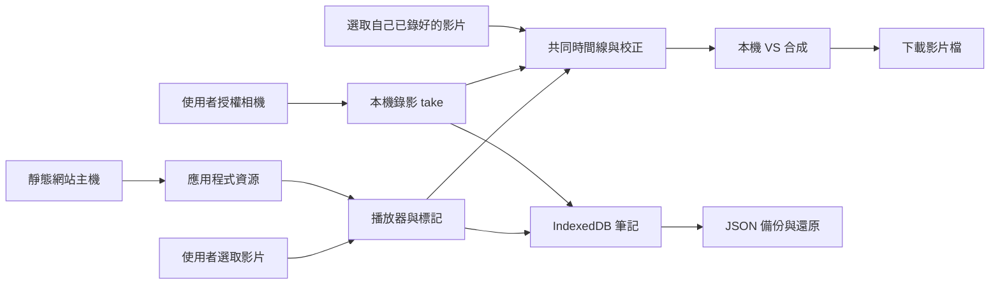

<!-- 檔案用途：產品與開發工具的技術決策索引。所在層：根文件。主要關聯：AGENTS.md、docs/PRODUCT_PLAN.md、docs/ai/HARNESS.md。 -->
# 技術設計與決策

最新桌面離線／容量／更新與個別刪除決策見第 19 節；前面標記原型階段的限制保留歷史版本歸屬。

狀態：2026-10-28；已加入桌面 Web 預覽版、既有影片比較與 AI harness；未完成整體 P0／手機驗收。工具測試與產品／真機驗收分開記錄。需求以 [PRODUCT_PLAN.md](docs/PRODUCT_PLAN.md) 為準。

## 1. 架構結論

第一候選：**TypeScript + Vite + Svelte，靜態 Web／PWA，原生媒體 API，IndexedDB（透過 Dexie）保存筆記。** 不需要 SSR、登入、SQL 雲端、付費影片平台或訂閱表。

這是可驗證的選擇，並非因為「換框架就能解決錄影」。最先做的工作是用最小 Web 頁面驗證手機同時播放與錄影，以及 VS 影片匯出。若 iPhone Web 過不了門檻，保留 Web 筆記，先以 SwiftUI + AVFoundation 做 iOS 媒體功能，再考慮 Android。

沒有由 App 發出的「媒體 → 雲端」箭頭。首次網站載入／更新仍會連線到靜態主機；不是完全沒有網路活動。相機與影片資料不跟隨程式更新上傳。P1 分享由使用者匯出檔案後，自行透過個人雲端或 AirDrop 傳送；這不新增 App 的影片儲存後端。

## 2. 框架選擇：依維護成本，不依偏好綁定 Vue

以下為本專案工程判斷，不是框架跑分。

| 候選 | 優點 | 本專案代價 | 決策 |
| --- | --- | --- | --- |
| Svelte + Vite + TypeScript | 適合小型互動介面；編譯式元件；易分離媒體核心 | 維護者需熟悉 Svelte 反應式生命週期 | 預設候選；可行性確認後鎖版本 |
| Vue + Vite + TypeScript | 單檔元件、成熟工具；若維護者更熟悉可降低時間成本 | 不因既有偏好自動採用；仍需相同媒體驗證 | 合理替代；不必用 Nuxt |
| React + Vite + TypeScript | 元件與工具選擇廣 | 需避免 effect 重複掛相機／音訊事件；不是不可用 | 有熟悉貢獻者時可選 |
| 原生 TypeScript | 驗證媒體路徑最快、依賴少 | 大量表單、時間軸、狀態整合後維護成本增加 | 用於第一個可行性原型 |
| Nuxt／Next／SvelteKit 全端 | 路由與伺服器能力完整 | 本期沒有 SSR、API 或帳號需求 | 不引入伺服器運行需求 |
| Flutter／React Native／Capacitor | 可包裝行動應用 | 仍需原生媒體實作；包 WebView 不會自動修復瀏覽器限制 | 不作第一步；iOS gate 失敗才比較 |
| SwiftUI + AVFoundation | 直接控制 iOS 相機、音訊、時間線與合成 | 第二套 UI／資料儲存、簽章及發佈成本 | iOS 備援首選，必須先有失敗證據 |

參考官方文件：[Svelte](https://svelte.dev/docs/svelte/overview)、[Vue](https://vuejs.org/guide/introduction.html)、[React](https://react.dev/learn)、[Vite](https://vite.dev/guide/)、[AVFoundation](https://developer.apple.com/av-foundation/)。版本、授權與依賴樹在建骨架時重新確認並鎖定，本文不指定未驗證的最新版本。

## 3. 模組邊界

不先建立 monorepo、通用外掛市場或抽象同步引擎。以下是未來檔案分工建議，現在不存在：

| 模組 | 責任 | 邊界 |
| --- | --- | --- |
| domain | 時間區間、標記、take 與比較配方驗證 | 不依賴 UI、DOM 或雲端 |
| media | 載入／seek、鏡像、速度、A–B、相機錄影與匯出 | 一個媒體資源由一個 owner 清理 |
| storage | IndexedDB 交易、migration、媒體副本與分段寫入 | UI 不能自行繞過儲存流程 |
| transfer | JSON 匯入／匯出、媒體重新連結、衝突副本 | 外部資料視為不可信，不執行 HTML |
| ui | 影片庫、練習、錄影、比較、資料管理 | 不把播放時間每一影格寫進全域 store |
| capability | 能力偵測與實測支援表 | API 存在不等於整條流程成功 |

只在實際出現第二個平台實作時抽 adapter。跨平台共同契約是資料交換格式與驗收範例，第一版不強求 Swift 與 TypeScript 共用執行碼。

## 4. 本機儲存與恢復

筆記與索引進 IndexedDB，Dexie 減少交易及 migration 樣板；不啟用 Dexie Cloud。示範原片預設是當次選取的 File，object URL 只在當次生命週期存在，不能當永久路徑存起來。重開後透過重新選檔連回筆記。

「保存離線影片副本」採明確選擇；初期試驗 200 MiB 以下單檔，這是待實測的產品護欄，不是瀏覽器保證容量。較大原片可繼續用重新選檔模式。錄影的 chunks 需逐步落盤並保留順序／MIME；最終完成前不宣稱可播放，殘留 chunks 不一定能單獨解碼。

先比較 IndexedDB Blob 與 OPFS 的真機可靠性，再固定媒體後端；筆記永遠不與大型媒體寫入綁在同一個長交易。寫入 staging → 成功關閉／檢查 → 更新 metadata 為 ready；中斷留下 failed／recoverable 狀態，下次提供重試或清理選項，不自動刪原片。

`navigator.storage.estimate()` 只供估計，`persist()` 可能未獲准。即使獲准，使用者清除網站資料仍會刪資料；備份是必需功能。多分頁以 revision 檢查防止覆寫，migration 遇到舊分頁時提示關閉；不做 last-write-wins 靜默覆蓋。來源：[Storage API](https://developer.mozilla.org/en-US/docs/Web/API/Storage_API/Storage_quotas_and_eviction_criteria)、[persist](https://developer.mozilla.org/en-US/docs/Web/API/StorageManager/persist)、[Dexie](https://dexie.org/docs)。

### P1 分享：檔案交換，不新增服務

2026-10-27 決策：[#18](https://github.com/sunpochin/dance-stamp/issues/18) 第一版只在 `transfer` 邊界做選定筆記檔匯出／匯入與媒體重新連結。沿用 [DATA_FORMAT.md](docs/DATA_FORMAT.md#6-分享格式p1) 的 `kind=share`、欄位篩選、ID 關聯與影片分離規則，不新增雲端網址欄位或憑證儲存。

使用者在 App 外自行使用 Google Drive、Dropbox、iCloud Drive 或 AirDrop 傳檔。下載／選檔匯入為基線；系統分享僅作能力偵測後的選用入口，取消或失敗保留原資料。App 無法確認外部傳送結果，不把匯出或系統分享回傳當成「已送達」。接收者先取得檔案，再人工確認影片配對；不把雲端分享頁當可直接播放的媒體來源。

選擇此方案是為了讓核心功能不依賴供應商帳號、免費配額或後端維運。排除自建影片儲存／上傳中繼、供應商 API／OAuth 直連、自動同步及大型 ZIP 打包；前者增加憑證、權限與服務維護，後者增加手機記憶體壓力。若日後需要直連，另提規劃與授權；本次只更新設計，未宣稱已通過裝置驗收。

## 5. 播放與相機

### 既有影片入口（2026-10-28 桌面實作，#10／#11）

「比較已有影片」接受老師課後原片與自己的練習原片，無須呼叫相機／麥克風。復用既有選片驗證、take／recipe、共同時間線及 VS 合成；不建立第二個剪輯器。首頁與老師片頁提供明確入口，取代只靠「載入自拍測片」發現功能的用法。外部原片預設 session-only，保存副本須明確操作，不能沿用相機錄影流程而暗中複製檔案。

老師 A–B、自己的起點 C 及固定 r 使用 [RECORD_COMPARE.md](docs/RECORD_COMPARE.md) 的同一映射，C 初始化 offset，不另增第二份起點欄位。新配對預設原速；使用者確認慢速跟跳才選既有固定比例，不把兩段片長比當成速度。資料關聯、舊 v1 相容與更換配方規則見 [DATA_FORMAT.md](docs/DATA_FORMAT.md)。桌面 runtime 已接入，交換格式維持 v1；實測範圍見[既有影片證據](docs/evidence/existing-comparison.md)。

排除強迫重新錄影、要求外部裁片／拼片、雲端上傳轉碼與自動 AI 對拍：使用者已有兩片，應可本機選取和手動對齊；原片保持不變，也不引入額外服務。#10 的外部影片入口依賴 #5／#6，可先於相機流程驗收；#9 僅是工具內錄影接入的依賴，整體 P0 仍保留兩條路徑的驗收。

2026-10-28 桌面實作：正式入口及兩側起點按鈕共用既有原生播放器。外部 File 只存本次頁面的 asset→File 對照，metadata 直接建立 ready take；只有明確按保存才使用既有原子 metadata／Blob 交易。候選影片實播及 metadata 寫入成功後才釋放舊 URL，quota、revision 衝突、取消與壞檔均回復舊片。

改動 A／B 或固定比例時另建 take／recipe，共用同一原片 asset；offset／鏡像只提高 recipe revision，舊輸出仍可下載並標明設定差異。輸出辨識包含兩側媒體身分，避免同時長的新片被誤認為上一組輸出。重新連結先載入保存的配方，再讓使用者預覽原片、明確確認；既有 v1 JSON 不加欄位、不改版本。

比較設定保存採同一佇列，避免失焦保存吞掉按鈕點擊或 revision 互撞；佇列等待只保證前件結束，單次 quota／revision／seek 失敗由該件獨立回報。拒絕讓 rejected Promise 永久阻擋整個操作入口，因為使用者必須能在不重載、不丟失 session File 的情況下備份與下載原片。預覽／匯出仍各自重新保存目前配方，實際失敗照常顯示，不繞過原子交易或 revision 保護。

共同預覽可一起暫停，再拖動時間線與繼續；合成固定從交集起點開始。自己片強制靜音，老師無音軌時輸出無聲；音軌資訊無法偵測的瀏覽器顯示條件式說明，不用尚未解碼的 0 bytes 冒充「沒有音軌」。沒有新增框架、雲端服務或 runtime 依賴。驗收工具使用二進位影格碼與不同頻率合成聲源，從下載檔獨立解碼，而非把 JS drift 當作成檔同步證據。

兩側使用 `requestVideoFrameCallback` 持續消費真正的影格更新；rAF 保持共同時鐘及 30fps 繪製節奏，缺少影格 callback 時保留 rAF 路徑。Chrome 的合成採 `captureStream(0)`，繪製後呼叫 `requestFrame()`；缺少該能力時先停止初始串流，再退回自動 30fps。停止、取消及失敗都清掉兩側 callback 與輸出 tracks。依據 [影片影格通知](https://developer.mozilla.org/en-US/docs/Web/API/HTMLVideoElement/requestVideoFrameCallback)與[手動擷取](https://developer.mozilla.org/en-US/docs/Web/API/CanvasCaptureMediaStreamTrack/requestFrame)的原生能力，偵測不能代替成檔驗證。

測試曾在慢速素材留下約 267ms 舊畫面，但 JS 繪製間隔仍約 20ms；僅改手動擷取或 CPU 畫布都未消除。讓比較持續接收兩側真正影格更新後，針對性實測才通過。故不把播放時間、編碼 fps 或 JS drift 當作 G2／G3；驗收仍獨立讀回下載檔的影格碼及音軌，門檻沒有放寬。

### 共用播放與相機規則

- `input type=file` 為跨瀏覽器基線；`showOpenFilePicker` 是能力偵測後的選用增強，不能成為 iPhone 的必要入口。[File API](https://developer.mozilla.org/en-US/docs/Web/API/File_API)、[picker 支援限制](https://developer.mozilla.org/en-US/docs/Web/API/Window/showOpenFilePicker)。
- 以 `loadedmetadata`／`seeked`／播放結果決定狀態；副檔名、MIME 和 `canPlayType()` 只能提示，不保證實際解碼。HEVC、旋轉、HDR、可變影格率均要真片驗證。
- A–B 優先使用 `requestVideoFrameCallback` 觀察顯示時間，fallback 用前景動畫迴圈及媒體事件；seek 有 in-flight 鎖，離開頁面清除 callback。背景暫停，恢復前重新定位。它不是逐格精準／無縫音訊循環保證。[rVFC](https://developer.mozilla.org/en-US/docs/Web/API/HTMLVideoElement/requestVideoFrameCallback)。
- 只鏡像影片／輸出圖層，不翻轉控制文字；預設 `preservesPitch`，不支援則顯示限制。[音高](https://developer.mozilla.org/en-US/docs/Web/API/HTMLMediaElement/preservesPitch)。
- 相機只在使用者進入錄影流程後請求；預設不開麥克風。停止、取消、離頁都釋放 track；中斷停止錄影並嘗試保存已完成部分。
- 同時播放／相機／音訊與匯出細節以 [RECORD_COMPARE.md](docs/RECORD_COMPARE.md) 為準。

## 6. 離線、發佈與安全

靜態檔可由免費主機或使用者自己的本機 HTTP server 提供，沒有必需後端。PWA 只 precache 應用資源，不把私人影片放公開 cache URL；未載入過的網站不能第一次離線啟動。使用 HTTPS 或受信任 localhost，不能只叫使用者雙擊 HTML 就保證相機／離線能力。

更新採「有新版 → 保存工作 → 使用者重新載入」。禁止錄影／匯出中強制切換 service worker；破壞性 migration 需先備份，不把 app 檔回滾當成資料可自動回滾。[Service Worker](https://developer.mozilla.org/en-US/docs/Web/API/Service_Worker_API/Using_Service_Workers)。

GitHub Pages 可當免費靜態候選，但有容量／流量／使用政策限制，不能用來放私人練舞影片。`sunpochin.github.io/dance-stamp/` 與同網域其他 repo 頁面共用 origin；不同路徑與 DB 名稱不是安全隔離。發佈前須盤點同 origin 信任邊界；有不受信任內容時改用可免費取得的獨立站點 origin，或保留專用 localhost 入口，不直接宣稱安全上線。[Pages 限制](https://docs.github.com/en/pages/getting-started-with-github-pages/github-pages-limits)。

使用純文字筆記、匯入大小／數量限制、CSP 與依賴鎖檔；不自動讀取筆記中的遠端 URL。禁止第三方追蹤、遠端字型與媒體分析 SDK。診斷匯出必須預覽並移除檔名／影片／筆記正文。

## 7. 排除的替代方案

| 方案 | 本期不採用原因 | 何時重評 |
| --- | --- | --- |
| Supabase Auth／雲端 DB／RLS | 本機單人資料不需帳號與服務維運 | 使用者另行要求自架協作 |
| Cloudflare Stream 等託管轉碼 | 無法承諾影片用量成長仍零費用 | 不在本路線圖 |
| 免費雲端配額拼湊／自建影片儲存 | 免費方案會變，不能當免費永續的核心；#18 改由使用者自行傳檔 | 不作核心依賴 |
| Google Drive／Dropbox／iCloud 的 API、OAuth 直連及同步 | 檔案匯出／匯入已滿足第一版分享，不增加憑證與權限維護 | 使用者另行要求並核准規劃；不阻擋 #18 |
| FFmpeg.wasm 全量轉碼所有影片 | 手機 CPU／記憶體／耗電與等待時間大 | 只有明確短片格式缺口、授權相容且實測通過 |
| 即時直接把 VS 烘焙進唯一錄影 | 錄完無法校正兩側偏移，失敗即失去素材 | 可作選用快速路徑，不能取代原始 take 保存 |
| WebCodecs 自寫完整剪輯器 | 解碼、編碼、封裝、背壓與跨裝置支援成本高 | 即時匯出已證明不足且本機替代可行 |
| 自動姿態評分／AI 對拍 | 不解決第一版找片、錄影、比較問題 | 核心驗收後獨立研究 |

FFmpeg.wasm 官方也指出與原生效能差距、多執行緒資源需求及組件授權差異；不能因「不收 API 費」就當成沒有成本。[官方 FAQ](https://ffmpegwasm.netlify.app/docs/faq/)。

## 8. 品質門檻與文件維護

建立程式時補型別檢查、lint、domain／migration／匯入測試與瀏覽器整合測試；相機與編碼必須另做真機。改架構須同步此文件並寫被排除方案；容易踩坑的時間映射、資源釋放、儲存順序在程式中用繁體中文說明原因。所有變更經新分支、檢查差異、單一任務提交並推送，不直接推 main。實際測試結果另記錄，不能靠文件存在宣告完成。

## 9. AI harness 與開發流程

- [AI 協作憲法](AGENTS.md)：唯一規則來源；工具入口保持薄轉接。
- [開發工作流程](docs/agents/workflow.md)：issue → 獨立分支 → 本機檢查／真機證據 → PR；AI 開票的標題標示實際開票廠商與模型 → 明確核准後發布。
- [Harness 說明](docs/ai/HARNESS.md)：來源版本、本機完整參考副本、公開啟用及未啟用範圍。
- [匯入清單](docs/ai/harness-import.json)：逐檔 Git blob、處理方式與 SHA-256。
- [證據範本](docs/agents/acceptance-template.md)：產品驗收依 commit／裝置留記錄。

決策：完整上游參考只留本機且不進 Git；公開可追溯的清單、適配規則、skills、破壞性命令防護、Git hooks 與公開內容掃描。CI 位於 `.github/workflows/harness-ci.yml`，PR 與 main 更新時使用 Bun 1.4.4 執行相同的 `bun run check`。只有 `contents: read`，不使用 secrets 或部署；目前沒有第三方套件依賴，產品框架版本留給 #3/#4 的證據決定。

排除直接套整個家健錄：會把照護授權、三語要求、資料庫、staging／production、付費審查與自動部署假設混進本機免費工具。也不重寫複雜 shell parser；沿用來源 destructive guard 及其必要依賴、負向回歸。來源 parser 的限制與工具端 hook 是否自動載入必須明說，Git native hooks 是另一層獨立防線。

`bun run check` 現在驗證指紋、入口、文件、工具／產品邏輯測試及原生 Web 語法建置，已接入 TypeScript checkJs 與 Biome；它們不代替 G1–G7。來源副本不在測試掃描入口內，不會啟動來源 CI、任務控制或 secrets。

使用者確認公開原始碼並保留非商用授權。為避免把歷史照護文件的真人／營運脈絡帶入公開 repo，拒絕整包上游原文公開；保留本機完整副本、公開必要通用工具與 MIT notices。使用者補上 workflow 權限後，將原範本移到正式位置，避免維護兩份會漂移的設定；不另建遠端專用檢查或加入自動部署。PR 的 CI 執行成功與合併後 main 的執行結果分開記錄。

## 10. 桌面 Web 預覽決策（#1）

2026-10-27 使用者明確要求先做 Web、暫不處理 iPhone。本次因此先交付桌面 Web 預覽，不以缺少 iPhone 阻擋可操作版本，也不宣告 #3 全平台 gate 或 #1 完成。

採原生 JavaScript ES modules 與 IndexedDB，無 runtime／npm 套件依賴；Bun 僅供本機建置與提供靜態資源。`web/` 分出時間邏輯、備份驗證、儲存、錄影工具與 UI，`bun run build` 驗證語法並產生 `dist/web/`。此次保留原生路徑以重用已走通的媒體程式；暫不導入 Svelte／Vite／Dexie，避免在尚未確認桌面流程前同時改動框架。原先框架比較仍作後續維護決策參考，後續 #4 接入 checkJs／lint，而不重寫已驗證的媒體層。

IndexedDB v1 分開 metadata、media、chunks。metadata 是有全庫 revision 的短交易快照；媒體 finalize 與對應索引同一交易，衝突或 quota 全部回滾。自拍錄影每次 dataavailable 依序落盤，未完成記錄保留工作狀態，恢復時先取得跨分頁鎖、組檔並讀回，成功才 ready；不因另一分頁開啟而自動判中斷。示範需明確點按才保存副本，object URL 永不寫入 DB。筆記輸出依 v1 白名單，不含媒體 bytes。衝突匯入目前拒絕整份且保留資料，另存衝突副本尚未實作，不能關閉 #12。

前景 canvas 即時合成保留來源音訊，重用單一 Web Audio source，閒置 suspend、離頁 close。一般示範播放與 A–B 循環會恢復既有 AudioContext，避免合成後練習無聲；暫停仍 suspend。換片前保護未保存的標記草稿，結束編輯時清除狀態，寫入另查影片歸屬；自拍替換只有新檔讀回成功才解除舊 take，讓失敗／取消後配方及輸出仍可保存。播放／取消／背景釋放相機與各次合成 tracks；新檔先用獨立 video 驗證，失敗不破壞先前成功輸出。完成的自拍與 VS 另存 IndexedDB；VS 中斷可從原片及配方重試，不以半成品冒充完成。

Service Worker 只快取已知靜態資源，cache 版本來自建置內容 SHA-256；不 skipWaiting、不強制重載、不快取使用者媒體。靜態入口限制固定資源及讀取方法，CSP 不允許外部資源，無部署、追蹤或外部服務。版本及限制見 [Web 說明](docs/WEB_PREVIEW.md)，驗收見 [Web 證據](docs/evidence/web-preview.md)。

## 11. #4 可重現靜態品質入口

固定 TypeScript 7.0.2（Apache-2.0）與 Biome 2.6.3（MIT OR Apache-2.0）為開發依賴，`bun.lock` 固定來源與完整性；產品仍沒有 runtime 套件。保留原生 ES modules，因既有媒體路徑可工作，為引入 Svelte／Vite 而重寫 UI 不能改善編碼能力。

`bun run typecheck` 檢查所有 Web JavaScript 的資料契約、DOM 對照與媒體型別，Service Worker 用獨立 WebWorker lib。啟用 strict 的空值及型別檢查；動態 callback 參數仍容許漸進式 JSDoc（noImplicitAny=false），沒有略過整份檔案。`bun run lint` 使用 Biome recommended、warning 也失敗；唯一局部說明是本機影片無自動字幕，以及 hidden 必須蓋過 display。

CI 已由主分支啟用，本次加 frozen lockfile／ignore-scripts 安裝，再執行同一 `bun run check`。建置產物帶根授權與第三方 notices，伺服器只提供白名單資源，不需金鑰、登入或伺服器 API。這是工程骨架驗收，不表示 #3 的實體媒體 gates 已通過；使用者先做桌面 Web 的決定保留。

## 12. #5 短交易、缺片與安全恢復

IndexedDB 明確實作 0→1 migration；未知路徑拒絕、交易回滾並保留舊版本，錯誤後可重試，不自動 reset。開啟後驗證三個 store、metadata 格式與 revision。讀 metadata 與媒體 key 清單在同一 readonly transaction，依實際 Blob 推導 ready／missing／interrupted；不把失效 object URL 存入 DB，也不以 state 字串取代實際讀回。

採原生 Web Locks 對同一 take 的錄製／恢復互斥，分頁或程序結束會釋放；不另寫容易過期的時間戳 lease。新分頁不自動改寫 recording 狀態。沒有 Web Locks 時錄製／恢復明確拒絕，筆記和播放器仍可用；不假裝多分頁安全。全庫 revision 檢查仍保護 metadata／Blob 原子 finalize；空間或版本衝突不留下半份資料，UI 草稿保留。

示範 session-only 與明確選擇保存副本分開；同名檔必須預覽確認，重連短片保留原 canonical 時間，超界 marker 顯示待修復且不能跳轉。測試使用 native IndexedDB 的初始化中途失敗、未知升級回滾、重試、兩個真實分頁互斥及同名不同長度的合成檔。這些是桌面 Chrome 證據，不延伸宣稱其他裝置。

## 13. #6 可恢復的本機播放器

選檔不以副檔名、MIME 或 canPlayType 宣告成功；先實際 loadeddata、讀尺寸與長度。換片採兩階段：新 URL 解碼成功且未取消才取代舊 URL；失敗只釋放候選，恢復原片時間與速度。空檔及取消也在 finally 清掉 file input，讓同檔可再選。自拍綁定只在新片成功後變更，避免錯誤檔讓既有比較配方失聯。

媒體啟動與事件等待由 mediaAction 共用 AbortController／finally；setter 同步拋錯、play Promise 拒絕、取消與逾時都撤銷 listener。先等到畫面事件也不表示 play Promise 已成功，兩者都完成才返回。沒有新增播放器套件或遠端解碼服務。

桌面 Chrome 156 已用合成 H.264 靜音片、180×320 直向、90° display matrix、VFR、H.264 MOV 與改名有效 MP4 實播。相同副檔名的壞檔即使 canPlayType 回 probably 仍拒絕，十次換片只保留一個現用 URL；候選解碼時最多兩個。HEVC／HDR 顏色、Safari 與手機仍未驗證，不能從 metadata 或第一幀推論全部支援。

## 14. #7 時間標記與草稿保護

點擊事件同步擷取毫秒，表單持有當時影片 ID；保存時驗證歸屬與全庫 revision。新增／編輯／刪除後立即重畫索引，依數字時間排序並顯示到毫秒。時間邊界由 `timeline.js` 的 `validateMarkerRange` 同時供表單與備份驗證，不另建第二套規則；點標記可在片頭／片尾，區間必須正長、非負整數毫秒且在原筆記及已連結媒體範圍內，不自動交換 A/B。

未保存的編輯阻擋換示範、切筆記、另一個編輯及刪除入口，明確保存或取消後才繼續；離頁由瀏覽器原生警示提醒。保存中停用操作並顯示狀態，失敗與多分頁衝突保留草稿。這比換片後靜默清空更能保留輸入，也不需要建立額外草稿資料表或自動存入正式筆記。瀏覽器強制結束仍可能失去未存草稿，不宣稱永久保存。

跳轉以既有 seek 路徑執行，無自拍時區間一併設 A/B；已有自拍則保留錄製來源範圍並明確提示。驗收使用 requestVideoFrameCallback 的 mediaTime 量實際顯示影格，沒有拿 currentTime setter 當證據。受測 H.264 檔與限制見 [#7 證據](docs/evidence/issue-7-time-markers.md)；這不是錄影成檔 G2 同步驗收。

## 15. #8 練習循環生命週期

循環啟動在等待 seek 之前就建立可取消的 session；開始按鈕立即成為停止入口。停止／切片／離頁會終止該 session，晚到的 seek／play 不得重新啟動。回捲以單一 in-flight Promise 互斥，影格 callback 與 ended 共用；callback 以版本及 session 歸屬拒絕過期結果，依原 API 取消，原生暫停也清理。前景優先用 requestVideoFrameCallback，缺少時用 requestAnimationFrame，不新增固定間隔計時器或播放器依賴。

停止會解除舊回捲 Promise 的歸屬，但取消等待不會取消原生 seek；重啟先等該跳轉完成，防止新 owner 誤接舊拒絕或重疊 seek。循環中修改 A/B 時仍檢查上下界；若目前位置落在新 A 之前，透過同一個可取消的回捲路徑校正，不另開一份循環。逆序區間則停止並提示。手動跳轉會停止循環，再按開始從 A 重新校正。原生 ended 走同一可取消啟動路徑；空白或逆序 A/B 拒絕，不自動交換。暫停、seek 完成與選片後都能更新鏡像 canvas，原生 video 控制與文字不翻轉。

練習速度獨立於錄影配方，使用六個既有選項；一般 play、load 的預設速度及媒體操作結束後恢復練習選項。錄製仍使用既有 0.5／0.75／1 配方及停用控制，不能在 take 中改寫來源時間。依 [preservesPitch](https://developer.mozilla.org/en-US/docs/Web/API/HTMLMediaElement/preservesPitch) 能力啟用音高保持並顯示限制，未提供時明確提示可能變調；能力存在不是音質驗收。

實測數據與各版本原生背景 gate 見 [#8 證據](docs/evidence/issue-8-practice-loop.md)。合成 visibility 事件只驗證 handler，不能代替真正切背景；保留獨立嚴格測試，不降低 ACCEPTANCE.md 門檻。受測桌面結果不擴大為整體 P0 或其他裝置通過。

原生背景補查須排除測試工具的 focus emulation：以全新專用 Chrome 的現有 default context，連線時設定 [noDefaults](https://playwright.dev/docs/api/class-browsertype#browser-type-connect-over-cdp)，不另建 context 或覆寫可見性。桌面必須解鎖且能觀察實際視窗；Mac 鎖定時的載入逾時不能冒充格式失敗。解鎖後 main 靜態 `2f1ec6b3335cd790` 已通過；提供只管理自己程序的 `launch-native-browser.ts`，runner 沿用同一份嚴格測試並記版本。測試另檢查 trusted 事件、回前景 500ms 內無 playing、callback 清空及原生 playing 從 A 啟動。排除事後從另一 CDP session 停用焦點、合成事件、改產品停止邏輯或搬用另一版本結果。鎖定期間與 PR #40 的歷史資料分別保留，未擴大為裝置／音訊驗收。

2026-10-28：PR #31 同步已合併既有雙片入口的 main `cbc5dee`。保留比較設定保存佇列、重連確認與標記草稿保護；媒體操作結束同時收起比較暫停按鈕並恢復練習速度。片尾只保留可取消 session 的單一 handler，排除直接保留兩份事件監聽的解法，避免重疊回捲與停止後重新播放。既有真機／背景與成檔證據仍綁原受測版本，本次同步不擴大驗收結論。

## 16. #9 錄影工作狀態與原片保護

新增錄影沿用 RECORD_COMPARE.md 的 0.5／0.75／1 固定速度、實際規劃 15–60 秒及 3／5／10 秒倒數；短片仍可練習、匯入或保留中斷原片，不把下限施加到既有檔案。前鏡頭採 ideal 以容納桌面 webcam，後鏡頭明確要求 environment；缺少後鏡頭不靜默換成前鏡頭。選項變更先釋放原串流，須再次按開啟才存取相機。權限、占用及缺少鏡頭有中文重試提示；全身框只在預覽，不混入原片與輸出。

建立 take 工作記錄不會立即變更目前自拍關聯；倒數取消標為 failed，舊自拍與配方維持原關聯。新原片解碼成功後才啟用新 take；新錄影永遠配置新 ID。「準備下一段」只清當次視圖、解鎖設定，已保存的舊 take 保留。選片、原片讀回及 chunks 恢復共用候選載入／失敗恢復路徑，避免另一套壞檔處理。

編碼 error 先拒絕 done 通知 owner 停止，但 stop 仍等原生最後 dataavailable／stop 或明確逾時，之後才移除監聽；落盤 queue 收齊後離開操作。遲到錯誤以 signal 歸屬限制，不能中止下一個操作。暫存使用 add 拒絕覆寫同一 index，恢復在同一 readonly transaction 讀 keys／Blob，僅組合從零連續、非空且容器一致的片段。解碼與原子 finalize 成功後才清 chunks；缺號／壞檔、quota 或寫入衝突保留原件。

中斷原片即使解碼成功、重新開啟或由 chunks 恢復，仍標示 interrupted，不能冒充完整 take。相機 ended／mute／尺寸改變、旋轉、freeze／hidden 與離頁停止並釋放 tracks；中斷監聽隨相機 owner 撤銷。BFCache 的 pagehide 保留同一 video／AudioContext 並 suspend，避免返回後為同一 video 建第二個來源節點；相機不自動重開。非 BFCache 離頁才 close 與撤銷 URLs。

可選 captureTiming 記錄呼叫錄影、原生 start 事件、play Promise 完成與示範位置，依 DATA_FORMAT.md 白名單往返。它們是單頁單調時間觀測，不以其差值自動校正，也不當 G2 影格同步證據。測試與未完成真機 gates 見 [#9 證據](docs/evidence/issue-9-capture-recovery.md)，不因合成資料通過而關閉 #9。

離頁驗收拆成 prepare／verify，中間由 CLI 真的導覽並接受瀏覽器原生警示；排除直接注入 pagehide 或停用 beforeunload，因為那些方式無法證明 document 被卸載後的片段保留。prepare 逐次 await IndexedDB 的 count 結果，至少兩塊確實保存才離開；本 CLI 的 async predicate 實測可能在查詢結果為 false 時仍先返回，不能把 Promise 當成功。依 [Playwright 的 truthy 等待契約](https://playwright.dev/docs/api/class-page#page-wait-for-function)，既有自拍回歸也改為操作結束後明確讀資料並 assert。匯出回歸等整個操作完成才讀診斷，避免下載連結先出現而讀到舊報告。這些只加強驗收，沒有新增 runtime 依賴或降低媒體 gate。

2026-10-28：PR #33 同步已合併既有雙片入口的 main `cbc5dee`，沿用 PR #36 已有的共同播放器解法，保留候選載入／metadata 同成敗、錄影尾塊排空、單一循環 owner 與 BFCache 資源歸屬。測試先明確保存用來驗證保留的舊片，並等待比較設定佇列完成；排除恢復外部影片自動保存或刪掉資料保護斷言的解法。新增同頁相機→VS→既有雙片→VS→重開錄影回歸；歷史長片、真機與背景證據不自動移作本次提交通過。

2026-10-28 審查修正：開啟另一個 take 時，候選原片、比較模式、A/B、速度、偏移、鏡像與下載連結要在解碼成功後一起切換。排除先換表單再嘗試讀片，因為取消或壞檔雖恢復舊播放器，卻會把另一段校正存進舊 take。缺片仍進人工重連；成功開啟其他已存 take 會清除先前的待重連狀態。`take-open-failure.js` 先重現舊版失敗，再核對修復後仍能以原配方匯出。

2026-10-28 保存選擇修正：只有直接錄下或從 chunks 恢復的資料自動 finalize。人工選回的原片即使屬於中斷 take，仍遵守 session-only；已存中斷原片重開也不重寫整份 Blob。副本只由明確保存入口建立，錄影中斷標籤保持不變。

## 17. #9 錄影與 #35 既有雙片整合

兩個功能分支都從 main `1d8ed7f` 延伸：#33 `f77a8bf` 包含標記、循環及錄影恢復，#35 `9935b06` 包含正式雙片入口與實際影格通知／手動擷取。整合保留雙方提交及單一入口，不把未審查的功能直接推到 main；另外實驗的雙片 dialog 原型只保存在獨立分支，不引入第二套 UI 或 schema。

選片、相機原片讀回及 chunks 恢復共用 `loadCandidate`。選片可在新 URL 提升前執行 metadata 交易，失敗還原舊播放器；錄影讀回仍能不帶使用者取消 signal 完成尾塊保護。保留 #9 的原生 stop／尾塊 queue、跨分頁鎖、interrupted 狀態及可選 captureTiming；外部 ready take 不製造相機觀測、不自動複製原片。從 chunks 實際恢復的片段才完成保存；人工重連原片與已存中斷片段只開啟，不因 interrupted 狀態自動複製或重寫。

保留 #8 的單一循環 owner／seek 與 #35 的比較影格 callback 排程，各操作都由同一 operation 清理。未沿用舊版重複的 ended listener，避免同一尾端觸發兩次回捲。BFCache 只 suspend 同一 AudioContext 並保留 session File；真正離頁才 close、撤銷 URLs 並清除 Map，避免回來無聲或失去未複製原片。

測試舊片保護時必須先明確保存合成基準副本，不恢復已排除的「選外部影片便自動保存」。設定保存回歸等候 aria-busy 清除再核對 revision；新增同頁相機 → 既有雙片 → 重開原錄影的整合測試，檢查一個 AudioContext、相機只依明確操作、原筆記／原片／VS 不變。成檔分析另檢查嚴格前進的影格時間與真正首末影格，不讓附近中位數掩蓋邊界偏移。結果依靜態內容版本另記於 [整合證據](docs/evidence/issue-9-comparison-integration.md)，不移用兩個原分支的歷史數據。

## 18. #12 預覽、衝突副本與媒體保存清單

備份仍為 v1 白名單 JSON，沿用 10 MiB／各表 10,000 筆與單筆 note 20,000 字的界線。`planBackupImport` 先驗證兩邊資料，再計算新增、重複與衝突；原生 dialog 顯示數量、來源影片及缺片提醒，預設焦點在取消。只有使用者明確確認才以原 revision 寫入單一 metadata transaction；quota／另一分頁衝突保留原配對及候選，取消以可選 AbortSignal 中止同一交易。錄影 finalize 不帶此 signal，保留 #9 尾塊排空政策。

本機新增實體仍用隨機 UUIDv4。不同來源以 sourceLibraryId／table／原 ID 建立穩定的 SHA-256 UUIDv8；同來源衝突只分開受影響的依賴閉包。配方衝突也分開 owning take，因為開啟入口按 take 取配方；take 副本身分包含校正內容，既有副本校正被編輯時另配置 take，不覆寫也不綁成不可選的第二配方。reference 變更須分開 Video；fork 配方／輸出也分開 VS asset，避免拿本機舊成檔充當備份的另一個輸出。副本 ID 包含 canonical 欄位、重寫後的關聯與來源版本；已存在的相同副本跳過，副本再被編輯時找下一個穩定候選，不覆寫。來源描述 hash 以 Map 共用，避免大量輸出重複序列化整份來源。這些 ID 不作授權、影片身分或內容去重證明；不讀媒體 bytes。

ID 位元依 [RFC 9562 的 UUIDv8](https://www.rfc-editor.org/rfc/rfc9562.html#section-5.8)，摘要使用瀏覽器內建 [Web Crypto digest](https://www.w3.org/TR/2017/REC-WebCryptoAPI-20170126/#subtlecrypto-method-digest)。沒有新套件或雲端呼叫。政策版本字串在 library.js，canonical 欄位順序以同檔白名單重建結果為準；不同平台若要相同 ID 必須實作相同政策，不依賴任意 dictionary 順序。空環境還原保留來源 library ID／原 ID，因此完整備份再還原後仍能重匯。交換 schema 不加本機 alias 表或裝置狀態；只用隨機新 ID 會讓重匯持續重複，本機私有 alias 表則會在換環境時遺失，兩者都未採用。現有 v1 接受 UUID 字串，舊資料 ID 不改動。

保存清單以實際 IndexedDB media keys 與已確認的 session File 判斷可用性，並涵蓋 reference／take／VS。JSON 的 ready 或相同檔名不能冒充影片存在。同名筆記只在畫面加第幾份標示，不修改原文。缺片才提供獨立預覽／確認 dialog；候選不碰主播放器，預設 session-only，保存副本須明確勾選且沿用 200 MiB 初期限制。已存比較所需 B 超過候選老師片長時拒絕連結，不能以同名裁切片取代原片；只有標記的短片修復仍沿用既有入口。VS 可另外重連與下載，不能當成比較原片。

相同容器保留既有 codec 描述，不因 File.type 沒提供 codec 就抹掉備份資訊。外部 File 最多讀 4 KiB 檔頭補正 MP4／MOV／WebM／Matroska 的容器型別，仍須真正解碼與播放；這不是轉碼或 codec 驗證。另存未知舊媒體時保留原始 bytes 的 bin 救援下載，不偽造 MP4。候選 URL 於取消／完成／離頁清理，已確認 File 仍依 session-only 政策保留。測試、實際還原演練與未驗證項目見 [#12 證據](docs/evidence/issue-12-backup-recovery.md)。

## 19. #13 桌面離線、容量、更新及個別刪除

沿用已驗證的原生 IndexedDB Blob／分段後端，不因新增離線資訊而搬移既有媒體或新增 OPFS／套件。metadata、media、chunks 仍為 schema 1；沒有破壞性 migration。既有初始化失敗、未知升級與多分頁保護仍拒絕並保留舊資料，未宣稱已有其他 schema 的升級／降級路徑。

離線狀態向當前 worker 查詢實際公開資源，逐一核對 SHA256，不以 SW 註冊或 online 狀態代替完整性。建置版本涵蓋所有 Web 來源、SW 來源及兩份 notices；只改授權說明也建立新 cache，避免改寫舊分頁使用的內容。manifest 包含應用及 notices，不包含媒體、筆記、其他 origin 或非 GET。安裝逐份無 HTTP cache 取回、驗證後存入；任一不符使安裝失敗，只清理該新版的未完成 cache。舊版缺檔也只補回符合自己 manifest 的 bytes；新版不同內容回 503，避免新舊 JS 混搭。這是本專案的建置一致性設計，不能當作來源主機或同 origin 已受信任。

更新保留原生等待生命週期，不呼叫 skipWaiting、clients.claim，也不因 controllerchange 重載。顯示新版待用，要求先另存工作及原片、關閉所有本站舊分頁後再開啟。只有 activate 清理本產品舊的公開 cache，不碰 IndexedDB 或其他 cache 名稱。首次在線備妥並重開受控制頁面後才可離線重開；影片需已有副本，或重新選取本機原檔。瀏覽器清除／回收仍可能使應用與媒體分別缺少，重新檢查會報不完整，不承諾永久離線或首次離線開站。生命週期依 [W3C Service Workers](https://www.w3.org/TR/service-workers/)；本節不宣告所有瀏覽器已支援或實測。

容量只顯示 navigator.storage.estimate 的估計 usage／quota／差額，不冒充裝置剩餘空間或寫入保證；缺值與例外顯示未知。持久保存僅點按才請求，分別回報允許、拒絕與失敗；手動清除不受保護。拒絕仍能使用，媒體副本與 JSON 仍應另存。估計可能變動，不以估計值繞過實際交易結果；quota、取消與中斷依同一原子寫入回滾。原片兩個保存入口也傳遞取消訊號。介面語義依 [WHATWG Storage](https://storage.spec.whatwg.org/)，不是本機容量保證。

個別刪除先由純資料 planDeletion 計算關聯及計數，原生 modal 預設取消焦點；確認前不寫入。副本只移除該 media Blob，保留描述、筆記及配方，本次已載入 File 可繼續使用，重開則缺片。單一 VS 只移除該輸出與無人引用的 asset；刪 take 包含其 recipes／exports；整份影片筆記包含所屬標記、take 及下游。原相簿／原始檔從不刪除。仍被其他 take 或輸出共用的媒體保留。

刪除先按固定 ID 順序取得所有受影響 take 的原生鎖，再以全庫 revision 核對；另一頁錄製／恢復或預覽後更新會拒絕。metadata、無關聯的 media 及 chunks 在同一原生交易提交，取消或 abort 全數回滾；chunks 按 cameraAssetId 清理，不是 take.id，共用原片未失去所有引用時不清分段。UI 及下載 URL 僅在成功後清理；等待缺片重連的 take 被刪除時也釋放 pending 狀態，下一次選片可新建配對。

排除自動啟用新版、強制 reload、清庫修復及只刪 metadata 後另清媒體：都可能中斷工作或留下半份關聯。也不新增另一份媒體後端、永久儲存宣稱、雲端備份或服務依賴。桌面真實 SW／IndexedDB 與瀏覽器斷網證據見 [#13 驗證](docs/evidence/issue-13-offline-storage.md)；瀏覽器斷網不等同手機飛航模式，iPhone、Safari、真實相機與全 P0 仍分開驗收。
