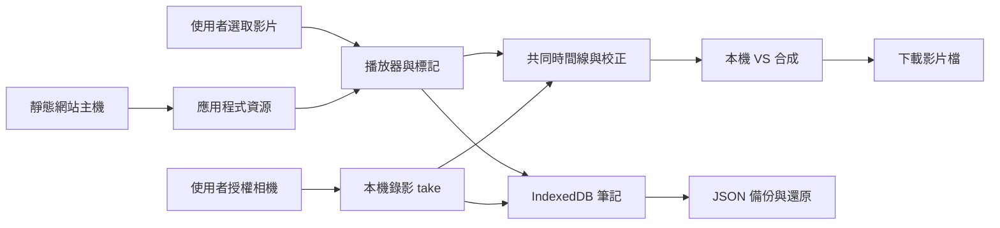

<!-- 檔案用途：產品與開發工具的技術決策索引。所在層：根文件。主要關聯：AGENTS.md、docs/PRODUCT_PLAN.md、docs/ai/HARNESS.md。 -->
# 技術設計與決策

狀態：2026-10-27；產品仍在規劃階段，已加入可執行的 AI harness。工具測試與產品／真機驗收分開記錄。需求以 [PRODUCT_PLAN.md](docs/PRODUCT_PLAN.md) 為準。

## 1. 架構結論

第一候選：**TypeScript + Vite + Svelte，靜態 Web／PWA，原生媒體 API，IndexedDB（透過 Dexie）保存筆記。** 不需要 SSR、登入、SQL 雲端、付費影片平台或訂閱表。

這是可驗證的選擇，並非因為「換框架就能解決錄影」。最先做的工作是用最小 Web 頁面驗證手機同時播放與錄影，以及 VS 影片匯出。若 iPhone Web 過不了門檻，保留 Web 筆記，先以 SwiftUI + AVFoundation 做 iOS 媒體功能，再考慮 Android。

沒有「媒體 → 雲端」箭頭。首次網站載入／更新仍會連線到靜態主機；不是完全沒有網路活動。相機與影片資料不跟隨程式更新上傳。

## 2. 框架選擇：依維護成本，不依偏好綁定 Vue

以下為本專案工程判斷，不是框架跑分。

| 候選 | 優點 | 本專案代價 | 決策 |
| --- | --- | --- | --- |
| Svelte + Vite + TypeScript | 適合小型互動介面；編譯式元件；易分離媒體核心 | 維護者需熟悉 Svelte 反應式生命週期 | 預設候選；可行性確認後鎖版本 |
| Vue + Vite + TypeScript | 單檔元件、成熟工具；若維護者更熟悉可降低時間成本 | 不因既有偏好自動採用；仍需相同媒體驗證 | 合理替代；不必用 Nuxt |
| React + Vite + TypeScript | 元件與工具選擇廣 | 需避免 effect 重複掛相機／音訊事件；不是不可用 | 有熟悉貢獻者時可選 |
| 原生 TypeScript | 驗證媒體路徑最快、依賴少 | 大量表單、時間軸、狀態整合後維護成本增加 | 用於第一個可行性原型 |
| Nuxt／Next／SvelteKit 全端 | 路由與伺服器能力完整 | 本期沒有 SSR、API 或帳號需求 | 不引入伺服器運行需求 |
| Flutter／React Native／Capacitor | 可包裝行動應用 | 仍需原生媒體實作；包 WebView 不會自動修復瀏覽器限制 | 不作第一步；iOS gate 失敗才比較 |
| SwiftUI + AVFoundation | 直接控制 iOS 相機、音訊、時間線與合成 | 第二套 UI／資料儲存、簽章及發佈成本 | iOS 備援首選，必須先有失敗證據 |

參考官方文件：[Svelte](https://svelte.dev/docs/svelte/overview)、[Vue](https://vuejs.org/guide/introduction.html)、[React](https://react.dev/learn)、[Vite](https://vite.dev/guide/)、[AVFoundation](https://developer.apple.com/av-foundation/)。版本、授權與依賴樹在建骨架時重新確認並鎖定，本文不指定未驗證的最新版本。

## 3. 模組邊界

不先建立 monorepo、通用外掛市場或抽象同步引擎。以下是未來檔案分工建議，現在不存在：

| 模組 | 責任 | 邊界 |
| --- | --- | --- |
| domain | 時間區間、標記、take 與比較配方驗證 | 不依賴 UI、DOM 或雲端 |
| media | 載入／seek、鏡像、速度、A–B、相機錄影與匯出 | 一個媒體資源由一個 owner 清理 |
| storage | IndexedDB 交易、migration、媒體副本與分段寫入 | UI 不能自行繞過儲存流程 |
| transfer | JSON 匯入／匯出、媒體重新連結、衝突副本 | 外部資料視為不可信，不執行 HTML |
| ui | 影片庫、練習、錄影、比較、資料管理 | 不把播放時間每一影格寫進全域 store |
| capability | 能力偵測與實測支援表 | API 存在不等於整條流程成功 |

只在實際出現第二個平台實作時抽 adapter。跨平台共同契約是資料交換格式與驗收範例，第一版不強求 Swift 與 TypeScript 共用執行碼。

## 4. 本機儲存與恢復

筆記與索引進 IndexedDB，Dexie 減少交易及 migration 樣板；不啟用 Dexie Cloud。示範原片預設是當次選取的 File，object URL 只在當次生命週期存在，不能當永久路徑存起來。重開後透過重新選檔連回筆記。

「保存離線影片副本」採明確選擇；初期試驗 200 MiB 以下單檔，這是待實測的產品護欄，不是瀏覽器保證容量。較大原片可繼續用重新選檔模式。錄影的 chunks 需逐步落盤並保留順序／MIME；最終完成前不宣稱可播放，殘留 chunks 不一定能單獨解碼。

先比較 IndexedDB Blob 與 OPFS 的真機可靠性，再固定媒體後端；筆記永遠不與大型媒體寫入綁在同一個長交易。寫入 staging → 成功關閉／檢查 → 更新 metadata 為 ready；中斷留下 failed／recoverable 狀態，下次提供重試或清理選項，不自動刪原片。

`navigator.storage.estimate()` 只供估計，`persist()` 可能未獲准。即使獲准，使用者清除網站資料仍會刪資料；備份是必需功能。多分頁以 revision 檢查防止覆寫，migration 遇到舊分頁時提示關閉；不做 last-write-wins 靜默覆蓋。來源：[Storage API](https://developer.mozilla.org/en-US/docs/Web/API/Storage_API/Storage_quotas_and_eviction_criteria)、[persist](https://developer.mozilla.org/en-US/docs/Web/API/StorageManager/persist)、[Dexie](https://dexie.org/docs)。

## 5. 播放與相機

- `input type=file` 為跨瀏覽器基線；`showOpenFilePicker` 是能力偵測後的選用增強，不能成為 iPhone 的必要入口。[File API](https://developer.mozilla.org/en-US/docs/Web/API/File_API)、[picker 支援限制](https://developer.mozilla.org/en-US/docs/Web/API/Window/showOpenFilePicker)。
- 以 `loadedmetadata`／`seeked`／播放結果決定狀態；副檔名、MIME 和 `canPlayType()` 只能提示，不保證實際解碼。HEVC、旋轉、HDR、可變影格率均要真片驗證。
- A–B 優先使用 `requestVideoFrameCallback` 觀察顯示時間，fallback 用前景動畫迴圈及媒體事件；seek 有 in-flight 鎖，離開頁面清除 callback。背景暫停，恢復前重新定位。它不是逐格精準／無縫音訊循環保證。[rVFC](https://developer.mozilla.org/en-US/docs/Web/API/HTMLVideoElement/requestVideoFrameCallback)。
- 只鏡像影片／輸出圖層，不翻轉控制文字；預設 `preservesPitch`，不支援則顯示限制。[音高](https://developer.mozilla.org/en-US/docs/Web/API/HTMLMediaElement/preservesPitch)。
- 相機只在使用者進入錄影流程後請求；預設不開麥克風。停止、取消、離頁都釋放 track；中斷停止錄影並嘗試保存已完成部分。
- 同時播放／相機／音訊與匯出細節以 [RECORD_COMPARE.md](docs/RECORD_COMPARE.md) 為準。

## 6. 離線、發佈與安全

靜態檔可由免費主機或使用者自己的本機 HTTP server 提供，沒有必需後端。PWA 只 precache 應用資源，不把私人影片放公開 cache URL；未載入過的網站不能第一次離線啟動。使用 HTTPS 或受信任 localhost，不能只叫使用者雙擊 HTML 就保證相機／離線能力。

更新採「有新版 → 保存工作 → 使用者重新載入」。禁止錄影／匯出中強制切換 service worker；破壞性 migration 需先備份，不把 app 檔回滾當成資料可自動回滾。[Service Worker](https://developer.mozilla.org/en-US/docs/Web/API/Service_Worker_API/Using_Service_Workers)。

GitHub Pages 可當免費靜態候選，但有容量／流量／使用政策限制，不能用來放私人練舞影片。`sunpochin.github.io/dance-stamp/` 與同網域其他 repo 頁面共用 origin；不同路徑與 DB 名稱不是安全隔離。發佈前須盤點同 origin 信任邊界；有不受信任內容時改用可免費取得的獨立站點 origin，或保留專用 localhost 入口，不直接宣稱安全上線。[Pages 限制](https://docs.github.com/en/pages/getting-started-with-github-pages/github-pages-limits)。

使用純文字筆記、匯入大小／數量限制、CSP 與依賴鎖檔；不自動讀取筆記中的遠端 URL。禁止第三方追蹤、遠端字型與媒體分析 SDK。診斷匯出必須預覽並移除檔名／影片／筆記正文。

## 7. 排除的替代方案

| 方案 | 本期不採用原因 | 何時重評 |
| --- | --- | --- |
| Supabase Auth／雲端 DB／RLS | 本機單人資料不需帳號與服務維運 | 使用者另行要求自架協作 |
| Cloudflare Stream 等託管轉碼 | 無法承諾影片用量成長仍零費用 | 不在本路線圖 |
| 免費雲端配額拼湊 | 免費方案會變，不能當免費永續的核心 | 不作核心依賴 |
| FFmpeg.wasm 全量轉碼所有影片 | 手機 CPU／記憶體／耗電與等待時間大 | 只有明確短片格式缺口、授權相容且實測通過 |
| 即時直接把 VS 烘焙進唯一錄影 | 錄完無法校正兩側偏移，失敗即失去素材 | 可作選用快速路徑，不能取代原始 take 保存 |
| WebCodecs 自寫完整剪輯器 | 解碼、編碼、封裝、背壓與跨裝置支援成本高 | 即時匯出已證明不足且本機替代可行 |
| 自動姿態評分／AI 對拍 | 不解決第一版找片、錄影、比較問題 | 核心驗收後獨立研究 |

FFmpeg.wasm 官方也指出與原生效能差距、多執行緒資源需求及組件授權差異；不能因「不收 API 費」就當成沒有成本。[官方 FAQ](https://ffmpegwasm.netlify.app/docs/faq/)。

## 8. 品質門檻與文件維護

建立程式時補型別檢查、lint、domain／migration／匯入測試與瀏覽器整合測試；相機與編碼必須另做真機。改架構須同步此文件並寫被排除方案；容易踩坑的時間映射、資源釋放、儲存順序在程式中用繁體中文說明原因。所有變更經新分支、檢查差異、單一任務提交並推送，不直接推 main。實際測試結果另記錄，不能靠文件存在宣告完成。

## 9. AI harness 與開發流程

- [AI 協作憲法](AGENTS.md)：唯一規則來源；工具入口保持薄轉接。
- [開發工作流程](docs/agents/workflow.md)：issue → 獨立分支 → 本機檢查／真機證據 → PR → 明確核准後發布。
- [Harness 說明](docs/ai/HARNESS.md)：來源版本、本機完整參考副本、公開啟用及未啟用範圍。
- [匯入清單](docs/ai/harness-import.json)：逐檔 Git blob、處理方式與 SHA-256。
- [證據範本](docs/agents/acceptance-template.md)：產品驗收依 commit／裝置留記錄。

決策：完整上游參考只留本機且不進 Git；公開可追溯的清單、適配規則、skills、破壞性命令防護、Git hooks 與公開內容掃描。CI 位於 `.github/workflows/harness-ci.yml`，PR 與 main 更新時使用 Bun 1.4.4 執行相同的 `bun run check`。只有 `contents: read`，不使用 secrets 或部署；目前沒有第三方套件依賴，產品框架版本留給 #3/#4 的證據決定。

排除直接套整個家健錄：會把照護授權、三語要求、資料庫、staging／production、付費審查與自動部署假設混進本機免費工具。也不重寫複雜 shell parser；沿用來源 destructive guard 及其必要依賴、負向回歸。來源 parser 的限制與工具端 hook 是否自動載入必須明說，Git native hooks 是另一層獨立防線。

`bun run check` 驗證指紋、入口、文件與工具測試，沒有代替 app build/lint/typecheck 或 G1–G7。#4 建立產品骨架時需把相應品質門檻接入，不保留無用的 placeholder build。來源副本不在測試掃描入口內，不會啟動來源 CI、任務控制或 secrets。

使用者確認公開原始碼並保留非商用授權。為避免把歷史照護文件的真人／營運脈絡帶入公開 repo，拒絕整包上游原文公開；保留本機完整副本、公開必要通用工具與 MIT notices。使用者補上 workflow 權限後，將原範本移到正式位置，避免維護兩份會漂移的設定；不另建遠端專用檢查或加入自動部署。PR 的 CI 執行成功與合併後 main 的執行結果分開記錄。
