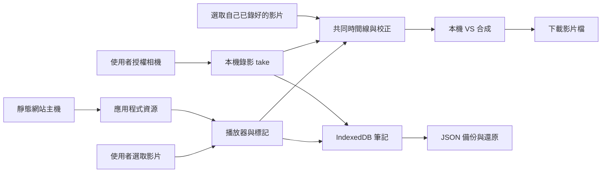

<!-- 檔案用途：產品與開發工具的技術決策索引。所在層：根文件。主要關聯：AGENTS.md、docs/PRODUCT_PLAN.md、docs/ai/HARNESS.md。 -->
# 技術設計與決策

首頁 badge 的真實數字、來源與更新限制見 [README coverage badge](#readme-coverage-badge)。
### #181／#185 整合：碼表與成片分開、工具各自收尾

像分開量找人、做影片和整體等待三站：採用 #181 最新 schema 2，人物路徑完成及 Worker 釋放後先 `endAnalysis`，原 `makeResult` 全程另量 `resultMs`，收尾才交付含 `totalFlowMs` 的整輪報告。製片取消仍保留已取得的分析與部分成片耗時、舊影片不變，失敗輪不加入成功重跑比較。回歸直接旁聽真正 MediaRecorder 建構起點，確認報告的分析耗時沒有跨入編碼，不放寬原數值門檻。原等比例補邊、原圖／補邊圖釋放、模型／8Hz 與音訊取消護欄保留；原75個瀏覽器情境原順序保留，最後新增耗時情境。

基準工具遇到 CDP 稽核故障時，原 finally 會跳過瀏覽器與主機關閉，已以受控故障重現。改為獨立收尾，稽核失敗仍嘗試 close 已知 handle，再停止自有主機；已知 PID、nonce 或資源未確認就留鎖、標失敗並保留原錯誤。九個純邊界注入案例直接執行工具 finally，沒有啟動原生程序或碰真正鎖。排除略過程序稽核、搶鎖、掃殺其他程序或把 close 成功當完整退出；未重跑長片效能基準，舊數字仍綁原版。

耗時案例的完整確認流程沿原180秒單一總預算觀察，再做原15秒idle檢查；製片取消的階段等待也扣同一總預算，取消／錯誤發生後仍先驗原15秒短恢復。像本來允許整件工作三分鐘，不能在第一個十五秒就把仍合法的分析判失敗；按取消卻仍須及時回到能操作的畫面。來源e33d32b完整CI原75案通過，新增案在idle十五秒先逾時；受控將首筆Worker訊息延後16秒（低於原30秒偵測期限）亦重現。這是測試觀察順序修正，產品的定位、推論、音訊、錄影、取消期限與全部原數值斷言不改；不把控制延遲當自然平台故障或效能資料。

整輪 CI 要連最後的下載驗證一起完成，像跑完檢查還要拿實際成品到另一台播放器打開。來源 d8edf16 的 run 41230175020 已通過76個不同情境，但離站原片／VS播放步驟被20分鐘工作上限取消；GitHub註記明示超過20m0s。只將 app-coverage 工作總預算改25分鐘，保留全部案例、原順序、180秒確認預算、15秒取消恢復及個別媒體期限。未跳過播放、解碼或備份比對，亦不把76案已過但收尾被取消的工作列為完整通過。

#176 像替每一站蓋時間章，先找練舞者等最久的一站；[本機耗時指南](docs/FOLLOW_PERFORMANCE.md)與[M4 Pro 合成基準](docs/evidence/issue-176-follow-performance.md)同時提供 ELI5 白話與技術寫法。技術上只加分段計時、P50／P95 與同輸入重跑比較，沿用主線 8 Hz、模型、追蹤與匯出；schema 2 分開分析、單側製片與總等待。85.8% 是 `5eda868` 原版基準的 detect 占比，不是後續狹框補邊及單側製片整合版的比例，也不外推成所有私人影片。

#11 固定 `5eda868` 的既有雙片原生 Safari 續驗見[本輪聲畫與保全證據](docs/evidence/issue-11-main-safari-matrix.md)：1×／0.75× 的 15 秒成片通過本輪量尺，0.5× 的提示音事件數不符即停止；長提示音的量測可靠性與音量降低原因仍待隔離。四份下載在關站後可自然播完，不能取代聲畫品質、十輪或真機驗收。

#170 讓老師與自己各有可播放、定位及下載的單側結果，見[獨立結果設計](#170-單側跟隨結果與匯出)與[短合成證據](docs/evidence/issue-170-follow-results.md)。

#11 的 Safari AAC 連續性修正見[八包有界解碼證據](docs/evidence/issue-11-aac-queue.md)：等真正 PCM 交付後才補包，保留八包未交付上限，片段結尾才 flush；三種速度各 15 秒的原生下載與關站後播放通過，完整長輪與真機仍未驗收。

#103 的更新啟用失敗收尾補測見[本輪證據](docs/evidence/issue-103-update-cleanup.md)：原訊息傳送失敗或十秒逾時後，頁面恢復、通道／監聽／計時器清理與同頁重試均檢查；產品與原期限不改，局部行數100%不代表全App100%。

版本號、更新紀錄與里程碑草稿流程見[版本與更新說明](docs/RELEASE.md#版本與更新說明)。

#165 的雙側人物框選、跟隨裁切與鏡像見[本次設計](#165-雙側人物跟隨裁切)及[合成驗證](docs/evidence/issue-165-person-follow.md)；手動對齊仍保留。

#11 固定 e6f0300 的原生 Safari 一般視窗十輪錄影／VS 成檔、完整檔案與同頁重開保全見[十輪對照](docs/evidence/issue-11-safari-ten-cycle.md)。本輪只減少旁聽並保留來源可見性紀錄，產品程式與原同步門檻未改；同來源先前第五輪失敗仍保留，不能由這次成功判定唯一根因或整體 Safari 已驗收。

#11 簡化雙片介面的原生 Safari 局部矩陣與量尺修正見[本輪證據](docs/evidence/issue-11-native-two-video.md)。14 份成片已完整下載、分析及原生播放；第七次 60 秒重複遇頁面切背景而停止，十輪與六個剩餘配置未驗收，後續工作目錄換版後不續接或重載混用。

#148 的雙側秒數尺讓使用者先定位畫面、再明確設起點，見[時間尺設計](#148-雙側秒數尺與明確設起點)。

#146 新增疊影匯出並整併比較控制，見[本次設計](#146-疊影匯出與比較控制整併)；第 48／49 節的「只供觀看」保留為初版歷史，以下節取代。播放入口的現況以「比較播放入口分區」節為準。

#103 已開舊頁遇到另一分頁升版的原生連線與備份保全見[資料庫升版回歸證據](docs/evidence/issue-103-storage-version-change.md)。回歸檢查舊頁停止保存、草稿與原片仍可另存；同輪 CI 在網站關閉後另以原生 file 播放器重開真下載。這是未知版本控制測試，產品 schema 不改。

#103 的人物背景分析回覆、重試與影格釋放補測見[背景工作單元證據](docs/evidence/issue-103-person-worker.md)。沿既有 VM／來源綁定計數器執行原 handler，量到的是背景控制碼，不是模型推論或真機品質。

#103 錄影供聲的停止、原期限逾時及原生聲音中斷回歸見[錄影供聲保全證據](docs/evidence/issue-103-webkit-capture.md)。沿原 WebKit 匯出基線與合成檔案相機，確認舊片／筆記保留及同頁重試；Chromium 條件分支測試不代表原生 Safari 或真機驗收。

整合 main `e6f0300`／靜態 `4525b1293b89a584` 的原生 Safari 九案、非零 A 重錄、重開與真正下載核對見[本輪證據](docs/evidence/issue-9-capture-recovery.md#2026-10-31-整合-main-的原生-safari-矩陣核對)。這是目前整合版的新驗證，原 #117／#119 失敗與 #130 舊候選矩陣仍保持各自來源；原 B／±100ms 未變。

整合版桌面 Safari 的錄影／VS、保存保全與未通過項目見 [2026-10-31 自主驗證](docs/evidence/safari-practice-validation-2026-10-31.md)：長輪第五輪中止、私人 VS／Blob 保存及準備逾時仍待處理；實拍、聽感與 iPhone 驗收分開記錄。

#103 相機合成影像自行播完的原生中斷保全見[來源耗盡回歸證據](docs/evidence/issue-103-native-camera-end.md)。預覽與錄影沿真正 track mute／來源 ended 通知停止，原筆記與舊 VS 保留；中斷原片下載、同 profile 重開與網站外播放另核對。這是合成來源生命週期回歸，不代表實體相機斷線或原生 Safari 驗收。

#13 的 Safari 27.0.1 普通／私人原生儲存對照見[私人影片保存界線](docs/evidence/issue-13-safari-private-storage.md)。原生雙表／雙寫即可重現缺結束通知；立即 abort 也沒有結束收據，因此維持原未知狀態護欄與 Blob 格式，只補明確另存／一般視窗使用說明，未把單次 ArrayBuffer 成功升格為格式遷移方案。

PR #119 調查時，Safari #9 的 0.75× 收尾回跳已由無產品／錄影／儲存的原生播放頁隔離至音高恢復；停止速率只把問題延到下次播放，當時未採用產品修正。現行修正見第 51 節。固定來源、原 B／100ms 失敗、真正下載與保全證據見[本輪根因調查](docs/evidence/issue-9-capture-recovery.md#2026-10-31-safari-075-收尾位置回跳根因)。

#9 的原生 Safari 恢復保全見[2026-10-31 證據](docs/evidence/issue-9-capture-recovery.md#2026-10-31-原生-safari-恢復原片)。恢復時先將組合 Blob 讀成獨立 bytes，再交原交易保存，避免清除 chunks 後新原片的共用底層檔案失效；讀回長度不符則拒絕並保留片段。此步增加一份完整原片的記憶體讀回，不改 schema、正常錄影或匯出；排除延後到刪除後才檢查、永久保留重複 chunks、Safari UA 特例及自動裁切原片。真機與完整 Safari 錄影矩陣仍未驗收。

老師半透明與自身錄影的疊影比較，其混色原理與共同時間線見第 48 節；團體示範的放大縮小、X／Y 移動與白話教學見第 49 節。

2026-10-30 的四線來源、收尾衝突保留及封裝結論見[既有整合證據](docs/evidence/p0-safari-reliability-integration.md#2026-10-30-四線整合候選)。產品採 #87 的 chunks 影格確認修正，靜態 7c728c8a5bd7fa2f；其餘三線原生結果維持舊版歸屬，不以整合或合併替代驗收。

新 VS 成檔後的保存尾段回歸見 [#11／#13 證據](docs/evidence/issue-11-vs-save-tail.md)：沿用 `persistExport` 不借用 `active.signal` 的保全契約，新增 Stop／原生拒絕與明示缺通知的可重跑入口；沒有更改產品設計或放寬品質護欄。

#11 已保存十份 Safari VS 的示範側逐格停格、來源覆蓋及 600 組閃光／提示音量測見[獨立檔案分析](docs/evidence/issue-11-reference-file-quality.md)。這是固定 e6f0300 舊來源的局部品質證據；練習側沒有二進位碼，不能由示範側結果宣告兩側同步或完整 G2／G3 通過。

最新可及性決策見第 20 節，下載包與發布準備見第 21 節；#74／#75／#76／#78 的來源固定與共存驗證見第 44 節。後續匿名證據與授權副本的封裝修正見第 45 節。前面標記原型階段的限制保留歷史版本歸屬。
分類、動作庫、練習歷史與 v1→v2 相容決策見第 26 節。

Safari 有界本機音訊候選的格式與資源取捨見第 33 節；這不是整體 Safari／P0 通過聲明。 Safari VS 的 WebM 專用匯出與原生原型界線見第 36 節。

#9 的半速錄影起播延遲與錄影音高歷史取捨見第 50 節；原生數據與未驗項沿用[本票證據](docs/evidence/issue-9-capture-recovery.md#2026-10-31-半速錄影起播延遲)。

#119 的 Safari 收尾回跳續修採錄影期間有界供聲、一般練習保持音高，設計及排除方案見第 51 節；原生證據與未驗項見 [#9 續修紀錄](docs/evidence/issue-9-capture-recovery.md#119-續作錄影聲路與一般練習音高)。

選定筆記分享的原始設計見第 27 節；整合格式取捨另記。

狀態：2026-10-28；已加入桌面 Web 預覽版、既有影片比較與 AI harness；未完成整體 P0／手機驗收。工具測試與產品／真機驗收分開記錄。需求以 [PRODUCT_PLAN.md](docs/PRODUCT_PLAN.md) 為準。

#3 的早期 macOS Safari 同步／私人副本失敗見[歷史證據](docs/evidence/issue-3-safari-feasibility.md)，各原生結果保持來源歸屬。一般新視窗不需改 Profiles，保存／關窗取回對照見第31節；有界音訊候選見第33節，與資料保護整合見第34節。原生續測已解鎖，99e862d 的私人未確認退出／原頁重開及一般保存收據見第19節；完整 Safari 品質、新 VS 未確認救援與裝置驗收仍保留。最新候選來源及整合界線見[整合證據](docs/evidence/p0-safari-reliability-integration.md#2026-10-29-最終-web-候選整合續作)，不以來源實測移記整合 head。

### 選片、預覽與命名（2026-10-30，#95 後續）

使用者介面的兩個角色固定為「示範影片」與「練習影片」；左／右只表示預覽位置，DOM 與資料欄位仍沿用 `reference`／`self`，避免純命名調整破壞既有配方與備份。選片卡、播放器可讀名稱、鏡像設定及載入提示共用這組用語。

延續 PR #98 的對應卡片佈局，各側用原生 `details` 包住選片按鈕與說明，預設展開；影片完成解碼且資料提交成功後才自動收合，摘要以純文字保留所選檔名。取消、壞檔及保存失敗維持原片、檔名及展開狀態。重開缺片或更換示範後清除不再適用的摘要；讀回已存影片則顯示載入狀態，不猜原檔名。

播放器、起點按鈕與重連確認放在收合區外，收起選片後仍能直接看第一格與確認重連；鍵盤焦點回到摘要，使用者已移到停止鍵則不搶回。排除收起整張卡片（會藏掉預覽）、強制自動播放（會干擾找起點與聲音）和額外 UI 套件。此調整不改解碼、同步、合成、保存規則或備份格式；瀏覽器回歸讀取合成素材的真實非黑影格，不能將此當作完整媒體或真機驗收。

## #165 雙側人物跟隨裁切

像拿一個小相框跟著影片裡的人走：先選好兩支影片與要比較的時間，再在老師卡按「框選老師並自動跟隨」，在自己的卡按「框選自己並自動跟隨」。每側從實際共同起點顯示原片，拖曳框住完整身體並留手腳空間；也能填位置、寬高百分比，或用方向鍵移框、Shift＋方向鍵改大小。按確認後只在裝置分析該段。接著播放共同預覽，檢查全段是否跟對人，兩側鏡像可分別切換；左右並排與疊影下載都保留目前的跟隨裁切。原片仍完整保留。

框選畫面保持原片方向；鏡像在裁切後套用，所以改方向不會把追蹤目標換成鏡中的人。每側可暫停跟隨或清除選框。擴大比較範圍超過已分析區間時，需重新分析或關閉該側跟隨，不能拿舊路徑冒充新片段。設定只留本頁，重開需重選，已下載／保存的成品 bytes 不變；JSON 不攜帶追蹤路徑。取消、人物不明確或分析失敗都保留上次成功的路徑與原片，成功換片只清除該側路徑。

本機 Worker 使用固定 `@mediapipe/tasks-vision` 1.2.0／EfficientDet-Lite0 int8 revision 1，8 Hz 對解碼影格做 person 類別偵測。首次只看使用者選框，後續在前次人物框周圍擴大搜尋，再把座標映回原片；避免寬畫面的大片背景把人物縮得太小。手動選框決定初始目標，後續依框重疊、距離與身體高度比維持連續性；兩個候選太接近不強行接手，短暫漏偵測沿前次位置，超過 0.75 秒則整輪拒絕，並提示重新框選／縮短片段。這些是追蹤失敗策略，不改 RECORD_COMPARE 的同步品質門檻。人物框的中心及高度變化映射至使用者選框，三點對稱平滑後按來源秒數插值；來源秒數由原共同時間線的 positions 提供，沒有新播放器時鐘或即時推論壓力。

2026-11-01 漏偵測續修：狹長選框不再直接送入方形模型。像把長照片原樣放在方形卡紙上，Worker 先用灰邊補成方形，身體不被拉寬；老師與自己都共用這一步。推論後扣掉灰邊偏移、裁回原選框並正規化，完全落在灰邊的框丟棄。補邊不進預覽或成品，不改選框、搜尋範圍、模型／分數、多人歧義與失聯護欄。原圖與推論用 ImageBitmap 都在 finally 釋放。排除擴大選人範圍（會帶入鏡中人／旁人）、降低分數與沒有偵測結果也假裝跟隨。截圖重現與合成回歸見 [#165 續修證據](docs/evidence/issue-165-person-follow.md#2026-11-01-狹長選框漏偵測續修)。

上游 [ImageToTensor 的比例選項](https://github.com/google-ai-edge/mediapipe/blob/master/mediapipe/calculators/tensor/image_to_tensor_calculator.proto)區分保持比例補邊與拉滿 tensor；本次以同一固定模型的本機前後對照驗證輸入處理，沒有升級依賴或只靠上游說明宣稱修好。

分析使用獨立靜音 video，不改現有兩側播放器或原檔。這個播放器不掛上螢幕，只等解碼 seeked 再取 ImageBitmap；不能套用匯出用的螢幕呈現通知，否則相同位置的第二次取樣會逾時。既有預覽／匯出的呈現護欄不改。每輪一個 Worker，取消／錯誤／逾時終止，ImageBitmap 每次釋放；只有完整成功才提交新路徑。共用 sourceCrop 在左右／疊影繪圖前取來源矩形，既有 contain、鏡像、疊影大小／位移與匯出器接續處理。分析期間鎖定來源與設定；路徑 revision 加入成品新舊簽章，避免重新框選後把舊成品標為目前設定。

模型與必要的非 SIMD CPU WASM 約 17 MB 隨靜態包與離線 manifest 提供，無 CDN、API key、付費 API、影片上傳或模型 runtime 網路依賴。CSP 僅增加 wasm-unsafe-eval，沒有開放 JavaScript eval 或跨來源。模型與 WASM 逐一固定 SHA256；建置和封裝拒絕未知 bytes，其餘公開文字仍做原掃描。Apache 授權見 THIRD_PARTY_NOTICES。拒絕雲端推論（隱私／成本）、只追固定像素模板（轉身變化更脆弱）、第二套匯出器（畫面易與預覽漂移）、把路徑寫入既有 recipe（增加本次不需要的格式遷移）。

這是區域偵測加連續性判斷，沒有生物辨識或姿態評分。遮擋、快速走位、相似衣著、多人交錯及鏡面仍可能跟錯，使用者必須預覽檢查；不宣稱與參考 App 品質相同。真人舞蹈、Safari、實體手機及完整 G1–G7 需另驗，不從合成素材推論已通過。

## 雙片檔案量尺的 WebM 片長與自然音高

像影片少了一張寫片長的標籤，檢查工具現在會把整段畫面與聲音讀完，再量出長度；不把預定的秒數當成實際結果。用 `python3 scripts/analyze-comparison.py <下載檔>` 核對合成測片；用 `python3 scripts/check-comparison-analyzer.py` 檢查量尺能接受好檔、拒絕刻意做錯的檔。兩者需本機 FFmpeg／ffprobe，媒體工具使用前須遵守共用測試鎖。

Safari WebM 缺 format.duration 時，沿既有 v5 方法使用最後視訊 PTS 加中位影格間距、完整保留時間原點的 8kHz PCM 尾端取較長值；有容器片長仍使用原欄位。兩側來源碼另核對起末覆蓋與全片時鐘，避免一起截短／重播卻看似同步。原 100ms 同步、250ms 停格／來源時鐘及 v5 完整長度門檻不放寬。聲源沿 comparison-pitch 的 660×rate 自然變調，須達原峰值下限且勝過非預期 660／880Hz；保留 source660Hz 原欄位並新增實際預期頻率／幅度。不採寫回容器、重編碼原片、以要求片長代填或沿用慢速固定 660Hz。連續音只能驗聲源／音高，不能證明閃光與音訊的絕對時間差或人工聽感。

## #170 單側跟隨結果與匯出

不用先找疊影或左右並排：選好兩片與片段，按老師／自己的框選按鈕，框住完整身體。分析完會在本機製作一支只看這個人的影片，約需片段本身的長度；完成後各自綠框裡就有播放、暫停、時間尺與匯出連結。看見的影片與下載的是同一份，所以可以先各看各的，再到下方比較。老師片帶老師原片聲音，自己片帶自己原片聲音，兩邊都用原速；下方比較速度與 VS 音訊規則維持原規格。

每側鏡像控制移到結果框。改鏡像後，既有結果會明確標「先前設定」，更新按鈕變明顯，下載文字改為「匯出上次…」；按更新後才用原追蹤路徑重製影片，不必重新推論。成功換片／清除選框仍保留舊下載並標示來源不同。取消、分析或編碼失敗都不換掉上次的路徑與影片；成功產生新片後替換該側上一份預覽／下載，想保留舊版請先下載。這些結果只留本頁，不放進 IndexedDB、備份或 VS 清單。

`follow-export.js` 使用同一 `record`／`seek`／`presentedFrame`／有界 Safari 音訊工具，建立一個僅製作期間存在的靜音輸出聲路，不重新掛接原片播放器的 MediaElementSource。Chrome 從臨時原片元素取得該側音軌，Safari 沿既有有界 AAC 路徑；原片只讀。先暖機、回原片片段起點、繪製第一格，再開始捕捉。原速走來源秒數、30fps 請求與前景限制，沿原 100ms 聲畫及片長護欄；取消／離開前景即停止本輪，收尾關閉 AudioContext、來源／目的節點、tracks、callback、臨時 video 與 URL。

共用 `drawFollow` 從同一追蹤路徑裁切後鏡像，`followSize` 依初始選框比例取偶數尺寸，長邊最多 1280，避免刻意放大低解析原片。獨立解碼核對尺寸與片長後，UI 才一起交換新路徑和新 Blob URL。WASM 推論完成就先終止 Worker，製作影片不需同時保留模型記憶體。結果用兩個原生 video 顯示同一份成品 Blob，直接取得各自的播放／暫停／seek 與鍵盤操作；播放其中一個會暫停其他結果與原片，停止鍵也涵蓋結果播放器。來源與既有 VS bytes 不受影響。

選擇先製作真正成品再顯示，讓預覽與下載完全相同，代價是每次首次分析後多一段約等於片長的製作時間。排除再做一套 canvas 播放控制與時鐘（增加理解與同步負擔）、CSS 翻整個 video（會翻轉原生控制文字）、把單側影片存成 VS（資料語意錯誤）及自動上傳。兩個結果播放器與生成器都屬同源靜態白名單，無新套件。原生 Safari、真人、實體手機、長片品質與完整 G1–G7 仍需另驗；本次短合成證據不代表上述已通過。

## 1. 架構結論

第一候選：**TypeScript + Vite + Svelte，靜態 Web／PWA，原生媒體 API，IndexedDB（透過 Dexie）保存筆記。** 不需要 SSR、登入、SQL 雲端、付費影片平台或訂閱表。

這是可驗證的選擇，並非因為「換框架就能解決錄影」。最先做的工作是用最小 Web 頁面驗證手機同時播放與錄影，以及 VS 影片匯出。若 iPhone Web 過不了門檻，保留 Web 筆記，先以 SwiftUI + AVFoundation 做 iOS 媒體功能，再考慮 Android。

沒有由 App 發出的「媒體 → 雲端」箭頭。首次網站載入／更新仍會連線到靜態主機；不是完全沒有網路活動。相機與影片資料不跟隨程式更新上傳。P1 分享由使用者匯出檔案後，自行透過個人雲端或 AirDrop 傳送；這不新增 App 的影片儲存後端。

## 2. 框架選擇：依維護成本，不依偏好綁定 Vue

以下為本專案工程判斷，不是框架跑分。

| 候選 | 優點 | 本專案代價 | 決策 |
| --- | --- | --- | --- |
| Svelte + Vite + TypeScript | 適合小型互動介面；編譯式元件；易分離媒體核心 | 維護者需熟悉 Svelte 反應式生命週期 | 預設候選；可行性確認後鎖版本 |
| Vue + Vite + TypeScript | 單檔元件、成熟工具；若維護者更熟悉可降低時間成本 | 不因既有偏好自動採用；仍需相同媒體驗證 | 合理替代；不必用 Nuxt |
| React + Vite + TypeScript | 元件與工具選擇廣 | 需避免 effect 重複掛相機／音訊事件；不是不可用 | 有熟悉貢獻者時可選 |
| 原生 TypeScript | 驗證媒體路徑最快、依賴少 | 大量表單、時間軸、狀態整合後維護成本增加 | 用於第一個可行性原型 |
| Nuxt／Next／SvelteKit 全端 | 路由與伺服器能力完整 | 本期沒有 SSR、API 或帳號需求 | 不引入伺服器運行需求 |
| Flutter／React Native／Capacitor | 可包裝行動應用 | 仍需原生媒體實作；包 WebView 不會自動修復瀏覽器限制 | 不作第一步；iOS gate 失敗才比較 |
| SwiftUI + AVFoundation | 直接控制 iOS 相機、音訊、時間線與合成 | 第二套 UI／資料儲存、簽章及發佈成本 | iOS 備援首選，必須先有失敗證據 |

參考官方文件：[Svelte](https://svelte.dev/docs/svelte/overview)、[Vue](https://vuejs.org/guide/introduction.html)、[React](https://react.dev/learn)、[Vite](https://vite.dev/guide/)、[AVFoundation](https://developer.apple.com/av-foundation/)。版本、授權與依賴樹在建骨架時重新確認並鎖定，本文不指定未驗證的最新版本。

## 3. 模組邊界

不先建立 monorepo、通用外掛市場或抽象同步引擎。以下是未來檔案分工建議，現在不存在：

| 模組 | 責任 | 邊界 |
| --- | --- | --- |
| domain | 時間區間、標記、take 與比較配方驗證 | 不依賴 UI、DOM 或雲端 |
| media | 載入／seek、鏡像、速度、A–B、相機錄影與匯出 | 一個媒體資源由一個 owner 清理 |
| storage | IndexedDB 交易、migration、媒體副本與分段寫入 | UI 不能自行繞過儲存流程 |
| transfer | JSON 匯入／匯出、媒體重新連結、衝突副本 | 外部資料視為不可信，不執行 HTML |
| ui | 影片庫、練習、錄影、比較、資料管理 | 不把播放時間每一影格寫進全域 store |
| capability | 能力偵測與實測支援表 | API 存在不等於整條流程成功 |

只在實際出現第二個平台實作時抽 adapter。跨平台共同契約是資料交換格式與驗收範例，第一版不強求 Swift 與 TypeScript 共用執行碼。

## 4. 本機儲存與恢復

筆記與索引進 IndexedDB，Dexie 減少交易及 migration 樣板；不啟用 Dexie Cloud。示範原片預設是當次選取的 File，object URL 只在當次生命週期存在，不能當永久路徑存起來。重開後透過重新選檔連回筆記。

「保存離線影片副本」採明確選擇；初期試驗 200 MiB 以下單檔，這是待實測的產品護欄，不是瀏覽器保證容量。較大原片可繼續用重新選檔模式。錄影的 chunks 需逐步落盤並保留順序／MIME；最終完成前不宣稱可播放，殘留 chunks 不一定能單獨解碼。

先比較 IndexedDB Blob 與 OPFS 的真機可靠性，再固定媒體後端；筆記永遠不與大型媒體寫入綁在同一個長交易。寫入 staging → 成功關閉／檢查 → 更新 metadata 為 ready；中斷留下 failed／recoverable 狀態，下次提供重試或清理選項，不自動刪原片。

`navigator.storage.estimate()` 只供估計，`persist()` 可能未獲准。即使獲准，使用者清除網站資料仍會刪資料；備份是必需功能。多分頁以 revision 檢查防止覆寫，migration 遇到舊分頁時提示關閉；不做 last-write-wins 靜默覆蓋。來源：[Storage API](https://developer.mozilla.org/en-US/docs/Web/API/Storage_API/Storage_quotas_and_eviction_criteria)、[persist](https://developer.mozilla.org/en-US/docs/Web/API/StorageManager/persist)、[Dexie](https://dexie.org/docs)。

### P1 分享：檔案交換，不新增服務

2026-10-27 決策：[#18](https://github.com/sunpochin/dance-stamp/issues/18) 第一版只在 `transfer` 邊界做選定筆記檔匯出／匯入與媒體重新連結。沿用 [DATA_FORMAT.md](docs/DATA_FORMAT.md#6-分享格式p1) 的 `kind=share`、欄位篩選、ID 關聯與影片分離規則，不新增雲端網址欄位或憑證儲存。

使用者在 App 外自行使用 Google Drive、Dropbox、iCloud Drive 或 AirDrop 傳檔。下載／選檔匯入為基線；系統分享僅作能力偵測後的選用入口，取消或失敗保留原資料。App 無法確認外部傳送結果，不把匯出或系統分享回傳當成「已送達」。接收者先取得檔案，再人工確認影片配對；不把雲端分享頁當可直接播放的媒體來源。

選擇此方案是為了讓核心功能不依賴供應商帳號、免費配額或後端維運。排除自建影片儲存／上傳中繼、供應商 API／OAuth 直連、自動同步及大型 ZIP 打包；前者增加憑證、權限與服務維護，後者增加手機記憶體壓力。若日後需要直連，另提規劃與授權；本次只更新設計，未宣稱已通過裝置驗收。

## 5. 播放與相機

### 既有影片入口（2026-10-28 桌面實作，#10／#11）

「比較已有影片」接受老師課後原片與自己的練習原片，無須呼叫相機／麥克風。復用既有選片驗證、take／recipe、共同時間線及 VS 合成；不建立第二個剪輯器。首頁與老師片頁提供明確入口，取代只靠「載入自拍測片」發現功能的用法。外部原片預設 session-only，保存副本須明確操作，不能沿用相機錄影流程而暗中複製檔案。

老師 A–B、自己的起點 C 及固定 r 使用 [RECORD_COMPARE.md](docs/RECORD_COMPARE.md) 的同一映射，C 初始化 offset，不另增第二份起點欄位。新配對預設原速；使用者確認慢速跟跳才選既有固定比例，不把兩段片長比當成速度。資料關聯、舊 v1 相容與更換配方規則見 [DATA_FORMAT.md](docs/DATA_FORMAT.md)。桌面 runtime 已接入，交換格式維持 v1；實測範圍見[既有影片證據](docs/evidence/existing-comparison.md)。

排除強迫重新錄影、要求外部裁片／拼片、雲端上傳轉碼與自動 AI 對拍：使用者已有兩片，應可本機選取和手動對齊；原片保持不變，也不引入額外服務。#10 的外部影片入口依賴 #5／#6，可先於相機流程驗收；#9 僅是工具內錄影接入的依賴，整體 P0 仍保留兩條路徑的驗收。

2026-10-28 桌面實作：正式入口及兩側起點按鈕共用既有原生播放器。外部 File 只存本次頁面的 asset→File 對照，metadata 直接建立 ready take；只有明確按保存才使用既有原子 metadata／Blob 交易。候選影片實播及 metadata 寫入成功後才釋放舊 URL，quota、revision 衝突、取消與壞檔均回復舊片。

改動 A／B 或固定比例時另建 take／recipe，共用同一原片 asset；offset／鏡像只提高 recipe revision，舊輸出仍可下載並標明設定差異。輸出辨識包含兩側媒體身分，避免同時長的新片被誤認為上一組輸出。重新連結先載入保存的配方，再讓使用者預覽原片、明確確認；既有 v1 JSON 不加欄位、不改版本。

比較設定保存採同一佇列，避免失焦保存吞掉按鈕點擊或 revision 互撞；佇列等待只保證前件結束，單次 quota／revision／seek 失敗由該件獨立回報。拒絕讓 rejected Promise 永久阻擋整個操作入口，因為使用者必須能在不重載、不丟失 session File 的情況下備份與下載原片。預覽／匯出仍各自重新保存目前配方，實際失敗照常顯示，不繞過原子交易或 revision 保護。

共同預覽可一起暫停，再拖動時間線與繼續；合成固定從交集起點開始。自己片強制靜音，老師無音軌時輸出無聲；音軌資訊無法偵測的瀏覽器顯示條件式說明，不用尚未解碼的 0 bytes 冒充「沒有音軌」。沒有新增框架、雲端服務或 runtime 依賴。驗收工具使用二進位影格碼與不同頻率合成聲源，從下載檔獨立解碼，而非把 JS drift 當作成檔同步證據。

兩側使用 `requestVideoFrameCallback` 持續消費真正的影格更新；rAF 保持共同時鐘及 30fps 繪製節奏，缺少影格 callback 時保留 rAF 路徑。Chrome 的合成採 `captureStream(0)`，繪製後呼叫 `requestFrame()`；缺少該能力時先停止初始串流，再退回自動 30fps。停止、取消及失敗都清掉兩側 callback 與輸出 tracks。依據 [影片影格通知](https://developer.mozilla.org/en-US/docs/Web/API/HTMLVideoElement/requestVideoFrameCallback)與[手動擷取](https://developer.mozilla.org/en-US/docs/Web/API/CanvasCaptureMediaStreamTrack/requestFrame)的原生能力，偵測不能代替成檔驗證。

測試曾在慢速素材留下約 267ms 舊畫面，但 JS 繪製間隔仍約 20ms；僅改手動擷取或 CPU 畫布都未消除。讓比較持續接收兩側真正影格更新後，針對性實測才通過。故不把播放時間、編碼 fps 或 JS drift 當作 G2／G3；驗收仍獨立讀回下載檔的影格碼及音軌，門檻沒有放寬。

#11 補充驗證沿用同一匯出流程，直接注入格式啟動／編碼／新檔讀回失敗及取消，核對上一支成功 VS、兩側原片與配方仍可用，再同頁重試原生 WebM。以短橫／直式邊界素材逐格獨立解碼檢查 contain、鏡像與單一老師聲源，不另建編碼器、雲端轉碼或產品內自動故障測試。這份靜態色條證據只補失敗與成檔內容，不替代 G2／G3 長片矩陣；版本與結果見 [#11 匯出證據](docs/evidence/issue-11-export-failure.md)。

### 共用播放與相機規則

- #89：影片庫的「選擇硬碟影片」同步開啟既有示範選檔欄位，沿用相同解碼、失敗回滾與人工重連確認；不新增第二份載入狀態。三個影片欄位一律使用 `.mov,.mp4,.m4v,.webm,.mkv,video/*`，避免系統僅憑 MIME 分類排除原片。筆記匯入明確標為 JSON，保留 `.json,application/json`。排除把影片交給 JSON parser、取消格式檢查或另建上傳／轉碼流程；可選取不代表該裝置能解碼所有 codec。
- 同票的介面釐清：區塊改名「影片與練習筆記」，日常先選片或開啟舊筆記；備份／分享／刪除收進原生 `details`，v1／v2 說明再收進進階項目。影片保存清單保持獨立，備份與匯入後仍可自動展開。排除完整影片＋筆記打包或改資料格式，因本次問題是用途與入口混淆。
- `input type=file` 為跨瀏覽器基線；`showOpenFilePicker` 是能力偵測後的選用增強，不能成為 iPhone 的必要入口。[File API](https://developer.mozilla.org/en-US/docs/Web/API/File_API)、[picker 支援限制](https://developer.mozilla.org/en-US/docs/Web/API/Window/showOpenFilePicker)。
- 以 `loadedmetadata`／`seeked`／播放結果決定狀態；副檔名、MIME 和 `canPlayType()` 只能提示，不保證實際解碼。HEVC、旋轉、HDR、可變影格率均要真片驗證。
- A–B 優先使用 `requestVideoFrameCallback` 觀察顯示時間，fallback 用前景動畫迴圈及媒體事件；seek 有 in-flight 鎖，離開頁面清除 callback。背景暫停，恢復前重新定位。它不是逐格精準／無縫音訊循環保證。[rVFC](https://developer.mozilla.org/en-US/docs/Web/API/HTMLVideoElement/requestVideoFrameCallback)。
- 只鏡像影片／輸出圖層，不翻轉控制文字；預設 `preservesPitch`，不支援則顯示限制。[音高](https://developer.mozilla.org/en-US/docs/Web/API/HTMLMediaElement/preservesPitch)。
- 相機只在使用者進入錄影流程後請求；預設不開麥克風。停止、取消、離頁都釋放 track；中斷停止錄影並嘗試保存已完成部分。
- 同時播放／相機／音訊與匯出細節以 [RECORD_COMPARE.md](docs/RECORD_COMPARE.md) 為準。

### 練習片段預設完整影片（#161）

新選示範與重新開啟影片筆記時，A 為 0、B 為影片 metadata 的完整毫秒長度換算成秒；未載入影片時結束欄留空。移除這兩個入口的 15 秒預設，不新增設定或另一份片段狀態。手動 A／B、標記跳轉及既有 take 配方仍沿原入口還原，不改寫保存資料。

完整影片可直接循環練習；比較、錄影與匯出的原 60 秒護欄仍適用，長片需先手動縮短再建立比較或錄影。排除把預設改成 60 秒：那仍會把使用者想練的整支影片截短；也不因預設範圍放寬媒體品質與錄影限制。

### 比較播放入口分區（#166 後續）

左右比較和疊影比較各有一個獨立區塊，在想看的區塊按「播放左右比較」或「播放疊影比較」，不再從同一顆模糊的播放鍵找畫面。可調並排放在左右區，原並排仍預設展開；共同時間線、起點及「一起暫停」沿用同一組，不會多出聲音或另一套進度。

兩個具名 sibling section 各自放播放鍵與對應 canvas，`aria-controls` 指向該區畫面。兩鍵共用既有 operation／timeline，只以入口名稱標示目前播放；保留同一對解碼來源及更新中的比較畫面。播放鍵移出 compare fieldset 後，改由 updateOverlayControls 明確承接 fieldset、有效比較／匯出區間與保存未確認的停用條件，忙碌時兩鍵一起鎖定，結束後恢復原觸發鍵焦點。簡化介面的缺片隱藏規則同時涵蓋兩個 section。

排除兩套播放器、音訊或獨立操作鎖，也不新增重複暫停鍵；這次解決入口與畫面混在同區的問題，沿用原時間、同步與匯出規則。瀏覽器回歸從兩個實際入口驗鍵盤播放、狀態、忙碌封鎖、共用暫停與資料保留，原生 Safari／真機未驗證。

### #166 額外的可調並排試看

原並排下方另放一個試看框，像把左右兩張照片各自放大、移近中間，方便把人物調到相近大小。左右各有大小、左右與上下滑桿，一鍵重設回原並排畫面。超出自己半邊的畫面會被遮住；先用來比較觀看效果，原並排、疊影與下載結果仍使用原設定。

沿用兩個已解碼 video 與共同播放／定位時鐘，新增獨立 1280×720 canvas；沒有新增播放器、音訊節點、影格迴圈或依賴。從疊影抽出 `drawVideoLayer`，維持其原混色／鏡像結果，讓兩種試看共用 contain、局部縮放、螢幕座標平移與 try/finally 還原。可調並排每側先 clip 到 640×672、下移標籤區 48px，然後等比繪圖；初始水平 anchor 分別為 1／0，與原並排朝中線靠齊一致。縮放繞原 contain 圖片中心，大小 25–400%；X／Y 為各自半框寬／高的 −200–200%，不因鏡像或放大反轉／倍增移動量。

設定只留本頁，與疊影六值獨立，不寫 recipe、備份或輸出外觀。沿已提交來源 URL 組合重設兩組空間控制；壞檔或取消還原同一來源時保留。缺片／非法區間隱藏試看並停用控制；共同預覽中可調整，匯出／保存期間鎖定。共同 draw 只在更新預覽時繪此框，逐幀合成不額外繪製。

排除 CSS 縮放整個比較框（兩側會一起變）、新建兩個 video（增加解碼與同步負擔）、讓左右層跨中線互蓋，以及直接改原片或新增匯出格式。此版刻意先讓使用者同頁看原並排、可調並排及疊影的差異；實際動作判讀是否更好仍需使用者試看，原生 Safari／真機與完整媒體門檻另記。
同步 #164 時保留整段影片的練習預設與可先編輯的範圍欄位；可調試看仍沿原比較護欄，長片先選短段再建立比較，不放寬錄影或匯出限制。
同步 #167 時，三種畫面沿用同一人物跟隨來源裁切，再套各自的手動對齊；不另算追蹤，也不把試看位置寫入跟隨或匯出設定。回歸以真正模型完成雙側分析與鏡像後，比對可調並排預設和原並排的像素，避免整合時只保留其中一種功能。

## 6. 離線、發佈與安全

### #157 新版提示與同意後立即更新

有新版時，畫面角落會自動出現提示與「立即更新」，捲到頁尾也看得到。先保存筆記、原片與輸出，按下按鈕才同意重新載入；不按就繼續用目前版本。播放／相機、錄影、匯出、保存及未完成編輯會先擋住，提醒完成或取消。其他本站分頁也須先保存並關閉，避免一頁同意卻打斷另一頁；只有目前這頁時不必關頁重開。已存筆記／影片保留，僅留在當頁的原片須重新選取，提示會事先說明。

沿用自動檢查、完整 manifest 驗證與 waiting 候選。提示使用非阻塞 `role="alert"`，不使用會暫停頁面事件的 `window.alert`／自動 modal；不按鈕就不發啟用訊息。離頁與更新共用草稿檢查，另保護保存佇列、播放及相機；按下後暫時將本頁設為 inert，避免檢查他頁期間又開始操作。候選 worker 收到明確 `ACTIVATE_UPDATE`，以 `clients.matchAll({type:'window', includeUncontrolled:true})` 確認唯一 client 就是發起頁，才執行 `skipWaiting`。本頁只在該候選真正成為 controller 後 reload；首次尚未受控制的頁面則等候選真正 activated。拒絕、例外或十秒內未完成均解除互動封鎖並提供重試。安裝仍不自動 skipWaiting，不 claim，不清 IndexedDB 或媒體；原本全部關頁後啟用仍可用。

排除自動重載、同意一頁便重載全部分頁，以及只呼叫 reload 卻仍被舊 worker 控制的做法。多頁自動協調會增加跨頁鎖與草稿保存協定，本次採保守拒絕；這不是 JavaScript 模組熱替換，而是同意後完整換版。已開著的舊程式不會憑空長出此按鈕，首次須正常換到含此功能的版本。瀏覽器回歸涵蓋草稿、多頁拒絕、真實 waiting／controllerchange、單頁點按換版、完整筆記及無關 cache 保留；原生 Safari／手機與實體媒體品質未在此改動中驗證。

PR #92 後續同步 #95／#102 主線時，瀏覽器回歸沿用新版「選擇示範影片」欄位與收合工具操作，只將固定預覽入口保留在 4174；不能為解衝突恢復舊欄位名稱或退回 4173。主線新增的介面、透明疊影與覆蓋率檢查均保留，整合結果重新驗證，不沿用舊 head 的通過紀錄。

2026-10-30 PR #92 與主線整合：開發與下載包預設固定 4174，保留 #94 的 `--watch` 判斷及命令列優先、環境參數其次的順序。不能恢復只讀 `process.argv[2]` 的舊寫法，因開發入口會先傳 `--watch`，導致連接埠無效。Cloudflare 沿用主線已審查的靜態建置及 `previews` 設定，排除另建部署入口或把本機即時更新工具帶入雲端產物。

#94 本機即時更新：`bun run dev` 明確啟用 loopback 的 `--watch` 主機，沿用原建置並監看 `web`／必要建置檔；同一時間只跑一份建置，成功後才公布新版本。開發腳本每秒只讀版本，閒置自動重載；有輸入、原片／串流、輸出或忙碌操作時保留工作，改由保存後的按鈕重載。失敗不換版本，保留上一個成功頁面。

開發 HTML 才注入外部腳本與標記；`offline.js` 只在 loopback 且有該標記時跳過正式 SW。原 SW 等舊頁結束後由開發替身自行 unregister，不 skipWaiting、不清 cache／IndexedDB；因此已有離線頁第一次切到開發模式須關閉再開。下載包、Cloudflare 與一般 `serve-web.ts` 沒有開發路由，離線驗收仍用一般主機。排除額外框架／WebSocket 依賴及熱替換媒體全域狀態，以免丟失只在本次頁面存在的 File；整合回歸以自有原始碼副本實際改檔，驗證草稿／原片保留與失敗恢復。

2026-10-30 PR #90 預覽修正：`wrangler.jsonc` 明確指定先執行既有 `bun run build`，再上傳 `dist/web`，沿用已存在 Worker 的相容日期。未宣告入口時 `versions upload --dry-run` 會直接失敗，而 `deploy` 自動偵測可能把 `web` 當成靜態目錄，漏掉 SW manifest、授權與 `_headers`。排除依賴自動偵測、把整個 repo 當 assets、新增 Worker 後端或雲端媒體服務；此設定只提供靜態資源入口，正式版本切換仍需另行授權。PR 測試使用既有 version URL，與正式站分開驗證。

同票補充：使用者提供的建置日誌確認 Cloudflare 自動流程實際使用 `npx wrangler preview`（Wrangler 4.156.0），建置已成功，失敗點是缺少 `previews` 區塊；因此加入空的 `previews`，讓預覽繼承頂層 assets／相容設定，不改 dashboard 或正式 deploy 命令。手動 `versions upload` 成功不能代替自動 Preview 流程成功，兩者結果分開核對。

靜態檔可由免費主機或使用者自己的本機 HTTP server 提供，沒有必需後端。PWA 只 precache 應用資源，不把私人影片放公開 cache URL；未載入過的網站不能第一次離線啟動。使用 HTTPS 或受信任 localhost，不能只叫使用者雙擊 HTML 就保證相機／離線能力。

更新採「有新版 → 保存工作 → 使用者重新載入」。禁止錄影／匯出中強制切換 service worker；破壞性 migration 需先備份，不把 app 檔回滾當成資料可自動回滾。[Service Worker](https://developer.mozilla.org/en-US/docs/Web/API/Service_Worker_API/Using_Service_Workers)。

GitHub Pages 可當免費靜態候選，但有容量／流量／使用政策限制，不能用來放私人練舞影片。`sunpochin.github.io/dance-stamp/` 與同網域其他 repo 頁面共用 origin；不同路徑與 DB 名稱不是安全隔離。發佈前須盤點同 origin 信任邊界；有不受信任內容時改用可免費取得的獨立站點 origin，或保留專用 localhost 入口，不直接宣稱安全上線。[Pages 限制](https://docs.github.com/en/pages/getting-started-with-github-pages/github-pages-limits)。

使用純文字筆記、匯入大小／數量限制、CSP 與依賴鎖檔；不自動讀取筆記中的遠端 URL。禁止第三方追蹤、遠端字型與媒體分析 SDK。診斷匯出必須預覽並移除檔名／影片／筆記正文。

## 7. 排除的替代方案

| 方案 | 本期不採用原因 | 何時重評 |
| --- | --- | --- |
| Supabase Auth／雲端 DB／RLS | 本機單人資料不需帳號與服務維運 | 使用者另行要求自架協作 |
| Cloudflare Stream 等託管轉碼 | 無法承諾影片用量成長仍零費用 | 不在本路線圖 |
| 免費雲端配額拼湊／自建影片儲存 | 免費方案會變，不能當免費永續的核心；#18 改由使用者自行傳檔 | 不作核心依賴 |
| Google Drive／Dropbox／iCloud 的 API、OAuth 直連及同步 | 檔案匯出／匯入已滿足第一版分享，不增加憑證與權限維護 | 使用者另行要求並核准規劃；不阻擋 #18 |
| FFmpeg.wasm 全量轉碼所有影片 | 手機 CPU／記憶體／耗電與等待時間大 | 只有明確短片格式缺口、授權相容且實測通過 |
| 即時直接把 VS 烘焙進唯一錄影 | 錄完無法校正兩側偏移，失敗即失去素材 | 可作選用快速路徑，不能取代原始 take 保存 |
| WebCodecs 自寫完整剪輯器 | 解碼、編碼、封裝、背壓與跨裝置支援成本高 | 即時匯出已證明不足且本機替代可行 |
| 自動姿態評分／AI 對拍 | 不解決第一版找片、錄影、比較問題 | 核心驗收後獨立研究 |

FFmpeg.wasm 官方也指出與原生效能差距、多執行緒資源需求及組件授權差異；不能因「不收 API 費」就當成沒有成本。[官方 FAQ](https://ffmpegwasm.netlify.app/docs/faq/)。

## 8. 品質門檻與文件維護

2026-10-30（#99）：新增 `bun run test:coverage`，沿用指定 Bun 1.4.4、`--isolate` 與明確 `./tests/unit`，產出文字及 LCOV，CI 另跑同一入口。未加入套件、忽略低覆蓋率檔案或修改產品 runtime。補測離線能力／更新、提示音排程與清理、媒體載入／錯誤、審查證據及 shell／Git 目的地判斷。Bun 只統計已載入模組，子程序、VM 與未載入的瀏覽器程式不會自動合併；因此排除以 Bun 的 All files 宣稱整個 App 已達 90%，也不套每檔 90% 門檻冒充整體門檻。基準、結果與剩餘範圍見 [#99 覆蓋率證據](docs/evidence/issue-99-unit-coverage.md)。

2026-10-30（#103）：新增獨立 `test:coverage:app`，從 `web/*.js` 列出完整分母，以相同 Istanbul 插樁合併單元 import、storage／SW 的 VM 及隔離 Chromium 計數。未執行檔案保留零分，逐一加總行數／函式／分支；拒絕來源 SHA、位置表或計數格式不符的收據。beforeunload／pagehide 收集頁內重載前的計數，並以實際重載後的新零計數驗證舊執行資料未被覆蓋。沿用既有瀏覽器案例、IndexedDB／快取與合成素材，補錄影完成、儲存邊界、WebKit 條件分支及最新疊影／選片流程。量測主機只提供插樁測試資源，SW manifest 對應其真正 bytes；不改產品 Web、正式建置、資料格式或支援門檻。只加開發依賴，排除將 Bun、V8 與 VM 的不同分母百分比直接相加，也不以忽略低分檔或改寫防護追求 100%。本機與 CI 走同一入口，完整公式、可重跑命令、原生驗收限制與未覆蓋項目見 [全 App 證據](docs/evidence/issue-103-app-coverage.md)。

2026-10-31（#112）：像把各自測好的零件裝在同一台機器再試一次，開發者執行 `bun run test:coverage:app`，會在同一候選核對疊影大小／位置與自動更新是否一起正常。完整矩陣加入既有 `comparison-overlay-layout` 與 `offline-multi-tab`，共 37 項；後者用真正 worker 安裝／等待與兩個舊頁保留草稿的行為驗證更新，不用假 waiting 事件。插樁主機只在該案例開放版本切換，下一項前復原，manifest 仍核對真正提供的資源；不改產品主機或發布規則。另補 schema 建立失敗／未知升版的事件單元回歸，確認原始錯誤不被後續 AbortError 蓋掉，失敗連線可重試且原資料仍在；此單元模型不代替原生交易回滾。排除只加總四張 PR 舊數字、把未插樁版號語法硬套到插樁產物，以及為補百分比移除防護的方案。來源與同版結果見 [整合證據](docs/evidence/issue-112-backlog-integration.md)。

同輪 #113 的打包測試隔離修正：在測試小倉庫工作，就不應拿著外層倉庫的「地址與暫存清單」。Git hook 會匯出本機 Git 環境，單用 `cwd`／`git -C` 不足；測試使用 `git rev-parse --local-env-vars` 的原生清單，只為測試子程序移除這些變數。用自己的外層倉庫與已暫存 sentinel 驗證 config／index bytes 不變，保留原完整 CLI 的負向輸出與正常封裝斷言。排除硬編碼少數變數、全域清空開發者環境，以及跳過 hook；產品打包入口與原暫存檢查仍保留外層正常環境。

2026-10-31（#103，VS 分享續補）：分享像把已做好的影片交給郵差；按取消或郵差拒收時，桌上的原片與筆記仍須保留，能另存、也能再試。新增 `vs-share` 回歸，先真正合成及下載三秒 VS，再核對分享 File 的 SHA-256／大小／容器名稱、當下點按資格、不支援時的下載後備，以及取消／拒絕後的完整筆記與三個播放器來源 URL。最後再下載核對同份檔案，避免只相信提示文字。只在測試替換 canShare／share，不打開實際 OS 寄件或宣稱對方收到；原產品不變。完整矩陣 37→38，排除用筆記 JSON 分享測試代替 VS 分支，及為測試 Blob 讀回放寬 CSP；基準一律走產品的真正下載。來源、結果與未驗項見 [VS 分享證據](docs/evidence/issue-103-vs-share.md)。

同票續補保存與刪除：影片做完卻存不進去時，仍須能拿走新片和原片；刪掉目前 VS，則應收起控制、讓舊網址失效，並可用保留的原片重做。完整入口復用既有 `vs-save-tail` 四個原生交易案例，補 `vs-live-delete` 的取消／原生 abort／只刪目前 VS／重新成檔，以及 `storage-startup-failure` 的真正 VersionError、未知欄位與完整 bytes 重開保全，38→44 項。保存尾段的缺通知仍是明示注入，coverage 呼叫只復用瀏覽器案例；原獨立 runner 的分析與離站播放另驗，不互相代替。備份按鈕移入收合工具後，既有案例先走真正的展開步驟；排除改產品 CSP、強求隱藏連結移除 href、為錯誤期望停用整個選片區，或新增清庫／降版機制。

同票補原生邊界，44→46 項：相機被瀏覽器拒絕，也不能弄丟舊片；解除限制後應能再開啟並停止。`camera-policy-denial` 只在隔離回應加入 Permissions-Policy，讓真正的 getUserMedia 回報 NotAllowedError，核對兩次拒絕、重開後的完整 metadata／影片指紋、原生合成相機重試與 tracks 釋放。SW 在該測試 context 停用，避免快取舊標頭混淆權限恢復；產品的 SW 與權限設定不變。`practice-natural-end` 讓既有短合成影片自然播完兩輪，觀察 trusted ended、回到 A 實播、單一影格 callback 與停止後無晚到重啟；以 capture 事件先讀尾端，因產品 handler 隨即開始回捲。排除手動派送 ended、替 API 製造拒絕或修改播放時鐘來取得通過。這些是隔離 Chrome 的產品流程證據，不能代替 Safari、硬體權限視窗、真人聽感或手機驗收。

同票接回錄影保全，46→47 項：錄到一半突然停下，也要拿得到未完成原片；只有刪掉對應的錄影或整份筆記，才撤銷那個救援連結。完整入口復用既有 `capture-integrity` 的 prepare／原生 early-stop／真短 bytes 注入／15秒同頁重試／取消與無關刪除／對應刪除各階段，逐份核對真正下載與頁內 Blob 完整指紋。只明確傳入已在量測清單的合成示範與無聲練習片，獨立媒體入口仍沿用原預設；不另建測試副本、不改播放器時鐘或產品完整性護欄。短 bytes 來自本輪早停的真正成檔，注入仍明示，不把這份受控故障回歸當成自然平台截斷、Safari或G1–G7證據。

同票補預覽等待取消，47→48 項：相機已送來畫面但程式仍在等通知時，按停止必須關相機、恢復舊自拍，舊VS仍能下載。`camera-preview-cancel` 只明示攔住真正的loadeddata通知，原生play承諾、串流、時鐘都不替換；以真正按鈕取消、同頁正常重試，核對所有tracks結束、完整library／revision／媒體指紋與來源URL相等，再真正下載舊VS核對完整bytes。這是受控通知故障，不能當作自然相機或Safari卡住重現。既有`practice-natural-end`另補真正seek後以Enter按「當下設為A／B」，核對三位小數播放位置與筆記不變，再保留原兩次自然ended及停止門檻。沒有改產品錯誤處理或為覆蓋率放寬控制。

2026-10-31（#103，操作外錯誤恢復）：以三條獨立 context 補一般播放的原生 error、既有 AudioContext 恢復拒絕與真正 ended 後重啟拒絕。前置先經公開 UI 保存原片／筆記、真正合成 VS，等 A/B 配方保存與定位後才固定保全基準；失敗後核對停止、零影格訂閱、整輪等待無晚到重啟、同頁公開入口重試、所有 Blob 指紋及實際舊 VS 下載，再重載讀回。原生壞內容拒絕與兩個明示的單次 API 拒絕分開記錄，不用直接呼叫 handler 或改門檻碰行數。完整輪重現原生 error 已先將播放器設為 paused、沒有 pause 事件，音訊 context 卻仍 running。只在共用 stop() 對閒置 running context 明確 suspend；active 成檔保全仍由原 operation 收尾，不借用停止提早截斷，也不重建一次性音訊來源節點。修正版依新來源重算分母，完整結果與剩餘未覆蓋項見 [一般播放錯誤證據](docs/evidence/issue-103-native-errors.md)。runner 只將同一把原子 QA 鎖提前到耗時單元前置前，避免準備完才與另一輪搶跑；仍只釋放自有 nonce。

2026-10-31（#103，動作草稿離頁）：還沒寫完就離開時，瀏覽器問是否離開；選取消後，草稿與已存內容都要留下。完整入口接回既有 `move-draft` 的真正導航／原生 beforeunload 提示拒絕／verify-navigation 回查，先等導覽取消收尾，再比較同頁表單與完整 library。沿用原 quota、另一分頁衝突及明確保存／取消，不另寫重複流程或手動派發離頁事件；來源、計數與限制見 [原生草稿離頁證據](docs/evidence/issue-103-native-draft-unload.md)。

2026-10-31（#103，保存中停止）：按「停止」後，已存筆記與影片要留下，同樣的操作還能再試。完整量測直接讀取既有 `metadataStopCases` 清單並呼叫原 `metadata-stop` 函式，51→61 條；與 VS 保存尾段共用合成素材、硬體禁用及收據邊界，兩種原生交易契約各自斷言。九條操作取消自己的 metadata 交易；等待比較佇列時，停止新操作不能中止先前獨立交易。延長真正交易只用原生 get 等待，不偽造 abort／complete；保留完整資料、Blob bytes、實際下載、同輸入重試與重載回查。排除另抄案例清單或新增同義測試，產品與品質門檻不變；來源、完整量測及網站外重播見 [保存停止證據](docs/evidence/issue-103-metadata-stop.md)。

2026-10-31（#103，搜尋課程開啟）：找到課程後，直接按「開啟課程」就該看到那堂筆記；離線有副本仍能讀片，只有JSON時仍能讀筆記並明示缺片。既有 `moves` 回歸只驗搜尋數量與動作片段／比較歷史入口，本次沿原兩堂課與原context補真正課程按鈕，核對課程ID、標題／分類、已解碼副本或缺片狀態，以及完整metadata保全；不直接呼叫handler或另建一份搜尋流程。新增單一老師篩選在回查後清回原條件，保留後段跨課程解除關聯／刪除的既有驗證。原產品不變；精確來源、初輪測試控制問題與結果見 [課程搜尋開啟證據](docs/evidence/issue-103-course-search-open.md)。

2026-10-31（#103，鍵盤選檔時序）：鍵盤選片偶發逾時時，要知道哪一步的訊號沒到，才能選對修正位置。沿用 #118 固定候選的捕獲／冒泡與操作階段紀錄，再由完整量測旁聽原driver既有CDP session的攔截命令、回覆、按鍵與原生選檔事件；成功／失敗都保存，不提早訂閱filechooser或插入等待。觀察器回傳同一Promise並在finally移除，不送額外攔截命令、不改產品／原十五秒期限或功能斷言。固定Playwright1.64.1的私有入口只限測試層；升版須重驗，缺入口明確失敗，不當作已觀測。取捨、控制失敗及Linux未知根因見 [原生時序證據](docs/evidence/issue-103-keyboard-protocol.md)。

2026-10-31（#103，恢復影格守門）：中斷片段重開時，要真正看到影格才換片；按停止不能因遲到通知偷偷保存。完整入口61→62，直接呼叫原 `recoveryFrameGuard`，保留原Stop／缺能力／播放拒絕、鎖、完整資料／chunks、舊URL與同輸入重試斷言。原65秒逐幀合成來源新增reference-only準備選項，僅省略未使用的相機大檔及設定；原4秒切片、原獨立入口預設來源不變，完整量測明示讀自己的相同來源副本。補真正基準VS下載並逐byte比對原生保存，供網站外重播。排除另抄守門流程或另換素材，產品與G1–G7門檻不變；來源與原生／注入界線見 [恢復守門整合證據](docs/evidence/issue-103-recovery-frame-coverage.md)。

2026-10-31（#103，匯出暖機停止）：準備匯出八拍時按停止，上次的片與筆記要留下，同頁再試仍能下載。完整預設62→63，將原 `export-ready.js` 加在既有62條之後；案例、素材、期限及斷言不變。沿原生影格暫緩交付驗真正Stop、未啟動編碼、影格等待清空；放行後真正成檔下載，準備／正式播放各一次明示拒絕仍保留舊輸出與metadata，tracks結束、兩側停止。排除另抄暖機流程、縮短素材或改產品保護；原案例未量測的完整媒體bytes／timer／listener不冒稱已驗，與恢復片段取消分開。來源與結果見 [匯出準備整合證據](docs/evidence/issue-103-export-ready-coverage.md)。

2026-10-31（#103，恢復回歸共存）：離線回覆、清單讀取、未知原始檔救援與草稿離頁失敗後，仍要保留原片與筆記並能重試。逐byte採用#127原恢復案例與歷史證據，接到#128固定候選，原63條順序不動再加四條，完整63→67；原五秒期限、readonly交易abort、原生離頁與完整資料／下載斷言不變。影格守門名稱也以recovery開頭，先保留其原TS函式入口，再分流一般恢復mode；排除盲套前綴或另抄四條流程，避免原守門被誤路由。產品來源不變，各候選的原分母與證據仍各自歸屬；同候選量測與取捨見 [恢復共存證據](docs/evidence/issue-103-recovery-integration.md)。

2026-10-31（#103，選檔訂閱就緒）：測試工具先準備好接住選檔通知，再送可見按鈕的真正Enter。CI #220自然逾時與固定版原碼顯示，waitForEvent啟動訂閱後立即返回；server還要等原生攔截並登記事件。沿既有同程序診斷旁聽原client updateSubscription的同一Promise，完整入口等原RPC確認後才按鍵；準備仍包含在原15秒選檔等待內，不另送CDP命令、不新增固定延遲或假事件，舊呼叫可選不傳callback。排除只等CDPack或提早另訂閱掩蓋前置，產品、可見入口及原功能斷言不變；受控250ms對照與原始失敗見 [選檔就緒證據](docs/evidence/issue-103-keyboard-readiness.md)。

2026-10-31（#103，非空清單刪除待補片段）：同課程只刪正在補原片的一段，其他影片與筆記仍應能重開及匯出。原deletion回歸保留全部斷言，末尾追加同課程其他已存練習與非空筆記；經真正重載建立缺片狀態，再用穩定take ID刪目標，核對所有保留資料表陣列、原生完整媒體指紋、單次revision及清掉等待狀態，最後重開原片、匯出並下載VS逐byte比對。原素材與67條入口不變；排除另抄刪除流程或只比清單數量，產品不改，詳見 [待補片段刪除保全證據](docs/evidence/issue-103-pending-take-delete.md)。

2026-10-31（#103，恢復後暫存清理失敗）：原片已存好後，清理暫存失敗仍要能下載、重開及只刪這一段。沿原恢復影格守門與原4秒合成切片，原三條取消／拒絕與重試斷言全保留，末尾追加目標chunks-only原生交易abort；驗trusted AbortError、完整原片與全部舊資料／暫存保全、同profile重開不重複寫入、公開指定刪除後回到原資料。排除假Promise拒絕或直接呼叫clearChunks灌命中；產品與67條入口不變，細節見 [恢復清理保全證據](docs/evidence/issue-103-chunk-cleanup-recovery.md)。

2026-10-31（#103，第二次失敗保全）：錄影提早停止而狀態又存不進去時，先下載未完成原片，重開後由該段公開入口恢復；仍標中斷，不當作完整錄影。重新連結選了空檔、舊候選也無法恢復預覽時，離頁選擇留下仍保留未確認候選；也能先取消再選片實播確認，原筆記與 VS 保留。原 capture／relink 全部斷言之後才追加指定原生交易 abort、真正早停與舊候選解碼輸入故障，逐份比完整 metadata、媒體／chunks 指紋及真正下載、同 profile 重開與公開恢復。不以空 catch 呼叫、偽造事件、清庫或刪除護欄補數字；九份產品 JS 與完整入口不變。固定來源、外部已合併狀態與結果見 [第二次失敗證據](docs/evidence/issue-103-secondary-failures.md)。

建立程式時補型別檢查、lint、domain／migration／匯入測試與瀏覽器整合測試；相機與編碼必須另做真機。改架構須同步此文件並寫被排除方案；容易踩坑的時間映射、資源釋放、儲存順序在程式中用繁體中文說明原因。所有變更經新分支、檢查差異、單一任務提交並推送，不直接推 main。實際測試結果另記錄，不能靠文件存在宣告完成。

## 9. AI harness 與開發流程

- [AI 協作憲法](AGENTS.md)：唯一規則來源；工具入口保持薄轉接。
- [開發工作流程](docs/agents/workflow.md)：issue → 獨立分支 → 本機檢查／真機證據 → PR；AI 開票的標題標示實際開票廠商與模型 → 明確核准後發布。
- [Harness 說明](docs/ai/HARNESS.md)：本 repo 自足的工具、方法、使用與相依邊界。
- [匯入清單](docs/ai/harness-import.json)：逐檔 Git blob、處理方式與 SHA-256。
- [證據範本](docs/agents/acceptance-template.md)：產品驗收依 commit／裝置留記錄。

2026-11-01（#177）決策：開發與維護只依本 repo 的追蹤內容。採用工具、完整必要相依、規則、skills、測試、文件與授權直接納入 Git；移除依賴本機來源副本的檢查入口。來源清單只核對公開且受 Git 追蹤的檔案、適配與指紋，歷史來源署名集中在 THIRD_PARTY_NOTICES.md；授權路徑改為中性的 `vendor/harness/`，下載包一併保留。

2026-11-01（#184）共用方法改採 [Agent Work Methods v0.1.0](docs/agents/work-methods.md)：像放一本完整手冊在 repo，工具只用相對書籤讀它。commit `938619f5472ff4475f702d51e2a466ab0cc63f60` 的 33 檔原樣納入 `vendor/agent-work-methods/`，[固定清單](docs/ai/work-methods-lock.json) 記錄發行包與逐檔 SHA-256。五個 `awm-*` 只存一份正文，root skills 與三個工具入口相對連結到同一份本地內容；一般檢查核對 bytes、Git 追蹤集合與實體目標，不需 Python、下載或外部 checkout。

原 [程式慣例](docs/agents/code-conventions.md)、[審查](docs/agents/review.md)、[Skill 安全](docs/agents/skill-security.md)、[介面檢查](docs/agents/ui-review.md) 改為產品補充；舊 skill 名稱保留薄接線，不再維護第二套通用正文。影片與資料保全、同步／音訊門檻、手機驗收、語言、分支／推送與發布授權仍由本產品規則決定。通用修改回來源發布，產品透過固定版本 PR 升級；刻意保留跨 repo 的完整副本來換取各自自足，排除會依賴外部狀態的跨 repo symlink、submodule、即時規則服務及自動更新。原 shell parser 與正常／負向回歸不變。

`bun run check` 驗證指紋、Git 追蹤內容、入口、文件、公開內容、工具／產品邏輯、TypeScript checkJs、Biome 與 Web 建置；不代替 G1–G7。以只含公開 Git 內容的乾淨副本執行安裝、check 與封裝，確認沒有靠原工作目錄的隱藏文件通過。CI 以 `.github/workflows/harness-ci.yml` 的實際設定為準，不新增遠端服務或部署步驟。

產品根授權與第三方 MIT／NOTICE 不變。公開掃描對未整理 vendor 參考採通用路徑防護，避免更名後繞過；來源副本即使仍在某位維護者本機也不是本 repo 的必要條件。PR 的 CI、獨立審查、合併後 main 與裝置驗收分開記錄。

## 10. 桌面 Web 預覽決策（#1）

2026-10-27 使用者明確要求先做 Web、暫不處理 iPhone。本次因此先交付桌面 Web 預覽，不以缺少 iPhone 阻擋可操作版本，也不宣告 #3 全平台 gate 或 #1 完成。

採原生 JavaScript ES modules 與 IndexedDB，無 runtime／npm 套件依賴；Bun 僅供本機建置與提供靜態資源。`web/` 分出時間邏輯、備份驗證、儲存、錄影工具與 UI，`bun run build` 驗證語法並產生 `dist/web/`。此次保留原生路徑以重用已走通的媒體程式；暫不導入 Svelte／Vite／Dexie，避免在尚未確認桌面流程前同時改動框架。原先框架比較仍作後續維護決策參考，後續 #4 接入 checkJs／lint，而不重寫已驗證的媒體層。

IndexedDB v1 分開 metadata、media、chunks。metadata 是有全庫 revision 的短交易快照；媒體 finalize 與對應索引同一交易，衝突或 quota 全部回滾。自拍錄影每次 dataavailable 依序落盤，未完成記錄保留工作狀態，恢復時先取得跨分頁鎖、組檔並讀回，成功才 ready；不因另一分頁開啟而自動判中斷。示範需明確點按才保存副本，object URL 永不寫入 DB。筆記輸出依 v1 白名單，不含媒體 bytes。衝突匯入目前拒絕整份且保留資料，另存衝突副本尚未實作，不能關閉 #12。

前景 canvas 即時合成保留來源音訊，重用單一 Web Audio source，閒置 suspend、離頁 close。一般示範播放與 A–B 循環會恢復既有 AudioContext，避免合成後練習無聲；暫停仍 suspend。換片前保護未保存的標記草稿，結束編輯時清除狀態，寫入另查影片歸屬；自拍替換只有新檔讀回成功才解除舊 take，讓失敗／取消後配方及輸出仍可保存。播放／取消／背景釋放相機與各次合成 tracks；新檔先用獨立 video 驗證，失敗不破壞先前成功輸出。完成的自拍與 VS 另存 IndexedDB；VS 中斷可從原片及配方重試，不以半成品冒充完成。

Service Worker 只快取已知靜態資源，cache 版本來自建置內容 SHA-256；不 skipWaiting、不強制重載、不快取使用者媒體。靜態入口限制固定資源及讀取方法，CSP 不允許外部資源，無部署、追蹤或外部服務。版本及限制見 [Web 說明](docs/WEB_PREVIEW.md)，驗收見 [Web 證據](docs/evidence/web-preview.md)。

## 11. #4 可重現靜態品質入口

固定 TypeScript 7.0.2（Apache-2.0）與 Biome 2.6.3（MIT OR Apache-2.0）為開發依賴，`bun.lock` 固定來源與完整性；產品仍沒有 runtime 套件。保留原生 ES modules，因既有媒體路徑可工作，為引入 Svelte／Vite 而重寫 UI 不能改善編碼能力。

`bun run typecheck` 檢查所有 Web JavaScript 的資料契約、DOM 對照與媒體型別，Service Worker 用獨立 WebWorker lib。啟用 strict 的空值及型別檢查；動態 callback 參數仍容許漸進式 JSDoc（noImplicitAny=false），沒有略過整份檔案。`bun run lint` 使用 Biome recommended、warning 也失敗；唯一局部說明是本機影片無自動字幕，以及 hidden 必須蓋過 display。

CI 已由主分支啟用，本次加 frozen lockfile／ignore-scripts 安裝，再執行同一 `bun run check`。建置產物帶根授權與第三方 notices，伺服器只提供白名單資源，不需金鑰、登入或伺服器 API。這是工程骨架驗收，不表示 #3 的實體媒體 gates 已通過；使用者先做桌面 Web 的決定保留。

## 12. #5 短交易、缺片與安全恢復

IndexedDB 明確實作 0→1 migration；未知路徑拒絕、交易回滾並保留舊版本，錯誤後可重試，不自動 reset。開啟後驗證三個 store、metadata 格式與 revision。讀 metadata 與媒體 key 清單在同一 readonly transaction，依實際 Blob 推導 ready／missing／interrupted；不把失效 object URL 存入 DB，也不以 state 字串取代實際讀回。

採原生 Web Locks 對同一 take 的錄製／恢復互斥，分頁或程序結束會釋放；不另寫容易過期的時間戳 lease。新分頁不自動改寫 recording 狀態。沒有 Web Locks 時錄製／恢復明確拒絕，筆記和播放器仍可用；不假裝多分頁安全。全庫 revision 檢查仍保護 metadata／Blob 原子 finalize；空間或版本衝突不留下半份資料，UI 草稿保留。

示範 session-only 與明確選擇保存副本分開；同名檔必須預覽確認，重連短片保留原 canonical 時間，超界 marker 顯示待修復且不能跳轉。測試使用 native IndexedDB 的初始化中途失敗、未知升級回滾、重試、兩個真實分頁互斥及同名不同長度的合成檔。這些是桌面 Chrome 證據，不延伸宣稱其他裝置。

## 13. #6 可恢復的本機播放器

選檔不以副檔名、MIME 或 canPlayType 宣告成功；先實際 loadeddata、讀尺寸與長度。換片採兩階段：新 URL 解碼成功且未取消才取代舊 URL；失敗只釋放候選，恢復原片時間與速度。空檔及取消也在 finally 清掉 file input，讓同檔可再選。自拍綁定只在新片成功後變更，避免錯誤檔讓既有比較配方失聯。

媒體啟動與事件等待由 mediaAction 共用 AbortController／finally；setter 同步拋錯、play Promise 拒絕、取消與逾時都撤銷 listener。先等到畫面事件也不表示 play Promise 已成功，兩者都完成才返回。沒有新增播放器套件或遠端解碼服務。

桌面 Chrome 156 已用合成 H.264 靜音片、180×320 直向、90° display matrix、VFR、H.264 MOV 與改名有效 MP4 實播。相同副檔名的壞檔即使 canPlayType 回 probably 仍拒絕，十次換片只保留一個現用 URL；候選解碼時最多兩個。HEVC／HDR 顏色、Safari 與手機仍未驗證，不能從 metadata 或第一幀推論全部支援。

## 14. #7 時間標記與草稿保護

點擊事件同步擷取毫秒，表單持有當時影片 ID；保存時驗證歸屬與全庫 revision。新增／編輯／刪除後立即重畫索引，依數字時間排序並顯示到毫秒。時間邊界由 `timeline.js` 的 `validateMarkerRange` 同時供表單與備份驗證，不另建第二套規則；點標記可在片頭／片尾，區間必須正長、非負整數毫秒且在原筆記及已連結媒體範圍內，不自動交換 A/B。

未保存的編輯阻擋換示範、切筆記、另一個編輯及刪除入口，明確保存或取消後才繼續；離頁由瀏覽器原生警示提醒。保存中停用操作並顯示狀態，失敗與多分頁衝突保留草稿。這比換片後靜默清空更能保留輸入，也不需要建立額外草稿資料表或自動存入正式筆記。瀏覽器強制結束仍可能失去未存草稿，不宣稱永久保存。

跳轉以既有 seek 路徑執行，無自拍時區間一併設 A/B；已有自拍則保留錄製來源範圍並明確提示。驗收使用 requestVideoFrameCallback 的 mediaTime 量實際顯示影格，沒有拿 currentTime setter 當證據。受測 H.264 檔與限制見 [#7 證據](docs/evidence/issue-7-time-markers.md)；這不是錄影成檔 G2 同步驗收。

## 15. #8 練習循環生命週期

循環啟動在等待 seek 之前就建立可取消的 session；開始按鈕立即成為停止入口。停止／切片／離頁會終止該 session，晚到的 seek／play 不得重新啟動。回捲以單一 in-flight Promise 互斥，影格 callback 與 ended 共用；callback 以版本及 session 歸屬拒絕過期結果，依原 API 取消，原生暫停也清理。前景優先用 requestVideoFrameCallback，缺少時用 requestAnimationFrame，不新增固定間隔計時器或播放器依賴。

停止會解除舊回捲 Promise 的歸屬，但取消等待不會取消原生 seek；重啟先等該跳轉完成，防止新 owner 誤接舊拒絕或重疊 seek。循環中修改 A/B 時仍檢查上下界；若目前位置落在新 A 之前，透過同一個可取消的回捲路徑校正，不另開一份循環。逆序區間則停止並提示。手動跳轉會停止循環，再按開始從 A 重新校正。原生 ended 走同一可取消啟動路徑；空白或逆序 A/B 拒絕，不自動交換。暫停、seek 完成與選片後都能更新鏡像 canvas，原生 video 控制與文字不翻轉。

練習速度獨立於錄影配方，使用六個既有選項；一般 play、load 的預設速度及媒體操作結束後恢復練習選項。錄製仍使用既有 0.5／0.75／1 配方及停用控制，不能在 take 中改寫來源時間。依 [preservesPitch](https://developer.mozilla.org/en-US/docs/Web/API/HTMLMediaElement/preservesPitch) 能力啟用音高保持並顯示限制，未提供時明確提示可能變調；能力存在不是音質驗收。

實測數據與各版本原生背景 gate 見 [#8 證據](docs/evidence/issue-8-practice-loop.md)。合成 visibility 事件只驗證 handler，不能代替真正切背景；保留獨立嚴格測試，不降低 ACCEPTANCE.md 門檻。受測桌面結果不擴大為整體 P0 或其他裝置通過。

原生背景補查須排除測試工具的 focus emulation：以全新專用 Chrome 的現有 default context，連線時設定 [noDefaults](https://playwright.dev/docs/api/class-browsertype#browser-type-connect-over-cdp)，不另建 context 或覆寫可見性。桌面必須解鎖且能觀察實際視窗；Mac 鎖定時的載入逾時不能冒充格式失敗。解鎖後 main 靜態 `2f1ec6b3335cd790` 已通過；提供只管理自己程序的 `launch-native-browser.ts`，runner 沿用同一份嚴格測試並記版本。測試另檢查 trusted 事件、回前景 500ms 內無 playing、callback 清空及原生 playing 從 A 啟動。排除事後從另一 CDP session 停用焦點、合成事件、改產品停止邏輯或搬用另一版本結果。鎖定期間與 PR #40 的歷史資料分別保留，未擴大為裝置／音訊驗收。

2026-10-28：PR #31 同步已合併既有雙片入口的 main `cbc5dee`。保留比較設定保存佇列、重連確認與標記草稿保護；媒體操作結束同時收起比較暫停按鈕並恢復練習速度。片尾只保留可取消 session 的單一 handler，排除直接保留兩份事件監聽的解法，避免重疊回捲與停止後重新播放。既有真機／背景與成檔證據仍綁原受測版本，本次同步不擴大驗收結論。

## 16. #9 錄影工作狀態與原片保護

新增錄影沿用 RECORD_COMPARE.md 的 0.5／0.75／1 固定速度、實際規劃 15–60 秒及 3／5／10 秒倒數；短片仍可練習、匯入或保留中斷原片，不把下限施加到既有檔案。前鏡頭採 ideal 以容納桌面 webcam，後鏡頭明確要求 environment；缺少後鏡頭不靜默換成前鏡頭。選項變更先釋放原串流，須再次按開啟才存取相機。權限、占用及缺少鏡頭有中文重試提示；全身框只在預覽，不混入原片與輸出。

建立 take 工作記錄不會立即變更目前自拍關聯；倒數取消標為 failed，舊自拍與配方維持原關聯。新原片解碼成功後才啟用新 take；新錄影永遠配置新 ID。「準備下一段」只清當次視圖、解鎖設定，已保存的舊 take 保留。選片、原片讀回及 chunks 恢復共用候選載入／失敗恢復路徑，避免另一套壞檔處理。

編碼 error 先拒絕 done 通知 owner 停止，但 stop 仍等原生最後 dataavailable／stop 或明確逾時，之後才移除監聽；落盤 queue 收齊後離開操作。遲到錯誤以 signal 歸屬限制，不能中止下一個操作。暫存使用 add 拒絕覆寫同一 index，恢復在同一 readonly transaction 讀 keys／Blob，僅組合從零連續、非空且容器一致的片段。解碼與原子 finalize 成功後才清 chunks；缺號／壞檔、quota 或寫入衝突保留原件。

中斷原片即使解碼成功、重新開啟或由 chunks 恢復，仍標示 interrupted，不能冒充完整 take。相機 ended／mute／尺寸改變、旋轉、freeze／hidden 與離頁停止並釋放 tracks；中斷監聽隨相機 owner 撤銷。BFCache 的 pagehide 保留同一 video／AudioContext 並 suspend，避免返回後為同一 video 建第二個來源節點；相機不自動重開。非 BFCache 離頁才 close 與撤銷 URLs。

可選 captureTiming 記錄呼叫錄影、原生 start 事件、play Promise 完成與示範位置，依 DATA_FORMAT.md 白名單往返。它們是單頁單調時間觀測，不以其差值自動校正，也不當 G2 影格同步證據。測試與未完成真機 gates 見 [#9 證據](docs/evidence/issue-9-capture-recovery.md)，不因合成資料通過而關閉 #9。

離頁驗收拆成 prepare／verify，中間由 CLI 真的導覽並接受瀏覽器原生警示；排除直接注入 pagehide 或停用 beforeunload，因為那些方式無法證明 document 被卸載後的片段保留。prepare 逐次 await IndexedDB 的 count 結果，至少兩塊確實保存才離開；本 CLI 的 async predicate 實測可能在查詢結果為 false 時仍先返回，不能把 Promise 當成功。依 [Playwright 的 truthy 等待契約](https://playwright.dev/docs/api/class-page#page-wait-for-function)，既有自拍回歸也改為操作結束後明確讀資料並 assert。匯出回歸等整個操作完成才讀診斷，避免下載連結先出現而讀到舊報告。這些只加強驗收，沒有新增 runtime 依賴或降低媒體 gate。

分頁背景另由 `capture-background.js` 使用 #8 的專用原生 Chrome 入口；`--capture` 僅追加合成相機來源與隔離頁標記，缺素材先拒絕，預設 #8 模式不啟用相機。測試在產品 listener 之後觀察 trusted visibility／同步 track 釋放，收尾解碼可等回前景，但未經操作不得重新錄製。保留明確的預覽、倒數與錄影案例，不拿 pagehide 或合成 visibility 結果冒充。下載透過原生 Browser domain 的 GUID 檔及完成事件，再核對實際磁碟檔／雜湊；不用 Playwright 私有下載欄位或只憑 Blob URL 判定成檔。舊片、可播放中斷片與新錄影片的 metadata／配方／完整 Blob SHA256 在重開後比較，避免同大小內容被覆寫仍通過。這是 QA 設計，實際已通過的範圍以 #9 證據為準，未修改產品停止或保存邏輯。

2026-10-28：PR #33 同步已合併既有雙片入口的 main `cbc5dee`，沿用 PR #36 已有的共同播放器解法，保留候選載入／metadata 同成敗、錄影尾塊排空、單一循環 owner 與 BFCache 資源歸屬。測試先明確保存用來驗證保留的舊片，並等待比較設定佇列完成；排除恢復外部影片自動保存或刪掉資料保護斷言的解法。新增同頁相機→VS→既有雙片→VS→重開錄影回歸；歷史長片、真機與背景證據不自動移作本次提交通過。

2026-10-28 審查修正：開啟另一個 take 時，候選原片、比較模式、A/B、速度、偏移、鏡像與下載連結要在解碼成功後一起切換。排除先換表單再嘗試讀片，因為取消或壞檔雖恢復舊播放器，卻會把另一段校正存進舊 take。缺片仍進人工重連；成功開啟其他已存 take 會清除先前的待重連狀態。`take-open-failure.js` 先重現舊版失敗，再核對修復後仍能以原配方匯出。

2026-10-28 保存選擇修正：只有直接錄下或從 chunks 恢復的資料自動 finalize。人工選回的原片即使屬於中斷 take，仍遵守 session-only；已存中斷原片重開也不重寫整份 Blob。副本只由明確保存入口建立，錄影中斷標籤保持不變。

2026-10-28 尾塊互斥修正：原生編碼 error 或候選原片讀回失敗，仍須在 take 鎖內等待已排入的 chunks 交易結束；相機先釋放，工作狀態持續忙碌。只在外層 finally 等待雖能保住本頁資料，卻已交出跨分頁鎖，會讓另一頁用未收齊的片段開始恢復。沿用既有 queue／Web Locks，不另建計時 lease 或固定延遲；成功路徑仍先落盤再原子 finalize，失敗保留 interrupted 與原 chunks。`capture-drain.js` 用真正 IndexedDB 未提交交易及另一分頁取得鎖的結果驗證，沒有用等待秒數猜測寫入完成。

2026-10-29：在已合併 #54 的 main `918d8d7` 有界稽核 #9，未重現需修改 runtime 的資料保留缺陷；補編碼器先自行停止、owner 後續重複 stop 的純事件回歸，涵蓋前塊／尾塊保留、error 不冒充成功、空片拒絕及完成後不再落盤。既有 queue／鎖／交易與恢復入口不變，不另建恢復狀態機。覆蓋、版本歸屬與未驗證條件見 [#9 證據](docs/evidence/issue-9-capture-recovery.md#2026-10-29整合-main-的有界覆蓋稽核)；mock 不代替原生 IndexedDB、瀏覽器或硬體驗收。

## 17. #9 錄影與 #35 既有雙片整合

兩個功能分支都從 main `1d8ed7f` 延伸：#33 `f77a8bf` 包含標記、循環及錄影恢復，#35 `9935b06` 包含正式雙片入口與實際影格通知／手動擷取。整合保留雙方提交及單一入口，不把未審查的功能直接推到 main；另外實驗的雙片 dialog 原型只保存在獨立分支，不引入第二套 UI 或 schema。

選片、相機原片讀回及 chunks 恢復共用 `loadCandidate`。選片可在新 URL 提升前執行 metadata 交易，失敗還原舊播放器；錄影讀回仍能不帶使用者取消 signal 完成尾塊保護。保留 #9 的原生 stop／尾塊 queue、跨分頁鎖、interrupted 狀態及可選 captureTiming；外部 ready take 不製造相機觀測、不自動複製原片。從 chunks 實際恢復的片段才完成保存；人工重連原片與已存中斷片段只開啟，不因 interrupted 狀態自動複製或重寫。

保留 #8 的單一循環 owner／seek 與 #35 的比較影格 callback 排程，各操作都由同一 operation 清理。未沿用舊版重複的 ended listener，避免同一尾端觸發兩次回捲。BFCache 只 suspend 同一 AudioContext 並保留 session File；真正離頁才 close、撤銷 URLs 並清除 Map，避免回來無聲或失去未複製原片。

測試舊片保護時必須先明確保存合成基準副本，不恢復已排除的「選外部影片便自動保存」。設定保存回歸等候 aria-busy 清除再核對 revision；新增同頁相機 → 既有雙片 → 重開原錄影的整合測試，檢查一個 AudioContext、相機只依明確操作、原筆記／原片／VS 不變。成檔分析另檢查嚴格前進的影格時間與真正首末影格，不讓附近中位數掩蓋邊界偏移。結果依靜態內容版本另記於 [整合證據](docs/evidence/issue-9-comparison-integration.md)，不移用兩個原分支的歷史數據。

## 18. #12 預覽、衝突副本與媒體保存清單

備份仍為 v1 白名單 JSON，沿用 10 MiB／各表 10,000 筆與單筆 note 20,000 字的界線。`planBackupImport` 先驗證兩邊資料，再計算新增、重複與衝突；原生 dialog 顯示數量、來源影片及缺片提醒，預設焦點在取消。只有使用者明確確認才以原 revision 寫入單一 metadata transaction；quota／另一分頁衝突保留原配對及候選，取消以可選 AbortSignal 中止同一交易。錄影 finalize 不帶此 signal，保留 #9 尾塊排空政策。

本機新增實體仍用隨機 UUIDv4。不同來源以 sourceLibraryId／table／原 ID 建立穩定的 SHA-256 UUIDv8；同來源衝突只分開受影響的依賴閉包。配方衝突也分開 owning take，因為開啟入口按 take 取配方；take 副本身分包含校正內容，既有副本校正被編輯時另配置 take，不覆寫也不綁成不可選的第二配方。reference 變更須分開 Video；fork 配方／輸出也分開 VS asset，避免拿本機舊成檔充當備份的另一個輸出。副本 ID 包含 canonical 欄位、重寫後的關聯與來源版本；已存在的相同副本跳過，副本再被編輯時找下一個穩定候選，不覆寫。來源描述 hash 以 Map 共用，避免大量輸出重複序列化整份來源。這些 ID 不作授權、影片身分或內容去重證明；不讀媒體 bytes。

ID 位元依 [RFC 9562 的 UUIDv8](https://www.rfc-editor.org/rfc/rfc9562.html#section-5.8)，摘要使用瀏覽器內建 [Web Crypto digest](https://www.w3.org/TR/2017/REC-WebCryptoAPI-20170126/#subtlecrypto-method-digest)。沒有新套件或雲端呼叫。政策版本字串在 library.js，canonical 欄位順序以同檔白名單重建結果為準；不同平台若要相同 ID 必須實作相同政策，不依賴任意 dictionary 順序。空環境還原保留來源 library ID／原 ID，因此完整備份再還原後仍能重匯。交換 schema 不加本機 alias 表或裝置狀態；只用隨機新 ID 會讓重匯持續重複，本機私有 alias 表則會在換環境時遺失，兩者都未採用。現有 v1 接受 UUID 字串，舊資料 ID 不改動。

保存清單以實際 IndexedDB media keys 與已確認的 session File 判斷可用性，並涵蓋 reference／take／VS。JSON 的 ready 或相同檔名不能冒充影片存在。同名筆記只在畫面加第幾份標示，不修改原文。缺片才提供獨立預覽／確認 dialog；候選不碰主播放器，預設 session-only，保存副本須明確勾選且沿用 200 MiB 初期限制。已存比較所需 B 超過候選老師片長時拒絕連結，不能以同名裁切片取代原片；只有標記的短片修復仍沿用既有入口。VS 可另外重連與下載，不能當成比較原片。

相同容器保留既有 codec 描述，不因 File.type 沒提供 codec 就抹掉備份資訊。外部 File 最多讀 4 KiB 檔頭補正 MP4／MOV／WebM／Matroska 的容器型別，仍須真正解碼與播放；這不是轉碼或 codec 驗證。另存未知舊媒體時保留原始 bytes 的 bin 救援下載，不偽造 MP4。候選 URL 於取消／完成／離頁清理，已確認 File 仍依 session-only 政策保留。測試、實際還原演練與未驗證項目見 [#12 證據](docs/evidence/issue-12-backup-recovery.md)。

### 備份容量邊界（2026-10-30，#12）

完整備份與未確認保存的救援入口共用 `downloadBackup`，先連同新 exportedAt 驗證，再輸出不加縮排的 JSON。原 10 MiB 上限按實際 UTF-8 bytes 計算；接近上限的合法筆記加縮排後可能被自己的匯入入口拒絕。排除提高匯入上限、截短筆記或只在救援入口另做格式，避免放寬信任邊界、遺失內容或兩條路徑漂移。schema、白名單、關聯與媒體交易不變；反例與驗證界線見 [#12 證據](docs/evidence/issue-12-backup-recovery.md#2026-10-30備份容量邊界修正)。

日期續審核對實際 owner：`newLibrary` 從最初 v1 即用 `toISOString()` 建立本機時間，`mergeBackup` 保留本機封裝、`planBackupImport` 在空庫只接來源 ID；`saveData`／migration／讀回不採用匯入檔的 exportedAt。短日期雖可通過外部驗證，並不經這些入口存成本機日期。以 v1／v2、日期字串／無毫秒 ISO、恰好 10 MiB 的 UTF-8 筆記補匯入→保存→重讀→正常／救援備份回歸；不為不可達的人工短日期 state 增加縮短時間或截字 fallback。已滿上限的短日期檔仍可能因既有合併封裝增加 bytes 而在預覽前被拒，不能將此拒絕稱作成功還原或本次新修正。

另一輪獨立審查在 `87e04e8` 重現合法中斷錄影備份的可達缺口：合併後 metadata 可恰好 10 MiB，`readLibrary` 再把 asset 的 missing 改為 interrupted，多 4 bytes，導致白名單之前的容量檢查連正常／未確認救援備份都拒絕。內部 `validateBackup` 現在以白名單完成後的可攜內容計算容量；外部 `parseBackup` 與 UI 的原檔 10 MiB 檢查不變，含未知欄位的超大外部檔仍拒絕。本機 asset 狀態、來源 ID、完整關聯及儲存交易保留；排除只在下載刪欄、提高上限或改讀回狀態，因為讀回後的初始化、保存與重匯也共用同一驗證入口。可達反例與正常／救援零餘裕回歸見[讀回狀態續審](docs/evidence/issue-12-backup-recovery.md#讀回狀態與可攜容量的獨立續審)。

### 大型匯入在規劃中停止（2026-10-30，#12／#18）

追查 `restore` → `parseBackup` → `planBackupImport` → 預覽／確認 → `writeLibrary` 後，沒有重現新的取消接線缺陷；只補規劃期間的回歸。外來源／分享的 ID 配置及衝突閉包的副本配置共用 `backupUUID`，原生 hash await 前後檢查同一個操作訊號；規劃完成才建立預覽草稿，確認才寫入。測試在已有 hash／副本配置進度後明示暫扣下一個原生 hash 結果，再取消，不以預先取消或交易內 Stop 代替此階段。合法大檔、完整舊圖、同檔重試及重匯冪等的[精確證據與重跑方式](docs/evidence/issue-12-import-planning-stop.md)分開記錄純邏輯與真正 Chrome Stop；不新增執行緒、效能毫秒門檻或改動產品 runtime。

PR #84 的獨立續審另重現新 QA runner 的兩個收尾缺陷：launch 已建立程序卻未交回 handle 時，空 profile 字串掃描會錯放鎖；context.close 拋錯則會跳過 server.stop。修正只在測試工具：啟動前標記未確認，取得 handle 後以 CDP 指認主 PID、核對獨立程序群組並保存所有已知 PID（含沒有 profile 字串的子程序），close 後再次核對 PID／群組全空才交回自有 nonce 鎖。瀏覽器、server 及鎖的收尾分開記錄；瀏覽器不確定仍保留鎖，但自己 server 照常關閉。沿用既有 quota／forced runner 的所有權模式，未引入通用管理器或更改產品 bytes；故障回歸與新版原生收據另列於同份證據。

## 19. #13 桌面離線、容量、更新及個別刪除

沿用已驗證的原生 IndexedDB Blob／分段後端，不因新增離線資訊而搬移既有媒體或新增 OPFS／套件。metadata、media、chunks 仍為 schema 1；沒有破壞性 migration。既有初始化失敗、未知升級與多分頁保護仍拒絕並保留舊資料，未宣稱已有其他 schema 的升級／降級路徑。

容量邊界另以 20／100／200 MiB 及 200 MiB＋1 byte 合成 MP4 驗證：保留同一份已解碼的媒體 sample，在尾端加入 [free atom](https://developer.apple.com/documentation/quicktime-file-format/skip_atom) 精確控制總 bytes，不用壞檔或虛報 File.size。這只測保存大小、資料完整性與上限，不能代表高碼率、長片、HDR 或空間回收能力。各保存雙片均在瀏覽器完全關閉、原始測片暫時移開後，以同一專用 profile 重啟並斷網重開；全 Blob／實際下載 SHA256 比對，避免僅憑同頁 preview 或存在 metadata 判定保存。兩階段腳本不清庫、不請求相機；證據見 [#13 大檔矩陣](docs/evidence/issue-13-media-size.md)。

離線狀態向當前 worker 查詢實際公開資源，逐一核對 SHA256，不以 SW 註冊或 online 狀態代替完整性。建置版本涵蓋所有 Web 來源、SW 來源及兩份 notices；只改授權說明也建立新 cache，避免改寫舊分頁使用的內容。manifest 包含應用及 notices，不包含媒體、筆記、其他 origin 或非 GET。安裝逐份無 HTTP cache 取回、驗證後存入；任一不符使安裝失敗，只清理該新版的未完成 cache。舊版缺檔也只補回符合自己 manifest 的 bytes；新版不同內容回 503，避免新舊 JS 混搭。這是本專案的建置一致性設計，不能當作來源主機或同 origin 已受信任。

更新保留原生等待生命週期，不呼叫 skipWaiting、clients.claim，也不因 controllerchange 重載。顯示新版待用，要求先另存工作及原片、關閉所有本站舊分頁後再開啟。只有 activate 清理本產品舊的公開 cache，不碰 IndexedDB 或其他 cache 名稱。首次在線備妥並重開受控制頁面後才可離線重開；影片需已有副本，或重新選取本機原檔。瀏覽器清除／回收仍可能使應用與媒體分別缺少，重新檢查會報不完整，不承諾永久離線或首次離線開站。生命週期依 [W3C Service Workers](https://www.w3.org/TR/service-workers/)；本節不宣告所有瀏覽器已支援或實測。

2026-10-31（#103）：連按「重新檢查」時，以最後一輪的離線結論為準；像先後問兩次門是否鎖好，遲來的舊答案不能蓋掉較新的檢查。啟動、worker 事件與手動重查共用 `refresh` 的遞增序號，在容量前置、原生回覆及錯誤後核對當前輪次。舊通道仍照原五秒期限清理，不序列化而阻擋新檢查，不另設版號或更改 worker／快取／資料格式；建置仍依內容產生新指紋。修正前的誤報、真正 MessageChannel 逾時、原生 SW 回覆與資料保全證據見 [離線回覆順序](docs/evidence/issue-103-offline-status-order.md)。

### 不需人工版號的自動更新檢查（2026-10-30，#13）

沿用家見路正式 Web 的檢查時機：註冊成功後立即、`visibilitychange`、`pageshow`、`online`，以及前景在線每 15 分鐘呼叫 `registration.update()`。背景／離線略過自動檢查；同一輪尚未完成時不重入，失敗保留目前版本，下次事件或手動按鈕可重試。只在正式 SW 註冊成功後掛排程；本機即時更新模式及不支援 SW 的環境維持原入口。

不需要 `package.json` 的人工版號或新增 `version.json`：建置已有靜態資源及回應政策的 SHA-256 指紋，資源變動會改變固定 `/sw.js` 的內容，瀏覽器以 bytes 判斷新版；相同內容重建不製造更新。註冊沿用 `updateViaCache: 'none'`。參考 [ServiceWorkerRegistration.update](https://developer.mozilla.org/en-US/docs/Web/API/ServiceWorkerRegistration/update)。

自動檢查／下載與啟用分開：通過完整性驗證的候選仍等待所有舊頁關閉，沿用既有提示。排除強制 skipWaiting／重新載入與照搬 React／Workbox：本專案的錄影、輸出、未存草稿和 session-only 原片不能被背景換版中斷，原生 API 即可補齊檢查，不需新依賴。已長期開著的舊版仍須先正常換到包含本改動的版本，才能使用新增的自動檢查。

回歸入口為 `tests/unit/offline.test.ts` 與 `tests/browser/offline-multi-tab.js`：後者用明示 `pageshow` 事件觸發產品邏輯，核對真實 worker 安裝／等待、草稿、雙舊頁、換版後原 IndexedDB 與其他 cache 保留；事件模擬不當作實體手機背景還原驗收。手機 Chrome、Safari 與實體裝置仍未驗證。

本次工作樹在 macOS 27.0.1／Headless Chrome 156 通過上述雙頁流程，靜態指紋 `b91248d8d88a465d`，測試候選為同份 manifest 的 `-next` worker。真正候選保持 waiting、兩個舊頁均無重載／controller 接管、草稿及換版後完整資料相同，無關 cache 保留，媒體擷取 API 呼叫為 0。Bun 1.4.4 的 `bun run check` 為 634 pass／0 fail，型別、lint、公開掃描與建置通過；此紀錄不代表手機驗收、合併或部署。

快取讀取／開啟失敗或補存遭 quota 拒絕時，仍可提供通過當前 manifest 雜湊的在線回應；實際未補存便維持離線不完整。排除把 Cache API 異常直接變成網路失敗，因為低空間時仍需在線開啟工作台及取出資料；也排除未驗證的 network-first fallback，避免混入新版模組。安裝候選仍要求整批保存成功，任何錯誤都拒絕該候選；此降級只用於既有 worker 的讀取，不放寬更新門檻。針對性重現與限制見 [#13 快取故障證據](docs/evidence/issue-13-cache-failure.md)。

2026-10-29 [有界更新稽核](docs/evidence/issue-13-update-audit.md)補上「第一份已存，第二份才遇網路／HTTP／雜湊／quota 失敗」的候選回滾，以及 install 與 activate 的清理邊界純邏輯回歸；未重現需改 runtime 的 P0 缺陷。既有真正 SW 更新函式只開一個受控制產品頁，handler 單元測試不代替生命週期驗收。後續 `offline-multi-tab.js` 用兩個真正舊控制頁補缺：第一頁關閉後，第二頁可保存同一筆記，第三個新導航也仍用舊 active；剩餘舊頁關閉後才換版，完整資料／revision 與無關 cache 保留。測試沿用原 worker／主機及產品表單，實際版本回覆與 waiting 文字共同作屏障，不以固定等待、直接觸發 activate 或結果欄位名稱當證據；媒體 API 明確禁用，精確提交／結果見交付 PR。

容量只顯示 navigator.storage.estimate 的估計 usage／quota／差額，不冒充裝置剩餘空間或寫入保證；缺值與例外顯示未知。持久保存僅點按才請求，分別回報允許、拒絕與失敗；手動清除不受保護。拒絕仍能使用，媒體副本與 JSON 仍應另存。估計可能變動，不以估計值繞過實際交易結果；只有真正 abort 才確認交易中止，缺少結束通知時依下述未確認契約處理。原片兩個保存入口也傳遞取消訊號。介面語義依 [WHATWG Storage](https://storage.spec.whatwg.org/)，不是本機容量保證。

2026-10-29 的[原生配額獨立重跑收據](docs/evidence/issue-13-native-quota-repeat.md)補上另一個新 profile 的完整 bytes／JSON 指紋：真正 quota abort、舊資料原子保留、同候選重試及同 profile 新程序重開。該次 runtime 為 `db129e273cf0039b`；目前沿用 main 已有的配額工具，不另維護第二份，也不承接最新 Safari runtime 或 UI／真實低磁碟／裝置驗收。

2026-10-29 #13 補正交易收尾契約：只有真正 complete 確認成功、真正 abort 確認中止。Safari 私人模式原生 Blob UnknownError 後可能沒有任一結束事件，連 abort 返回也不能證明中止；此時原本的 completed Promise 會永久忙碌。共用收尾器現在只在觀察到 error、要求取消或同步失敗後開始 1 秒結束通知寬限；正常大檔保存沒有新增總時限。期限到了只回報 `StorageUnconfirmedError`／「保存狀態未確認」，不回報成功、已回滾或已取消。正常 complete、quota／其他原生 abort 仍採原結果，清除通知監聽及寬限計時。

未確認旗標在本頁維持到真正重新導航：拒絕重用 DB 的讀／寫、釋放本頁既有儲存等待，盡力 abort 並 close 自有連線。依 [IndexedDB 關閉規則](https://www.w3.org/TR/IndexedDB/#closing-connection)，close 只阻止新交易，仍需等既有交易完成，不能作回滾證明；不清庫、不自動重連／重試覆寫，也不因遲到 complete 或 BFCache 返回而解封。其他分頁／程序並無全域隔離保證。

UI 退出忙碌後暫停可能換掉影片或寫入的操作，保留當次原片、已成檔 VS 的 Blob／下載 URL、最後確認的筆記與表單輸入；獨立救援入口從記憶體匯出最後確認的 JSON（不含未保存草稿及影片），待使用者確認另存後才重開同一頁讀回。私人分頁不能假定共用同一 storage partition。排除只 reject 後照常重試、把固定延遲當回滾證據、換空分頁當恢復、清庫與新增儲存後端。原生缺陷來源、單元／控制器覆蓋與驗收界線見 [未確認保存證據](docs/evidence/issue-13-unconfirmed-storage.md)。

操作在等待初始化與比較保存結束後、執行任何動作前再次檢查未確認旗標；只在入口檢查仍會讓已排隊的「準備下一段」越過等待期間才發生的封鎖，清掉當次自拍。拒絕走既有 catch／finally，確保忙碌狀態收尾與救援提示照常執行；不依賴按鈕 disabled 或個別動作自行補判斷。

受測 `99e862d`／靜態 `ba8397999a6d08f4` 已由主聊天補 Safari 27.0.1 真正產品儲存對照：私人模式原生 Blob UnknownError、缺 abort／complete，1006ms 轉未確認並退出忙碌，原片可下載、救援筆記可另存；原分頁確認重開後兩次原生 metadata 與原 revision 2／keys 完全相同。一般模式同片真正 complete 到 revision 3，1,789,027 bytes 的原生 Blob 與重載後兩次完整狀態／SHA 均一致。觀測器只旁聽原方法，QA 頁額外載入觀測程式，產品模組 bytes 保持受測版；後續文件提交不改 runtime。這只涵蓋該版／原分頁與合成原片，未產生 VS，當輪未驗原生在途取消／abort、其他程序或私人 partition 關窗後保留；不以舊 `782790a` 或歷史 quota 輪承接。完整方法與限制見同份證據，#13／主 P0 仍未完成。

另以同版五份原樣儲存模組補一般 Safari 的取消 API／原生交易單輪：非空合成基準與不可播放 sentinel 正常 complete 後，在真正 media.put 回傳 pending request 的同一呼叫堆疊發 signal.abort，由產品 handler 中止交易。真正 trusted abort 後產品 1ms 回 AbortError、unknown=false，原生 metadata／revision／keys／完整 bytes／SHA 保留，正常重試再 complete 到 revision 2。這區分「已收到原生中止」與「缺收據而未確認」，不把取消 signal 或固定等待本身當成回滾證據；仍不代替產品 Stop、VS、低磁碟或跨分頁驗收。只補匿名文件，不改 runtime。

個別刪除先由純資料 planDeletion 計算關聯及計數，原生 modal 預設取消焦點；確認前不寫入。副本只移除該 media Blob，保留描述、筆記及配方，本次已載入 File 可繼續使用，重開則缺片。單一 VS 只移除該輸出與無人引用的 asset；刪 take 包含其 recipes／exports；整份影片筆記包含所屬標記、take 及下游。原相簿／原始檔從不刪除。仍被其他 take 或輸出共用的媒體保留。

刪除先按固定 ID 順序取得所有受影響 take 的原生鎖，再以全庫 revision 核對；另一頁錄製／恢復或預覽後更新會拒絕。metadata、無關聯的 media 及 chunks 在同一原生交易提交，取消或 abort 全數回滾；chunks 按 cameraAssetId 清理，不是 take.id，共用原片未失去所有引用時不清分段。UI 及下載 URL 僅在成功後清理；等待缺片重連的 take 被刪除時也釋放 pending 狀態，下一次選片可新建配對。

排除自動啟用新版、強制 reload、清庫修復及只刪 metadata 後另清媒體：都可能中斷工作或留下半份關聯。也不新增另一份媒體後端、永久儲存宣稱、雲端備份或服務依賴。桌面真實 SW／IndexedDB 與瀏覽器斷網證據見 [#13 驗證](docs/evidence/issue-13-offline-storage.md)；瀏覽器斷網不等同手機飛航模式，iPhone、Safari、真實相機與全 P0 仍分開驗收。

## 20. #14 Web 可及性與觀察測試準備

先修正桌面可重現問題，不用版面漂亮替代 P0 驗收：鍵盤按保存後，fieldset 暫停用會把焦點丟到 BODY；編輯既有標記時在停用中 focus 也不生效。操作結束後才恢復原控制或明確下一步；列表以本機 record／action key 尋回重繪後的控制，媒體清單的非同步重繪同樣保留焦點。若使用者已移到停止鍵等處，不搶回；原生 modal 開啟／關閉分別前往適當控制與返回開啟處，不新增自製 focus trap。key 僅在 DOM，不進 JSON 或網路。

長狀態原先可佔去橫向小畫面大半高度，遮住已取得的鍵盤焦點。現在保留完整文字與原生捲動、限制可見高度，預留 scroll padding；停止／暫停分列，停止至少 56px，重連 checkbox 以整列 label 提供 44px 可點範圍。欄位按 rem 自動換欄，原生檔案選取的 flex 項可縮小，長 token 可換行，不用橫向裁切掩蓋內容。維持 contain 與獨立鏡像，不更動時間映射、繪製或編碼。已補跳到主要控制的原生連結、播放器可讀名稱、共同時間線單位／描述、禮貌且完整的狀態訊息；busy 只在工作控制區，狀態不包在 busy 內，不逐影格宣告進度。

依 [W3C 焦點不可被遮蔽](https://www.w3.org/WAI/WCAG22/Understanding/focus-not-obscured-minimum.html)、[狀態訊息](https://www.w3.org/WAI/WCAG22/Understanding/status-messages.html)及[44px 目標](https://www.w3.org/WAI/WCAG22/Understanding/target-size-enhanced.html)選擇上述修正；44px 是本專案原要求，不宣稱已通過全部 WCAG。可捲動狀態在受測 Chrome 使用原生鍵盤行為，不為靜態段落新增多餘 Tab stop，也不關閉 lint 規則；[Chrome 原生可捲動焦點](https://developer.chrome.com/blog/keyboard-focusable-scrollers)仍須按實際瀏覽器驗證，未測 Safari 不算通過。

原生錯誤可能含檔名／裝置資訊，diagnostics.lastError 只記 cancelled／storage-full／operation-failed 分類；詳細錯誤留在本機狀態，不自動送出。相機設定仍只保留必要尺寸、frameRate、facingMode，不帶 label／deviceId／groupId。沒有新增追蹤、外部服務或依賴。

[五人 Web 觀察操作單](docs/WEB_USABILITY_CHECK.md)依 #1 現行三項任務，預留匿名空表並明示尚未執行，不造人數或結果。人工提示、實體觸控、讀屏實聽、相機／音訊及裝置保存與自動化各自記錄；iPhone 暫緩，#14 不因工具檢查關閉。

2026-10-30 補[保存狀態未知時的鍵盤保全](docs/evidence/issue-14-storage-keyboard.md)：沿用既有 operation／救援控制，不改產品。Chrome 的真正 ConstraintError／abort 加上明示抑制產品結束通知，分別驗標題保存及匯入 modal；Tab 下載最後確認筆記、兩支原片與既有 VS，AX 警示文字、唯讀播放、取消不寫入、同頁 reload 舊庫及隔離備份匯入均核對。排除 mock 事件、直接 focus 救援入口、以新空 context 推論舊庫及重跑普通版面矩陣；注入不是 Safari 自然故障，亦不替代 VoiceOver／真人／裝置驗收。

## 21. #15 獨立下載包與來源邊界

沿用未編譯改寫的靜態 Web bytes，以 Bun 原生 Archive 打包，既有本機主機隨包提供，不新增壓縮、HTTP 框架或 runtime 依賴。白名單與回應標頭抽到同一個 web-assets.ts，建置、主機及打包共用；靜態 `_headers` 由同一來源產出。政策也參與建置版本，避免離線頁繼續使用舊標頭的 cache。沒有改動媒體演算法、資料格式或時序門檻。

先拒絕未知檔／目錄、符號及硬連結才讀檔，再做公開內容掃描；建置寫入前也共用這個檢查，避免先沿輸出連結覆寫其他檔案。每檔雜湊、來源 commit／dirty 與整包雜湊分開記錄，壓縮後讀回核對。排除遞迴壓縮 checkout、只掃副檔名、先刪可疑檔再打包及自動 CI 發布，避免把私人資料帶走或繞過發布決策。雜湊不作簽章或來源可信證明；下載包不附使用者資料。

包內操作單及支援表明示需 Bun、尚無公開發行與真人／裝置缺口。公開 GitHub Pages 盤點無法排除同 origin 其他來源，因此本輪使用專用 localhost；專用 pages.dev 只作待核准的託管候選，不先建立資源。比較與回復取捨見 [發布準備](docs/RELEASE.md)，實際包與本機流程證據另記，不把 CI 或來源中繼資料寫成發布、隔離或真人驗收完成。

2026-10-28 補查發現 Bun.write 也會沿最外層 archive／checksum 的符號或硬連結覆寫另一端，因此在任何打包寫入前先逐一 lstat 兩個輸出；既有路徑只能是單一連結的一般檔案，懸空連結、目錄及其他類型一律拒絕。不能只查壓縮檔，否則 checksum 到最後才拒絕時，舊 archive 已被改寫；也不自動移除異常路徑。完整 CLI 回歸覆蓋兩個輸出各四種異常與正常重建，確認合成 sentinel 與另一份舊產物不變。這是本機既存路徑的預檢，不宣稱抵禦其他本機程式同時競態改寫輸出；應使用本聊天專用目錄。

2026-10-29 補查 #15：打包時拒絕連結仍不足以保護啟動後的 HTTP 讀檔。以獨立合成包重現，把合法 `main.js` 換成指向包外 sentinel 的符號連結，舊主機回 200 並傳回 sentinel 原文。主機現在每次 GET／HEAD 都用 lstat 核對包根目錄到白名單檔案：中間層須為真正目錄，末端須為單一連結的一般檔案，異常及缺檔統一 404。這也涵蓋明確啟用的既有測片路徑，不新增路由。排除只在啟動時查一次、只查末端及 realpath 後直接服務包外 bytes；前者漏掉後續誤換連結，後兩者漏掉父目錄邊界。保留 Bun.file 的傳輸方式與原標頭，不改媒體／SW bytes；此預檢仍不是對同時惡意改檔的本機程式之隔離保證。實際 HTTP 回歸見 `tests/unit/serveWeb.test.ts`，版本證據見 [#15 紀錄](docs/evidence/issue-15-web-package.md)。

2026-10-30 裸包文件引用補查：原回歸只核對操作指南的 `docs/evidence/*.md` 連結，漏掉八處指向未隨包提供的 `TECHNICAL.md`、手機測試清單及原始碼。現在核對隨包指南、證據與授權來源 Markdown 的相對連結；本機目標須在白名單內，來源庫專用內容改為明示「需連網」的固定 `c0ab39b` GitHub 連結，保留原歷史來源及驗收界線。排除為修連結而收進整份開發文件、原始碼與手機測試工具，避免擴大發布白名單或讓裸包看似能執行缺少的開發命令；使用者操作、恢復與支援證據仍隨包。本輪不改 Web／主機／manifest 或媒體演算法。

後續獨立審查 `f95a256` 的實際包另找到 `dist/web/THIRD_PARTY_NOTICES.md` 的五處斷鏈：根文件原樣複製到新位置，但來源測試刻意排除 dist，官方 checker 也只驗完整性。建置現在只為授權 Markdown 副本補回包根目錄的相對路徑，根授權與離線附帶文件保留；版本、SW manifest 與輸出共用同一份轉換後 bytes，不能修好連結卻讓離線校驗期待舊原文。seal／verify 共用 owner 直接檢查傳入包內全部 Markdown bytes 的既有 inline 連結，不讀 repo 推測產物；白名單、語法與主機路由不擴大。原八處固定連網來源仍保留，操作／恢復指南與 119 個本機連結可離線找到目標；新增來源與限制見同一 #15 證據。本次僅授權副本及衍生 cache／manifest 改 bytes，媒體、儲存及 UI 原始碼未改。

## 22. #3 首輪成檔量測與手機測試入口

沿用 main 已有的原生媒體流程，不為可行性驗證重寫框架或帶入未合併的 #9。合成測片加入逐幀二進位時間碼，下載每段原 take 與 VS 後，使用本機 FFmpeg 與 Python 標準函式庫獨立解碼，核對配方起／中／末、漂移、編碼 fps、重複畫面與提示音。已知 200ms 偏移的負向自查必須拒絕；JS 時鐘僅作診斷，不當成成檔同步。選擇可機器讀取的色塊，避免新增 OCR／影像辨識依賴。

這是合成檔對配方的量測，實體相機、光學時鐘、聲音聽感及裝置保存仍須真機證據。長錄影測試沿用同一隔離資料庫，逐次核對媒體存在，不以清庫重開掩蓋遺失；原片及量測產物留 ignored output，公開只記匿名化數據。

本機伺服器以明確命令列連接埠優先、其次 DANCE_STAMP_PORT、最後 4174 的順序保留下載包與媒體工具兩種入口，避免佔用別的工作；預設仍是 loopback HTTP。2026-10-30 依使用者要求將預設由 4173 改為固定 4174，開發入口與下載包使用同一網址，避免與其他本機網站衝突。不採自動尋找空埠，因為換埠會改變網站資料所屬的 origin，使用者可能誤以為筆記遺失；舊網址資料須自行匯出／匯入，不自動搬移或清除。既有明確指定埠的隔離測試仍保留，歷史證據中的受測埠不改寫。共用產品白名單先複製，僅在明確測片模式加入固定合成路由，不污染一般主機與打包清單。手機區網入口必須明確設定 HTTPS 憑證；用七天測試 CA 並由使用者安裝信任，避免為取得相機能力直接對外部署或引入隧道服務。仍不提供任意檔案、目錄或上傳，拒絕憑證覆寫與不完整設定，私鑰不進 Git。

重現與限制見 [媒體驗證](docs/MEDIA_PROBE.md)、[本輪證據](docs/evidence/issue-3-media-feasibility.md)、[手機操作](docs/PHONE_MEDIA_CHECK.md)。無設備或 Safari 自動化未啟用均標記未驗證，不能觸發 iOS fallback；#3 在真機 gates 補齊前保持開啟。

首輪 24 組全部成檔並保存；20 組在右側呈現出 264–268ms 停格，G3 未過。原片對應區間約 46ms，合成後才停住。降低微小播放速率更新的有界實驗未穩定消除問題，已撤回，拒絕提高門檻或略過輸出前一秒來過關。後續整合與最新手機安排見第 21 節。

## 23. G3 解碼呈現與同版驗證

第 20 節為修正前基線。合成按鈕會讓來源播放器離開 viewport，本機 Chrome 的靜音來源雖然 currentTime 前進，drawImage 仍可能取得重複畫面。控制條件實驗中，持續訂閱實際呈現的影格就解除停格，無需移動播放器或改播放速率。

本輪測試期間 main 合併 PR #35，已在共用 timeline 為兩側各維持一個 requestVideoFrameCallback，並在畫好 canvas 後明確 requestFrame；不支援手動擷取時保留 30fps 自動擷取。正常、取消及錯誤會清理訂閱，rAF 仍保留共同時鐘與停滯檢查。此次直接整合該修正，不再疊加另一套訂閱或修改時間映射；沒有影格 API 的裝置仍須另做 G3。

驗收工具只觀察產品自己的影格回呼，不另掛訂閱而意外修掉問題。每段立即全片解碼、失敗即停；同版重跑三速度／三長度、十次 60 秒 capture→export、WebM、校正及取消／失敗恢復，核對回呼釋放及資料庫 Blob 與下載指紋。

拒絕提高 250ms 門檻、忽略前一秒、裁片或降低品質目標；也不引入轉碼套件、WebCodecs 或新框架。精確版本及結果見 [G3 證據](docs/evidence/issue-3-g3-composition.md)。手機依最新使用者安排，等桌面完整重跑通過後才安排。

交付前 main 合併錄影恢復、比較整合、備份與離線功能，本輪最終以 `e9e154a`／靜態內容 `2f1ec6b3335cd790` 重跑，不用中途 `cbc5dee` 的數據代替。分析器另將聲音事件限制於合法交集、末格呈現時間納入凍結，正負向自查仍須拒絕原停格／缺音／錯位；公開證據保留舊誤報與校正原因。

PR #34 的保存／音訊 PTS／完整匯出三項審查意見已納入：依預期媒體關聯找遺失檔，以共同 PTS 建立量測 PCM，90 秒用完整 ready 上界判定。用實際移除還原 Blob、僅平移音軌 PTS 與 100 秒收尾作反例，最終以分析器 v4 統一覆核，不能用弱化的檢查聲稱通過。

此固定版本的九組／十輪、WebM、正負校正及恢復共 24 組已通過，48 份持久化媒體與下載指紋一致；最長重複畫面 134.333ms、完整匯出上界 62.383 秒。這是桌面合成相機證據，手機及實體相機光學同步仍未驗證。

PR #41 審查再補 v5 完整性與本輪保存門檻：解碼長度和來源時間碼必須覆蓋合法交集，拒絕截短及重播補長；保存前後 ID 差集要有本輪 take／export，關聯及 Blob 內容均一致。全片來源時間碼亦依輸出時鐘核對，沿用 250ms 品質容差。24 組重新覆核、24 對關聯核對，另以真實 quota 證明成檔可下載仍不等於已保存。產品 runtime 與靜態版本未改。

## 24. #1 P0 Web 整合候選

從 main `0a8bbd6` 以獨立候選分支整合 #39／#40／#41／#45／#46／#48／#49，保留來源提交與舊證據歸屬，完成後以同一份 runtime 驗證並重建包，不自動合併 main 或發布。下載包與量測工具的主機入口統一為命令列 port 優先、環境參數次之，產品路由與標頭共用，測片路由只加入獨立 Map。排除以覆蓋分支或任選一側的方式解衝突，以免遺失錄影保護、可及性、快取版本驗證或包的來源校驗。

入口與隨包支援表明示桌面 Chrome 候選；Safari 的已知匯出／保存阻礙與 iPhone 暫緩分開記錄。這是使用者選環境所需資訊，不能把「桌面」字樣當成全部瀏覽器皆可用。最終整合證據須另綁候選提交與靜態版本，來源 PR 的通過數不直接相加為本版通過。

## 25. #11 慢速比較的音高與成檔同步

P0 整合靜態 `59fa4aa5134d6cbe` 的 0.5×／15 秒在 headless 與有視窗 Chrome 重現聲音早於畫面 104.6–124.6ms，成檔約 15.101–15.110 秒；既定工具拒絕，後續矩陣停止。去除靜音啟動旗標仍失敗，觀察音訊處理／輸出延遲只有約 5.3／16ms；把換速提前到定位前也未修好。僅關閉 `preservesPitch` 的有界對照降到 60ms、長度 15.034 秒並通過相同門檻；這支持音高處理是本環境的影響因素，不代表已定位瀏覽器內部缺陷。

最小修正於共用 `align` 設定比較音訊自然變調，故比較預覽、scrub 後續播放與 VS 使用同一行為；`operation` 原有 finally 恢復一般練習的音高保持。缺 API 時不建立假屬性。介面及開始指南明示聲音會隨比較速度變調；仍只輸出老師聲源，不改配方、音訊路徑、schema 或既有同步門檻。[preservesPitch 語義](https://developer.mozilla.org/en-US/docs/Web/API/HTMLMediaElement/preservesPitch)。

排除硬填 100ms 音訊延遲（不同裝置及路徑不固定）、縮短合法交集／略過首尾、放寬分析器、引入轉碼套件，以及保留無效的提前換速實驗。新回歸真正下載三速度輸出，另解碼驗自然頻率、老師聲源與失敗／取消後的原播放設定；完整候選媒體與裝置 gates 仍須分別驗證。

### WebM 啟播就緒與完整起點

`be00fdd`／`2cda4630fadf2da4` 的九組與同 session 十輪 MP4 通過後，WebM 以原 v5 測得首個聲畫差 110ms；獨立有視窗 Chrome 也重現，後段約 32–34ms。影音開始錄製前尚未真正呈現的等待被寫進初始時間軸，不能從已成檔或格式支援判定通過。

有界對照先等兩側原生影格才建立輸出，WebM 降到 45ms，卻讓慢速自拍起點缺 140.133ms，被完整性門檻拒絕；該作法不保留。改為先喚醒兩側解碼／音訊，再暫停並依同一配方重新 seek 到合法起點，才建立輸出與正式播放。`presentedFrame` 有取消及逾時清理，仍各側最多一個訂閱；缺 API 時退回原生 playing，該平台 G3 仍需實測。原時間映射、音高取捨、來源音軌、片長及品質門檻不改，不硬填補償或裁片。

未提交對照 `22c187ea10e457c2` 的 WebM／0.5× MP4 都通過原 v5，聲畫最大差 31／51.8ms，兩側起點誤差均 0；這是實驗 bytes，非 `be00fdd` 的新通過。新增準備取消、兩次播放拒絕、舊片保留及重試下載回歸；完整候選矩陣須從提交後同版重跑。量測 runner 預設拒絕未提交來源；實驗須明確指定 `--allow-dirty` 並在每筆記錄保留 sourceDirty，避免 Git head 被誤綁。

`efd0910`／`22c187ea10e457c2` 已完成提交後正式 24 組、同 session 十輪、18 組瀏覽器、獨立包與真正離頁／更新及三份 file:// 重播；完整數據與證據歸屬見 [媒體驗證的正式同版節](docs/MEDIA_PROBE.md#p0-整合候選的正式同版桌面證據2026-10-28)。本次僅補證據與 Safari 版本界線，runtime 未再改動；不重算舊實驗或降低原門檻。

## 26. #17 分類、動作庫與練習歷史（桌面候選）

以下保留原 #51 獨立候選設計；跨功能整合以第 29 節補充為準。

依 2026-10-28 當次授權在獨立分支實作 P1；不改動 #15、P0、人工／真機與發布門檻。沿用原生 Web、同一 metadata revision／IndexedDB 交易、既有重連及比較入口。Video 增加選填 teacher／danceStyle／recordedDate；Move 以 id、name、danceStyle、status、revision 保存，Marker 選填 moveId，一個動作可連多支影片的標記。狀態只有 wanted／practicing／learned，由人明確保存；take 次數與播放器事件不更改狀態。

搜尋直接掃描有筆數上限的本機白名單資料，NFKC 正規化、不分大小寫；關鍵字空白分詞採 AND，與舞風、老師、日期起迄及手動狀態共同篩選。老師與日期限定課程，舞風可匹配課程或所連動作；未填日期的課程不符合日期篩選。沒有另建全文索引、遠端搜尋或分類服務，避免第二份資料同步／migration；大量資料互動效能尚未量測。

歷史從所列 Marker 與既有 PracticeTake 老師區間相交計算：區間採半開邊界，點標記在 take 起點內、結尾外，同 take 去重並依 createdAt 新到舊。createdAt 只是練習紀錄建立時間，不宣稱相機拍攝日期。編輯／解除 marker 關聯會改變歷史視圖，原 take／recipe 不改；此語義在 UI 明示。排除額外 take→marker 外鍵及另一套播放器；從動作開片段、比較配方都重用既有載入、seek、take lock 與原片缺檔重連，缺片仍可讀標記和配方摘要。

交換與本機 metadata schema 提升為 v2，避免舊版 v1 白名單靜默丟掉新增資料。v2 能讀 v1，舊 ID、revision、筆記、take、配方及媒體不搬動；讀取只在記憶體升版，第一次成功編輯才在原子交易寫 v2。IndexedDB 結構仍為 version 1 的 metadata／media／chunks，沒有新增 store 或大檔 migration。交易取消、quota、多分頁衝突或未知格式必須保留舊資料；舊程式會拒絕 v2，不能宣稱支援降版。回復舊程式前需保留升版前用舊版匯出的 v1 備份及分開另存的影片，在另一個資料環境還原；不能覆蓋現有 v2 庫或清庫修復。新版本匯出的備份為 v2，不提供會丟資料的 v1 另存。

衝突副本沿用既有穩定 ID 政策，加入 marker.moveId 依賴閉包／重寫，先配置 Move 副本 ID 再配置 Marker。不同來源、同動作 ID 的狀態衝突及再匯入皆保留本機，動作副本只帶入對應 marker，不覆寫既有配方。移除動作由既有刪除預覽／取消焦點處理，只刪 Move 並解除 marker.moveId、增加 marker revision；不刪標記、take、配方、原片、VS 或 chunks。單純解除關聯同樣不碰媒體。

本候選驗證與限制見 [#17 證據](docs/evidence/issue-17-moves.md)。不擴成 #18 分享輸出、#19 拍點、AI 學會判斷、帳號或雲端，也不將尚未合併的其他 P1 schema 當前置。

## 27. #18 選定筆記檔分享（桌面 Web）

以下保留原 #50 獨立候選設計；跨功能整合以第 29 節補充為準。

2026-10-28：依使用者當次授權先做獨立 P1 工程；不把 P0、#15 發布或真實跨裝置前置判為完成。基線 main `0a8bbd62035cc90f4498cb82bde1f58de83c447b` 已含 #12／PR #37 的原子匯入與重連；#48 是未合併的補充測試，沒有工程依賴，也未引入本分支。第 4 節的檔案交換方案現在接入桌面介面；其他平台與外部傳送仍依實測記錄。

`createShare` 從各表逐欄建立新物件，不展開資料庫列後刪欄。使用者逐一勾 Video 標題／描述、Marker、take 或 VS；選 Marker 補其 Video／reference 描述，選 VS 只補 owning recipe／take／兩側原片描述，不拉入其他練習、其他標記或其他 VS。標題與時間必含，正文、老師、舞風、原檔名、拍攝日期預設不含；額外欄位另勾。move、節拍、任意未來 metadata、captureTiming、裝置狀態及位置都不自動輸出。允許的文字仍可能被使用者寫入私人內容，所以明示核對標題並提供實際文字與完整 JSON 預覽。

預覽的 File 是下載／系統分享的同一份 bytes；任一選項改動會清掉舊預覽並停用傳送。每次開啟都重設選取，避免上次允許正文變成下次預設。沿用 v1 的 10 MiB／各表 10,000 筆／正文 20,000 字元界線，另檢查縮排後實際 UTF-8 File 大小。take／export 必填 createdAt 使用固定 `1970-01-01T00:00:00.000Z` 佔位，不輸出原練習日期，也不讓重複匯出因時間變動產生假衝突；exportedAt 只表示匯出時間。原資料與舊備份不改寫。

驗證器接受 v1 backup／share，保留明確允許的三個 Video 欄位及 originalName，使接收後完整備份不遺失它們。分享永遠以 `dance-stamp-share-v1`／sourceLibraryId／table／原 ID 建立穩定 UUIDv8，即使空庫或同來源也重建；沿用第 18 節的完整衝突閉包、重匯冪等與單一 revision 交易。只在 ID 規劃完成後轉為本機 backup 資料；低階 merge 拒絕未規劃的 share。完整備份保留接收者 library 身分，恢復後仍可重匯相同分享。沒有 schema migration、alias 表或媒體複製。

接收端共用既有選檔、格式／大小／關聯驗證、完整內容預覽與取消優先的 modal。缺片仍留筆記，reference／take／VS 逐側實播及人工確認；選檔不自動信任同名或相同長度，短於 B 的示範拒絕，其他裁切／轉碼顯示差異，原時間不截斷。內容是否為正確原片仍靠人核對，未聲稱能自動辨識任意 VS；VS 重連不替換比較原片。確認後可從筆記開啟並跳標記，take 保持既有時間映射。

系統分享依 [Web Share API](https://www.w3.org/TR/web-share/) 檢查實際 File 的 canShare，只在使用者明確點按時呼叫 share，呼叫前不 await；取消／拒絕／失敗保留下載途徑。不包含 URL、帳號或連結，不顯示送達。排除完整備份直接分享、隨機 ID 導致重匯重複、全物件匯出、雲端 API／OAuth／上傳中繼、大 ZIP 及自動媒體辨識。影片另傳時的畫面／聲音／內嵌資訊與已下載副本不能撤回，分享前明示。

版本與測試限制見 [#18 證據](docs/evidence/issue-18-sharing.md)。同機隔離 context／系統 API stub 不代替真實跨裝置、OS 寄件或 Google Drive／Dropbox／iCloud Drive／AirDrop；未操作真人資料、相機、麥克風或雲端帳號，待 Claude Code 或使用者最終審查。

## 28. #19 手動拍點與拍數倒數

以下保留原 #52 獨立候選設計；本整合候選的 v2 與分享規則見第 29 節。

2026-10-28：依當次授權先實作獨立桌面工程候選，未宣告 #15、P0 或發布完成。沿用原生 UI、metadata transaction 與 v1 格式；新增 `beats.js`，由建置、伺服器白名單與 SW 指紋一起提供，不新增套件。

BPM 以來源音樂原速為準；第一拍為來源整數毫秒。Video 的可選 `beatGrid` 跟筆記保存，標記仍保存原秒數，八拍標籤由來源位置即時計算。新相機 take 留一份拍點快照；修改老師拍點不回寫舊 take、不改錄影時間映射、配方或影片 bytes。詳細公式及護欄以 [錄影比較](docs/RECORD_COMPARE.md#7-19-手動拍點與倒數桌面工程候選) 與 [資料格式](docs/DATA_FORMAT.md#12-19-可選手動拍點metadata) 為準。

表單明確保存、取消與移除；輸入尚未保存時阻止換片及新錄影，其他保存不清掉草稿。只有短交易成功才換設定，quota、取消及 revision 衝突保留舊資料與目前輸入。秒數／秒倒數不需要 BPM。沒有資料庫升版或搬移；舊 v1 缺欄直接讀取，拒絕壞拍點的整份輸入而非部分匯入。

拍數倒數先完成既有音訊啟動與 A 定位，提示音由同一 AudioContext 排程，文字讀同一音訊時鐘，完成才啟動既有錄影。取消會停止並斷開所有音節點；提示音只接監聽端，不接 VS 音軌。原有 #9 chunks、鎖、失敗保護及停止流程不重寫。倒數不能證明原生錄影／播放的取樣級同步，真人及路由驗收仍另計。

排除自動 BPM／曲目辨識、逐幀烘焙八拍字樣、第二套音訊 context、把慢速 BPM 寫回來源、依牆鐘累加拍號及自動 snap A：它們增加誤判或改寫時間語意，手動能力已足以校正。自動辨識留獨立後續。合成證據見 [#19 驗證](docs/evidence/issue-19-manual-beats.md)。

## 29. #1 Web 功能候選的格式與隱私整合

整合既有 #17／#18 工程候選時，沿用動作庫 v2；完整備份及新分享都輸出 v2，可讀 v1 backup／share。v1 合法的老師／舞風／日期及原檔名白名單也保留，分類依 v2 的字數與日曆日期契約驗證，不猜測或靜默省略無效值；格式不合就拒絕且保留輸入與本機原件。分享的穩定 ID 命名空間仍保留 `dance-stamp-share-v1`，讓同一分享內容從 v1 正規化至 v2 後不重複匯入。新分享仍不帶 Move、marker.moveId、節拍或未選欄位；接收者已有動作與私人資料保留。

分享關閉沿用 P0 的延後焦點流程，控制尚停用時也能在操作 finally 返回分享入口；沒開分享時不搶其他操作焦點。保留原始 v1／v2 範例及各來源證據的版本歸屬，不把單獨候選的測試合計為整合驗收。原儲存結構、媒體演算法及發布核准邊界沿用既有規則。

拍點整合保留 Video 與 take 的獨立 `beatGrid` 快照，完整 v2 備份往返保留，分享白名單仍預設排除。拍點標籤與動作名稱同時顯示，不犧牲既有片段關聯；離頁保護合併 beat 草稿、標記及分享確認框。新增 beats.js 只接共用 web-assets 白名單，建置／主機／SW／下載包同步取得，不維護另一份模組表。更新測試主機也共用此表與回應政策，使用專用 loopback 測試埠；測試控制路由不進產品。下載包另帶三份匿名功能證據，支援限制可離線查閱。

PR #54 審查實際重現：編輯動作甲或填新增動作時，點乙的編輯會直接覆蓋未保存輸入。現在追蹤本頁動作表單的 input；有草稿時保留名稱／舞風／狀態，切換提示先保存或明確取消，並回到原表單。只有交易成功或使用者取消才清旗標，quota／revision 失敗繼續保護；離頁保護亦納入草稿。排除每次切換直接覆寫、只靠按鈕 disabled、以及自動保存未確認內容；不新增持久化草稿或改 schema。

P1 整合沿用 P0 `efd0910` 的啟播準備／回到起點及準備失敗清理，不另建合成排程。分類、分享與拍點的資料／私密欄位規則保持；來源候選的量測仍只屬該 runtime，整合後另驗瀏覽器與媒體。

## 30. #1 Web 整合的正式驗證與資料規模

P1 受測 `587689d143bb1417ef48f083e5fe983a81af2c02`／靜態 `db129e273cf0039b` 另跑自己的完整 24 組與十輪，不能承接 P0 的數據。14 組整合流程、額外動作草稿原生離頁、裸包雙入口、同頁三功能、真正錄影離頁恢復／SW 更新及產品外重播均通過；完整證據見 [媒體驗證](docs/MEDIA_PROBE.md#p1-整合候選的正式同版桌面證據2026-10-28)。仍保留人工、實體媒體、Safari／跨裝置及發布 gates。

新增 `integrated-workflow.js` 真正由介面保存拍點／動作關聯、成檔與歷史、分享預設排除和完整備份還原。分享要裁去私人關聯，完整備份要保留，故不能只用同一份過濾後 JSON 自我比較；接收端另開空環境核對完整 v2 關聯且無影片。原片與輸出仍留 ignored output，不新增帳號、服務或依賴。

`notes-scale.js` 在獨立效能鎖與無媒體 API 的環境量測原生 IndexedDB 及真正 DOM 搜尋；每種資料 100／1000／5000 筆，最大 JSON 5,200,234 bytes，空白重建最多約 664ms、唯一命中約 30ms。搜尋前後 revision／內容指紋不變。這是本機一次量測，非低階手機、全部格式上限或持續負載承諾；沒有憑空建立新的速度門檻。暫不引入持久化索引、分頁架構或搜尋服務，保留單份原資料與目前掃描方式。

本次合入 P0 的後續文件並新增可重現驗證，不再改產品 runtime；最終乾淨包應與受測 587689d 的 15 份執行資源逐檔相同，來源 head 與 archive 校驗在 PR／release.json 另記，避免文件自我引用形成無窮重建。

## 31. 原 #58 Safari 環境對照（歷史版本界線）

普通新視窗與獨立 loopback origin 已能完成一般模式對照，不需要初始化 Profiles。新增僅供手動診斷的 `safari-storage-probe`，完全不讀產品 DB；用原生文字及 8 KiB 記憶體 Blob 分開定位私人模式錯誤，排除以清庫、檔案 materialize 或新增外部服務作為未驗證修復。每步 timeout 只界定診斷等待，不聲稱產品交易回滾。當前匿名證據沿用下載包文件白名單，離線閱讀支援限制時仍可開啟；診斷程式不進產品包。

一般模式當前候選真的產生並保存 MP4，關窗取回的兩支原片與 VS 均逐 byte 相同；原 v5 卻拒絕實際凍結 351.667ms、聲畫及完整長度，因此不擴大 Safari 支援承諾。保留目前 runtime 與原品質護欄，不重試已失敗的共用音訊時鐘／可見性假設、不把 JS drift 當成成檔驗收。完整版本及限制見[當前 Safari 證據](docs/evidence/issue-3-safari-current.md)。

後續以各秒不同頻率確認MediaElementSource原生對照確實缺來源0提示音，且後續音延遲360–450ms。已解碼BufferSource的1×／0.5×音訊對照保留首音，獨立新origin、有頁面執行識別且controller=none的15秒完整VS原型亦通過原v5，聲畫最大差73.333ms。這只是私有小檔原型：全檔解碼的長片記憶體、完整格式與取消恢復尚未工程化，正式runtime不變；排除直接照搬無界ArrayBuffer/PCM、固定補延遲及以HTTP雜湊代替實際執行版本。先前同輪無執行識別的兩份完整VS不歸因新路徑，詳見同一證據文件。

## 32. 原 #58 P0 可靠性修正交付

從 main `918d8d7` 整合 #55 `2372aa4`、#56 `6227ec9`、#57 `2f5998b`，再納入 #59 `99e62f1`、#60 `fe82329` 的停止順序與部分更新回歸，形成可一起檢查與打包的候選。Safari 當前證據、明確 v1 完整備份回歸與主機每次讀檔的連結拒絕各保留來源；不把各 PR 的測試次數相加為整合通過。整合後重跑原 check／hooks 與裸包 HTTP 邊界，精確 head／檔案數／校驗由交付 PR 與 release.json 綁定。

下載包白名單保留目前 Safari 證據，並帶入 #12／#15 的新匿名說明及 #13 更新證據界線；診斷工具不進產品 runtime。Web 的十份程式／畫面／樣式資源與 `db129e273cf0039b` 受測版保持相同，主機程式則有新的路徑防護，不能將舊 HTTP 成功直接移記為新版。本輪不改媒體配方、音訊來源、schema、支援範圍或品質門檻；未合併 main 或發布。

額外 G7 單輪量測綁 `2372aa4`，完整 60 秒合成上界 63,987ms、v5 通過；約一秒取樣的自有程序樹 RSS 最高 1,379,808 KiB，非精確 footprint／瞬時峰值／無洩漏或低記憶體壓力證明。AC 電源、熱警告查詢沒有實際溫度／電池數據。不能併入舊 24 組或當成整合新 head 的媒體量測，詳見 [#3 G7 紀錄](https://github.com/sunpochin/dance-stamp/issues/3)。

後續整合 #61 `d763d5f` 的真正部分安裝／SIGKILL／同profile離線重開回歸，保留來源提交與實際worker／測試SHA；此證據使用已提交合成筆記與不可播放sentinel，不能承接媒體品質或寫入交易中斷。裸包白名單加入[強制中斷證據](docs/evidence/issue-13-forced-install.md)，使MEDIA_PROBE內連結在離線解壓包也能閱讀；只增加文件，不把需要自有程序控制的測試工具塞入產品runtime，也不重用舊42檔校驗。最終包檔數／SHA仍由提交後release.json與PR綁定。

`verify-native-quota.ts` 補真正Chromium配額拒絕，而非再注入put例外；替換及新增交易均須trusted abort／QuotaExceededError、原生全庫／Blob完整保留，解除限制後同資料重試及同profile重開。31秒空間快取前置不能冒充拒絕證據，capture事件亦避免Promise先結束而漏收原生收據；原失敗輪保留。這項只新增工具與[匿名證據](docs/evidence/issue-13-native-quota.md)，不修改產品儲存行為，不宣稱UI／低磁碟／裝置通過；證據沿既有下載包白名單提供。

2026-10-30 另加選用 `--low-space`，沿用同一份 fixture、原生快照、失敗保留、重試與跨程序重開斷言。以本輪新建且上限 256 MiB 的 HFS+ 映像容納全新 profile，確認原生 IndexedDB 裝置歸屬，再寫自有 filler 取得 ENOSPC；不設定配額 override。磁碟 Blob I/O 的原生 DataError 與配額 QuotaExceededError 分開要求，不改預設配額斷言。排除填滿宿主磁碟、接受任意既有磁碟／profile、mock throw 與以 estimate 代替真實拒絕。啟動狀態不明或程序稽核／卸載失敗保留鎖；只在自有程序確認退出後正常卸載本輪映像。這是 QA 的有界檔案系統證據，沒有修改產品、資料格式、依賴、媒體門檻或支援範圍；實測結果與失敗輪沿上列證據分版記錄。

獨立收尾審查在 `27d72ef` 重現 attach 失敗／部分成功會誤放鎖，以及 ps 回 1 且帶權限錯誤仍被當成已退出。現在 attach 呼叫前先標未確認，只有成功才轉為已掛載；錯誤時保留鎖與映像，不猜測裝置或強制卸載。ps 另須 stderr 為空，不能僅憑 exit code 1 與空 stdout 宣稱成功。排除錯誤後盲目 detach 及掃描／終止其他程序。回歸直接執行工具的建立、填充、啟動、關閉與 finally，只替換 OS 邊界；本輪不啟動原生瀏覽器或承接舊低空間實測，細節見[獨立收尾審查](docs/evidence/issue-13-native-quota.md#獨立收尾錯誤邊界審查)。

後續乾淨 `fa6e69e` 已沿原工具完整重跑低空間及預設配額：各自替換／新增的真正拒絕、全庫保留、同候選重試與同 profile 跨程序重開均通過。22 份完整快照另獨立解碼所有 Blob／chunk bytes；26 個已知自有 PID、服務、override、自有 filler／映像及 nonce 均確認收尾，未碰他人鎖。工具與產品 bytes 未變，原生成功綁定受測 commit 與工具 SHA，後續文件 head 不冒充新實測；[固定證據與限制](docs/evidence/issue-13-native-quota.md#fa6e69e-乾淨工具原生補驗)保留各層驗收界線。

## 33. #3／#11 Safari 有界本機音訊候選

本節早期候選並非 Safari P0 完成證據：當時 1×／0.75× 的 15 秒成檔通過，1×／30 秒觸發 250ms 畫面同步護欄，0.5×／15 秒被原 v5 的覆蓋／漂移檢查拒絕；原始結果仍留在既有證據。2026-11-01 的八包有界解碼續修與三種速度 15 秒結果見[本輪證據](docs/evidence/issue-11-aac-queue.md)，不取代完整矩陣驗收。

原生 Safari 的 `MediaElementSource` 冷啟動曾遺失有身分的來源零秒聲音；AudioBufferSource 的小型原生對照能保留它。故 WebKit 比較合成改用 `local-audio.js`，練習及比較預覽直接播放同一老師片，不永久綁元素來源。Chrome 保持原 MediaElementSource 聲路，沒有縮短其長片、無音軌或 WebM 支援，也沒有新增必要服務或套件。其他 WebKit 瀏覽器僅套保守路徑，是否通過仍按裝置證據；iPhone 暫緩。

有界解碼只讀 Blob 小段，跳過視訊 mdat。一般非 fragmented MP4、單一自包含 AAC-LC（8–48kHz／1–2 聲道／1024-sample frame）為來源範圍；支援 stco／co64、固定或逐包 stsz、stsc／stts、v0／v1 的單一正常 edit，或前置空 edit＋正常 edit。拒絕多音軌、HE-AAC／SBR／PCE、加密、外部資料參照、特殊 edit rate、音訊 ctts、碎片化及不一致表格；MOV v1/v2 sample entry 與 WebM 尚未加入 Safari 相容解碼。無音軌的一般 MP4 明確輸出無聲；不能把有音軌的解碼失敗當無音軌。

| 應用配置／讀取預算 | 上限及拒絕點 |
| --- | --- |
| 單份 moov | 8 MiB，讀取前檢查；不整檔 ArrayBuffer |
| 音訊索引 | 250,000 包，typed arrays 約 4.77 MiB；表格一致性驗證後才取片段 |
| 每包 AAC／未交付 | 16 KiB／最多 8 包；真正 PCM 交付並 close 後才補包，尾端才 flush，不堆積全部壓縮資料 |
| PCM | 來源交集最多 60 秒、48kHz、雙聲道 float32，最多 23,040,000 bytes（約 21.98 MiB） |
| 解碼暫存 | 每聲道最多 1024 frames；每個 AudioData 立即 close；所選片段含兩包前置最多 2,900 包 |
| 結構／等待 | 最多 4096 個頂層 box／16 tracks；原生支援查詢、未交付等待、尾端 flush、錄影 start 各最多 10 秒 |

這些是應用可限制的配置與工作量，並非瀏覽器／作業系統總 footprint 保證；原片 Blob、兩側視訊解碼、Canvas、錄影器與輸出 chunks 沿用既有成本。長來源不是整支 PCM 解碼，但超過索引預算仍安全拒絕；Safari 不能藉此宣稱支援所有長片。選取／練習／原片下載仍可用，失敗保留資料且不默默回退壞聲路。

片段從 `positions(value,0)` 的 A+rL 取至 `comparison(value).durationMs*r`，AAC 以 edit list 與原封包時間戳定位；兩包前置僅恢復重疊窗，輸出固定 PCM 片段不含額外來源。fresh Destination／BufferSource 每輪建立；真正 recorder start 後留 10ms 排程前置，再啟播既有雙片時間線。這是排程前置，沒有減去裝置延遲、修改 offset、裁首尾或放寬門檻。自然變調率 r 與原配方一致。

取消／背景／錯誤會關閉 AudioDecoder queue，所有 AudioData 用 finally close，停止及斷開 BufferSource、清空 buffer 引用、停止目的端與輸出 tracks。每輪重新讀目前老師片，不留跨來源 PCM cache；舊原片、配方及前次 VS 沿用既有保護。解碼前置亦在匯出 try/finally 內，不能準備失敗後漏清理。

同一 AAC 片段的原生隔離顯示，每八包 flush 會引入短暫音量凹陷；只省略中途 flush 的診斷對照能消除凹陷，但沒有保留應用的八包上限，不能直接採用。現行改以 `submitted - outputs` 等待真正輸出，僅在整段最後 flush；輸出關閉後或原生錯誤都喚醒等待，取消／逾時沿用原期限並清除等待引用。依 [WebCodecs 規格](https://www.w3.org/TR/2026/WD-webcodecs-20261026/#audiodecoder-interface)，`decodeQueueSize` 計控制佇列，減少時仍可能有 codec 內部輸出未交付，因此排除只以該數字代替未交付額度的方案。原格式、PCM／封包預算、聲音排程與聲畫門檻不變。

排除整檔 decodeAudioData＋僅信 video.duration 的方案：容器資訊不足以限制 native 解碼配置，且長片會配置全部 PCM。也排除 ffmpeg.wasm、雲端轉碼、換輸出副檔名及固定裝置補償：代價大或不能處理已知來源問題。採 [WebCodecs AAC 封包／設定契約](https://w3c.github.io/webcodecs/aac_codec_registration.html)與原生 AudioDecoder，依 [WebKit 的實作說明](https://webkit.org/blog/17333/webkit-features-in-safari-26-0/)先檢查支援，實際能力仍以完整下載檔驗證。

單元、瀏覽器與版本綁定的原生結果見 [Safari 音訊候選證據](docs/evidence/issue-3-bounded-audio.md)。需要 Claude Code 或使用者獨立審查；#1／#3／#11 與未測 gates 保留，不合併或發布。

審查續修保留兩個不同時間邊界：MP4 正常 edit 的呈現起點與 AAC 封包解碼起點。前置空 edit 期間保持零 PCM；提早解碼的封包仍供重疊窗暖機，但不得複製進正常 edit 之前的靜音。排除只平移所有封包而忽略 edit 下界的方案，因為它會把已丟棄的來源聲音洩入空白。

BufferSource 的 AudioContext 時鐘不會等待 `video.play()` 或視訊短暫停滯，因此有音訊的相容匯出逐次比較實際音訊起點後的經過時間與既有老師時間線；沿用 RECORD_COMPARE 的 G2 限制，超標先拒絕，且在片尾成功判定之前檢查。音訊 context 未運作也拒絕，前次 VS 與原片保留。一般預覽、無聲來源與 Chrome 元素音訊仍走原時間線。選擇拒絕已失同步的輸出，暫不增加另一套速率控制、硬 seek 或固定延遲補償；這項防護不宣稱修好了原生 Safari 的短片覆蓋或長片品質，完整矩陣仍待重驗。

原 v5 逐格追查進一步確認 eb8f10d 的三份原生15秒片最早老師碼1／自己碼0，0.5×片的實際視訊跨度少108.333ms，即使容器時長與來源末格看似正確仍不完整。下一步核對第一次擷取與啟播／停止時鐘，詳見上述證據的逐格追查節；尚未把假說改成產品排程，也不修改來源邊界或分析門檻來取得通過。

Safari 候選的相對驗證連結也必須能離線讀取，因此下載包明列加入其匿名證據文件；程式模組仍只沿用 `webFiles`。包內指南及媒體規格的本機證據連結另由單元從實際 Markdown 推導並核對白名單，避免只測清單自身而漏掉新增文件。排除遞迴打包所有文件或 output 的方案，保留公開內容與明列路徑邊界。下載指南同步移除已完成的一般視窗設定等待；這不擴大支援，與 PR #58 的修補整合另見第34節；不代替原生品質、人工審查或發布核准。

13976bb／adbe8eb1d6acfd09另完成自己的Chrome headless原24組合成錄影→匯出回歸，原v5全通過，48份下載均完整解碼並留指紋；最大聲畫差88.333ms、最長完整匯出上界64,003ms。十輪保留同一資料庫並逐輪導航，沒有改排程或品質門檻。這補足新候選的Chrome完整回歸，不延伸為Safari、無重載常駐資源或實體驗收；來源、範圍與數據見上述證據。

原生續測已排除只等Mac解鎖的前置：e0acf88的半速啟播兩次被原100ms護欄拒絕，30秒檔的完整覆蓋成立但完整耗時未量測；私有呈現等待原型修正首格後，容器尾端仍超出原容差。後續f88c28d候選以影格metadata判目標，在currentTime=0而metadata仍為舊0.1秒時原生逾時，未建立輸出。單元模型與真實呈現分開，沒有將私有時鐘假說或裁切當修復；細節與未過項見上述Safari音訊證據的新續測節。

eb21064後續原生單輪0.5×／15秒通過，但兩側起點覆蓋仍貼100ms邊界；1×／30秒容器30.105秒仍失敗，不能承接為完整矩陣。私有先停輸出軌、取消timeslice、提前送起點影格三種對照皆否決：前後兩者未改善長度，無timeslice更只解碼到約16秒畫面。產品保持未採用這些猜測；精確來源、耗時及v5結果見同一證據，不裁片或放寬分析門檻。

## 34. #1 Safari 候選與可靠性修補整合

從同步 main `918d8d7aa814533823522e3d4e0ab18df75cb212` 建立獨立候選，保留 #58 `2d313027c28ebc1d4f7cfd03177fbb8141fd7d23` 與 #62 `13976bb83e259be699f7c822cc125850e776f81e` 的完整提交／來源歸屬；交付前再納入 #62 新增的文件提交 `676ba501914f278ab1aa0d2c40990f9a0bff23ae`，不覆蓋較新證據。主機逐次拒絕連結、完整備份、編碼器停止、部分更新／強制終止及原生 quota 回歸全部保留；`local-audio.js` 仍由同一 `webFiles` 提供給建置、主機、SW 與下載包。空 edit 靜音與獨立音訊時鐘的100ms拒絕不變，不另設時間線、不改 G2／G3／v5 或資料格式。

衝突只合併指南及明列打包依賴，排除只選單邊來源覆蓋另一邊及遞迴收集 output。打包回歸從所有隨包操作指南推導本機匿名證據連結，另核對新模組確實由共用資源表進入下載包；不維護第二張 runtime 清單。免費主機資料仍屬2026-10-28查核，未藉文件整合宣稱重新查價。

14份建置資源以 #62 的提交內容及主回歸 state.json 指紋逐 byte／SHA256 核對，只有相同資源的原證據可保留其受測來源；主機防護另跑既有 HTTP 回歸。來源 SHA、整合 head、實際測試 head 與未完成 gates 分開記錄於[整合證據](docs/evidence/p0-safari-reliability-integration.md)及交付 PR，不能把未完成的主24組寫成通過。合成矩陣不代替 Safari、真人、實體／跨裝置或獨立審查，iPhone 暫緩；未合併、發布或關票。

整合後新增音訊模組使 SW manifest 從11份增為12份，故排除僅由相同storage原碼承接舊更新測試的做法。主聊天在乾淨9d483e0以未修改工具重跑真正部分安裝／SIGKILL／同profile離線重啟，原生cache、舊殼、已提交筆記與完整sentinel保留；精確來源與限制見上述整合證據。沒有改動更新策略、清除殘留cache或把不可播放sentinel當成媒體品質通過。

審查續修讓強制中斷與原生配額兩支 QA 工具共用平台適用的暫存位置：macOS 保留既有 `/private/tmp`，Linux 使用 `os.tmpdir()`。不建立不存在的 macOS 目錄，也不改成每輪各自的鎖；前者讓 Linux 在瀏覽器啟動前失敗，後者會失去跨工具互斥。原子取得、nonce 所有權與只清理自有程序的規則不變；產品 runtime 與資料格式未改。

### PR #63 最新候選的 QA 收尾審查（2026-10-29）

審查從 `e0acf88391c31ce75a5419d80a1e77691b316eb3` 開始；期間 PR #63 經來源更新至 `ebdbe5c` 後由其他操作合併為 main `38e6cf9`，本聊天未執行合併。本修正從同步 main 建後續分支，保留平台暫存目錄修正；兩個收尾缺陷仍存在。審查發現兩個共用鎖風險。強制中斷工具原本即使 `stop()` 查核／退出失敗也在 finally 刪鎖，且主程序已退出時未查殘留群組；原生 quota 工具則可能先清掉 context handle，再因 CDP／ps 查核失敗離開，讓 finally 誤判可以放鎖。兩者都會讓下一輪驗證與尚未確認退出的瀏覽器重疊。

現在只在已知自有程序群組全數退出且 nonce 相符時放鎖；無法證明收尾便保留鎖、失敗狀態與原始紀錄，不掃殺其他程序。已退出主程序的群組只做唯讀查核，殘留時不再憑舊 PID 發訊號；owner 記錄讀取失敗亦須完成自己的主機收尾。排除以 `context.close()`、主程序 exit 或清掉 handle 代替全程序退出證據，也不以捕捉錯誤後繼續刪鎖來取得表面成功。

`mediaProbeCleanup.test.ts` 直接執行兩支工具的真正收尾程式，僅替換 OS／檔案／CDP 邊界；涵蓋程序稽核失敗、主程序已退而群組殘留、正常結束、nonce 變更與 owner 讀取失敗。故障測試不啟動瀏覽器或操作真實共用鎖。產品 `web/`、媒體時間線、SW、資料格式與 G2／G3／v5 門檻均未改；Safari、人工、實體／跨裝置與發布驗收仍按各自證據保留，iPhone 暫緩。

### PR #66 續審：已確認未啟動的程序不可留下空鎖（2026-10-29）

`b423027` 的保守收尾在 spawn 被作業系統拒絕、從未取得 PID 時仍保留 child handle，導致下一輪被一份已無瀏覽器可清理的自有鎖擋住。本輪以 Bun1.4.4 對不可執行的合成文字檔實際取得 EACCES、pid undefined、close code −13；沒有啟動瀏覽器或 HTTP 主機。新增回歸先重現未放鎖，修正後明確拒絕仍標失敗並保留原始錯誤，只釋放確定沒有程序的自有鎖。

啟動時固定追蹤本次 ChildProcess，先記錄 spawn error；只有該 handle 仍屬本輪且沒有 PID 才清掉它，waitFor 直接傳回原錯誤。已有 PID 的錯誤仍交 stop 查整個群組；只有無 PID、沒有 error 的未知狀態亦留鎖。排除「沒有 PID 就一律放鎖」以及清掉 handle 後繼續讀 global child 的方案，避免漏掉未確認程序或以 TypeError 掩蓋原生啟動失敗。正常啟動、群組退出及 nonce 驗證政策不變。 原工具另以修正工作樹實際跑過不可執行檔：EACCES 仍 exit 1，自有 nonce 鎖釋放、本機 HTTP 入口關閉、沒有瀏覽器或媒體啟動；工具 SHA-256 f4c8eb229e55dca2e62f00f7c3f5b80d66e1aee278ac83060358382dccaa9953，歷史正常強制中斷結果不移植為本次新測。

續審只改 QA 啟動／收尾與直接回歸，產品 Web、SW、資料格式及 G2／G3／v5 不變。原生 Safari 已解鎖續測，新的直接結果依 [PR #67／98fb551](https://github.com/sunpochin/dance-stamp/pull/67) 的獨立版本證據；不能把本次單元或 CI 當作已修好原生起點等待、尾端長度或私人儲存。整合候選後續須保留該新證據，不回寫「等待 Mac 解鎖」的舊現況；iPhone 仍暫緩。

## 35. #3／#11 起點影格等待候選（接續 #62，原生續修）

f88c28d 的原始候選在 Safari 匯出暖機先等兩側真正前進的影格，再暫停回到配方起點；回零時同時等待 seeked 與目標呈現影格，兩者先後順序均可。影格訂閱須先於 currentTime 寫入，且不能因 seeking 尚為 true 丟掉已到達的目標格。只有兩者完成才繪製第一張 Canvas 並進既有 recorder／音訊啟播。Chrome、普通 seek／預覽及配方時間映射維持原路徑，未增加固定等待、偏移補償或片尾補長。

該版單元在修正前重現提早完成，修正後驗證舊暖機格不會解鎖起點、反向事件順序、取消與 native 訂閱／seek 例外的清理。這只處理等待契約；30 秒同步與半速覆蓋／漂移仍須原生逐檔確認。原 v5、100ms／250ms 與完整矩陣門檻均保留；沒有把此單元結果寫成 Safari 媒體通過。未改用新時鐘或減少 playbackRate 寫入猜測修復長片，因為仍缺受測新版的原生追蹤。

2026-10-29 原生續測已否定 f88c28d 的嚴格 metadata 條件：乾淨來源／靜態 0379406c3618c580、controller=none 的 Safari 27.0.1 中，兩側 seeked 且 currentTime=0，self 的唯一呈現通知仍報 mediaTime=0.1；暫停後沒有第二次通知，15秒逾時且尚未建立 recorder。保留此失敗與舊門檻。續修改為同時等待 seeked 與一次呈現通知，兩事件可任意先後，之後再由既有 align 重畫 Canvas；不把過期 metadata 當成像素驗證。暖機真正前進的條件與取消／例外清理仍保留。

此選擇依據實際原生事件順序；[rVFC 草案](https://wicg.github.io/video-rvfc/)也只描述最近呈現的 metadata 與盡力同步，沒有保證它可當暫停 seek 的像素校驗。排除不等呈現通知、固定延遲、重新 play 推進來源來解除等待；後兩者會引入錄影起點／片長變化。單元重現兩種事件順序且過期 metadata 不再卡住，但不宣稱實際首格或完整輸出已通過。主聊天統一操作原生 Safari；本聊天未啟動媒體測試或取得媒體鎖，完整矩陣／十輪仍待同一受測版本逐檔驗證。

## 36. #3／#11 Safari VS 的原生 WebM 專用候選

2026-10-29 主聊天以乾淨 eb21064 為基底、execution webm-eb21064-f6458c357387 的私有單次1×／30秒對照，僅限制既有 recorder 的候選為 WebM／VP8／Opus，保留 start(1000)、原音訊／停止與原 v5。真正成檔及產品下載逐 byte 相同，原 v5 通過；完整解碼末端30.0175秒、901格、30音／30閃，來源完整覆蓋成立。這只支持把此路徑工程化，不能移記為正式新 head 的完整矩陣或十輪通過；產品外原生重播仍待該工作串記錄。

選擇已存在且有 [WebKit 官方支援](https://webkit.org/blog/16574/webkit-features-in-safari-18-4/)的原生格式，不新增轉碼套件或必要服務。`record()` 只增加一次性 `{webmOnly: true}` 選項，由 localAudio 的 VS 呼叫；不改相機1秒 chunks、一般 Chrome 或復原格式順序。專用模式只詢問並嘗試 `video/webm;codecs=vp8,opus`，不支援、建構或 start 拒絕就明確停止，不能退回已有原生成檔缺口的 MP4 或未驗證 bare WebM。原片、配方與前次 VS 沿原 finally／失敗路徑保留，檔名沿真實 MIME 成為 .webm；既有無音軌來源仍輸出真正無聲。

採小型明確選項而非全域更改候選或 UA 分流到第二套 recorder，才能保留相機／Chrome 的既有序列、編碼 error、原生自動停止、尾塊、取消與重試的同一份清理。兩個格式回歸在 eb21064 原碼副本先失敗，修正後驗證選項只作用當次、普通 MP4→WebM 退回仍可用、專用拒絕不試 MP4及編碼 error 後 head／tail完整。原 local-audio 瀏覽器回歸另加入三種原生格式拒絕、原片／舊 VS 指紋、資源釋放及專用候選斷言；是否實際執行另列，語法／單元不冒充 Chrome 或 Safari 媒體證據。

此前停止輸入軌、取消 timeslice、立即重畫起點的私有原生對照均失敗，未納入正式 runtime；原 v5、100ms／250ms、90秒完整耗時及覆蓋／漂移門檻完全保留。完整失敗與原型來源見[證據](docs/evidence/issue-3-bounded-audio.md)。iPhone 暫緩，不合併、部署或關閉 P0 gates。

41b3023／f81d1c69861fa21e在真正Chrome156.0.8078.49原聲路另完成無相機入口、三速度自然音高及匯出失敗／WebM重試回歸，14份新下載逐檔完整解碼；四份失敗後舊VS與基準bytes相同，原片前後指紋相同。WebKit工程分支則在該Chrome引擎等待native start逾時，原生事件於stop呼叫後才出現；這不等同Safari失敗。首格、音訊及兩者prime的私有對照仍逾時，移除start gate的私有對照只到基準成檔，後續工具fetch(blob:)遭原CSP阻擋，未全過，全部未採用。正式web/維持41b3023；後續僅修正測試工具直接讀File／已保存Blob做相同bytes及URL斷言，不放寬CSP，也未聲稱工程分支已跑通。原生Safari矩陣／十輪仍由主聊天續驗。

整合續審另以隔離 Chrome 的真正 FileList 執行原 chooseFile（只替換解碼邊界、不啟動媒體）：input 在 finally 從1件變0件，證明 QA 於成檔後再讀 input.files 仍會失去來源。local-audio 回歸改在原生 change 擷取階段保留 File，之後直接讀該 File 及已存 VS Blob，URL／完整 bytes 斷言不變；不改 CSP 或產品選片。這個 DOM 邊界重現不代替仍未過的 Chrome WebKit-UA 完整工程分支。

正式41b3023／f81d1c69861fa21e已由主聊天完成自己的原生Safari27.0.1半速15秒單輪：14份資源與目前建置指紋相同、產品下載與native chunks逐byte相同；原v5全解碼454格、15.026秒、8音／8閃、最大聲畫80ms、三點[0,-33.333,0]ms／新漂移0及完整覆蓋通過，完整匯出上界15,399ms。仍保留逐格配方最大100ms、內容時鐘差133.333ms與各版本失敗，不擴寫成每格≤100ms或整體穩定。本檔網站外播放、正式完整矩陣／十輪仍待驗，與私有30秒原型及Chrome工程分支分開；runtime保持41b3023，詳見同一證據文件的新正式單輪段落。

### 非同步 start 通知不可成為輸入閘門

41b3023 的 Chrome 工程分支曾等到 stop 才收到 native start；MediaRecorder.start() 成功回傳只代表接受錄製，通知在平行收集資料後交付，不能讓音訊／影格等通知才開始供給。正式續修只在 localAudio VS 移除此等待，仍先同步完成原 record(stream, undefined, undefined, {webmOnly:true})，才沿既有10ms排程及兩側播放。同步不支援／建構／start拒絕、非同步error、done／stop尾塊與finally清理沿原路；未改共用recorder、相機回呼、Chrome聲路、時間戳、來源起訖或100ms／250ms護欄。只移除main未使用的audioReady匯入；解碼器內的有界等待保留。

採用前，精確私有main SHA256 5b75942873f8202663badab32dabd4889243f8223d000131c9611aff720a568c 已在真正Chrome通過本機音訊、時鐘拒絕／恢復與非同步編碼錯誤短回歸，另由主聊天在真正Safari同頁依序完成1×30秒及0.5×15秒，均通過原v5。這些是私有來源證據，正式新增版本仍須各自重跑，不承接成矩陣／十輪通過。採用的產品變更只多清除unused import及過時註解，沒有加入prime影格、固定補償或新停止策略。

瀏覽器回歸在原3秒基準延後交付真正native start通知一秒，原生資料流持續，斷言BufferSource.start與正式reference playing都先於通知交付，且事件isTrusted；不派發假start、不增加影格請求。舊VS與來源指紋在change擷取階段用Map保留File，避免產品正常清空input後誤判；沿用PR #72的最小QA修正，不放寬CSP。三種格式拒絕、解碼拒絕、取消及重試仍須通過；真實瀏覽器執行及限制另記證據。

正式6f7f89a／14f503e0971a9ab8的真正Chrome短回歸已全過：延後真正start通知後音畫仍先供給、三種WebM同步拒絕與取消／重試、獨立編碼error恢復、原100ms時鐘護欄拒絕及普通Chrome無相機5秒入口。8份成功輸出全片解碼，其中6份有聲工程WebM沿原v5全過（最大聲畫50ms／完整匯出3562ms），1份無聲及普通Chrome原聲路另完整解碼；產品下載與native chunks相同，負向raw保留。36個自有程序及4個profiles退出後已釋放服務／nonce。這不是正式Safari九組／十輪，完整原生驗收仍由主聊天續跑，細節見同一證據文件。

## 37. #3／#11 WebM 尾部完整性與保存前片長守門

整合ef114988／c895264的原生Safari正式矩陣前六案通過，第7案1×15秒被原v5拒絕：451次requestFrame、約15.024秒timeline，下載卻只有422格／14.055秒，尾部來源覆蓋-1033.333／-1000ms、15音14閃。產品load讀回14056ms仍成功保存，因為只驗可解碼與正片長，沒有對照配方交集；新修正不能覆寫這份正式失敗或把後續私有結果接成矩陣。通過的第1、4案也有空尾dataavailable，因此不以空事件本身判壞，不拿BlobEvent.timecode當成檔末PTS。

主聊天精確私有recorder SHA256 0e463ca1020e201aeaf13bed36473c22a8b5cccb866f75e84671f397fb0d8824只讓webmOnly呼叫start()，其餘仍start(1000)。同頁1×15→30→60秒原v5全過，下載與native chunks相同；這是WebM寫入器自己的新證據，不能借用先前失敗的MP4 no-timeslice假說，也不代表穩定性通過。正式候選採此最小條件，VS不需要逐秒持久化，相機／普通Chrome及WebM格式備援仍逐秒落盤；沿原stop／error／最後dataavailable收集，不加requestData、固定等待、補長或第二套停止策略。

新VS讀回後、清除驗證播放器及替換／保存舊VS前，核對未取整validationVideo.duration毫秒與comparison(value).durationMs；非有限值或差超過原100ms就拒絕。診斷整數沿舊格式，不能把四捨五入當額外容差，也不能用timeline實際耗時取代配方合法交集。原finally清掉新URL／播放器、音源與tracks，舊outputBlob、連結及保存資料還未修改。此為必要片長守門，不能取代獨立全片解碼、視訊首尾覆蓋、聲畫、漂移或250ms內容時鐘門檻。

回歸使用前次真正成檔的3秒WebM bytes替換本輪4秒輸出的資料，讓原生播放器正常讀出較短片長，沒有偽造duration；拒絕後比較兩側File／舊VS完整SHA256與URL、保存筆數及資源釋放，同頁重試真正4秒成功。先在乾淨4bd48ca的精確私有候選以真正Chrome跑原本機音訊／格式／取消回歸及新短片拒絕，4份輸出全解碼，其中3份有聲原v5全過，無音軌來源仍無聲；每次start前驗證合成Canvas stream及禁止真實媒體要求。正式版本的原check／hooks與必要Chrome回歸另記，原生完整矩陣／十輪仍待凍結後重跑。

正式9bb26d0／16a65c24d89bb5df的必要Chrome回歸已全過：單塊WebM、真實較短bytes讀回拒絕／全指紋及保存筆數保留／同頁重試、原格式與取消／靜音、時鐘拒絕、編碼error恢復及普通Chrome5秒原MP4流程。9份成功輸出全解碼，其中7份有聲工程WebM原v5全過（最大聲畫60ms／完整匯出4206ms），實際產品下載與native chunks一致；每次start前確認受控合成stream，普通Chrome仍傳1000。36個自有PID及4個profiles退出後已釋放server／nonce。正式原生完整矩陣／十輪仍待整合凍結後另跑，全部原失敗及私有來源界線見同一證據文件。

## 38. 整合16bd7ca的同版Chrome與儲存證據

本節維持16bd7ca受測與84a85fd文件交付時的歸屬；其後的6f7f89a啟動順序續修另依新整合head驗證。

乾淨16bd7ca／fe23327aa3da26c5由根聊天用原media-feasibility／run-media／v5完成24組、48份下載，並用原download-playback在產品程序停止後，以新Chrome/file入口播放三份實際MP4／WebM／校正檔到ended。原quota及部分安裝強制SIGKILL亦在同版重跑；本聊天只讀核對原案例、全部下載SHA、11份完整儲存快照與兩個工具來源，不改runtime或分析器。數據、來源指紋與清理界線見[同版補驗](docs/evidence/p0-safari-reliability-integration.md#16bd7ca-同版補驗)。

只補匿名文件及指南，14份Web資源保持受測版；排除把文件head冒充影音重跑、下載指紋代替最終IDB逐份bytes、每輪導航的十輪宣稱無重載常駐，以及RSS加總當峰值／無洩漏。正式WebKit-UA分支失敗與尚未採用的私有5b另列；Safari／新VS救援、人工／實體／跨裝置與iPhone暫緩的界線不變。後續乾淨包／check／CI識別由PR72綁定。

## 39. #1／#3／#9 擷取完整性與未完成原片保護

345b2d1／fe4bf7952cad2421的新Chrome原24組在矩陣9案及穩定前5輪通過後，第6輪停於原save的「輸出長度不足」。實際相機take是876,089 bytes、H.264無音軌28.030933秒／841格；沿原分析器影格函式讀出素材碼93→933連續，素材本身1950格／65秒，停在素材中途。原工具在斷言前未回傳diagnostics，尚未下載該VS；隔離context已關閉，不能假稱取得原失敗VS或captureTiming。另一次有完整觀測的60秒控制實際UI為0→60秒／1×，正常錄59.996秒並通過原v5；它不證明原截斷根因已排除，也不拿來補十輪。

獨立的原生早停控制已證明保護缺口：同一舊版15秒配方，原生stop真正結束在1.197秒，仍被標ready與「已錄好」。capture原先只看老師到終點／取消／chunk錯誤，recording.done只處理拒絕，沒有處理提早成功；VS以實際自拍交集輸出可能正確，不能靠改匯出等待、格式或音畫門檻掩蓋原片不足。

修正只在新擷取owner處理成功done：本輪尚未要求stop且未取消時，中止該輪並標未完成；stopRequested先於recording.stop及releaseCamera，仍等最後資料與chunkQueue。片長依captureDuration(recipe)預期，沿原media-feasibility.js的decodedDurationMs > seconds×1000−500下限；不是G1規格新增的±500ms，也沒有新增超長上限。loadCandidate的beforeCommit先確認新片，短缺達原下限時不替換舊self URL、take／下載／配方或finalize ready；全域load與合法短中斷片段恢復不改。

拒絕後保留原始chunks與中斷工作記錄，另以「下載未完成原片」保留本輪bytes，避免為保全新片而撤銷舊take下載或VS。救援連結只綁本次asset；明確且成功刪到該asset的take／video才撤銷URL，取消、無關刪除、普通換片或重試都保留。排除重置資料、替換舊片後回補、先finalize再降級狀態、全域改load及更換相機編碼／Safari VS管線；finalize會清chunks且markStoppedTake不降ready，必須先拒絕。

回歸以真正native early-stop與其成檔短bytes作控制，不假造duration或完成事件；檢查舊筆記／take／recipe／VS完整指紋及URL、chunks與部分原片相同、原生停止與資源釋放、同頁重新錄完整，另驗救援刪除生命週期。執行結果與精確版本另記[擷取證據](docs/evidence/issue-9-capture-recovery.md#擷取完整性續審)。原格式、1000ms相機分塊、時間映射、Safari VS與原v5不變。新乾淨head仍須從頭跑24組，#69 pending-write未驗不由舊default中斷通過替代；iPhone暫緩，不合併／發布。

同一工作樹的針對性完整性回歸、原capture與capture-drain已全過；前者同頁依序原生早停、真短bytes、正常15.001秒重試及救援刪除生命週期。新QA每take唯一檔名，四份實際檔逐次Node完整hash與頁內Blob相同並完整解碼；原命名碰撞／被覆蓋的首early證據缺口仍記錄，不補造下載收據。原check408／1551通過；這些來源標dirty，不承接成乾淨head24組或Safari產品驗收。

## 40. #13 未提交寫入中斷工具整合

#13 後續沿用同一個程序所有權／重啟工具，以選用 `--pending-write` 補原生筆記＋Blob 交易未提交時的中斷案例。原生 keep-alive 讀取只延長待提交時段，必須先看到兩個 trusted put 成功、交易內候選 metadata、產品 Promise 未完成，才強制終止；同 profile 重啟比對舊資料，再以相同候選重試並重新開啟。排除另建程序管理器、以正常 close／注入 abort 冒充崩潰，以及由更新下載中斷推論資料交易可靠性的方案；這項不改產品儲存實作，也不證明提交瞬間、chunks、斷電或低磁碟。各情境的來源、結果與限制見[強制中斷證據](docs/evidence/issue-13-forced-install.md)。

乾淨 `9e69034`／`4651fae419d8d9c8` 已沿原 runner 從頭完成 default 與 pending-write：新版授權 manifest 的候選 1／12 真正 SIGKILL 後，同 profile 離線取回完整舊殼及資料；兩個 trusted put 未提交時 SIGKILL 後舊值保留，同候選重試與第三程序重開斷言通過。51 個已知自有 PID／5 群組、兩個服務與 nonce 均獨立核對收尾。原始指紋、逐 byte 檢查及第三份 snapshot 未另序列化的限制見同一證據新增段落；只補受影響的更新／交易中斷，不承接舊 manifest、低空間或媒體矩陣，也不修改 runner／產品。

整合精確來源566f04a時逐段保留PR #66既有PID有效性、spawn error／無PID證據、已退出主程序仍查群組、nonce失敗後主機收尾等保護；沒有整檔覆蓋。摘要使用已記錄的scenario／candidateVersion，不把情境判斷摻入共用finally。產品web／schema／套件與靜態1aa1ae164c31d690不變。整合當時原生pending-write與此工具修改後的default情境均待固定乾淨head另驗，不由16bd7ca歷史default通過替代；沿原check及真實收尾故障單元驗證整合結果。

## 41. 同版Chrome再驗證與匿名交付

乾淨9e6f0ef／1aa1ae164c31d690已沿原media-feasibility、run-media、v5完成24組／48份實際下載，產品程序停止後再用原download-playback於新Chrome/file入口播放三份實際MP4／WebM／校正檔到ended；兩階段全部已知自有PID／精確profile、server及ownnonce收尾確認。被動原生事件觀察不增加影格訂閱或改時鐘，原CLI每次回應留存；成功各輪未另存完整原生事件檔。各案保存／下載Blob比對不延伸為新增最終IDB逐份完整bytes掃描。

Safari十九份合成、一般原生檔案播放／同origin重載與私人四次安全拒絕仍綁345b2d1，不改標新head的Safari相機驗收；原Chrome第六輪截斷、QA下載命名碰撞及全部原失敗保留。G7僅有兩次已知PID子集的RSS加總，可能重複shared且漏新增程序，不拿來宣稱峰值、無洩漏、溫度／耗電或低磁碟通過。原生pending-write與修改後default現已在同一乾淨9e6f0ef真正通過：未提交兩個trusted put後SIGKILL保留完整舊值、同候選重試及第三程序整份assert成立；候選1／12更新中斷後同profile離線取回完整舊殼與資料。第三次snapshot未另序列化，不能宣稱獨立重比第三份raw；51個已知自有PID／5群組、profile／埠／nonce交叉清理確認，mediaCalls=0。這是sentinel與函式／SW證據，不是VS、Stop、chunks或真正低磁碟驗收，未由舊default承接。

只補匿名文件與指南，最終包沿原58檔白名單；排除QA raw、profiles、合成媒體或內部操作識別。文件head／封裝sourceRevision與受測9e6f0ef分開綁定，14份runtime須逐byte相同，不把文件提交冒充重跑媒體。具體量測、完整下載與收據指紋、原生版本界線及未驗收條件見[整合證據](docs/evidence/p0-safari-reliability-integration.md)。iPhone暫緩，Claude Code／使用者最終審查、私人新VS救援與人工／實體／跨裝置仍保留；不合併、發布或關票。

本輪匿名文件原check通過408 tests／1552 expects／0 fail、公開掃描、型別、原lint與build；原19項lint info保留。提交與推送沿原hooks，最終乾淨封裝與CI由PR綁定，runtime仍1aa1ae164c31d690。

## 42. #13 明確UI保存的停止訊號與保全例外

ba89487／1aa1ae164c31d690在真正Chrome已重現標題保存缺口：native metadata put成功後交易仍pending，實際點Stop未收到abort且busy仍true；解除QA自己的原生get hold後才complete，revision11→12、UI稱已保存，reload也讀到新標題。舊媒體完整bytes未遺失，這是取消接線缺口，不能把診斷成功寫成產品Stop通過。原copy-reference實點Stop的trusted abort／舊bytes／同File重試正向控制仍保持ba來源。

只讓使用者發起且可取消的metadata入口傳自己的signal給saveData，再由writeLibrary第四參數取消同一原生交易：標題／分類、標記保存與刪除、動作保存、兩側選片beforeCommit metadata、缺示範asset時的確認連結。預覽／匯出準備呼叫saveCurrentRecipe時明確傳signal；changeComparison仍不傳，維持獨立佇列owner。選片的取消除了還原播放器，也必須中止尚未提交的metadata，不能留下已取消的新配對。

| 呼叫者 | 決策與原因 |
| --- | --- |
| 明確UI資料編輯／選片／連結、預覽／匯出準備 | 傳本輪signal；abort前不換state／清草稿，取消保留舊metadata與bytes。 |
| changeComparison獨立佇列 | 不借用active；新操作會先等它，不能因新操作Stop而取消前次編輯。 |
| beginTake／finalizeTake／markStoppedTake、chunks落盤與清理 | 維持原保全契約；取消錄製仍須保存已收到的片段及中斷狀態。 |
| 成檔後persistExport | 保全契約不變；新VS已可下載。一般Chrome的真Stop後保全完成另見第43節；Safari／私人模式仍未驗，不用metadata準備交易證據代替。 |

排除把saveData的signal全域預設為active.signal：active在等待舊comparisonSave前就建立，可能誤綁別次操作；錄影取消後的finally保全也會被同一取消訊號截斷。不改operation控制器、writeLibrary／schema、時間映射、編碼、原100ms／250ms／v5或新增套件。原Chrome24＋3及Safari十九案保持原受測來源，不因本次UI接線而改標新版重跑。

新增可重用metadata-stop瀏覽器回歸，以原生get延長真正put後的pending時段，只讓真正UI Stop發取消；核對trusted abort／無complete、完整舊metadata／Blob bytes／URL及六份實際下載、busy退出／unknown=false、同輸入重試complete及reload。另驗獨立比較佇列持續完成、新操作才取消；選片重試按產品重新產生ID，以相同來源bytes／語意核對。修正工作樹的完整十案已通過：九個可取消UI及一個獨立佇列例外，119份native binary／57份實際下載逐byte核對。第一輪原生confirm QA與第二輪fieldset判斷／Play屏障不足的失敗保留，第三輪從頭全過。原capture與drain亦通過，尾塊pending期間鎖仍持有、111,252 bytes恢復及重載保留；各自已知PID／精確profile、server與nonce收尾確認。這些是工作樹／ba parent結果，不冒稱乾淨head；新head及獨立title／copy Stop、manifest更新證據另綁。Safari／私人模式的成檔VS保存Stop、人工／實體／iPhone等未驗項繼續保留。

乾淨99a2169／422c70c3633b8e88已由獨立來源重跑title／copy真正Stop、native abort、完整舊bytes／metadata／URL、重試與reload，另以原default驗新manifest部分安裝SIGKILL／同profile離線舊殼保留。兩案24份native檔／12份實際下載核對相同，三案45個已知PID／4群組、三profile／埠／nonce全數清理。default的sentinel由原runner逐byte斷言，raw未另序列化全部bytes，不冒稱另讀字節檔。本節工作樹十案與獨立clean-head兩入口分開歸屬；最終只補匿名文件，14份runtime逐byte等於99功能版，舊24＋3／Safari十九案不改標新head。原check／hooks、最終CI與58檔本機包由PR綁定；所有未驗收條件不變。

最後匿名文件原check通過408 tests／1555 expects／0 fail、235檔公開掃描、型別、原lint與build，靜態仍422c70c3633b8e88；原19項lint info保留。原hooks與最終文件head的CI／乾淨包另由PR綁定，未啟動新瀏覽器或服務。

## 43. 成檔VS保存Stop的原生保全觀察

2026-10-30 Asia/Taipei，乾淨14128c2606029f5f11d438965ca001a84be4caed／422c70c3633b8e88、一般Chrome156.0.8078.49，獨立單案例只用既有合成雙片。真正Stop發生在新VS已成檔、metadata／media雙put成功但未提交後；256.1ms觀察仍pending、無abort。僅解除QA自有get hold後取得trusted complete，busy=false／unknown=false並完整reload。這符合完成檔保全契約，不是取消回滾，沒有重現需改runtime的bug；不為要求abort而把active.signal接進persistExport。

基準revision12；匯出準備另有資料不變的complete13，新VS交易才complete14。14份native快照檔、候選Blob及7份實際下載逐byte核對，舊metadata只追加一asset／export；新83,137-byte VS三次下載與原生讀回相同，舊VS由產品清單取回也相同。Stop前後recorder已inactive、影格訂閱0，但串流音／視tracks在pending仍live，真正complete後才全ended；不能宣稱Stop立即釋放、硬體相機或音訊節點圖驗收。

原analyze-media.py的fullDecode命令exit0，兩筆null輸出DTS訊息完整保留；私有QA額外要求stderr空的失敗亦保留。後續只讀原檔的原生packet／frame時間戳均嚴格遞增，91格及原48000Hz stereo音訊完整解碼，兩對DTS碰撞與null輸出timebase量化吻合；未改檔、重封裝、重採樣或放寬原門檻，不升格成新G2–G4或完整品質矩陣。

來源函式、raw、解碼／時間戳收據與限制見[14128c2保存Stop證據](docs/evidence/issue-13-unconfirmed-storage.md#14128c2-成檔vs保存stop的保全觀察)。本次只補三份匿名文件，14份runtime維持14128c2；不重跑影音或取得媒體鎖。Safari／私人模式保存Stop、私人新VS救援、實體／五人操作／讀屏聽感及iPhone等未驗項保留；最終文件head、CI與58檔乾淨包另由PR綁定，不合併、發布或關票。

## 合併審查：保留 Linux 與交易中斷驗證

最終候選納入 #71 的獨立 Linux CI，與既有部分安裝及 pending-write 共用同一支工具。衝突保留交易情境、dirty／storage 指紋及平台／核心／實際鎖位置兩組欄位，避免以選單邊檔案解衝突而丟失證據。產品 runtime 不變；新整合提交的 Linux 結果須由自己的 CI 產生，不能承接 #71 舊收據。

## 44. 候選來源固定、容量續修與裸包共存

2026-10-30 從 main `c0ab39b` 建獨立整合分支。固定 #74 最新文件 head `57e3fa1`（含 #73 `27d72ef` 及工具修正 `fa6e69e`）、#78 `c46f0b5`（含 #75 日期／UTF-8 續審 `87e04e8` 與功能 `1dc8aef`）、#76 `f95a256`；以保留來源父提交的單次合併納入，不再分別挑入已被包含的來源。初版三方工作樹的成功保留原歸屬；#75 的中斷媒體讀回容量缺口被確認後，更新為 #78 再從頭檢查受影響流程，不以增加餘裕避開失敗。

最終 Web 逐 byte 等於 #78，低空間工具／收尾回歸等於 #74，文件連結回歸等於 #76，靜態 `0e9c7c7af09286e2`。原 check、package／check:package、repo 外裸包 HTTP 與五組恰好 10 MiB 的原生 UI 匯入／保存／下載／還原通過；救援附加收據使用受控丟失結束通知，不當成自然 Safari 故障或另一線既存媒體保留驗收。本聊天不跑低空間或影音品質量測；舊鍵盤／viewport 與原影音證據按各自受測 tree／靜態版本保留。排除重寫功能、只合計舊 CI、移記來源媒體結果或提高外部容量上限。精確來源、實際結果及未驗項見[整合證據](docs/evidence/p0-safari-reliability-integration.md)。最終文件提交後另重建乾淨包、核對全部 payload 與受測執行資源；來源 PR 保持開啟，獨立審查、真人／裝置及發布核准仍分開處理。

## 45. PR #80 續作：實際 Markdown 產物與分版證據

在保留 `396037f` 包／manifest／收據後，同一候選分支納入 #77 `3c8ed4a`、#79 `82c5f84`、#81 `cce0273` 與 #82 `e6e086f`，各自固定已通過 CI 的來源；#81 已含 #78／#75、#82 已含 #76，不重複挑入。#82 只調整建置授權副本的五個相對目標，並在 seal／verify 核對實際 Markdown bytes；版本與 manifest 使用同一份轉換後內容。根 LICENSE／NOTICE、條款、web/ 原始碼及 HTTP 政策／路由不變。

只明列增加兩份 #77／#79 匿名 Markdown 到下載包，讓指南的離線讀者也能查到原版證據；不遞迴收錄 raw、媒體或 profiles。#81 的新來源救援證據沿既有文件追加；各自的實測 head、餘裕與注入界線保留。新靜態 `4651fae419d8d9c8` 相對 396037f 的十四份建置資源只有授權副本與衍生 SW 改變，其餘十二份 bytes 相同；不把舊影音或五組 UI 結果改標新版。重新封裝／解包、產物連結／manifest／HTTP、入口與 context 離線檢查及單一滿額正常備份 smoke 的來源與結果見[續作證據](docs/evidence/p0-safari-reliability-integration.md)。新 SW 上的原生強制中斷／pending-write 由指定工作線另補，本聊天沒有重跑或代簽；獨立審查與發布核准仍分開。

## 46. #9／#13 錄影 chunks 交易中的程序中斷回歸

既有 `--pending-write` 只覆蓋 metadata／media；`capture-drain` 在原生 stop 後放行尾塊，並未終止程序。新增選用 `--chunk-write`，沿用原強制重啟工具的 spawn-error、PID／profile／程序群組與 nonce 保護；獨立情境模組只管錄影與資料斷言，不另建程序管理器。原 default／pending-write 斷言保持原樣。

真實合成錄影先提交前兩塊，再保持第三個 add 已原生成功的交易未提交，真正 SIGKILL 並用同 profile 新程序讀回。先實際組裝／下載已提交部分，再以相同 asset／index／bytes 重試第三塊並走 UI 恢復；完整舊筆記／原片／VS 與第三次重開的快照、二進位逐 byte 比對。只有檔頭的原生首塊另外驗證解碼拒絕及 interrupted 保護，不能以「Blob 非空」取代解碼。取捨是延長原生交易以重現確切時點，排除正常 close、手動 throw、假事件與另建泛用控制器；不宣稱 Safari 自然故障、提交瞬間、斷電或硬體驗收。執行方法與精確來源見[媒體驗證入口](docs/MEDIA_PROBE.md)及[本輪證據](docs/evidence/issue-9-capture-recovery.md#錄影-chunks-未提交時的真正程序中斷)。

此案例重現真正產品缺陷：Chrome 可對沒有任何影格的 752-byte MP4 初始化段回報 loadeddata、尺寸與正時長，舊恢復流程因此 finalize 成 media ready 並清 chunks。最小修正放在 `openTakeUnlocked` 的 recovered 候選 beforeCommit：沿用 `presentedFrame`，本機靜音實播直到原生影格呈現才允許換片與 finalize；失敗／取消會暫停、撤銷等待並由原候選流程還原舊 URL。沒有影格確認能力時保留 chunks 並說明改用受測瀏覽器。排除硬編碼 MP4 檔頭長度或任意最短秒數，因為容器與合法短片不能用大小／時長猜測；不把此限制擴張到選片、已存原片或相機正常完成流程。

PR #87 續審另以 `--recovery-frame` 只驗新 beforeCommit 接線的 Stop／能力缺失／play 拒絕。原 `take-open-failure.js` 停在 loadeddata 之前，`mediaAction.test.ts` 則測共用事件工具，兩者未覆蓋新守門的外層訊號與 finally。新增情境延後送達真正原生影格 callback 的同一份參數，不偽造影格／時長；實點 Stop 後驗原訊號、計時器、abort 監聽、候選 URL 與遲到通知不提交。同頁能力移除及播放拒絕明示為受控注入，三案失敗資料精確保留、同輸入恢復後再核對。此續審只增測試／文件，產品仍是 `5a90f35`／`7c728c8a5bd7fa2f`，舊三套程序中斷收據保持原工具指紋，未在本機重跑。

## 47. #95 左右選片與練習流程的資訊層級

2026-10-30 使用者回報兩個選片入口都把影片放到左側。原因是影片庫的泛稱按鈕與「示範影片」共用 `reference-file`，自己的 `self-file` 卻埋在錄影設定之後。移除影片庫的泛稱代理入口，兩張卡片各有一個明確選片按鈕，只開自己唯一的原生檔案欄位，分別與「左 · 老師示範」和「右 · 我的練習」播放器同卡呈現；可見名稱直接說明選片對象與位置。檔案欄位隱藏，避免為支援同檔重試而清空欄位後，原生「未選檔」文字讓使用者誤認影片已消失；按鈕旁以角色與秒數顯示已載入狀態，不顯示私人檔名。右側在老師筆記尚未載入／確認時停用，旁邊說明前置步驟，避免先選右片後只收到錯誤。

主要順序改成選影片／片段 → 對齊合成 → 保存結果；老師筆記與練習紀錄、繼續舊筆記／管理、離線容量放在後面，頁首提供舊筆記的直接跳轉。相機控制收進原生 details，明示「邊看老師邊錄下我的練習」，成片進右側；選已有雙片全程不需要相機能力。窄版上下排列兩張完整卡片，仍保留左右角色名稱與輸出對應，文字放大可換行。

排除只改泛稱按鈕文案：仍會留下兩個同側入口。排除依次猜測要載入哪一側、自動把第三支影片換邊、額外建立模式／上傳流程：使用者明確選擇角色即可，不改時間映射、配方、儲存格式、原片或取消／壞檔回滾。選片和播放器包在既有 controls fieldset 內，沿用忙碌與未確認保存的封鎖。相機、開舊筆記、確認重連及下載資料的既有保護保持原契約。

回歸 `video-roles.js` 用不同尺寸的合成影片透過真正 FileChooser 載入各側，檢查右片不更換左片、不新增老師筆記，並逐側核對取消／壞檔後的完整資料與來源 URL、無相機 API、鍵盤、320–1280px／100–200% 文字。既有回歸只更新可見標籤與展開相機的導覽，原資料／媒體斷言不變。實測結果與未驗項見 [#95 證據](docs/evidence/issue-95-video-roles.md)。

## 48. #102 半透明疊影比較

使用者結果：保留老師／自己原生播放器、左右比較及帶音訊 VS，另加一個「疊影比較」框，讓人直接看同一時刻的身體與腳步位置差異。透明度預設 50%，0% 只看自己；可在共同播放中或暫停後調整。先各自選同一動作起點，再用既有 offset、鏡像及共同時間線校正。操作說明見 [桌面預覽](docs/WEB_PREVIEW.md#疊影比較)。

### 技術與混色原理

沿用原生 JavaScript、HTML Canvas 2D 與既有兩個 `HTMLVideoElement`，沒有新增 runtime 套件、相機請求、影片上傳或後端。`drawImage(video, …)` 把已解碼的影片影格畫到獨立 960×540 畫布；CSS 延用既有寬度自適應。先畫不透明的自己，再以 `globalAlpha = 老師可見度 / 100` 覆蓋老師。老師必須最後畫，否則後畫的不透明自拍會完全遮住老師。

採 Canvas 預設的 source-over 合成。在兩片影像重疊的像素上，若老師像素為 T、自己為 S、老師可見度為 a，結果 `C = a × T + (1−a) × S`（瀏覽器畫布色彩空間的通道混色，非線性光能運算）。a=0 看自己、a=0.5 各占一半、a=1 老師影像覆蓋自己。這是完整畫面混色，背景也會一起混合；沒有去背、骨架分析或自動評分。

兩側各自呼叫既有 `contain`，等比例縮放、置中、保留全身與腳，不拉伸／裁切。不同長寬比不自動對齊人體；老師影像矩形外仍看得到自己，兩片都未覆蓋處顯示深色底。各側沿用配方的 `referenceMirror`／`selfMirror`，以 `save → translate → scale → drawImage → restore` 隔離變換與透明度，避免污染另一層或控制文字。可見度只留在本次頁面，不寫入 recipe／備份、不改原片、也不影響舊 VS 判定。

參考：[Canvas drawImage](https://developer.mozilla.org/en-US/docs/Web/API/CanvasRenderingContext2D/drawImage)、[globalAlpha](https://developer.mozilla.org/en-US/docs/Web/API/CanvasRenderingContext2D/globalAlpha)、[source-over](https://developer.mozilla.org/en-US/docs/Web/API/CanvasRenderingContext2D/globalCompositeOperation)。

### 同步與資源生命週期

時間契約完全引用 [RECORD_COMPARE 第 4 節](docs/RECORD_COMPARE.md#4-時間與鏡像契約)：示範 `A+r×t`、自己 `t+δ`，從合法交集 L 開始。疊影播放按鈕轉交既有共同預覽；不新增 video、解碼器、音訊節點、計時器或第二份時間／偏移。共同 scrub 等兩側 seek 完再畫；共同預覽同一個 `draw` 呼叫更新左右與疊影，沿用 rAF／rVFC 與 30fps 繪製節奏。只播放老師聲源，自己維持靜音。

暫停、Stop、離頁／背景沿用既有取消與清理，停止後保留畫面供檢查。只有老師片、缺自拍、待人工確認、準備新 take 或非法／空交集時隱藏畫布並停用播放，避免把上一組疊影當新片。可見度在共同預覽期間保持可調，儲存／換片／匯出等其他操作期間鎖定。

疊影額外持有一張 960×540 畫布，名義 RGBA 像素緩衝約 2 MiB，不代表程序實際記憶體峰值；不複製原片或堆積影格。VS 仍只 capture 原 1280×720 左右畫布。匯出錄製迴圈跳過疊影重畫，以免增加編碼時每格負載；完成／取消後由現有操作收尾更新靜止疊影。此功能只交付觀看比較，未新增疊影影片匯出。

### 取捨與限制

排除另放兩個 CSS 疊層 video：會增加解碼與同步 owner，已有同一對來源可直接共用。排除 WebGL、WebCodecs、自建播放引擎及 FFmpeg.wasm：Canvas 2D 足夠呈現透明度，不為一個預覽框增加維護與手機負擔。排除混入既有 VS 畫布：會改變原左右輸出契約；需要疊影下載時另訂輸出需求。排除 AI 姿態／自動對拍與去背：本需求是肉眼比較，兩片仍須人工對齊。

拍攝角度、距離、人體大小與背景不同都可能產生視差；本版沒有人體位置／大小自動配準或數值誤差量測。疊影不能證明動作正確或計算「差幾度／幾毫秒」。建議用接近的角度、全身大小與背景拍攝。既有時間同步護欄不變；正式相機／長片 G1–G7、原生 Safari、實體手機及真人判讀仍需各自驗收，不由合成瀏覽器測試代替。

重現入口為 `tests/browser/comparison-overlay.js`（先執行 `scripts/make-comparison-fixtures.ts`），另跑原有 `comparison-appearance.js` 與 `comparison-pitch.js` 保護左右鏡像及聲路。版本與實際測試結果記在 [#102 證據](docs/evidence/issue-102-overlay.md)。

## 49. #107 團體示範的縮放與 X／Y 對齊

### 小朋友解說：把兩張透明照片疊整齊

老師傳來的影片可能是一整班人，老師站在旁邊，而且看起來比自己小。想像影片是兩張透明照片：把老師那張放大一點，再往左／右、上／下挪，讓老師的頭、腰和腳大致對到自己，就比較容易看出手腳動作差在哪裡。這裡的大小和位置只改「你怎麼看」，原影片沒有被剪壞或覆寫。

做法：先用既有起點／共同時間線找到同一拍並暫停；在「老師 · 示範影片」拉「大小」放大／縮小，再拉「左右位置」（X）和「上下位置」（Y）把老師移到自己的身體位置。也可分別調自己的圖層。確認人物高度與站位後，再按播放疊影看動作。老師仍可調半透明，兩片也仍可分別鏡像。

例如：老師在團體片的左邊，先把老師層調 200%，再向右移，直到老師與自己重疊；需要時上下微調。鏡像之後，「向右」仍然是螢幕右邊。調亂了按「重設兩側大小與位置」，兩側都回 100%／0／0，透明度保留。團體中的其他人也會跟著移動；這不是自動認出／剪出老師或去背。

### 技術原理與座標契約

沿用第 48 節同一張 960×540 Canvas、同一對已解碼 video、原生 2D `translate`／`scale`；不另建播放器、時鐘、影格佇列或套件。每側各有大小百分比 S（25–400%，預設 100）、水平百分比 X 與垂直百分比 Y（−200–200%，預設 0，每格 0.5）。X／Y 分別以整個比較框的寬 W／高 H 換算，與視窗 CSS 寬度無關；縮窄視窗仍保留相對位置。±200% 允許 4× 放大時，將團體片最邊緣的人移到中央。

先用原 `contain` 算等比例置中矩形 R，設定 `s=S/100`、`dx=W×X/100`、`dy=H×Y/100`、鏡像符號 m=−1 或 1。原先 contain 後的畫框座標 `(u,v)` 映射為：

- `x = W/2 + dx + m×s×(u−W/2)`
- `y = H/2 + dy + s×(v−H/2)`

實作依序 `save → translate(W/2+dx,H/2+dy) → scale(m×s,s) → drawImage(R.x−W/2,R.y−H/2,R.width,R.height) → restore`。所以從畫框中心等比例放大、人物不變胖；平移在鏡像／縮放外，鏡像不反轉滑桿方向，2× 時移 10% 仍只移框寬的 10%。`try/finally` 保證繪圖拋錯也還原狀態，下一層與重試不會累加變換。Canvas 邊界自然裁掉超出的部分；移出視野時可重設找回。參考：[translate](https://developer.mozilla.org/en-US/docs/Web/API/CanvasRenderingContext2D/translate)、[scale](https://developer.mozilla.org/en-US/docs/Web/API/CanvasRenderingContext2D/scale)。

自己的層先畫，老師的層仍用第 48 節的 alpha 覆蓋；重疊像素的混色公式不變。縮放／平移只作用疊影，不改兩側原生播放器、共同時間映射、鏡像配方、來源聲音或左右 VS。共同預覽與暫停期間都能即時調整，匯出／換片／儲存期間沿用操作鎖；原 VS 編碼迴圈仍跳過疊影更新。

### 設定生命週期與取捨

桌面以預覽／控制雙欄排列，預覽在控制區內 sticky，方便邊看身體邊調整；窄版上下排列且取消 sticky，避免蓋住鍵盤焦點與滑桿。六個原生 range 的值是本次頁面的觀看設定，不寫入 IndexedDB recipe、備份或已成檔 VS。比對成功提交後的兩側來源 object URL，來源組合改變才重設；壞檔、取消或保存失敗回復舊 URL 時保留原對齊。同一組原片的時間／offset／鏡像調整不重設空間設定。排除在開始選檔或 `emptied` 事件即重設，否則取消也會丟掉使用者的調校。

排除 CSS 放大整個 canvas（會一起放大自己與老師）、直接修改原片／既有 VS、WebGL／FFmpeg／姿態辨識套件、透視變形與自動人物追蹤：使用者要手動對齊團體片中的老師，共用畫布的兩個局部變換已足夠。畫面放大沒有增加原始解析度；不同拍攝角度、鏡頭遠近或老師走位仍需人工調整，這不是量角度／自動評分工具。

使用者已確認稍早「合影框不見」是正式站尚未 F5 更新；本次保留原有缺片／待確認／空交集的顯示規則，不加入不必要的顯示修正。憲法第 2 節第 3 項補明「功能／修正須完成實作與驗證，文件也須先白話說明怎麼用與為何有效」，現有各工具入口繼續只引用 AGENTS.md。

驗證入口與版本界線見 [#107 證據](docs/evidence/issue-107-overlay-alignment.md)。

## 50. #9 半速錄影起播與音高處理（PR #117 歷史方案）

此節保留原方案及失敗歸屬；目前 Safari 採第 51 節，錄影不再切換 video 的音高設定。

原生 Safari 27.0.1 的半速錄影在示範起播後有固定的一段等待；`play()` resolve 時來源仍在 A，不能當作播放時鐘已前進。乾淨基線的 15 秒原 take 為 15.110／15.132 秒，超過既有 `capture-matrix.js` 的 ±100ms。相同來源、合成相機與全新 Safari session 的單變因對照，只在起播時關閉 `preservesPitch`，原 take 降至 15.052 秒。資料支持慢速音高處理增加起播延遲；不是 Safari 編碼器內部實作的完整診斷。

在錄影設定速度後、倒數前關閉示範音高保持，沿用比較／VS 的自然變調政策；介面在相機區說明聽感。完成、取消與失敗都由原有 `operation` 收尾恢復練習速度與音高保持，不建立第二套清理流程。示範仍從 A 播到 B，錄影先啟動才播示範；原相機 Blob 不裁切、不補影格、不轉碼，時間映射、bytes、儲存格式與原 ±100ms 測試門檻均不變。一般練習仍保留音高。

排除依牆鐘提早停止：會在 B 前少錄來源。排除延後開錄、裁片或扣固定毫秒：可能丟掉開頭動作且隱藏原片的真實時序。排除為此加入音訊處理套件或播放暖機：前者擴大媒體管線，後者增加倒數前播放／seek 與聲音管理；原生單一設定已有有界對照證據。仍需各受測裝置量測，不能保證所有硬體都沒有起播延遲。

既有 `capture-matrix.js` 另核對錄影時自然變調、完成後練習音高恢復；`practice.js` 核對取消後恢復。原片時長、B 自停、資料保留及權限釋放斷言保留。原生版本、完整檔案解碼及失敗紀錄見[本票證據](docs/evidence/issue-9-capture-recovery.md#2026-10-31-半速錄影起播延遲)；合成測試不代替真相機／LED、音樂聽感、私人模式或 G1／G6，iPhone 繼續暫緩。

## 51. #119 續作：Safari 錄影供聲與原生暖機

初版只拆聲路仍在原速 60 秒的下一次播放退回關鍵影格，不能交付。後續原生單變因支持在開錄前暖機並回到 A，產品矩陣另綁來源驗證。原生 Safari 對照先確認：0.75× 錄影後由 `preservesPitch=false` 恢復 true 會回到先前關鍵影格；延後恢復只會把失敗移到下一次播放。維持音高但讓 video 自己出聲，15 秒原片仍超過原 ±100ms；同條件只靜音 video 則通過。因此從 main 獨立續修，不疊加 #117 的音高切換，也不修改 #114／#117。完整原始調查歸屬 [PR #119](https://github.com/sunpochin/dance-stamp/pull/119)，不能當成本候選的成功證據。

Safari 錄影沿用 `decodeLocalAudio` 的原片 A–B 有界 AAC 解碼，在倒數前準備好本輪 PCM；video 的音高保持 true，錄影期間暫時靜音。正式倒數前，先在 A 以 2× 啟播，等待來源位置真的前進、影格時間亦大於 A 且符合目前 2× 播放時鐘的原 100ms 容差，暫停並回到同一 A，再設定正式 r；暖機最多 2 秒，取消／逾時關閉等待與相機、保留舊片。不能只檢查影格時間大於 A：Safari 回到 A＝0 後曾送來前一輪 17.667 秒的通知，實際來源位置仍為 0。這只喚醒原生播放管線，不將暖機影格算進新原片。原生相機 recorder 仍先於正式示範 `play()`，待原生 play Promise 完成後，以既有 AudioContext 10ms 排程供聲，BufferSource 速率固定 r，只供本機跟跳；自拍原片仍不收麥克風，VS 沿原配方重讀示範音訊。錄影聲音自然變調，下一次一般練習仍由 video 正常出聲並保持音高。原片、時間映射、B 迴圈、recorder 停止順序及資料格式不變，收尾不 seek 到 B，也不裁片或改驗收讀值。

聲音沿用原音量；使用者已靜音或音量為零時不解碼／供聲。無音軌回傳 null，不能把不支援格式或壞解碼猜成靜音。格式與資源預算完全沿用第 33 節：一般 MP4 單軌 AAC-LC、最多雙聲道／48kHz／60 秒來源區間，其他有聲格式在倒數前明示拒絕並保留舊片。Chrome 維持原聲路，沒有新增套件、整檔 decodeAudioData 或雲端轉碼。

本輪 AudioContext 停止或來源／聲音時鐘差超過原 100ms，設完整性錯誤後走既有中斷／partial download 與 chunks 保全，不能讓新原片取代舊成功片。所有出口先停止、斷開本輪 BufferSource／Gain 並放開 buffer，再等待編碼及保存尾段；最後還原原來 muted、相機與一般練習設定。取消解碼沿用原 decoder.close／signal，晚到結果不能啟動音訊。影格 helper 對已結束的 callback 直接返回，避免晚到的不合格影格重新訂閱；新增先紅後綠的生命週期回歸。

原生 1×／60 秒控制顯示，只避免重複音高寫入仍回跳；暖機組與原控制的倒數到開錄為 5.001／5.002 秒，原片完整覆蓋、最大聲畫差 76ms，B 與下一次播放都通過，沒有延後開錄或停止。另一個在 B 後重新載入／seek 原停止點的原型也通過，但會重建收尾播放器且更難區分位置修補，因此採開錄前暖機，不採收尾重載。

排除 video→MediaElementAudioSource 路由（同樣回跳且時長更差）、整體停用音高保持（會改變一般練習）、只靜音（跟跳失去聲音）、延後恢復 pitch／rate（下一次仍失敗），以及固定裝置補償值。最初在 play 前供聲的半速見證檔曾達 107ms 聲畫差，未放寬門檻；只改成 play Promise 完成後供聲，原生逐幀／提示音對照降為 82ms。額外等待首影格的方案遇到原生查詢逾時，未取得完整結果、不採用。實際產品矩陣與 scoped 見證檔分開記錄，不以 JS 時鐘代替成檔影音或完整 G1–G7。

### PR #130 收尾審查：B 後仍須驗聲音

照常按錄影即可；如果聲音在最後一刻停住，這次會標成「未完成」並保留舊片，不會當成成功錄影。因為畫面可能已經先跑到 B，結束前仍要再確認聲音跟得上。一般練習維持原音高。

原生影片可在主執行緒忙碌時跨過 B，下一輪 while 條件直接為 false，會略過只放在迴圈內的音訊檢查。Safari 實測已出現原片 15.090 秒、B／±100ms／下一次播放均合格，音訊卻已停止且時鐘差約 120ms，take 仍為 ready。只把狀態檢查留在迴圈內不足以保護新的分離聲路。

沿用同一 checkCaptureAudio，在每輪及自然退出迴圈後各呼叫，仍使用原音訊狀態與 100ms 來源／音訊映射；不改 B、開錄／停止時機或 seek。完整性錯誤也必須保留在 diagnostics.capture.interrupted，不能因位置已過 B 而覆寫為完成。既有 beforeCommit 會拒絕取代舊播放器，保留 interrupted take、原片與 chunks。原生重現及本機修正結果見 [#130 收尾審查](docs/evidence/issue-9-capture-recovery.md#pr-130-c4cc5fb-收尾審查)。

若片段剛好錄到示範影片結尾，聲音播完不應被當成故障；但拖長的錄影仍不能當成功。PR #138 審查另以原生 Safari 重現 15.098333 秒的合格原片因全域 AudioContext 時鐘繼續走而被誤拒。聲音位置因此限制在已準備的 PCM 終點，保留狀態檢查及原 100ms；不截斷示範位置、停止讀值或成檔。這也使非 EOF 超過 B 映射 100ms 的晚停無法靠全域時鐘一起前進而過關。只有有界供聲且自然 EOF 的成功候選，另在 beforeCommit 以原生 self.duration 未四捨五入值守住既有 ±100ms，超差仍保留舊片與 chunks。其他聲路、原 expected−500ms 下限及合法中斷片保全不變；排除只略過 EOF 檢查或只截斷聲音時鐘、卻接受過長原片的做法。EOF 的原 raw-play 續播判定仍照實記失敗，不能改標為原 #119 續播 gate 通過。

## 52. 2026-10-31 既有 PR 整合

錄影中斷後能保留原片，停止後也能接著練習；離線檢查以最後一輪結果為準。整合來源與衝突取捨見[審查紀錄](docs/evidence/pr-review-integration-20261031.md)。 同日後續 11 份 PR 的固定來源、資料保全回歸與秒數尺整合見該紀錄末節；原生媒體結果仍保留各自版本，最終整合 head 另跑完整 CI。 第一輪 70／71 的停止事件觀察問題，改從編碼器建立時記錄完整原生資料與停止順序；不把最後一包必須非空當保證，產品、原交易與保全斷言不變，詳見該紀錄的首輪修正。 等待期間另接回主線 #153 已合併的控制顯示／更新提醒，保留其回歸後以同一最新 head 驗證；來源與同步原因仍見該紀錄。 新觀察進一步定位固定 Playwright 的非同步 predicate 會被當作 truthy，原 DB 等待因此過早返回；改以同步原生 start／非空資料屏障後明確讀回 chunks，不更動產品與個別期限。71 案 CI 工作總預算提高到 20 分鐘以保留完整收尾。

以同步 main 建整合分支並保留全部原始提交。PR #130 的錄影函式取代 #117 的音高切換；#117／#119 原生失敗留作歷史，不重新歸屬整合版。保留 main 的疊影縮放、#120 的閒置音訊停止、#115 的恢復 bytes 獨立化與 #121 的離線輪次保護。#127 已由 #129 採用的恢復案例只執行一次；完整 67 條順序、原門檻與 #129 的選檔訂閱確認皆保留。

排除整份採舊分支、丟棄歷史失敗、重複追加案例或改成 squash：前兩者會倒退功能或證據，後兩者會改變驗證前置或失去原 PR 的提交關係。使用者已明確授權審查及合併；獨立整合 PR 的檢查與審查完成後才合併。合併不關閉仍缺真機／人工證據的 #9／#103，也不代替完整 G1–G7 或 iPhone 驗收。

## #146 疊影匯出與比較控制整併

本節保留 #146 當時整併成一個播放鍵的設計；播放入口現由前文「比較播放入口分區」取代，兩種匯出與保全規則繼續沿用。

把兩張透明照片疊起來看差異，或把兩張照片放左右看全身，兩種都保留。先在「02 · 對齊與預覽」按同一個播放鍵，兩種畫面一起走；狀態列的一起暫停也同時停。左右預覽可展開查看。「03 · 合成與下載」選左右並排或半透明疊影，再按輸出；下載後就得到選定外觀的一支影片。可以各做一支，先前保存的檔案仍在練習清單。

疊影沿用 `drawOverlay`，將目前老師可見度、兩側縮放／位移及鏡像直接畫到 1280×720 輸出畫布；預覽為 960×540，相同比例座標不先放大預覽像素。每輪開始凍結外觀快照並鎖定編輯，時間線只畫選定佈局，沿原 canvas stream／MediaRecorder、音訊聲路、取消、片長與偏移護欄。沒有第二個合成器、播放器、時鐘或新套件。左右並排仍使用完整 contain 與原標籤，不套用疊影空間設定；疊影保留使用者明確縮放造成的裁切。

刪除 `overlay-play`／`overlay-pause` 的轉送按鈕，保留 `play` 與狀態列 `pause-comparison`；合成移到保存區唯一入口。即時左右 canvas 移入可展開的預覽，不再與保存區的完成影片並列冒充另一份輸出。下載連結只拿完成 Blob，取消／失敗不換前次 URL。疊影下載用 `dance-overlay` 名稱；修改疊影參數或輸出佈局會標示舊片不對應目前設定。

輸出 `exports[].presentation` 可選紀錄疊影外觀；缺欄位的舊輸出維持左右並排。時間配方仍由既有 recipe 管理，單支成品的外觀快照跟著 artifact，避免另存左右影片時改寫先前疊影。備份／選定分享經白名單保留且驗證邊界，沒有 IndexedDB schema migration。取回成品會標明疊影並下載原 bytes；開啟配方仍不自動還原本頁的空間滑桿，需重新調整才能產生另一支相同外觀。這項限制明列於使用指南。

排除新增獨立疊影匯出按鈕：讓兩種版面共用同一個輸出選擇，避免增加另一組合成／下載控制。排除同時錄兩份流與背景轉碼：使用者分別成檔即可保留兩種用途，降低即時編碼負載。排除把外觀塞入舊 recipe 的 side-by-side 欄位：同一時間配方可有兩種輸出。

來源指紋、失敗保留與實檔結果見 [#146 證據](docs/evidence/issue-146-overlay-export.md)。瀏覽器回歸 `overlay-export` 驗真正六份三秒成品、0／32／100% 混色、縮放／位移／鏡像、兩種輸出並存與取消保留；合成回歸與外部下載解碼分開記錄。這是合成 Chrome 功能證據，原生 Safari、完整 G1–G7、實體裝置與人工動作判讀／聽感仍未驗證；不承接舊版媒體驗收。

## #154 左右並排預設展開與中線靠齊

打開頁面就能看到左右並排預覽，也可自行收起。兩片像把兩張完整照片往中間靠攏，多出的黑邊留在外側，較容易看動作差異；不放大、不拉長、不裁掉頭腳。影片原本就拍進去的背景或黑邊仍會保留，新匯出的左右影片也採相同排列。

沿用每側 640×672 的 contain 尺寸、48px 標籤區及 1280×720 畫布，只將老師的水平起點設為 `640−width`、自己的起點設為 0。先決定靠齊位置，再以影片自身寬度鏡像，避免鏡像把留白翻回中央；垂直維持置中。共同預覽與左右匯出仍呼叫同一 `draw`，疊影、時間線、音訊、配方格式與既有成品 bytes 不改。

使用原生 `details open` 表達預設展開，保留鍵盤收合，不新增狀態保存。排除 cover／裁切或自動去黑邊：前者可能裁掉舞步，後者需要猜測影像內容且可能誤刪黑色衣物；此任務只移除版面額外產生的中央留白。橫片寬度已占滿半框時維持原排列。

2026-10-31 合併前審查同步 #151／#157 的主線：保留新疊影預覽 wrapper 內唯一的缺片提示、開頁即可見的控制與明確同意後更新機制，再套用左右預覽的 `open`。衝突時若整段取舊版，會留下重複的 `overlay-empty` 或退回舊版控制排列；因此按各功能保留後重跑整合回歸。
同步 #156（`0694f73`）時，並排繪圖與展開設定維持原修改，保留主線新增的錄影／資料保全回歸及第 53 節的版本邊界；文件衝突採兩節並存，整合版另跑完整 CI。
後續 #160 已將原並排功能與新版比較介面一起整合；接回 #162 後，本 PR 的產品檔案逐檔等同 main，僅保留此處同步紀錄。原始提交與各版驗證紀錄維持原歸屬。

## 53. #203 原始選檔的固定 Linux 對照

先讓測試工具能接通知，再按真正的Enter，就像先準備接門鈴通知再按鈴。如何看結果與為何有效見[白話用法與固定對照](docs/evidence/issue-103-keyboard-chooser.md#怎麼看這次對照)；成功一次仍不代表歷史偶發問題已消失。

獨立診斷工作固定 #203 的 f1ac4ef checkout與原測試，只比較冷／原前置、相同命令延遲下的原流程／原RPC就緒流程，及明示取消負對照；重用 #129 的固定版driver觀察器。排除改目前完整runner、額外CDP session、提前另訂閱、假回覆或延長15秒門檻，避免把新的準備方式混成原歷史來源。預期逾時的原exit1獨立記錄，完整App回歸與產品分母不受影響；不以工具控制結果代替產品／裝置驗收。

本輪已在原f1ac4ef的Linux冷／原前置兩組自然重現：trusted Enter未取消，但回覆先於訂閱確認、chooser0。相同250ms命令延遲下，原流程仍15秒失敗，確認原RPC後才送Enter則真正選檔及全部原斷言通過；明示取消仍失敗。[實際順序與版本限制](docs/evidence/issue-103-keyboard-chooser.md#linux實際結果兩次自然逾時與固定因果對照)支持既有 #129 的測試前置修正，兩個自然失敗工作保持紅燈；不把缺少原始事件的 #203 兩次逐一斷言為同因。

首次paths規則因PR三點差異而在文件推送自動重觸，已獨立保留並取消額外輪；改為僅opened事件，避免把文件回填混成額外採樣。額外cold成功不改寫首輪自然失敗，取消中的暖組收尾未驗證，詳見同份證據的重觸紀錄。

## #151 疊影調整從初始畫面就可見

像先把遙控器放在桌上：打開疊影區就看得到老師與自己的大小、左右、上下滑桿，還沒選好兩片時先停用並說明原因，不必先播放或等按鈕出現。窄螢幕先放控制、再放預覽；桌面保留左預覽、右控制。只看到透明度的舊版分頁不會自動長出新控制；新版備妥時頁首也會提醒，先保存工作與原片，再關閉所有本站分頁重開。

六個原生 range 與預設值保持靜態 HTML；`updateOverlayControls` 只更新可用性、狀態說明與預覽，不切換控制的 hidden。控制在 DOM 排於預覽之前；桌面用明確 grid 欄位保留原雙欄位置，窄版按 DOM 顯示順序排列。預覽 wrapper 在缺片時保留說明，避免隱藏 canvas 使控制跳欄；sticky 移到 wrapper，繼續讓調整時看得到畫面。

頁首 `update-notice` 與離線面板共用原 registration.waiting 訊號及同一句說明；沒有候選時隱藏。排除依賴影片事件才插入控制、用清除網站資料換新版、強制 skipWaiting／重載，以及新增第二份更新輪詢。既有快取分頁須正常關閉再開才能載入本次改善；不覆寫當次原片、筆記或尚未保存的工作。

驗證沿用 `comparison-overlay-layout` 的未選片／僅老師／兩片就緒與 320–1440px 版面、像素／匯出回歸，以及 `offline-multi-tab` 的真正 waiting、草稿保留與全部舊頁關閉後啟用。這是合成 Chrome 回歸；實體觸控、讀屏與 Safari／手機未由本次驗證。

## #148 雙側秒數尺與明確設起點

像拿尺找照片中的同一瞬間：老師與自己的播放器下各有一把秒數尺。拖到動作開始，畫面和目前秒數會跟著變；再按「當下畫面設為起點」才套用。尺下另列已設起點，所以可以先找更好的畫面，又不怕拖一下就改掉原本的比較。可用方向鍵移動 0.01 秒，或按往前／往後 0.1 秒；刻度跟著兩支原片各自的長度，不假裝它們等長。

沿用原生 range 與現有 video 解碼器，輸入只 pause／seek 對應來源；不建立第三個時間映射、不寫筆記或重算 offset。設起點仍走原 `changeComparison`／`saveCurrentRecipe` 佇列與毫秒驗證；自己的起點仍由原 offset 表示，負值保留原合法交集語意。共同比較、錄影、換片、匯出與保存佇列忙碌期間鎖定獨立定位，避免一邊合成一邊把單側移走。缺片各自停用，壞檔／取消的原流程還原播放器後，尺也回到同一來源與位置。

`timeupdate`／`seeked` 只更新可讀的目前秒數、原生滑桿值與已設起點，刻度僅在來源長度改變時重建。持續秒數設 `aria-live=off`，滑桿用 `aria-valuetext` 提供精確秒數，不讓播放時的讀屏播報蓋過操作。沿用原生鍵盤／焦點，不新增時鐘、拖曳套件、縮圖、波形或逐影格儲存。

排除拖曳就直接儲存起點：使用者往往還在找動作，不應每移一下就建立比較或碰儲存交易。排除把兩支影片硬套同一把原片尺：不同開頭與時長仍須獨立定位，共同比較仍交給既有共同時間線。示範 focus 放大目前是疊影的老師大小／X／Y 控制，25–400% 與鏡像順序保持；本次未增加原生播放器裁切或把疊影裁切套用至左右輸出。

瀏覽器回歸 `source-time-rulers` 核對實際原生定位、目前／已選秒數、拖曳無寫入、鍵盤與前後界限、明確兩側起點、共同比較鎖定、真正成檔、壞檔與取消保全、320–1440px 版面；另與疊影匯出／既有鍵盤／大小位置／焦點回歸同輪驗證。這是合成 Chrome 功能證據，原生 Safari、手機實體觸控、讀屏實聽與人工易用性仍未驗證。

本輪基於已合併 #147 的 main `807f1e3e0f2b41d58125f3bd2afca1d254af549f`。同輪五項（時間尺、疊影實檔匯出、既有鍵盤、疊影大小／位置及焦點）全部通過、0 page errors；保留前一輪舊基線的四項結果，沒有挪為整合版。新增 UI 函式使儲存 VM 測試缺視圖替身的首次失敗已保留，補上同類替身後原保全斷言全部保留，時間尺本身由真正瀏覽器另驗。人工查看雙側尺快照，320–1440px 無水平溢出。

疊影回歸在本輪也產生六份真正下載；未把 #146 的產品外播放收據改標本版本。額外的本輪離站播放器重跑因另一工作持有共用媒體鎖而未執行，不接管或移除他人鎖。原編碼／音訊程式未改，已通過的功能與未驗證的完整媒體／裝置品質分開記錄。最終提交仍由自己的 CI 完整回歸核對。

## 54. #149 暫時收斂為已錄雙片比較

使用者指定本階段只開放兩支已錄影片的選片、起點校正、左右／疊影預覽與 VS 下載。`body[data-comparison-only]` 是唯一介面開關，`data-deferred` 標記暫藏頁首重複入口、預覽版長說明、相機／倒數／即時錄影、筆記／拍點／動作庫／歷史、備份管理／離線容量／診斷／頁尾、原片重複下載與系統分享。整合保留後來 #153 的疊影大小位置控制與 #158 更新按鈕／草稿保護，避免簡化時退回舊主線；不再套用原分支假設控制已隱藏的單欄 CSS。之後移除 body 標記即可恢復；不加設定頁、帳號、依賴或第二份播放器，不刪任何舊筆記／原片，也不改 schema。未採用直接刪 DOM 或媒體程式，避免破壞現有事件綁定與資料救援。

首次只顯示兩側選片；CSS 沿用已提交的 `self-selection[data-source]` 摘要，左片就緒先顯示片段設定，兩片就緒才顯示秒數尺、校正、疊影及輸出，不另建立 UI 狀態。停止鍵在可停止的工作／播放中才顯示；忙碌中的取消仍沿原保全流程，閒置收起時交回可見焦點。移除簡化頁的「正在保留已錄資料」暫時提示，但錯誤、進度及真正取消結果仍公開可讀。保存未確認的救援區保持可見，並重新顯示已有的原片下載；啟動儲存錯誤也送到可見狀態列，不能藏進停用的資料管理區。

App 回歸的既有完整介面案例在產品模組執行前明確移除 DOM 顯示開關（來源與 SW 雜湊不改），保留所有原斷言及順序，收據記為 `retained-full-interface`，只驗證暫存程式未退步；不能據此宣稱目前開放錄影。新增 `simplified-comparison` 在未改寫 HTML 的真正預設介面驗選片、鍵盤、窄版、預覽停止、匯出真下載、壞檔／取消保全與零硬體擷取；獨立記為 `comparison-only-default`。人工／Safari／真機與 G1–G7 不由這些回歸代替。

### #161 與簡化預設頁的長片入口保護

全長預設可能超過原 60 秒比較護欄；右片的提交前仍須通過 recipe／comparison，不能為了載入放寬資料契約。簡化首頁因此在左片成功後就顯示既有片段設定，讓使用者先選短段；雙側尺、校正與輸出仍等兩片就緒。沿原來源摘要用 CSS 控制，不新增狀態或自動裁短。排除繼續等右片成功才顯示欄位：那會讓長片先被拒絕，卻沒有可見的恢復入口。

既有真正預設頁回歸追加 80 秒示範保持全長、右片被原護欄拒絕且筆記不變、可見欄位縮短至 15 秒後成功重試。原短片、鍵盤、取消、舊輸出保全及窄版斷言保留。第一次本機驗證被其他作業的 wx 媒體鎖擋下，尚未啟動瀏覽器；不是產品失敗或回歸成功，完整整合結果另綁最終 PR head。

完整片長秒數的浮點往返由共用 `practiceRange` 以整數毫秒檢查上界，與原比較配方一致；新選片、重開與手動練習共用此修正。直接執行產品函式的單元回歸先重現 65001ms 誤拒，再確認完整邊界通過、超出 1ms／逆序／負值／空值／無限值仍拒絕；不要求使用者少選一毫秒，也不加另一套時間門檻。

整合 `55af174` 的完整 CI 保留 71／72：真正預設頁長片拒絕／可見縮短重試通過，唯獨原 `overlay-export` 新增的混合比例迴圈在 80 秒示範後未先選兩秒，導致右片依原護欄拒絕、offset 停用並逾時。修正只把本例原有兩秒範圍明確放到右片載入前，另在配對失敗時輸出原狀態；原三種比例、四種鏡像、七份成品／像素、取消保全及十五秒期限不變。後續完整輪另綁新 head，不把 71／72 或單項成功改寫為整輪通過。

### #165／#166 整合：共用人物來源，試看調整保持獨立

先依當前來源時間取人物跟隨裁切，再由 `drawVideoLayer` 做鏡像及各框縮放／位移；疊影與可調並排共用此來源，原並排沿原裁切 draw。可調並排的六個手動值仍不進配方、輸出辨識或成品；人物跟隨按 #165 的設定影響原並排及疊影成品。匯出不重畫額外試看框，也不新增解碼器、時鐘或分析服務。排除整段選一邊的 drawOverlay：那會遺漏另一功能的裁切或手動變換。

保留 main 的全長預設、長片可見縮短入口與毫秒精度保護；新試看回歸在載入右片前明確選原短段。74 個不同情境保留原 72 案順序，再追加試看與人物跟隨；兩個新功能均明示走真正預設頁。人物回歸另比對兩側實際上衣中心／面積，確認試看採相同裁切，再改試看大小核對原並排與疊影完全不變。既有鏡像、混色、七份成檔、取消與資料保全斷言及期限保留；不以合成結果代簽真人／真機。

整合後的短合成回歸保留失敗：未調整側在鏡像重畫前後有 1 階原生色彩捨入；直式預設由中心矩陣另畫時與原並排最大差 2 階。可調框改先複用原並排 canvas，只裁清並繪製真正調整的一側，未調整與重設後保留同一畫素，亦省去重複影片繪圖。裁切隔離回歸將另一側快照放到鏡像／位移完成後、極端縮放與跨線位移之前，仍要求逐像素完全相等；不放寬差異門檻、期限或原成檔斷言。新 head 另跑完整矩陣，舊結果不改寫。

#163 的短片重連審查另由既有 relink 回歸先重現：原 65 秒筆記保存三秒重連副本，重開卻把 B 設回 65 秒。`openVideoNotes` 改以本次成功解碼的 `referenceDurationMs` 作全長預設；缺媒體時才以原筆記片長顯示，不更動持久化 metadata。回歸保留完整筆記／媒體快照比對、超界標記、原生重連失敗與舊 VS 保全，另確認重開後 B 等於實際短片長度且真的可以開始／停止循環；沒有裁掉原標記或改寫筆記片長。毫秒回歸補上審查提到的 16001ms 精確邊界，超出 1ms 仍拒絕。

#168 最後版 fd486ed 的左右／疊影播放分區保留，共用原操作鎖與暫停，來源 4bea26b 的像素容忍放寬不採用：整合版未調整側複用原畫面，預設與人物鏡像後仍要求完全相等。新增分區屬實際產品變更，故以新 head 重跑完整 74 案，不沿用前版完整輪結果。

### 本輪整合：停止能取消尚未啟動的聲音

像播放器還在等系統允許出聲，按停止也應立即回到可操作畫面。單側跟隨製作在原生 AudioContext 尚未 running 時，沿既有 mediaAction 等待 statechange，保留原15秒事件期限及 AbortSignal；不直接等待可能永久 pending 的 resume 承諾。取消會關閉本輪音訊、保留兩側舊成品，之後可重試。已用真正暫停的 AudioContext 先重現舊版停止後仍卡住，再於原 follow-results 回歸驗證取消、close、兩側舊URL保留及後續正常重製；沒有放寬期限或改儲存。#172 的補邊座標三案與 #173 的五案失敗／重試／釋放測試整併在同一原產品來源與既有VM計數器，兩組斷言均保留。

### #19 拍號與顯示秒數使用同一毫秒快照

播到一拍交界時，秒數與拍號現在看同一個時間點。原生時間如0.349999秒會顯示0.350，但舊拍號仍以未取整時間判成「第一拍之前」；先以直接執行原renderBeatPosition的單元重現紅燈，修正後一次讀取來源時間，取整到畫面既有的毫秒精度供秒數與拍號共用。不改來源時鐘、BPM、播放／匯出映射或純beatPosition的精度。完整CI ee18a11保留74／75，beats原錯誤沒有快照，不能把此邊界缺陷宣稱為唯一成因；瀏覽器原120ms／速度／拍號斷言與期限均保留，只補失敗快照診斷，新head另跑完整75案。

## 55. #182 版本更新紀錄與里程碑草稿

2026-11-01：用官方 release-please manifest 的單一根目錄 node 策略更新 `package.json`、版本 manifest 與 `CHANGELOG.md`，不新增產品執行期依賴。空 manifest／開發版 `0.0.0` 不虛構發行；首次版本 `0.1.0`，bootstrap 固定導入前 main，之後按 Conventional Commits 推進 SemVer。使用者版本號不取代既有 SW／下載包內容雜湊或 sourceRevision。

採明確里程碑的 workflow_dispatch，分 prepare PR 與 draft Release；固定 action commit、main 與本 repo，只有該 job 提升必要寫入權限。`draft=true` 保留人工公開發布，未啟用強制 tag、資產上傳或部署。Harness CI 增加手動入口，補內建 token 建 PR 不觸發 CI 的官方限制；同一 head 仍須通過完整檢查。

排除每次 Preview Deploy／push 都發布、付費服務、私人 token、自寫 commit 解析器及將完整 Git history 貼成公告。版本 PR 的檔案與 PR 筆記須一起人工整理；draft 階段只讀已合併 PR 以免覆寫筆記。設定驗證不代表遠端發布、真機驗收或 #15 完成。操作與官方依據統一放 [RELEASE.md](docs/RELEASE.md#版本與更新說明)。

## README coverage badge

首頁的小牌子像成績單：CI 顯示 main 最新檢查狀態，三個 coverage 牌子顯示上次完整測試實際走過多少行、函式和分支。點任一 coverage 牌子即可看來源提交、分子／分母及 CI 報告；首次合併並通過 main CI 後才有數字。新一輪失敗或尚未完成會保留上次成功數字，因此仍需一起看 CI 狀態。桌面預覽階段與非商用授權牌子分別連到現行使用說明與 LICENSE。

沿用 `test:coverage:app` 的全 `web/*.js` 分母與 Istanbul 計數；`scripts/coverage-badges.ts` 拒絕失敗、局部、髒來源、錯誤提交、缺少模組或未完成清理的收據，並重算原始計數比對摘要與最終收據。沿用原百分比，不把 99.99 四捨五入成 100。單元報表仍獨立，不把其載入模組的數字冒充全 App。

PR 與 main CI 在實際下載重開成功後產生 `app-coverage-report` artifact（30 天），只含三份 Shields endpoint JSON、完整摘要、來源指紋、README 及可離線開啟的原始碼 HTML 報表；不含影片、profile 或資料庫。僅 push main 且三個既有工作都成功後，獨立 `coverage-badges` 工作以內建短期 token 更新 `codex/coverage-badges` 分支，永不寫 main、不強推；動手前確認遠端 main 尚是本輪提交。所有測試工作保持 contents:read，寫入權限只給此工作，不 checkout 或執行 PR 程式。

README 的 coverage 使用 [Shields endpoint](https://shields.io/badges/endpoint-badge) 讀取該分支 JSON，CI 使用 [GitHub 原生狀態 badge](https://docs.github.com/en/actions/how-tos/monitor-workflows/add-a-status-badge)。GitHub／Shields 的快取可能延遲顯示；最後成功輪的來源仍可從 badge 連結核對。未測、失敗與尚未建立的 endpoint 不會被填成假分數。

排除手寫固定百分比（會過期）、只顯示單元載入模組（遺漏主畫面／儲存／SW）、將報告 commit 回 main（污染產品歷史與遞迴 CI），以及額外 coverage 帳號／秘密或部署（現有 GitHub 已足夠）。此變更不增加產品對外服務依賴，也不提高 coverage 或代替真機驗收。

## 比較起點與預覽暫停／續播（#10）

像把兩本翻頁書各翻到同一招：在兩側拖到同一個動作，按「設為起點」就夠了。播放時同一按鈕變成「暫停」，再按「繼續」會接著剛才那一頁播放；因為兩片共用一條進度，不會各自回到開頭。

預設雙片頁只保留兩側定位尺與「當下畫面設為起點」，第 02 區收起重複的練習起點數字欄；±10／50ms 微調與共同時間線保留。原 `offset` 欄沿用暫藏工具開關，仍是同一配方的內部值，未新增起點狀態或修改 schema／時間映射。排除另存 C 或刪除共用欄位，以免舊工具與保存／重連出現兩套資料。

預覽以原 `operation`／`timeline` 執行；只讓目前預覽入口保持可按，顯示「暫停」，取消後顯示「繼續」並沿用共同時間線。另一區、準備中與合成期間仍停用播放入口，避免多輪聲音或繞過保存護欄。結束後清除本輪入口；片尾沿用原 20ms 回頭規則。排除解除整個 fieldset 的鎖或建立第二套播放器，因為換片／對齊／合成仍需一致的互斥與取消保全。

真正預設頁的 `simplified-comparison` 回歸檢查保留的定位尺、兩種入口各三次原地暫停／續播、兩側媒體時間與共同時間線、暫停不前進、片尾重播、合成鎖、配方保全及真實 VS 下載；結果與裝置限制記在 PR。自動化合成素材不代替原生 Safari、真人／實體手機或 G1–G7 品質驗收。

完整 CI 在 `aec71bc` 的四個預設頁案例仍填舊 `offset` 欄而逾時。四案改走可見的自己片定位尺與「設為起點」，片段欄位改用真正 Tab 失焦，保留既有時間映射、像素、音軌、保存、取消及期限斷言。可調並排的無交集案例改選自己片尾作起點，仍驗證無畫面時停用及恢復；不以強制顯示舊欄位、移除簡化模式、直接改內部值或延長等待期限換取通過。產品 JS 與時間契約不變，完整 CI 必須重新通過才合併。
