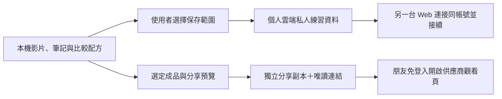

<!-- 檔案用途：規劃 Web 個人雲端接續與免登入影片分享。所在層：產品／架構提案。主要關聯：PRODUCT_PLAN.md、DATA_FORMAT.md、TECHNICAL.md、GitHub #209。 -->
# Web 個人雲端接續與免登入影片分享

規劃日期：2026-11-02（Asia/Taipei）。追蹤：[#209](https://github.com/sunpochin/dance-stamp/issues/209)。**狀態：規劃已交付，同日使用者已授權在新聊天開始實作；雲端／手機尚未驗收。** 原規劃提交沒有功能實作；最新授權、來源與接手步驟見[實作交接](#10-實作交接2026-11-02)。

## 1. 白話：先把自己的練習帶到另一台，再把成品交給朋友

現在像是把筆記放在這台電腦的抽屜。之前的 #18 讓你把筆記和影片拿出來，自己用 Google Drive、Dropbox 或 AirDrop 傳送；並沒有讓 Dance Stamp 直接連接雲端。

新方案像增加一個「自己的雲端抽屜」：在電腦按「存到雲端」，手機連接同一個雲端帳號，再按「從雲端接續」，就能拿回筆記、比較設定和有勾選保存的影片。沒上傳的原片仍需重新選檔；只存成品 VS，無法取代兩支原片繼續調整。

分享是另一個動作：選好一支成品，確認「持有連結的人都能看」，才產生觀看網址。朋友不必註冊 Dance Stamp 或登入雲端；先在 Google Drive／Dropbox 的觀看頁播放。自己的筆記與原片不因此公開。

建議 **Google Drive 先做，Dropbox 第二個；先手動保存／接續，再做前景自動同步**。Google 優先是縮小第一輪整合範圍的工程選擇，不是宣稱 Google 在所有裝置都比較可靠。只做 Web；手機瀏覽器仍須實測，沒有必要不做 iOS App。

## 2. 既有功能與此次新增範圍

以規劃基線 main `7dede9f` 與 2026-11-02 查閱的 [#18](https://github.com/sunpochin/dance-stamp/issues/18) 為準：

| 能力 | 原有範圍 | 新規劃 |
| --- | --- | --- |
| 本機使用 | 不登入，選片、比較、匯出 | 保留，雲端失敗也可繼續 |
| 檔案交換 | #12 備份／還原、#18 選定分享／重連；目前首頁部分管理入口隱藏 | 復用格式及資料保全，另設精簡雲端入口 |
| 同帳號手機／電腦接續 | 人工傳檔，不是帳號同步 | 連接同一供應商帳號與同一練習資料集 |
| 傳網址直接看影片 | 使用者自己在外部雲端操作 | 在 App 明確選片上傳、建立並管理觀看連結 |
| 自動同步 | 無 | 後階段、明確啟用、頁面開啟且授權有效時才做 |
| iOS 原生 | 既有條件式媒體備援 #16 | 本需求不啟動，也不列為前置 |

#18 原本刻意排除 API／OAuth、同步及遠端播放。本提案另行追蹤，不把歷史「手動傳檔」改寫成已有雲端串接；也不替 #12／#18 的跨裝置驗收簽收。

## 3. 登入與授權：要 GIS，但不先建另一套會員系統

白話：登入是「認出你是誰」；雲端授權是「允許工具打開哪個抽屜」。拿到姓名不代表能讀影片，也不代表筆記已同步。

| 項目 | 用途 | 本提案決策 |
| --- | --- | --- |
| Sign in with Google（GIS 的身分驗證） | 讓自有服務辨識使用者，取得 ID token | 首版不需要獨立的 Dance Stamp 帳號／登入閘門 |
| GIS OAuth 授權 | 取得呼叫 Google Drive API 的 access token | Google 連接入口必需；按鈕用「連接 Google Drive」 |
| Dropbox OAuth 2.0 | 取得 Dropbox 檔案操作權限 | Dropbox 階段用獨立連接入口；不能拿 Google token 呼叫 Dropbox |

GIS 全名是 **Google Identity Services**，同一套程式庫分開提供 authentication 與 authorization。ID token 與 Drive access token 不可混用；GIS 不提供同步引擎或影片儲存。這是 [Google 官方對兩種流程的區分](https://developers.google.com/identity/oauth2/web/guides/overview)。

首版採靜態 Web 可用的 [GIS token model](https://developers.google.com/identity/oauth2/web/guides/use-token-model)：使用者主動連接、取得短效 access token，瀏覽器直接呼叫 Drive API。Token 到期先保留本機操作，顯示「請重新連接」，再由使用者操作取得新 token。不承諾關頁後持續同步或永久免重登。

Dropbox 採 authorization code + PKCE（S256、一次性 state／verifier、固定 redirect URI），首版只要求當次存取，access token 只留記憶體，不持久保存 refresh token。這是本提案的保守憑證政策；Dropbox 本身另支援 refresh token。採 [Dropbox 官方 OAuth 流程](https://docs.dropboxapi.com/dropbox-api/docs/oauth)，不沿用舊 implicit flow，也不把 client secret 放進前端。

只有日後真的需要統一 Dance Stamp 帳號、綁定多家雲端或服務端持續工作，才另評估 OIDC 登入與最小後端。Google 的 [code model](https://developers.google.com/identity/oauth2/web/guides/use-code-model) 由後端交換及保管憑證；若做自有登入，後端另須驗證 ID token 簽章、issuer、audience、期限及 nonce，不能只解碼 JWT 就信任。這些都不列入首版。

## 4. 儲存、權限與架構

白話：雲端空間由使用者自己提供，Dance Stamp 只搬動他明確選好的資料；私人抽屜與給朋友的成品分開。

| 設計項 | Google Drive 先行 | Dropbox 第二階段 |
| --- | --- | --- |
| 最小存取範圍 | `drive.file`，只操作 App 建立或使用者透過 Picker 授予的檔案 | App Folder；初期不要求 Full Dropbox |
| 私人保存 | App 建立、使用者可見的私人資料夾；記錄實際 folder／file ID | App Folder 內的私人練習資料 |
| 媒體傳輸 | 大檔採 resumable upload，按需下載 | 大檔採 upload session，按需下載；端點細節在實作前確認 |
| 分享 | 單獨成品副本，`type=anyone`、`role=reader`、禁止探索式公開索引 | 單獨成品副本，public view-only shared link |
| 帳號分界 | 從已授權 API 取得的帳號識別＋雲端資料集 ID | Dropbox account ID＋雲端資料集 ID |

`drive.file` 是 Google 建議的逐檔最小權限；它不等於可任意掃描整個 Drive，也不因選了某資料夾就自動得到所有既有子檔。先支援本 App 建立的內容；既有雲端影片匯入另用明確 Picker 選檔，不擴大成整碟權限。[Google scopes](https://developers.google.com/workspace/drive/api/guides/api-specific-auth)

首版選可見私人資料夾，讓使用者能自行查看、搬走資料；暫不採隱藏 `appDataFolder`，因為它不能直接分享檔案，且與影片分享仍要分兩套位置。這是簡化方案的取捨，**可見資料夾不代表已公開**。[Google appDataFolder 限制](https://developers.google.com/workspace/drive/api/guides/appdata)

同步檔案按供應商、帳號、資料集隔離；不能靠相同 email、名稱或 localStorage 中的任意 ID 認定同一份雲端資料。每次重新授權先確認帳號，再恢復其佇列；更換帳號暫停舊佇列，不把舊帳號的待傳資料送到新帳號。私人根資料夾需檢查分享／繼承權限；若被使用者改成公開，停止將新的私人資料傳入，提示建立新的私人位置。

## 5. 手機／電腦接續流程與資料保全

### 使用者流程

1. 在電腦完成比較，按「存到雲端」，選供應商並授權；預覽帳號、練習名稱、資料種類、檔案數與總大小。
2. 筆記／比較設定與每支影片分開勾選。要在另一台繼續調整，需保存老師原片及自己的原片；只看結果可以只保存 VS。來源選檔已失效時，先請使用者重選，不宣稱上傳了不存在的 File。
3. 顯示「此裝置已保存」「雲端傳送中」「雲端已保存」「部分影片未保存」；只有已完成並核對的項目才打勾。第一次先明確按保存，不自動搬走整個本機資料庫。
4. 手機開 Web，連接**同一供應商的同一帳號**，選同一練習資料集，按「從雲端接續」。先讀小型資料與影片清單，再由使用者下載需要的原片／成品；開始播放仍由使用者觸發。
5. 手機調整後另存一版，電腦取回。兩邊都改過時顯示兩個版本供預覽，保留本機或另存副本，不能悄悄以較晚時間覆蓋。

Google 帳號 A 與 Dropbox 帳號 A 不會自動互認；首版一份資料集只選一個供應商。同供應商兩台裝置各自授權，不在裝置間傳 OAuth token。雲端不是備份的唯一出口，既有本機 JSON／影片下載仍保留。

### 技術契約（待實作，不更動現行 schema）

- 復用 [DATA_FORMAT.md](DATA_FORMAT.md) 的合法資料、關聯驗證、容量限制與匯入保全。既有整庫 `backup`、去識別 `share` 與「私人練習接續」不是同一件事：新同步封套只帶選定練習的必要關聯；若選整庫備份需另明示。不能為方便而把整庫隱性上傳，也不能用會刪私人欄位的 `share` 當完整同步。
- 同步封套獨立版本化，至少描述資料集、唯一 snapshot ID、父 snapshot、來源 library、所選物件、媒體 role／asset ID／遠端 ID／byte size／內容校驗，以及哪些媒體尚缺。遠端 ID 不取代本機 ID；映射需可持續重匯且不產生重複。不得持久化 `blob:` URL、電腦路徑、OAuth token；雲端同步封套不混入既有公開分享格式。
- 首版用**不可覆寫的具名快照**：每次保存新增一份，媒體完成並核對後才寫入完整 manifest。不用單一 `latest.json` 無條件覆寫，也不把 Drive revision 或檔案修改時間當跨檔案原子交易。中斷留下待處理項目，完整舊快照仍有效；重試用同一操作識別核對，不能無限新增副本。
- 同一父版本有兩份新快照，兩者都保留並標示衝突；重讀清單後仍需做父版本比較。首版不自動合併正文、不憑裝置時鐘判勝負；使用者選擇或另存後建立下一版。列表分頁、重複根目錄及同名檔都須處理，不把第一筆當唯一正確版本。
- 下載先驗格式、關聯、大小與媒體內容，預覽後走既有原子保存／衝突副本流程。影片未備妥只標缺片，不把 VS 錯接成原片。播放／比較先取得有權下載的 bytes，再沿本機媒體入口開啟；不能把需要 Authorization header 的 API URL 直接塞進 `<video>` 就算完成。
- 傳輸只在操作擁有者內處理，有進度、取消、有界重試及待重連狀態。大檔分段，不整庫 base64／ZIP；Google 可恢復傳輸依[官方 upload 流程](https://developers.google.com/workspace/drive/api/guides/manage-uploads)。存續的傳輸紀錄不得寫入可授權的 session URL／token；失去 session 時可重新傳輸，保留原檔及舊快照。
- 首版不做刪除傳播或自動清理雲端舊版本；刪本機副本不刪雲端，刪雲端不刪本機，取消不做跨裝置刪除。版本會占用空間，明列用量並提供使用者在供應商管理的入口；後續清理另做預覽、引用檢查與明確確認。

後階段自動同步限使用者明確啟用的資料集與資料種類，沿用相同快照與衝突契約。本機修改先安全保存，雲端狀態另外顯示；離線先標待傳，回到前景／授權有效時才嘗試。相機錄製中、匯出中、未提交草稿不被遠端套用覆寫；不把每一幀播放位置寫到雲端，也不承諾跨裝置無縫接續未完成的錄影或匯出。

## 6. 免登入觀看連結

### 首版使用者流程

1. 點「分享這支影片」，選已完成的 VS 或單側成品；先看實際影片、聲音、標題及檔名。預設不含筆記、老師原片、自拍原片或其他練習。
2. 明示目的帳號及「持有連結的人都能看，也可能下載或轉傳」。選定來源後建立獨立成品副本，不變更私人資料集或父資料夾的權限。
3. 上傳並確認成檔後，才建立唯讀公開連結。Google 使用 `anyone/reader` 且 `allowFileDiscovery=false`；Dropbox 用 shared link 並檢查實際生效的分享範圍，不能只相信請求值。管理員禁外部分享時回報失敗，不繞過政策。[Drive 權限欄位](https://developers.google.com/workspace/drive/api/reference/rest/v3/permissions)、[Dropbox 分享 API](https://docs.dropboxapi.com/dropbox-api/docs/sharing)
4. 使用者複製觀看網址，自行傳送；收件者在供應商觀看頁播放，不要求登入 Dance Stamp。Google「知道連結的任何人」與 Dropbox view-only link 都有免登入入口，但實際影片格式／播放仍需驗收。[Google 免登入分享](https://support.google.com/drive/answer/7166529)、[Dropbox 免登入預覽](https://help.dropbox.com/share/share-outside-dropbox)
5. 提供「開啟觀看頁」「複製連結」「停止此連結分享」。停止後重查權限；只撤銷本 App 建立的該項授權／連結，若仍有繼承權限或其他公開連結需明示，不能誤稱完全私人。已下載副本不能收回。

本機生成、雲端上傳、權限建立、供應商預覽可用與對方已看過是不同狀態。影片可能仍在供應商處理；不能把上傳成功直接寫成「對方可播放」或「已送達」。實作驗收需退出供應商登入，以全新私人視窗／另一裝置播放至結尾、確認聲音及跳轉；不能只用寄件者自己的登入狀態測試。

權限建立或撤銷的回應若遺失，先標「分享狀態待確認」，重讀指定副本的權限／連結再重試；取消不代表遠端已撤銷，也不能因請求失敗就宣稱私人。影片格式無法預覽時可提供下載，但須明示「目前不能線上播放」，該格式的免登入觀看驗收不算通過，不改副檔名或偷偷上傳轉碼。

### 暫不把供應商當作影片 CDN

首版連結是 **Drive／Dropbox 觀看網址**，不是自有 `dance-stamp/...` 觀看頁。分享頁 HTML 不是穩定的影片 bytes URL；不靠改網址參數就承諾所有檔案可內嵌。若後續要求留在 Dance Stamp 看，另驗證官方嵌入能力、CORS、Range／seek、重導向、格式／音軌、連結壽命與行動瀏覽器限制，再決定是否值得新增 viewer；不先架公開檔案代理。

Google 工作／學校帳號可能禁止外部分享；Dropbox 連結受傳輸流量限制，密碼／到期日等能力也可能依方案而異。首版不承諾免費永久連結或無限觀看，也不把付費控制列為必備功能。[Google 分享限制](https://support.google.com/drive/answer/7166529)、[Dropbox 流量限制](https://help.dropbox.com/share/banned-links)

## 7. 免費、隱私與設定邊界

- 核心繼續免費、免登入、本機可用。雲端接續使用個人現有容量；額滿可停止傳輸、保留本機並下載，不要求升級成付費會員。免費容量／API 配額與公開分享流量分開，不填未驗證的永久額度。
- 影片與筆記預設不離開裝置；只有明確選定的雲端保存／分享或後續明確啟用範圍才可傳輸。資料直達選定供應商，沒有 Dance Stamp 媒體中繼、轉碼伺服器、追蹤或分析上傳。這不是端到端加密方案；供應商會處理其收到的內容，公開連結是持有即可存取。
- OAuth 程式庫在使用者開啟連接功能時才載入；API token 不進 URL、分享檔、備份、記錄、Service Worker cache 或 localStorage。PKCE 暫存只服務當次授權且結束清除。驗證精確 origin／redirect、state 與 popup 來源；拒絕權限及阻擋彈窗時返回可用的本機畫面。
- 「中斷連接」停止佇列並清除當次憑證；「撤銷供應商授權」「刪除雲端資料」「停止公開分享」分開說明。登出或撤銷 App 授權不保證既有公開連結失效，不自動刪除任何本機／雲端檔案。
- 開工需準備專案擁有者控制的 OAuth app、核准 origin／redirect、隱私頁與測試帳號；公開給其他人前完成當時適用的 Google 驗證／Dropbox production access 要求。Client ID／app key 可作公開識別，client secret 不可。自架者需自己的設定，不能假設任意 domain 共用同一授權。此提案不操作 Console 或取得任何私人憑證。
- 儲存、OAuth、分享仍依各平台規則與最新官方文件確認；機構帳號被限制不能以放寬權限或自建代理繞過。既有 [免費政策](LICENSING_AND_COST.md) 不變。

## 8. 建議實作切片與完成條件

以下為 #209 實作拆分順序；使用者已要求新聊天開始，尚無日曆交期。粗估是一位熟悉程式庫的工程師工作日，不含等帳號設定、供應商審查及測試裝置。先做一個供應商的完整流程，再加入第二家；不先蓋通用同步平台。

| 順序 | 可交付結果 | 依賴與驗收 | 粗估 |
| --- | --- | --- | --- |
| A | Google 連接及小型合成檔可行性 | 最小 scope、帳號切換、私有根目錄、拒絕／到期、兩台 Web 讀回相同 bytes；確認供應商設定與當前首頁入口 | 2–3 日 |
| B | Google 手動保存／跨裝置接續 | A；選定練習封套、原片／VS 分離、完整快照、衝突／斷線／quota、沿 #12／#13 保全；#5／#10 的配方不另造一份 | 4–7 日 |
| C | Google 免登入影片分享 | A 與既有成品能力，可獨立於 B；獨立副本、公開確認、免登入實播、停止分享、失敗恢復；公開發布仍依 #15 | 2–4 日 |
| D | Dropbox 同等能力 | B／C 契約穩定後加薄 adapter，OAuth／App Folder／傳輸／分享各自驗收；不跨帳號混合 | 3–5 日 |
| E | 選定資料集前景自動同步 | B／D 證明不丟資料後；明確啟用、持久待傳工作、雙裝置衝突與活動中保護；不承諾關頁後工作 | 3–6 日 |

第一個 Google 完整版本粗估 A＋B＋C 共 8–14 工程日，實際估算在 A 結果後修正；手機瀏覽器缺陷與外部審查可能增加工期。沒有新增 iOS App 工時；手機 Web 測試仍是 B／C 的完成條件，缺設備標未驗證。

| 驗收情境 | 必須觀察到的結果 |
| --- | --- |
| 未連接／拒絕授權 | 可照常本機選片、比較、匯出；沒有雲端資料請求 |
| 電腦存、手機取、手機改、電腦取 | 同帳號同資料集，筆記／配方／兩側正確原片一致，可繼續比較；只有 VS 的情況清楚標不能重編 |
| 兩台從同一版本離線修改 | 重連後兩份都在；明確選版本或另存，沒有 last-write-wins 靜默覆寫 |
| 斷網、關頁、背景暫停、token 到期、取消 | 舊本機／雲端完成版本保留，待傳可辨識、重試不重複，未完成不標成功 |
| 雲端／本機額滿、404、損壞 manifest／媒體 | 舊資料與下載入口保留，不部分套用或清庫修復 |
| 換帳號、同名資料集、刪除遠端原片 | 不串帳號／錯配影片；缺片可重選，沒有連帶刪除 |
| 匿名觀看 | 全新未登入環境開連結、實際播放選定片到結尾，有正確音訊及 seek；不只能下載或看到預覽圖 |
| 分享範圍／停止分享 | 僅選定成品可取得，筆記／原片／其他練習不可取得；撤銷後新匿名請求被拒絕，既有下載例外明示 |
| 桌面與實體手機 Web | 分別記錄瀏覽器、版本、來源 commit 與真實傳輸結果；模擬 viewport／同機 context 不當跨裝置通過 |

上述目前全部**未驗證**。後續以合成、無第三方音樂素材，在獲准的測試帳號操作；公開證據只記匿名結果，不附帳號、token 或私人分享網址。既有影音品質仍依 [RECORD_COMPARE.md](RECORD_COMPARE.md)，本規劃不另訂音畫門檻。

## 9. 排除方案與再評估條件

| 方案 | 本次未採用的原因／重啟條件 |
| --- | --- |
| 只加 Google 登入按鈕 | 沒有檔案授權、傳輸或衝突處理，無法達成接續 |
| 先建 Dance Stamp 帳號及影片後端 | 增加營運、憑證與儲存負擔；有跨供應商身分或自有觀看服務的實際需求才另審 |
| 一次做兩家完整串接、通用外掛引擎 | 第一輪未知太多；Google 閉環完成後才抽必要 adapter |
| 將私人同步資料夾直接公開 | 容易把筆記與原片一起公開；分享使用獨立成品副本 |
| 雲端單檔覆寫或以時間較新者獲勝 | 雙裝置競態會丟資料；採不可覆寫快照與明確衝突選擇 |
| 直接把分享頁塞進自有播放器 | 不能保證媒體 bytes、權限、CORS 或 seek；另做 viewer 可行性驗證 |
| iOS 外殼、關頁背景自動傳輸 | 外殼不能解決同步、儲存或分享權限；先驗證本提案 Web 流程，確有 Web 核心阻礙才另案 |

完整設計取捨在本文件維護；產品範圍、技術索引與路線圖只連回本頁，避免各自定義不同的同步或分享契約。

## 10. 實作交接（2026-11-02）

白話：規劃和進度都放在這個 repo，下一個聊天從本頁接著把按鈕和功能做出來。先讓 Google Drive 的保存、接續和分享走通，再補 Dropbox；不用重做規劃，也不用先做 iOS App。

### 授權與來源

- 使用者最新要求：「文件請要放在 repo 方便 handoff…把這點寫入憲法…然後 new session 實作吧」。已授權新聊天進行本提案的 Web 功能實作與驗證，不再停在計畫交付。
- 原規劃基線 main `7dede9f41ac7fc4be31a59bdd38c98ce487ae5ca`；規劃提交 `0c361130ef9a4c174610e4aef596b860487bbbef`，分支 `docs/web-cloud-sync-sharing`、[PR #210](https://github.com/sunpochin/dance-stamp/pull/210)。交接更新也提交在該分支；接手須查最新 head／main／PR 狀態，不把本段當永久即時狀態。
- 本次交接只修改憲法與文件，沒有雲端 runtime。原規劃的 Bun 1.4.4 `bun run check`／提交 hook 通過 704 tests、3804 expects、0 fail，公開掃描 426 檔；既有 19 項 lint info 保留。這是文件版本的證據，實作後需重新驗證。
- 尚無本任務已確認可用的 OAuth client 設定、測試帳號授權與真實雲端傳輸證據。不得把對話中的 Drive／Dropbox 連接器憑證搬進產品。需要使用者設定時，列出精確的 client ID、origin／redirect 與測試條件；先完成可獨立實作、測試與審閱的部分，不猜憑證，也不把模擬測試寫成真實授權通過。
- 合併、正式發布、付費／必要外部服務、私人帳號／私人媒體操作與額外平行派工未因本次交接自動獲准。產品的上傳與公開分享須由使用者明確選取內容並操作；真實測試僅用獲准帳號與合成素材。

### 接手順序與完成紀錄

1. 讀根 `AGENTS.md`、本頁、`TECHNICAL.md` 索引與直接相關的資料／媒體規格；先核對 #209／#210 最新狀態。從同步 main 的獨立實作分支開工，保留其他工作。若 #210 尚未合併，只納入本規劃及交接提交作為必要文件依賴，記錄來源，不自行合併 PR。
2. 從第 8 節 A 開始，實作 Google 連接、最小權限、設定入口、拒絕／到期／切帳號保護與可驗證傳輸，再依 B／C 完成手動接續與成品分享。不要只做假按鈕、登入殼或新的計畫；沿用現有本機資料與媒體能力。D／E 依既定前置逐步進行，不一次引入通用同步框架。
3. 產品操作以現行雙片首頁為入口；純邏輯與失敗案例用既有測試風格補驗，真正雲端／匿名觀看／實體手機與電腦另記來源、帳號授權及裝置證據，缺項標未驗證。首次小檔試驗失敗先診斷，不放寬資料保全或音畫標準。
4. 每個可驗收切片執行原 `bun run check` 與必要測試，檢查完整 diff，commit、立即 push、開 PR。更新本文件及直接相關技術文件中的進度、設定方式、精確受測 commit、未驗證項與下一步；產品程式需繁體中文 why 註解。
5. 文件交付不等於功能完成；本機測試不等於兩台實體裝置驗收；PR 與 CI 不等於合併或發布。不要因等待帳號設定就丟失已完成實作，也不應在缺真實證據時關閉完整驗收項目。
