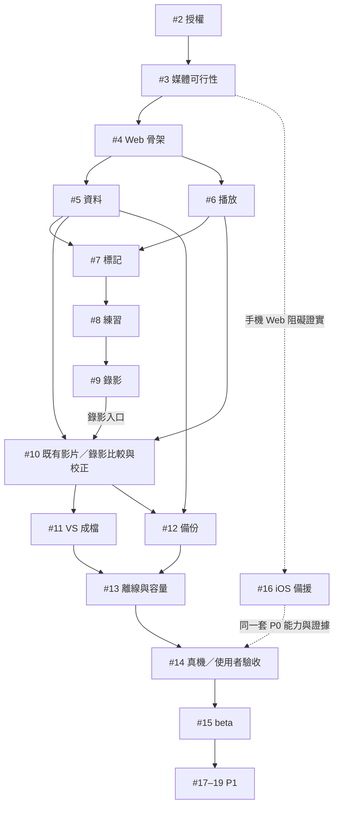

# 路線圖與 issue 導覽

原規劃日期：2026-10-27；需求更新：2026-10-28。已有桌面預覽基礎，各功能依 issue 收集驗收證據，總追蹤：[issue #1](https://github.com/sunpochin/dance-stamp/issues/1)。本次僅補規劃，不表示任一產品驗收完成。

2026-10-28 需求補充：P0／M2 納入「比較已有影片」，讓老師課後原片與自己已錄好的片直接並排、手動對齊及匯出。使用既有 #10／#11 追蹤，#12 補備份驗收，不重建同目的 issue。桌面入口已實作，合成雙片的九組比例／時長、十次長輸出及備份重連見[證據](evidence/existing-comparison.md)；重要變更待人工審查，整體 P0、手機與真實相機仍未完成。

## 1. 里程碑與停止條件

| 階段 | 可展示的結果 | 進入下一階段的條件 |
| --- | --- | --- |
| M0 決策與風險 | 授權轉換、最小邊播邊錄＋VS 成檔試驗、平台決策 | 手機／桌面證據齊全，或明確啟動 iOS 備援；沒有設備不能假判失敗 |
| M1 筆記與練習基礎 | 選片、標記、保存、變速、鏡像、A–B | 正確時間、可重開、資料不靜默遺失 |
| M2 P0 錄影比較 | 倒數錄影或選兩支既有影片、同步校正、單檔 VS、備份還原 | 兩條入口各依 [錄影比較規格](RECORD_COMPARE.md) 驗收與資料恢復；不能以雙播放器代替輸出 |
| M3 可用 beta | 離線、容量與更新安全、手機可用性、真機與使用者驗收 | 支援矩陣及授權／隱私／取得方式明確 |
| M4 後續 | 動作庫、分享筆記、Salsa 八拍輔助 | P0 完整後才安排，不提前擠占核心工作 |
| 條件式 iOS | Web 無法可靠完成的核心流程由 iOS 提供 | 需 Web 可重現阻礙＋限時修正結果；仍按相同 P0 驗收 |

## 2. 工作清單

工程日為一位熟悉相關技術的工程師的初估，含該任務自身驗證；不是承諾完成日期。未分配執行者與日曆期限。

| Issue | 階段／優先級 | 任務 | 依賴 | 工程日粗估 |
| --- | --- | --- | --- | --- |
| [#2](https://github.com/sunpochin/dance-stamp/issues/2) | M0／P0 | 採用非商用授權與零必要服務費政策 | — | 0.5–1 |
| [#3](https://github.com/sunpochin/dance-stamp/issues/3) | M0／P0 | 真機驗證 Web 邊播邊錄與 VS 成檔，決定是否啟動 iOS | [#2](https://github.com/sunpochin/dance-stamp/issues/2) | 3–5 |
| [#4](https://github.com/sunpochin/dance-stamp/issues/4) | M1／P0 | 建立靜態 Web 骨架與可重現品質檢查 | [#2](https://github.com/sunpochin/dance-stamp/issues/2)、[#3](https://github.com/sunpochin/dance-stamp/issues/3) | 1–2 |
| [#5](https://github.com/sunpochin/dance-stamp/issues/5) | M1／P0 | 實作本機資料模型、交易與媒體重新連結 | [#4](https://github.com/sunpochin/dance-stamp/issues/4) | 2–3 |
| [#6](https://github.com/sunpochin/dance-stamp/issues/6) | M1／P0 | 本機選片與可恢復播放器 | [#4](https://github.com/sunpochin/dance-stamp/issues/4) | 1–2 |
| [#7](https://github.com/sunpochin/dance-stamp/issues/7) | M1／P0 | 時間標記、區間筆記與一鍵跳轉 | [#5](https://github.com/sunpochin/dance-stamp/issues/5)、[#6](https://github.com/sunpochin/dance-stamp/issues/6) | 1–2 |
| [#8](https://github.com/sunpochin/dance-stamp/issues/8) | M1／P0 | 變速、獨立鏡像與 A–B 練習循環 | [#6](https://github.com/sunpochin/dance-stamp/issues/6)、[#7](https://github.com/sunpochin/dance-stamp/issues/7) | 2–3 |
| [#9](https://github.com/sunpochin/dance-stamp/issues/9) | M2／P0 | 邊播邊錄：倒數、自拍 take 與中斷恢復 | [#3](https://github.com/sunpochin/dance-stamp/issues/3)、[#5](https://github.com/sunpochin/dance-stamp/issues/5)、[#6](https://github.com/sunpochin/dance-stamp/issues/6)、[#8](https://github.com/sunpochin/dance-stamp/issues/8) | 3–5 |
| [#10](https://github.com/sunpochin/dance-stamp/issues/10) | M2／P0 | 既有影片／錄影並排比較、共同時間線與手動同步校正 | 共用 [#5](https://github.com/sunpochin/dance-stamp/issues/5)、[#6](https://github.com/sunpochin/dance-stamp/issues/6)；錄影接入另依 [#9](https://github.com/sunpochin/dance-stamp/issues/9) | 原 2–4；新增入口後待重估 |
| [#11](https://github.com/sunpochin/dance-stamp/issues/11) | M2／P0 | 本機合成並保存帶音訊的 VS 影片 | [#10](https://github.com/sunpochin/dance-stamp/issues/10) | 3–5 |
| [#12](https://github.com/sunpochin/dance-stamp/issues/12) | M2／P0 | 可攜 JSON 備份、還原與媒體清單 | [#5](https://github.com/sunpochin/dance-stamp/issues/5)、[#7](https://github.com/sunpochin/dance-stamp/issues/7)、[#10](https://github.com/sunpochin/dance-stamp/issues/10) | 2–3 |
| [#13](https://github.com/sunpochin/dance-stamp/issues/13) | M3／P0 | 離線使用、影片副本與容量／更新安全 | [#4](https://github.com/sunpochin/dance-stamp/issues/4)、[#5](https://github.com/sunpochin/dance-stamp/issues/5)、[#9](https://github.com/sunpochin/dance-stamp/issues/9)、[#11](https://github.com/sunpochin/dance-stamp/issues/11)、[#12](https://github.com/sunpochin/dance-stamp/issues/12) | 2–4 |
| [#14](https://github.com/sunpochin/dance-stamp/issues/14) | M3／P0 | 手機易用性、無障礙與完整真機驗收 | [#7](https://github.com/sunpochin/dance-stamp/issues/7)、[#8](https://github.com/sunpochin/dance-stamp/issues/8)、[#9](https://github.com/sunpochin/dance-stamp/issues/9)、[#10](https://github.com/sunpochin/dance-stamp/issues/10)、[#11](https://github.com/sunpochin/dance-stamp/issues/11)、[#12](https://github.com/sunpochin/dance-stamp/issues/12)、[#13](https://github.com/sunpochin/dance-stamp/issues/13) | 3–5 |
| [#15](https://github.com/sunpochin/dance-stamp/issues/15) | M3／P0 | 免費發佈方案、來源信任邊界與 beta 發行 | [#2](https://github.com/sunpochin/dance-stamp/issues/2)、[#3](https://github.com/sunpochin/dance-stamp/issues/3)、[#11](https://github.com/sunpochin/dance-stamp/issues/11)、[#12](https://github.com/sunpochin/dance-stamp/issues/12)、[#13](https://github.com/sunpochin/dance-stamp/issues/13)、[#14](https://github.com/sunpochin/dance-stamp/issues/14) | 1–2 |
| [#16](https://github.com/sunpochin/dance-stamp/issues/16) | 備援／條件式P0 | 手機 Web gate 失敗時優先實作 iOS 原生媒體 | [#3](https://github.com/sunpochin/dance-stamp/issues/3) | 另估10–20 |
| [#17](https://github.com/sunpochin/dance-stamp/issues/17) | M4／P1 | 影片分類、動作庫與練習歷史 | [#15](https://github.com/sunpochin/dance-stamp/issues/15) | 後續估算 |
| [#18](https://github.com/sunpochin/dance-stamp/issues/18) | M4／P1 | 選定筆記與影片檔的可攜分享流程 | [#12](https://github.com/sunpochin/dance-stamp/issues/12)、[#15](https://github.com/sunpochin/dance-stamp/issues/15) | 後續估算 |
| [#19](https://github.com/sunpochin/dance-stamp/issues/19) | M4／P1 | Salsa 八拍、手動 BPM 與錄影倒數 | [#15](https://github.com/sunpochin/dance-stamp/issues/15) | 後續估算 |

#18 第一版限於檔案匯出／匯入與影片重新連結：選定筆記檔與影片分開，使用者自行透過 Google Drive、Dropbox、iCloud Drive 或 AirDrop 分享。不提供自己的影片儲存服務，不做雲端 API／OAuth 直連、同步或連結串流；未使用雲端仍可交換本機檔案。依賴仍為 #12、#15，維持 M4／P1；更新規劃不代表功能或真機驗收完成。完整流程見 [DATA_FORMAT.md](DATA_FORMAT.md#6-分享格式p1)，驗收見 [ACCEPTANCE.md](ACCEPTANCE.md#8-p1-檔案分享18)。

前 14 個常規 P0 任務原粗估合計 **26.5–46 工程日**，未含本次既有影片入口的增量，#10／#11／#12 與總量須依現有能力重估；再保留整合、設備與不可預期問題的緩衝。原約 6–12 個全職工作週只是排程起點，不用這個數字保證交期。iOS 備援另估 10–20 日起，App Store 分發準備／審核、等設備與外部測試者時間未包含；不能把 Web 與 iOS 的重疊工作機械相加。P1 尚未估算。

## 3. 依賴圖與平台切換

圖表呈現主線，完整前置條件以工作表與 issue 為準。M0 最小原型先串完錄影／輸出，不等待 M1 完整介面；這不是把 P0 錄影拖到最後才研究。

#10 的既有影片入口可在 #5／#6 基礎上獨立實作與驗收，不要求先完成 #9 或開相機。#10 整體結案仍須涵蓋錄影接入；#11 對兩種輸入各自驗證成檔，#12 驗證兩片配對與配方的備份／重連。現有桌面預覽或單一路徑通過不能代替另一條驗收。

若啟動 #16：Web 保留筆記、備份及可用的桌面能力；#9–11 等 issue 追蹤的是使用者能力，可用明確連結的 iOS 實作驗收，不能要求先完成失敗的 Web 實作才能開始 iOS。#14/#15 依實際支援平台收證據並發布限制，不把手機 Web 未通過寫成全面 Web 支援。Android 原生不在本輪派工。

Web 全數通過時 #16 保持條件式候選，不是必需執行的 P0 子任務。總覽只有常規 P0 與「確實觸發的備援」都驗收後才能完成。

## 4. 每個 issue 的完成標準

- 有明確範圍、依賴、驗收與不做事項；變更先走新分支與 PR。
- 測試使用合成或經授權素材；真機結果附裝置、版本、commit、輸出與數據。
- 影響資料格式／架構時更新 [DATA_FORMAT.md](DATA_FORMAT.md)／[TECHNICAL.md](../TECHNICAL.md)，時間與清理順序用繁體中文註解解釋原因。
- 檢查差異，完成既有型別／lint／測試，單一任務提交並推送；不能把文件中的目標當成測試成功。
- PR 合併與使用者流程驗收分開記錄；僅完成規劃不關閉實作 issue。

## 5. 主要風險與決策

| 風險 | 首先在哪裡處理 | 失敗後的動作 |
| --- | --- | --- |
| iPhone 同時播放＋錄影或輸出不穩 | #3 | 限時修正；仍失敗啟動 #16，不先做 Android |
| 音畫時間持續漂移 | #3/#10/#11 | 修正時間排程／改平台，不能只加固定 offset |
| 格式能錄卻不能保存／接收端播放 | #3/#11 | 先驗證替代容器／本機路徑，誠實列限制 |
| 大檔與瀏覽器清除 | #5/#12/#13 | 明確備份、媒體重連、quota 恢復，縮短 take 作可靠性護欄 |
| 私人內容被分享／公開主機暴露 | #14/#15/#18 | 預覽與欄位篩選、網路驗證、origin 信任盤點 |
| 非商用與第三方授權不相容 | #2/#4 | 選相容依賴、保留原授權，不自行加限制 |
| iOS 商店費用與零支出矛盾 | #15/#16 | 分開確認成本與取得方式，不聲稱原生上架必然免費 |

## 6. 暫不排程

自建雲端影片託管、帳號／同步、供應商 API／OAuth 直連、公開社群、付款、AI 舞蹈評分、自動下載社群影片、手錶控制、雙平台原生同時上架。使用者自行用個人雲端傳檔屬於 #18，不代表排入服務串接。提出這些新需求時先確認是否仍符合免費與非商用方向，再建立獨立規劃。

### #19 當次授權例外（2026-10-28）

使用者明確授權先完成本票可自主的桌面手動能力：BPM、來源第一拍、八拍標籤、4／8 拍提示音倒數與備份相容；以獨立一般 PR 交付，不接入其他候選分支。#15 仍開啟且發行候選未合併；其發布依賴、P0 媒體與真人門檻不因本票開始而消失。驗證及未驗證範圍見 [#19 證據](evidence/issue-19-manual-beats.md)，不提前關閉 issue。自動拍點另行研究。
